# Everything Skills

**English** · [简体中文](https://github.com/findscripter/everything-skills/blob/zh/README.md)

<!-- BEGIN GENERATED:brand -->
<p align="center">
  <a href="INDEX/catalog.md"><picture><source media="(prefers-reduced-motion: reduce) and (max-width: 600px)" srcset="assets/brand/hero-mobile-static.svg" /><source media="(prefers-reduced-motion: reduce)" srcset="assets/brand/hero-static.svg" /><source media="(max-width: 600px)" srcset="assets/brand/hero-mobile.svg" /></picture></a>
</p>

<p align="center"><strong>Find skills by task. Connect them into workflows. Install by volume.</strong></p>

<p align="center">
  <a href="INDEX/catalog.md">Skill catalog</a> · <a href="INDEX/graph.md">Knowledge graph</a> · <a href="INDEX/skill-repos.md">Skill repositories</a> · <a href="CONTRIBUTING.md">Contributing</a>
</p>

<p align="center">
  <picture><source media="(max-width: 600px)" srcset="assets/brand/stats-mobile.svg" /></picture>
</p>
<!-- END GENERATED:brand -->

Find skills for a task, combine them into a workflow, and install the volumes you need.

**[Search skills online](https://findscripter.github.io/everything-skills/)** · **[Try a worked example](examples/README.md)** · [Full catalog](INDEX/catalog.md) · [Relationships](INDEX/graph.md)

<details>
<summary>Watch the 33-second catalog walkthrough</summary>


[Sharper video and recording scope](assets/demos/README.md)

</details>

## 1. Pick a task and a skill combination

| Your task | Start with | Then add |
| --- | --- | --- |
| Take over a codebase | [codebase-onboarding-doc](07-productivity/codebase-onboarding-doc/SKILL.md) | [monorepo-navigator](02-engineering/monorepo-navigator/SKILL.md) |
| Explain a paper and organize references | [academic-paper-explainer](09-verticals/academic-paper-explainer/SKILL.md) | [citation-management](01-documents/citation-management/SKILL.md) |
| Review and test a REST API | [api-design-reviewer](02-engineering/api-design-reviewer/SKILL.md) | [api-test-suite-builder](02-engineering/api-test-suite-builder/SKILL.md) |
| Audit web accessibility | [accessibility-wcag-audit](02-engineering/accessibility-wcag-audit/SKILL.md) | [wcag-22-audit-patterns](02-engineering/wcag-22-audit-patterns/SKILL.md) |

Open the skill's `SKILL.md` for its scope, inputs, and required tools. [Worked examples](examples/README.md) include prompts, expected outputs, and verification steps. Follow `requires`, `related`, and `combines_with` for more options.

## 2. Install and try a task

### Claude Code

Run these commands inside Claude Code to add the marketplace and install the engineering volume:

```text
/plugin marketplace add findscripter/everything-skills
/plugin install 02-engineering@everything-skills
```

Then supply your OpenAPI file or API specification and start with:

> Use the api-design-reviewer skill to review this REST API. Read its prerequisites first, ask for missing inputs, and report compatibility issues with evidence and suggested fixes.

Each volume below is a separate plugin; install several when your task needs them.

### Install one skill for Codex with the skills CLI

With Node.js **22.20.0 or later**, run this from the project where you want the skill available:

```sh
npx skills@1.7.4 add findscripter/everything-skills --skill codebase-onboarding-doc --agent codex --copy
```

This installs the selected skill files at project scope. Read their runtime prerequisites before using them for a task. To discover the default public set without installing, use a separate command:

```sh
npx skills@1.7.4 add findscripter/everything-skills --list
```

Claude Code's volume plugins and the skills CLI's individual-skill installation are separate options.

### Local search with Node.js 22 or later

With Git, Node.js **>=22**, and npm available, run:

```sh
git clone https://github.com/findscripter/everything-skills.git
cd everything-skills
node --version
npm run skill -- search "API review"
npm run skill -- why api-design-reviewer
```

The CLI has no third-party dependencies, so no `npm install` is needed. It searches the checked-in indexes; `why` shows related skills. Open a returned `SKILL.md`, then ask your agent to follow it for your task. Codex, Cursor, and Gemini CLI can use [AGENTS.md](AGENTS.md), [CLAUDE.md](CLAUDE.md), and [GEMINI.md](GEMINI.md) as repository navigation guides.

### System entry and composition plans

The entry `bin/everything-skills.mjs` locates its own catalog, including when called from another project directory:

```sh
node bin/everything-skills.mjs compose api-review --json
node bin/everything-skills.mjs show api-design-reviewer --json
```

`compose` returns an ordered, documented example recipe or unordered combination suggestions; it executes nothing. `show` returns the skill body, absolute path and resource directory. The [catalog navigation skill](00-meta/everything-skills-catalog/SKILL.md) explains staged use. See [Arch/Omarchy integration](docs/omarchy.md) for the optional system package, client setup, dependencies and limits; the package is not yet in Omarchy's repositories.

## 3. Explore by domain

| Volume | Tasks |
| --- | --- |
| [00-meta](00-meta/README.md) | Research, planning, reasoning, agent workflows |
| [01-documents](01-documents/README.md) | Documents, spreadsheets, presentations, writing |
| [02-engineering](02-engineering/README.md) | Development, architecture, testing, delivery |
| [03-data](03-data/README.md) | Analysis, databases, data engineering |
| [04-ai](04-ai/README.md) | Models, RAG, agents, evaluation |
| [05-business](05-business/README.md) | Marketing, product, operations, growth |
| [06-creative](06-creative/README.md) | Design, images, audiovisual work |
| [07-productivity](07-productivity/README.md) | Communication, projects, personal workflows |
| [08-security](08-security/README.md) | Defensive audits, risk, compliance |
| [09-verticals](09-verticals/README.md) | Science, healthcare, legal, specialist workflows |
| [10-platform](10-platform/README.md) | Cloud, CLIs, connectors, automation |

## What is included

Volume plugins offer **1094 current skills**. The catalog also retains **21 archived entries** for source history and migration, making **1115 bundled skill folders** in total. Their bodies retain their native language.

**4441 external repository entries** provide discovery metadata for upstream projects. Their skill bodies are not included in the volume plugins. Daily repository collection expands this directory; bundled skill additions and revisions follow a separate curation workflow.

The [catalog](INDEX/catalog.md), [tags](INDEX/tags.md), [graph](INDEX/graph.md), [search.json](INDEX/search.json), and [quality.json](INDEX/quality.json) are generated navigation and evidence views. Review status, freshness, licenses, and runtime dependencies are separate facets; `unknown` or `unreviewed` is not a verification claim. Read the selected skill's prerequisites and [source/license record](INDEX/sources.md) before running it.

## Contribute and follow updates

Missing a useful skill or found a broken workflow? [Open an issue](https://github.com/findscripter/everything-skills/issues/new) or follow [CONTRIBUTING.md](CONTRIBUTING.md). If this collection helps you, star it to find it again and [watch releases](https://github.com/findscripter/everything-skills/releases) for curated updates.

[Architecture](ARCHITECTURE.md) · [Language policy](LANGUAGE.md) · [Maintenance SOP](sop.md) · [Security](SECURITY.md) · [Sources](INDEX/sources.md) · [License](LICENSE) · [Notice](NOTICE)

---

<!-- BEGIN GENERATED:skill-repos -->
## Skill repos directory

Browse **4441** indexed entries for external GitHub skill libraries, marketplaces, and curated lists. Their skill bodies are not bundled here.

Open a category below for the complete tables, including summaries, licenses, recorded stars, and review status. [Full repository index](INDEX/skill-repos.md).

| Category | Indexed entries |
| --- | ---: |
| [Official](INDEX/skill-repos.md#1-official) | 543 |
| [Collections](INDEX/skill-repos.md#2-collections) | 750 |
| [Domain skills](INDEX/skill-repos.md#3-vertical) | 2012 |
| [Installers / registries / infrastructure](INDEX/skill-repos.md#4-infra) | 913 |
| [Other skill libraries](INDEX/skill-repos.md#5-other) | 24 |
| [Names without skill / agent](INDEX/skill-repos.md#6-unnamed-repo-name-lacks-skill--agent) | 199 |

Recorded upstream status: 6 upstream archived · 19 unavailable; history preserved · 1 historical source only.
<!-- END GENERATED:skill-repos -->
