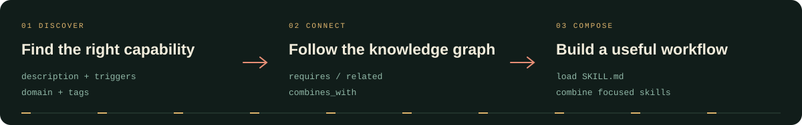

# 技能大典 · Everything Skills

<!-- BEGIN GENERATED:brand -->
<p align="center">
  <a href="INDEX/catalog.md"><picture><source media="(prefers-reduced-motion: reduce) and (max-width: 600px)" srcset="assets/brand/hero-mobile-static.svg" /><source media="(prefers-reduced-motion: reduce)" srcset="assets/brand/hero-static.svg" /><source media="(max-width: 600px)" srcset="assets/brand/hero-mobile.svg" /></picture></a>
</p>

<p align="center"><strong>事以类聚，技以互见。为 AI Agent 编写的技能类书。</strong></p>

<p align="center">
  <a href="INDEX/catalog.md">技能总目</a> · <a href="INDEX/graph.md">关系图谱</a> · <a href="INDEX/skill-repos.md">外部技能库</a> · <a href="CONTRIBUTING.md">贡献指南</a>
</p>

<p align="center">
  <picture><source media="(max-width: 600px)" srcset="assets/brand/stats-mobile.svg" /></picture>
</p>
<!-- END GENERATED:brand -->

## 快速开始

在 Claude Code 中添加插件市场，再选择需要的卷：

```text
/plugin marketplace add findscripter/everything-skills
```

例如，安装研发卷：

```text
/plugin install 02-engineering@everything-skills
```

每条技能由一个 `SKILL.md` 和独立目录组成。Codex、Cursor、Gemini CLI 等 Agent 可通过 [AGENTS.md](AGENTS.md)、[GEMINI.md](GEMINI.md) 或 [CLAUDE.md](CLAUDE.md) 找到技能，再按任务读取所需指令。

## 从任务开始找技能

你不必先知道技能名称。先选择最接近目标的一行，打开第一条技能；需要更完整的覆盖时，再沿着它的 `requires` / `related` 关系继续查找：

| 我想要…… | 从这里开始 |
| --- | --- |
| 了解并接手一个代码库 | [codebase-onboarding-doc](07-productivity/codebase-onboarding-doc/SKILL.md) → [monorepo-navigator](02-engineering/monorepo-navigator/SKILL.md) |
| 调研并解释一篇论文 | [entity-research-dossier](00-meta/entity-research-dossier/SKILL.md) → [academic-paper-explainer](09-verticals/academic-paper-explainer/SKILL.md) |
| 设计、测试和审查 API | [api-design-reviewer](02-engineering/api-design-reviewer/SKILL.md) → [api-test-suite-builder](02-engineering/api-test-suite-builder/SKILL.md) |
| 做无障碍或 Agent 安全审计 | [accessibility-wcag-audit](02-engineering/accessibility-wcag-audit/SKILL.md) · [agent-skill-security-scanner](08-security/agent-skill-security-scanner/SKILL.md) |

### 你看到的内容分别是什么

- **仓库内技能**：本仓库中的实际目录，每条都有 `SKILL.md`，可按卷通过 marketplace 安装。
- **外部仓库索引**：[INDEX/skill-repos.md](INDEX/skill-repos.md) 中的外部技能库、marketplace 和目录摘要。这里不复制它们的源代码或 `SKILL.md`；使用前请回到上游核对许可和安装方式。
- **生成的导航文件**：目录、标签、关系图、`search.json`、`quality.json`、marketplace 元数据和 README 统计。这些文件由源数据生成，用于导航，不是额外的技能正文。`quality.json` 提供审核状态、来源新鲜度、许可可信度、依赖和安全风险等证据维度；`unknown` / `unreviewed` 表示尚无对应结论。

### 四个入门组合

下面的组合展示如何把关系图串成一条可执行的工作流：

| 组合 | 建议路径 |
| --- | --- |
| 仓库接手 | [codebase-onboarding-doc](07-productivity/codebase-onboarding-doc/SKILL.md) → [monorepo-navigator](02-engineering/monorepo-navigator/SKILL.md) → [spec-driven-workflow](02-engineering/spec-driven-workflow/SKILL.md) |
| 文献综述 | [entity-research-dossier](00-meta/entity-research-dossier/SKILL.md) → [academic-paper-explainer](09-verticals/academic-paper-explainer/SKILL.md) → [citation-management](01-documents/citation-management/SKILL.md) |
| API 交付 | [api-design-reviewer](02-engineering/api-design-reviewer/SKILL.md) → [api-test-suite-builder](02-engineering/api-test-suite-builder/SKILL.md) → [api-security-best-practices](08-security/api-security-best-practices/SKILL.md) |
| 无障碍与供应链信任 | [accessibility-wcag-audit](02-engineering/accessibility-wcag-audit/SKILL.md) → [wcag-22-audit-patterns](02-engineering/wcag-22-audit-patterns/SKILL.md) → [supply-chain-risk-auditor](08-security/supply-chain-risk-auditor/SKILL.md) |

## 本地检索

仓库自带一个零依赖 CLI，直接读取生成的索引：

```text
npm run skill -- search "无障碍审计"
npm run skill -- list --domain science
npm run skill -- why agent-self-reflection
npm run skill -- repo anthropics/skills
npm run skill -- eval
```

`eval` 会运行版本库中的 `data/search-eval.json` 任务集；分数衡量这些示例的召回覆盖，不代表运行时、安全或专业效果认证。

## 从发现到组合

<p align="center">
  <picture><source media="(max-width: 600px)" srcset="assets/brand/workflow-mobile.svg" /><source media="(prefers-reduced-motion: reduce)" srcset="assets/brand/workflow-static.svg" /></picture>
</p>

这是一部面向 AI Agent 的技能类书：按领域归位，用关系图连接。通过 `domain`、`tags`、`triggers` 缩小候选范围，再按 `description` 匹配任务。技能正文保持原始语言，每个技能只存放一处。

完整技能目录见 [Catalog](INDEX/catalog.md)，标签入口见 [Tags](INDEX/tags.md)，依赖、互见与组合关系见 [Graph](INDEX/graph.md)。机器可读版本为 [search.json](INDEX/search.json) 和 [graph.json](INDEX/graph.json)。

## 十一卷，按需取用

| 卷 | 领域 | 适用任务 |
| --- | --- | --- |
| [00-meta](00-meta/README.md) | 通用 | 研究、规划、思考与 Agent 工作方法 |
| [01-documents](01-documents/README.md) | 文书 | 文档、表格、演示与写作 |
| [02-engineering](02-engineering/README.md) | 研发 | 开发、架构、测试与交付 |
| [03-data](03-data/README.md) | 数据 | 分析、数据库与数据工程 |
| [04-ai](04-ai/README.md) | 智能 | 模型、RAG、Agent 与评测 |
| [05-business](05-business/README.md) | 商业 | 营销、产品、经营与增长 |
| [06-creative](06-creative/README.md) | 创意 | 设计、图像、音视频与交互 |
| [07-productivity](07-productivity/README.md) | 协作 | 沟通、项目、流程与个人效率 |
| [08-security](08-security/README.md) | 安全 | 防御审计、风险与合规 |
| [09-verticals](09-verticals/README.md) | 领域专精 | 科研、医疗、法律与行业工作流 |
| [10-platform](10-platform/README.md) | 平台集成 | 云平台、CLI、连接器与自动化 |

## 维护与贡献

技能元数据和外部仓库 JSONL 是源数据，目录、图谱与品牌统计由脚本生成。新增或修改条目后运行 `npm run build:zh`（中文）或 `npm run build`（英文）；提交后运行对应的 `check:zh` / `check` 确认生成物一致。

- [CONTRIBUTING.md](CONTRIBUTING.md)：添加、修改和验证技能。
- [ARCHITECTURE.md](ARCHITECTURE.md)：源数据、生成物与发布边界。
- [LANGUAGE.md](LANGUAGE.md)：`main` / `zh` 界面与原语言技能正文；历史 `en` 镜像已废弃。
- [PROJECT-REVIEW.md](PROJECT-REVIEW.md)：本次全库审查、已修正问题和后续建议。
- [assets/brand/README.md](assets/brand/README.md)：动画 Logo、静态版本与 SVG 素材使用方法。

安全与许可：技能是 Agent 指令包，来源与许可见 [INDEX/sources.md](INDEX/sources.md)、[LICENSE](LICENSE) 和 [NOTICE](NOTICE)；使用约定见 [SECURITY.md](SECURITY.md)。

---

<!-- BEGIN GENERATED:skill-repos -->
## 技能仓库目录

目前有 **2741** 条 GitHub 技能库/市场/精选列表目录记录。只根据 README 摘要，不收录对方源码、不复制 SKILL.md。

完整分表（含 stars / summary / license）由 `data/skill-repos.jsonl`（及 part 分片）生成，见 **[INDEX/skill-repos.md](INDEX/skill-repos.md)**。本页为归类链接目录。

<details>
<summary>1. 官方与权威（official）（425）</summary>

- [`anthropics/skills`](https://github.com/anthropics/skills) — Anthropic 官方 Agent Skills 示例与文档技能；marketplace 源 anthropics/skills。 (上游可访问)
- [`mem0ai/mem0`](https://github.com/mem0ai/mem0) — 通过官方 SDK/CLI 技能、集成测试与 OSS 到托管平台迁移流程接入 Mem0 持久记忆。 (上游可访问)
- [`vercel-labs/agent-browser`](https://github.com/vercel-labs/agent-browser) — Vercel 官方浏览器自动化 CLI + 可安装 Agent Skill（发现桩 + CLI 热加载 core）；npx skills add vercel-labs/agent-browser。仓库名含 agent。 (上游可访问)
- [`phaserjs/phaser`](https://github.com/phaserjs/phaser) — 开发 Phaser 4 游戏，覆盖场景、资源、输入、物理、动画以及 Phaser 3 迁移。 (上游可访问)
- [`ueberdosis/tiptap`](https://github.com/ueberdosis/tiptap) — 在应用中搭建和扩展 Tiptap 编辑器，集成协作、评论、AI 功能和文档转换。 (上游可访问)
- [`github/awesome-copilot`](https://github.com/github/awesome-copilot) — GitHub 官方 Awesome Copilot：自定义代理、指令、prompt 与技能精选。 (上游可访问)
- [`anthropics/claude-plugins-official`](https://github.com/anthropics/claude-plugins-official) — Anthropic 维护的 Claude Code / Cowork 官方插件市场。 (上游可访问)
- [`anthropics/financial-services`](https://github.com/anthropics/financial-services) — Claude for Financial Services 官方技能/插件包。 (上游可访问)
- [`supermemoryai/supermemory`](https://github.com/supermemoryai/supermemory) — 为 TypeScript 或 Python Agent 集成持久记忆、用户画像、个性化和语义知识检索。 (上游可访问)
- [`vercel-labs/agent-skills`](https://github.com/vercel-labs/agent-skills) — Vercel 官方约 8 条可安装 Agent Skills。 (上游可访问)
- [`googleworkspace/cli`](https://github.com/googleworkspace/cli) — Google Workspace 非官方支持 CLI（gws）：Drive/Gmail/Calendar 等 Discovery 动态命令面，附 100+ Agent Skills。 (上游可访问)
- [`vercel-labs/skills`](https://github.com/vercel-labs/skills) — Vercel npx skills CLI 与 skills.sh：向 70 余种编码代理安装 GitHub 技能仓的事实标准安装器。 (上游可访问)
- [`opendataloader-project/opendataloader-pdf`](https://github.com/opendataloader-project/opendataloader-pdf) — OpenDataLoader PDF 产品附公开 Agent Skill，用于结构化提取、格式选择与运行时 CLI 发现；企业版 PDF/UA 服务另计。 复审：odl-fix强化before/head两端可编译且真正症状失败的回归、重复PDF正文不能被header过滤蒙蔽，发帖带AI说明。新增odl-review维护流程：先只读triage，再风险深度/独立证据，代码先读且执行隔离、base/head重现、计划和发帖两个gate；不混作产品PDF用户技能数量。 (上游可访问)
- [`TanStack/table`](https://github.com/TanStack/table) — 构建 TanStack Table v9+ 表格，覆盖各框架的初始化、状态、迁移、特性、模糊排序和开发工具。 (上游可访问)
- [`openai/skills`](https://github.com/openai/skills) — OpenAI 早期技能示例；README 标明已弃用，现行示例迁至 openai/plugins。 (上游可访问)
- [`agentskills/agentskills`](https://github.com/agentskills/agentskills) — Agent Skills 开放规范（agentskills.io）：SKILL.md 格式与跨厂商可移植性。 (上游可访问)
- [`anthropics/knowledge-work-plugins`](https://github.com/anthropics/knowledge-work-plugins) — 知识工作向 Cowork 插件（约 11 个角色插件）。 (上游可访问)
- [`getpaseo/paseo`](https://github.com/getpaseo/paseo) — 通过 Paseo 的交接、顾问、委员会与CLI工作流协调编程 Agent。 复审：增加list_hosts及serverId多host工具路由，agentId须与serverId成对保存，远程workspace/cwd归目标host (上游可访问)
- [`resend/react-email`](https://github.com/resend/react-email) — 构建 React 邮件模板和可视化编辑器、渲染 HTML，并用 Resend 发送事务邮件。 (上游可访问)
- [`google/skills`](https://github.com/google/skills) — Google 官方 Agent Skills：GCP/GKE/BigQuery/Ads/Firebase 等，npx skills add google/skills；并捆绑 Claude/Codex/Antigravity 插件市场。 (上游可访问)
- [`browser-use/browser-harness`](https://github.com/browser-use/browser-harness) — 让 Claude Code、Codex 或 Cursor 通过 CDP 操作用户浏览器的浏览器 Harness。 (上游可访问)
- [`Canner/WrenAI`](https://github.com/Canner/WrenAI) — 使用 Wren 连接数据源、建立语义模型、补充业务上下文、查询 SQL 并构建 GenBI 仪表盘。 复审：generate-mdl增加OpenMetadata catalog导入替代直接database introspection，携带人工维护描述/标签/owner和FK relationships；先dry-run，默认仅加缺文件，--force会丢本地生成文件编辑而需具体授权；仍validate→build并人工补非FK join。 (上游可访问)
- [`longbridge/gpui-kit`](https://github.com/longbridge/gpui-kit) — 结合 GPUI Kit 组件、编码指南及交互和视觉设计规则构建 Rust 桌面界面。 (上游可访问)
- [`tradingview/lightweight-charts`](https://github.com/tradingview/lightweight-charts) — 使用 Lightweight Charts v5 构建图表，并开发自定义序列、图元和图表插件。 (上游可访问)
- [`larksuite/cli`](https://github.com/larksuite/cli) — 飞书/Lark 官方 CLI：200+ 命令与 26 条 Agent Skills（日历/文档/消息/表格/会议等），skills CLI 安装 larksuite/cli。 (上游可访问)
- [`NVIDIA/OpenShell`](https://github.com/NVIDIA/OpenShell) — 操作 OpenShell CLI、沙箱策略、推理路由与集群故障诊断。 复审：去掉OpenShift sandbox授予privileged SCC的旧建议，改排查UID/GID覆盖并使用restricted-v2 补充复审：内部helm-dev说明shared supervisor已从占位变真实assignment stream：TLS/JWT签名、受限token Secret读写/续期与health listener；新增internal release-captain的qualified pre-release→approved promotion→next-train维护流程，sync路由相应补齐，snap canary补prover alias。均属维护，不计公开4技能。 (上游可访问)
- [`umijs/qiankun`](https://github.com/umijs/qiankun) — 创建 qiankun 3 微前端主应用与子应用，处理 React、Vue 和 Vite 集成。 (上游可访问)
- [`microsoft/SkillOpt`](https://github.com/microsoft/SkillOpt) — 微软把 SKILL.md 当可训练状态的优化器：冻结模型、用轨迹与验证门编辑技能文档，产出可部署 best_skill.md。 (上游可访问)
- [`scalar/scalar`](https://github.com/scalar/scalar) — 在应用框架中集成与诊断 Scalar API Reference，覆盖认证、主题和 API 描述加载。 (上游可访问)
- [`greensock/gsap-skills`](https://github.com/greensock/gsap-skills) — GSAP 官方动画技能 8 条：core/timeline/ScrollTrigger/plugins/utils/react/performance/frameworks；npx skills add greensock/gsap-skills。 (上游可访问)
- [`MiniMax-AI/skills`](https://github.com/MiniMax-AI/skills) — MiniMax Agent 技能，覆盖前后端及移动开发、Shader、文档、幻灯片、音乐、多模态工作流和视觉分析。 (上游可访问)
- [`anomalyco/opentui`](https://github.com/anomalyco/opentui) — 通过与版本匹配的 OpenTUI API 和组件技能文档构建终端界面。 (上游可访问)
- [`microsoft/playwright-cli`](https://github.com/microsoft/playwright-cli) — 微软 Playwright CLI with SKILLS：playwright-cli install --skills，面向编码代理的浏览器 CLI（相对 MCP 更省 token）。 (上游可访问)
- [`cursor/plugins`](https://github.com/cursor/plugins) — cursor/plugins：当前复审口径为 119 plugins / multiple skills，具体公开分发范围见固定版本证据。 复审：pstack新增创建/维护formal verification与statechart：按代码选property/tool，保留反例与mutation可失败性、sync commit、区分model drift和产品bug；statechart把TLA+映射到用户可见状态并要求真实replay。sharpen改为输出深化后的prompt而非执行原任务；ketchup不能靠字数删决策项；Claude Code adapters不重复计数。X第三方guide撤旧credits逻辑并增Lists/Spaces/livestream/Chat边界，免费/权限为该产品快照主张未外部运行验证。 (上游可访问)
- [`AnmolSaini16/mapcn`](https://github.com/AnmolSaini16/mapcn) — MapLibre/shadcn 地图组件的 Agent Skill，指导 React 应用按需安装和配置地图。 复审： (上游可访问)
- [`rerun-io/rerun`](https://github.com/rerun-io/rerun) — 通过官方技能探索机器人记录与数据集、转换传感器格式，并设计 Rerun 查看器布局。 复审：blueprint扩展到segment/catalog表格列序、可见性、名称、SQL行过滤和cards 补充复审：catalog query补CatalogClient须rerun://、rerun+https://或local rerun+http://，不可plain HTTPS；REDAP_TOKEN/auth stored token，segment URL拆ID。puffin条目仅函数例名apply_many→write_segment_manifest，不改分析方法。 (上游可访问)
- [`moonshine-ai/moonshine`](https://github.com/moonshine-ai/moonshine) — 使用 Moonshine 集成端侧语音识别、语音合成、声音克隆和 AgentFlow 语音 Agent。 (上游可访问)
- [`huggingface/skills`](https://github.com/huggingface/skills) — Hugging Face 官方 Hub/训练/评测/Spaces 技能；市场默认只暴露 hf-cli，其余用 hf skills add。 (上游可访问)
- [`google/adk-recipes`](https://github.com/google/adk-recipes) — Google ADK 官方零售插件技能，提供商品检索和虚拟试穿 Agent 工作流。 (上游可访问)
- [`pinchtab/pinchtab`](https://github.com/pinchtab/pinchtab) — 本地优先的浏览器控制服务器与 Agent Skills，支持 CLI、MCP、性能优化和隐身评分。 (上游可访问)
- [`xberg-io/xberg`](https://github.com/xberg-io/xberg) — Xberg 文档/多媒体解析与 OCR 工具的官方 Agent Skills、插件和 MCP 集成。 (上游可访问)
- [`anthropics/claude-for-legal`](https://github.com/anthropics/claude-for-legal) — Claude for Legal 官方技能：合同审查、法律研究与律所工作流。 (上游可访问)
- [`open-pencil/open-pencil`](https://github.com/open-pencil/open-pencil) — 使用 OpenPencil 检查和编辑 Figma .fig文件、导出资源并分析设计令牌。 复审：替换旧“figma无绑定方法”的说法，补Figma variables/getLocalVariables/createVariable/setValueForMode及node.setBoundVariable，区分Figma字段与OpenPencil字段 (上游可访问)
- [`ariga/atlas`](https://github.com/ariga/atlas) — 通过 Atlas 官方技能管理数据库 Schema、迁移、CI 流程与数据库专属工作流。 (上游可访问)
- [`google-labs-code/stitch-skills`](https://github.com/google-labs-code/stitch-skills) — Google Stitch 设计技能与三个插件（design/build/utilities），兼容 Codex、Antigravity、Claude Code、Cursor。非官方支持产品。 (上游可访问)
- [`mufeedvh/code2prompt`](https://github.com/mufeedvh/code2prompt) — Code2Prompt 产品技能：按范围探索仓库、查看实体图并分组读取源码，组织编码 Agent 上下文。 (上游可访问)
- [`TheWidlarzGroup/react-native-video`](https://github.com/TheWidlarzGroup/react-native-video) — 集成与迁移 React Native Video v6/v7，覆盖播放、流媒体、DRM、轨道及原生配置。 (上游可访问)
- [`anthropics/defending-code-reference-harness`](https://github.com/anthropics/defending-code-reference-harness) — Anthropic 防御性安全参考 harness：威胁建模、扫描、分诊、补丁与检测响应技能，外加自主扫描流水线。标明不再维护。 (上游可访问)
- [`goadesign/goa`](https://github.com/goadesign/goa) — 使用 Goa DSL 设计 Go 服务契约，生成 HTTP、gRPC、JSON-RPC 代码并实现和验证服务。 复审：仅.cursor/skills/goa-release维护指南增加warm-proxy阶段，等gopkg.in tag并按commit预热Go proxy/sum再查tag。属于本仓发布维护，不是新增对外Goa用户技能。 (上游可访问)
- [`google/agents-cli`](https://github.com/google/agents-cli) — Gemini Enterprise Agent Platform 的 CLI + 技能：把任意编码代理变成 ADK 代理构建/评测/部署专家。 (上游可访问)
- [`openai/plugins`](https://github.com/openai/plugins) — OpenAI 现行 Codex 插件/技能示例目录，接替 openai/skills。 (上游可访问)
- [`dotnet/skills`](https://github.com/dotnet/skills) — .NET 官方 Agent Skills 插件市场：dotnet/advanced/data/diag/msbuild/nuget/upgrade/maui/ai/test/aspnetcore/blazor 等，Copilot/Claude/Codex/Cursor 插件市场。 (上游可访问)
- [`OpenSenseNova/SenseNova-Skills`](https://github.com/OpenSenseNova/SenseNova-Skills) — 商汤 SenseNova 办公技能：信息图/PPT/Excel 分析/深度研究/多源搜索，SKILL.md 可装 OpenClaw 与 Hermes。 (上游可访问)
- [`emqx/MQTTX`](https://github.com/emqx/MQTTX) — 使用 MQTTX CLI 完成 MQTT 连接、收发验证、MQTT 5、认证、编解码、模拟与诊断。 (上游可访问)
- [`remotion-dev/skills`](https://github.com/remotion-dev/skills) — Remotion 官方 Agent Skills：best-practices/create/markup/studio/render/maps/captions/saas/interactivity/docs/upgrade/multimedia。 (上游可访问)
- [`google-gemini/gemini-skills`](https://github.com/google-gemini/gemini-skills) — Gemini API 官方技能：gemini-api-dev / live-api / omni-flash；npx skills add google-gemini/gemini-skills。非官方支持产品。 (上游可访问)
- [`DingTalk-Real-AI/dingtalk-workspace-cli`](https://github.com/DingTalk-Real-AI/dingtalk-workspace-cli) — 通过 CLI 随附 Agent Skills 操作钉钉多维表、会话、日历、文档、邮件与协作流程。 复审：chat/tag新增A2UI回复占位/同卡streaming与runtime避免重复投递；contact增加按手机号/钉钉号get-open-dingtalk-id并限定企业灰度，区分userId；event回复遵守既有授权，aitable api-key明确Supabase域。 (上游可访问)
- [`browserbase/skills`](https://github.com/browserbase/skills) — Browserbase 官方浏览器自动化技能：browser/functions/trace/autobrowse/safe-browser/search/ui-test 等；npx skills add browserbase/skills。 (上游可访问)
- [`qawolf/cli`](https://github.com/qawolf/cli) — 通过 CLI 操作 QA Wolf 覆盖需求、缺陷报告、测试运行、环境与浏览器工作流。 复审：补多会话workspace隔离参数以免auth switch改变整机默认 (上游可访问)
- [`google-deepmind/science-skills`](https://github.com/google-deepmind/science-skills) — 使用面向基因组学、结构生物学、化学信息学、文献检索和专业科学数据库的研究技能。 (上游可访问)
- [`anthropics/claude-plugins-community`](https://github.com/anthropics/claude-plugins-community) — 社区插件市场只读镜像；经提交、安全扫描与审批后夜间同步。 (上游可访问)
- [`TanStack/ai`](https://github.com/TanStack/ai) — 通过用户级集成技能选择 TanStack AI包并迁移应用。 复审：migration明确0.x→1.0：1.0删除所有0.x deprecated API，应先在0.x移到替代接口、再同时升级@tanstack/ai*；provider表增加-neon 补充复审：包级指南同步1.0 required threadId/runContext、AG-UI RUN_FINISHED而非[DONE]、REASONING事件、body→forwardedProps、移除旧interrupt APIs/monolithic adapter；artifact blobKey必填，旧0.x需backfill。MCP新增harness plugin/OAuth connector/events webhook/raw HMAC/dedup；CredentialStore按tenant+user非thread、secret静态加密/不记录。media输入走generationParamsFromRequest并补多模态角色/expiry边界。docs维护默认tone不再审批，客户端镜像不增count。 (上游可访问)
- [`NVIDIA/skills`](https://github.com/NVIDIA/skills) — NVIDIA 官方已验证技能目录：Physical AI、仿真、CUDA-X、RAG。 (上游可访问)
- [`nuxt-content/docus`](https://github.com/nuxt-content/docus) — 创建和审核 Docus 文档站点，并从文档内容分发可发现的技能。 复审：新增release-notes维护技能：CHANGELOG机械生成scaffold/贡献者、minor/major写2–4个有验证API的highlights、patch不加Highlights、新文档核对anchors；输出ignored vVERSION.md让维护者贴发布，非自动commit/post。 (上游可访问)
- [`snyk/agent-scan`](https://github.com/snyk/agent-scan) — Snyk 官方：扫描 AI agents/MCP/skills 安全风险。 (上游可访问)
- [`microsoft/skills`](https://github.com/microsoft/skills) — 微软官方 Azure SDK / AI Foundry Agent Skills；Skill Explorer 宣称 175 条。 (上游可访问)
- [`flutter/agent-plugins`](https://github.com/flutter/agent-plugins) — Flutter官方Agent插件市场（marketplace.json）；面向Flutter开发的可安装Skills。 (上游可访问)
- [`cloudflare/skills`](https://github.com/cloudflare/skills) — Cloudflare 官方 Workers/Agents SDK/Durable Objects/Wrangler/Cloudflare One 技能与 MCP。 (上游可访问)
- [`supabase/agent-skills`](https://github.com/supabase/agent-skills) — Supabase 官方技能：supabase 全产品包 + postgres-best-practices；skills CLI 与 Claude 插件市场。 (上游可访问)
- [`aws/agent-toolkit-for-aws`](https://github.com/aws/agent-toolkit-for-aws) — AWS 官方 Agent Toolkit：aws-core/agents/data-analytics/devsecops 四插件 + MCP；README 称后继 awslabs/agent-plugins；npx skills add aws/agent-toolkit-for-aws/skills。 (上游可访问)
- [`expo/skills`](https://github.com/expo/skills) — Expo 官方构建/部署/升级/调试技能；Claude/Codex 走插件市场，其余用 skills CLI。 (上游可访问)
- [`frappe/builder`](https://github.com/frappe/builder) — 通过 frappectl 创建、编辑、换肤并发布 Frappe Builder 页面与组件。 复审：从frappectl专用流程改为assistant/MCP/CLI均可用的文档读写与whitelisted methods (上游可访问)
- [`apify/agent-skills`](https://github.com/apify/agent-skills) — Apify 官方 5 条：ultimate-scraper/actor-development/actorization/output-schema/sdk-integration；npx skills add。社区精选见 apify/awesome-skills。 (上游可访问)
- [`alpic-ai/skybridge`](https://github.com/alpic-ai/skybridge) — 按照 Skybridge 的生命周期、架构、实现、迁移与部署指南构建 ChatGPT 插件和 MCP Apps。 (上游可访问)
- [`anthropics/commerce-agents`](https://github.com/anthropics/commerce-agents) — Anthropic 购物与商户 Agent 参考蓝图（prompt/skills/工具契约）。 (上游可访问)
- [`WordPress/agent-skills`](https://github.com/WordPress/agent-skills) — WordPress 官方 17 条：blocks/themes/plugins/REST/Playground 等；npx skills add WordPress/agent-skills。 (上游可访问)
- [`lodev09/react-native-true-sheet`](https://github.com/lodev09/react-native-true-sheet) — 在 React Native 应用中集成 TrueSheet 底部面板，覆盖导航、动画、滚动、键盘及版本迁移。 复审：修正auto detents下FlashList等flex包装仍需sheet flex:1 补充复审：仅内部e2e场景表维护，描述FlatList/ScrollView切换、footer/navigation、overlay和焦点等测试覆盖；表格文字/列宽不新增对外TrueSheet API，不算新技能。 (上游可访问)
- [`deepmodeling/deepmd-kit`](https://github.com/deepmodeling/deepmd-kit) — DeePMD-kit 安装、势能模型训练与微调、Python 推理及 LAMMPS 模拟工作流。 (上游可访问)
- [`reactive/data-client`](https://github.com/reactive/data-client) — 在 React 或 Vue 中集成规范化 REST、GraphQL 数据，覆盖端点、模式、缓存、测试与迁移。 复审： 补充复审：8入口description从API词表改按用户任务路由；React/Vue运行态先读__DC__.controller/actions，schema用shouldReorder保留version新数据而shouldUpdate只是省工；setup写AGENTS并从既有CLAUDE引用，Windows symlink/首次加载说明修订；testing/manager/rest入口职责文字更清楚。 (上游可访问)
- [`figma/mcp-server-guide`](https://github.com/figma/mcp-server-guide) — Figma 官方 MCP 指南仓：Cursor/Claude 插件含 Agent Skills；另有 video-interaction-mapper / generate-project-plan 独立工作流技能。README 标明 Beta。 (上游可访问)
- [`MicrosoftDocs/mcp`](https://github.com/MicrosoftDocs/mcp) — Microsoft Learn 技能：检索官方文档与代码参考、创建技能，以及使用 Microsoft Learn CLI。 (上游可访问)
- [`timescale/pg-aiguide`](https://github.com/timescale/pg-aiguide) — Timescale Postgres AI 指南：MCP 与可安装 postgres Agent Skill/插件；npx skills add timescale/pg-aiguide。 (上游可访问)
- [`spotify/portal-ai-plugins`](https://github.com/spotify/portal-ai-plugins) — Spotify Portal AI Plugins：把 Portal CLI 工作流接入 Claude/Codex/Cursor。 (上游可访问)
- [`callstackincubator/agent-skills`](https://github.com/callstackincubator/agent-skills) — Callstack：面向 React Native 的 Agent Skills 集合。 (上游可访问)
- [`Redocly/redocly-cli`](https://github.com/Redocly/redocly-cli) — 使用 Redocly CLI 校验和打包 API 描述、生成文档与客户端、编写 API 校验规则，并配置或运行 recheck 的 Markdown 与文案检查。 复审：平台称谓由Reunite泛化为Redocly platform，preview去掉Realm/Reef/Revel限定，命令表增加skills安装到.agents与检测客户端目录。 补充复审：PHP generator说明discriminated union按mapping目标hydrate，无独立class的plain oneOf保留raw array；Python aliases须在类和依赖aliases之后定义以免import时未定义。examples副本不另计，但generator正文属于可交付模板需保留。 (上游可访问)
- [`microsoft/hve-core`](https://github.com/microsoft/hve-core) — 微软 Hypervelocity Engineering：面向 GitHub Copilot 的指令/提示/代理/技能组件集 (上游可访问)
- [`microsoft/azure-skills`](https://github.com/microsoft/azure-skills) — 微软 Azure 技能插件：准备/校验/部署/诊断/成本/AI/RBAC 等，并接入 Azure MCP 与 Foundry MCP。 (上游可访问)
- [`mozilla-ai/cq`](https://github.com/mozilla-ai/cq) — Mozilla AI 共享知识 commons（cq）Claude 插件。 (上游可访问)
- [`starknet-io/starknet.js`](https://github.com/starknet-io/starknet.js) — 按当前 calldata、provider、账户、合约与交易约定开发 Starknet JavaScript/TypeScript 集成。 (上游可访问)
- [`langchain-ai/langchain-skills`](https://github.com/langchain-ai/langchain-skills) — LangChain/LangGraph/Deep Agents 21 条技能；npx skills add langchain-ai/langchain-skills。早期开发。 (上游可访问)
- [`espressif/esp-dl`](https://github.com/espressif/esp-dl) — 乐鑫 ESP-DL 内含 4 条 Agent Skills，覆盖算子实现、量化精度迭代调优与 ESP32-S3/P4 的 PIE SIMD 优化。 (上游可访问)
- [`TencentCloudBase/CloudBase-AI-Toolkit`](https://github.com/TencentCloudBase/CloudBase-AI-Toolkit) — 腾讯云 CloudBase AI Toolkit（含 Agent Skills）。 (上游可访问)
- [`microsoft/skills-for-fabric`](https://github.com/microsoft/skills-for-fabric) — Microsoft Fabric 技能市场：fabric-skills 全包与独立的 Power BI 作者包。 (上游可访问)
- [`frappe/frappe-ui`](https://github.com/frappe/frappe-ui) — 使用 Vue 3 组件、设计令牌、表单、弹窗和列表构建 Frappe 应用界面。 (上游可访问)
- [`Kotlin/kotlin-agent-skills`](https://github.com/Kotlin/kotlin-agent-skills) — Kotlin 官方：Kotlin 项目可用的 AI Agent Skills。 (上游可访问)
- [`google-gemma/gemma-skills`](https://github.com/google-gemma/gemma-skills) — 使用官方开发与训练技能构建 Gemma 应用，并开展模型微调。 复审： (上游可访问)
- [`vercel-labs/next-skills`](https://github.com/vercel-labs/next-skills) — 路标仓：原 Next.js Agent Skills 已迁入 vercel/next.js 的 skills/，用 npx skills add vercel/next.js。 (上游可访问)
- [`anthropics/launch-your-agent`](https://github.com/anthropics/launch-your-agent) — Anthropic 参考技能：访谈→范围 v0→在本人账户启动 Claude Managed Agent→评分迭代→定时部署。 (上游可访问)
- [`getsentry/skills`](https://github.com/getsentry/skills) — Sentry 团队官方开发技能约 27 条 + 2 子代理；npx skills add getsentry/skills。产品接入技能另见 getsentry/sentry-for-ai。 (上游可访问)
- [`ForgeCAD/forgecad-public-kit`](https://github.com/ForgeCAD/forgecad-public-kit) — ForgeCAD历史GitHub技能来源；当前固定公开Git快照无SKILL.md，README引导至产品文档。 (仅历史来源)
- [`Mininglamp-OSS/octo-cli`](https://github.com/Mininglamp-OSS/octo-cli) — 通过原生 CLI 操作 Octo 消息、文件、网盘、文档、邮件、HTML、市场与 Agent 集群。 复审：环境凭证改OCTO_TOKEN优先于兼容别名OCTO_BOT_TOKEN，并可覆盖隐式stored-profile选择 补充复审：docs/drive/files/html/loop/messaging/summary同步OCTO_TOKEN优先及legacy alias，显式profile优先；doc/sheet import是原子replace不append，file download返回presigned URL JSON而非bytes、upload type/path为query，html list支持page而comment list当前一次全量；event loop改父shell process substitution保留cursor，Loop scope与schema校准。 (上游可访问)
- [`SynaLinks/synalinks-skills`](https://github.com/SynaLinks/synalinks-skills) — 按 Synalinks 原生方式构建神经符号语言模型程序、工具、Agent、训练及奖励流程。 (上游可访问)
- [`awslabs/agent-plugins`](https://github.com/awslabs/agent-plugins) — AWS Labs Agent Plugins 市场：Amplify、Serverless、SageMaker、deploy-on-aws 等；README 称后继为 Agent Toolkit for AWS。 (上游可访问)
- [`openfilm/openfilm`](https://github.com/openfilm/openfilm) — OpenFilm 开源 AI 视频 Agent，包含视频制作路由和多种可安装的创意视频技能。 复审：keynote与screen-demo删OpenFilm自带headless capture/npx openfilm capture能力宣传；TTS/music与用户现有工具路线保留。目录不得据旧文本宣称内置capture当前存在。 (上游可访问)
- [`TickDB/tickdb-unified-realtime-marketdata-api`](https://github.com/TickDB/tickdb-unified-realtime-marketdata-api) — 查询 TickDB 市场价格、复权 K 线、期货、公司财务数据与 API 订阅信息。 (上游可访问)
- [`oxylabs/agent-skills`](https://github.com/oxylabs/agent-skills) — Oxylabs官方产品Agent Skills。 (上游可访问)
- [`stripe/link-cli`](https://github.com/stripe/link-cli) — 使用 Link 钱包支付凭证、财务洞察与身份能力，并提供 Cursor 托管 MCP 购买流程的独立指南。 复审：wallet-wide default只在用户明确要求时设置/清除，redacted list识别payment method且explicit bool。requires_action新增partner_auth_challenge在Link app完成后auto_resume原request，retry类型则新spend request；Eve与主技能一致，未知结果不重复支付。 (上游可访问)
- [`oracle/skills`](https://github.com/oracle/skills) — Oracle 精选开源可安装技能（数据库等）；npx skills add oracle/skills/db。 (上游可访问)
- [`hashicorp/agent-skills`](https://github.com/hashicorp/agent-skills) — HashiCorp 官方 Terraform 16 条 + Packer 4 条 Agent Skills；npx skills add 与 Claude/Codex 产品插件包 terraform@hashicorp / packer@hashicorp。 (上游可访问)
- [`google/mantis`](https://github.com/google/mantis) — Google 可移植安全审查技能套件：计划、研究、复现、补丁、报告的顺序流水线；npx skills add google/mantis。非官方支持产品。 (上游可访问)
- [`higgsfield-ai/skills`](https://github.com/higgsfield-ai/skills) — Higgsfield 官方 9 条：generate/soul-id/photoshoot/brandkit/marketplace-cards/websites/explainer/thumbnail/game-generation；npx skills add higgsfield-ai/skills。 (上游可访问)
- [`microsoft/power-platform-skills`](https://github.com/microsoft/power-platform-skills) — 微软 Power Platform 插件市场：Power Pages、Model/Canvas/Code/Mobile Apps、Power Automate 等。 (上游可访问)
- [`laravel/agent-skills`](https://github.com/laravel/agent-skills) — Laravel 官方 Agent Skills（Cloud/LSP/Nightwatch 等）。 (上游可访问)
- [`Unity-Technologies/skills`](https://github.com/Unity-Technologies/skills) — Unity 官方 AI Agent Skills 集合（项目/CLI/UI/多人/IAP 等）。 (上游可访问)
- [`dbt-labs/dbt-agent-skills`](https://github.com/dbt-labs/dbt-agent-skills) — dbt Labs 官方：面向 dbt 工作流的 Agent Skills 集合。 (上游可访问)
- [`planetscale/database-skills`](https://github.com/planetscale/database-skills) — PlanetScale 官方数据库技能：mysql/postgres/vitess/neki；npx skills add planetscale/database-skills。 (上游可访问)
- [`angular/skills`](https://github.com/angular/skills) — Angular 官方编码技能：angular-developer 与 angular-new-app，npx skills add angular/skills；源在 angular/angular 的 skills/dev-skills。 (上游可访问)
- [`apache/datafusion-python`](https://github.com/apache/datafusion-python) — Apache DataFusion Python 提供 1 条可安装的数据框/SQL Agent Skill，另含 4 条贡献者维护技能，覆盖 Arrow 数据读取、表达式与查询常见问题。 (上游可访问)
- [`elastic/agent-skills`](https://github.com/elastic/agent-skills) — Elastic 官方技能：Cloud/Elasticsearch/Kibana/Observability/Security 五组，npx skills add elastic/agent-skills 与 Claude/Copilot 插件市场。 (上游可访问)
- [`openai/role-specific-plugins`](https://github.com/openai/role-specific-plugins) — OpenAI 官方角色化 Codex 插件模板（销售/数据/产品设计等）。 (上游可访问)
- [`lightonai/next-plaid`](https://github.com/lightonai/next-plaid) — LightOn 语义/多向量代码搜索 Tools Skills。 (上游可访问)
- [`butterbase-ai/butterbase-skills`](https://github.com/butterbase-ai/butterbase-skills) — Butterbase.ai 官方技能插件；claude plugin add @butterbase/skills。 (上游可访问)
- [`ClickHouse/agent-skills`](https://github.com/ClickHouse/agent-skills) — ClickHouse 官方技能：best-practices/architecture/JS troubleshooting/chdb/infra/ClickStack OTel；npx skills add 与 clickhousectl skills。 (上游可访问)
- [`posit-dev/skills`](https://github.com/posit-dev/skills) — Posit 官方 Claude 技能：R 包/Shiny/Quarto/Connect/GitHub PR 等分类；npx skills add posit-dev/skills。 (上游可访问)
- [`tuya/tuya-openclaw-skills`](https://github.com/tuya/tuya-openclaw-skills) — 通过涂鸦官方 OpenClaw 技能查询与控制智能家居设备、家庭、天气、能耗统计及设备事件。 (上游可访问)
- [`makenotion/claude-code-notion-plugin`](https://github.com/makenotion/claude-code-notion-plugin) — Notion 官方 Claude Code Notion 插件与技能。 (上游可访问)
- [`VisActor/skills`](https://github.com/VisActor/skills) — VisActor/skills：当前复审口径为 3，具体公开分发范围见固定版本证据。 复审：当前移除data-storytelling/vchart-skill/vtable-skill三个旧manifest，新增chart-storytelling共享plan→HTML/Web-PPT、editorial-magazine语义HTML/CSS多场景模板→HTML+PNG+sources、life-chronicle真实人物照片/日期精度/模板随机抽选→HTML+PNG。新入口依赖VSeed/VChart/VTable或VInfo/字体CDN按各contract，不是把旧vchart变更冒充同一路径。保持素材与内容来源、人工视觉检查且不自动发布。 (上游可访问)
- [`google-ai-edge/litert-samples`](https://github.com/google-ai-edge/litert-samples) — 转换、量化、基准测试和验证端侧 LiteRT 模型，并搭建 CompiledModel 应用。 (上游可访问)
- [`OpenMinis/MinisSkills`](https://github.com/OpenMinis/MinisSkills) — OpenMinis/MinisSkills：当前复审口径为 57，具体公开分发范围见固定版本证据。 复审：新增ios-dev：手机iSH上ObjC/C clang+lld编译IPA、证书/profile签名、loopback VPN+RemotePairing安装再get_apps回读；免费Apple ID7天profile，paid只bring-own-p12且未实证paid证书；无Swift/Xcode编译器，初次pairing可能仍需Mac。doctor/--check先行，private endpoints/Anisette与账户写入、secret600、本机覆盖边界明确，不应摘要成“所有iOS完全免电脑”。 (上游可访问)
- [`anthropics/k12-teacher-skills`](https://github.com/anthropics/k12-teacher-skills) — Claude for Teachers 配套 K-12 技能与评测，与 Learning Commons 合编。 (上游可访问)
- [`NVIDIA-BioNeMo/bionemo-agent-toolkit`](https://github.com/NVIDIA-BioNeMo/bionemo-agent-toolkit) — NVIDIA BioNeMo 生命科学官方技能：Boltz-2/DiffDock/Evo2/GenMol/OpenFold/RFdiffusion/Parabricks 等 NIM 与工作流；npx skills add。双许可。 (上游可访问)
- [`elevenlabs/skills`](https://github.com/elevenlabs/skills) — ElevenLabs 官方 TTS/STT/agents/SFX/music/dubbing 等 10 条；npx skills add elevenlabs/skills。 (上游可访问)
- [`astronomer/agents`](https://github.com/astronomer/agents) — Astronomer 官方 Airflow/数仓技能 20+（DAG/dbt/lineage/分析）+ MCP；npx skills add astronomer/agents。 (上游可访问)
- [`docker/skills`](https://github.com/docker/skills) — Docker 官方技能库，帮助 AI 编码代理构建、测试、调试与优化容器；npx skills add docker/skills。 (上游可访问)
- [`firebase/agent-skills`](https://github.com/firebase/agent-skills) — Firebase 官方 Agent Skills：README 安装命令指向 firebase/skills 别名路径，兼 Gemini/Claude/Codex/Kimi 插件。 (上游可访问)
- [`microsoft/skills-for-copilot-studio`](https://github.com/microsoft/skills-for-copilot-studio) — 微软 Copilot Studio STANDARD agent YAML 插件：manage/author/test/advisor 四子代理。实验性、非官方支持产品。 (上游可访问)
- [`mckinsey/agents-at-scale-ark`](https://github.com/mckinsey/agents-at-scale-ark) — McKinsey Agents at Scale / ARK 插件 Skills。 (上游可访问)
- [`GizClaw/flowcraft`](https://github.com/GizClaw/flowcraft) — 为 Go Agent 应用编写和校验 FlowCraft 部署、运行时、图、插件及资源配置。 复审： (上游可访问)
- [`microsoft/win-dev-skills`](https://github.com/microsoft/win-dev-skills) — 微软 WinUI 3 / Windows App SDK 技能 8 条 + winui-dev 编排代理；Copilot/Claude/Codex 插件市场。Preview。 (上游可访问)
- [`getsentry/warden`](https://github.com/getsentry/warden) — Sentry 本地/PR AI 代码评审 Agents Skills。 (上游可访问)
- [`TheQtCompanyRnD/agent-skills`](https://github.com/TheQtCompanyRnD/agent-skills) — Qt 官方 12 条：C++/QML review、UI、docs、profiler、test、Figma tokens/components、CMake；Claude 插件市场 + npx skills add + Gemini 扩展。 (上游可访问)
- [`rhesis-ai/rhesis`](https://github.com/rhesis-ai/rhesis) — 通过 Rhesis MCP 工作流设计 AI 测试套件、执行评估并检查反馈。 (上游可访问)
- [`Unity-Technologies/unity-agent-plugin`](https://github.com/Unity-Technologies/unity-agent-plugin) — Unity 官方代理插件与技能；Claude 插件市场安装。 (上游可访问)
- [`LambdaTest/agent-skills`](https://github.com/LambdaTest/agent-skills) — TestMu AI（原 LambdaTest）官方测试技能：Selenium/Playwright/Cypress 等跨语言框架，npx agentskillsforall add。 (上游可访问)
- [`oracle/netsuite-suitecloud-sdk`](https://github.com/oracle/netsuite-suitecloud-sdk) — oracle/netsuite-suitecloud-sdk：当前复审口径为 15，具体公开分发范围见固定版本证据。 复审：新增5个SuiteSkills domain/router：customers-sales、finance、onboarding、operations、workforce，按index和共享contract选runbook；涵盖pricing/inventory/close/cash/HR/time等分析，写记录/批准时间须supported action和具体用户确认，no payroll submission/no就业eligibility。onboarding已有具体任务直接handoff，导入资料仅data；声明UPL-1.0。 (上游可访问)
- [`railwayapp/railway-skills`](https://github.com/railwayapp/railway-skills) — Railway 官方代理技能，用于在 Railway 部署与运维；/plugin install railway@claude-plugins-official。 (上游可访问)
- [`amd/skills`](https://github.com/amd/skills) — AMD 官方 Agent Skills：Ryzen AI 本地推理、Instinct LLM serving、ROCm 诊断等；npx skills add amd/skills。 (上游可访问)
- [`JetBrains/benjamin-plus-skill`](https://github.com/JetBrains/benjamin-plus-skill) — JetBrains Benjamin-Plus 降 token 成本技能。 (上游可访问)
- [`NVIDIA/nvidia-kaggle`](https://github.com/NVIDIA/nvidia-kaggle) — NVIDIA 官方 Kaggle 插件：竞赛综述/writeup/kernel 复现/提交；Codex/Claude 插件市场 + SKILL.md。 (上游可访问)
- [`Cecilapp/Cecil`](https://github.com/Cecilapp/Cecil) — 创建和配置 Cecil 静态站点，并开发可复用的 Twig 主题。 复审：主题指南大量澄清layout候选优先级、theme依赖配置并非递归加载、保留false/0须用??、theme-installer^2.1的extra.cecil.theme-name、html()替代废弃filter、翻译/notes/组件与输出校验。新段落说无site data也加载theme data，但末尾故障表仍称需建site data，存在文档内部矛盾，目录更新不应等同运行认证。 补充复审：cecil主技能补frontmatter/date/weight/schedule、section sort/pagination、CLI选项、doctor fail-on、JSON-LD linked graph、Twig components/html()替旧filter；旧.github PR/PHP维护入口移除并以.claude address-pr-comments回归证据/用户确认发帖替代，不计产品public技能。 (上游可访问)
- [`databricks/databricks-agent-skills`](https://github.com/databricks/databricks-agent-skills) — Databricks 官方稳定技能 29 条（core/jobs/pipelines/Unity Catalog 等）；databricks aitools install 与多宿主插件市场。 (上游可访问)
- [`langfuse/skills`](https://github.com/langfuse/skills) — Langfuse 官方 Agent Skills：教代理做 tracing / prompt / evaluation。 (上游可访问)
- [`EpicGames/unreal-engine-skills-for-claude-code-plugin`](https://github.com/EpicGames/unreal-engine-skills-for-claude-code-plugin) — Epic 官方 Unreal Editor Claude Code 插件：unreal-mcp 技能 + 30+ MCP toolset (上游可访问)
- [`vercel/vercel-plugin`](https://github.com/vercel/vercel-plugin) — Vercel 官方插件：35 条生态技能 + 3 专家代理 + 知识图谱；npx plugins add vercel/vercel-plugin。 (上游可访问)
- [`basecamp/basecamp-cli`](https://github.com/basecamp/basecamp-cli) — Basecamp 官方 CLI 与 Agent Skills (上游可访问)
- [`brightdata/skills`](https://github.com/brightdata/skills) — Bright Data 插件技能：网页研究、结构化数据源、CLI/MCP/SDK 使用、抓取工具开发和 SEO 工作流。 (上游可访问)
- [`dataforseo/mcp-server-typescript`](https://github.com/dataforseo/mcp-server-typescript) — 通过 DataForSEO CLI 检索 API 文档并请求 SEO 与营销数据。 (上游可访问)
- [`anthropics/oncall-kit`](https://github.com/anthropics/oncall-kit) — Anthropic 官方 Claude 值班工具包，覆盖事件分诊、设置、交接与状态天气技能。 (上游可访问)
- [`qdrant/skills`](https://github.com/qdrant/skills) — Qdrant 官方向量检索技能：scaling/sizing/search-quality/multitenancy/model-migration 等 + Advisor 元技能。 (上游可访问)
- [`temporalio/skill-temporal-developer`](https://github.com/temporalio/skill-temporal-developer) — Temporal 官方开发技能；npx skills add temporalio/skill-temporal-developer。 (上游可访问)
- [`iflytek/iFly-Skills`](https://github.com/iflytek/iFly-Skills) — 科大讯飞官方技能：语音、OCR、翻译、校对与多模态；经 ClawHub / 腾讯 SkillHub 分发。 (上游可访问)
- [`vercel/sandbox`](https://github.com/vercel/sandbox) — 使用 Vercel Sandbox SDK 构建隔离 Linux MicroVM执行和开发环境。 (上游可访问)
- [`open-mercato/skills`](https://github.com/open-mercato/skills) — Open Mercato 企业级 AI 工程技能（100+，源自百万行 ERP 实践）；npx skills add open-mercato/skills。 (上游可访问)
- [`OpenZeppelin/openzeppelin-skills`](https://github.com/OpenZeppelin/openzeppelin-skills) — OpenZeppelin 官方安全合约技能：Solidity/Cairo/Stylus/Stellar/Sui 的 setup/upgrade/review。 (上游可访问)
- [`Adancurusul/embedded-debugger-mcp`](https://github.com/Adancurusul/embedded-debugger-mcp) — 以CLI预检和可选MCP方式检查嵌入式探针、调试ARM/RISC-V目标并使用烧录与RTT工作流。 (上游可访问)
- [`modular/skills`](https://github.com/modular/skills) — Modular 官方 Mojo 与 MAX 开发 Agent Skills；Claude 插件市场安装。 (上游可访问)
- [`mongodb/agent-skills`](https://github.com/mongodb/agent-skills) — MongoDB 官方 Atlas 插件 + 查询/schema/Search/Vector 技能；npx skills add mongodb/agent-skills。 (上游可访问)
- [`sanity-io/agent-toolkit`](https://github.com/sanity-io/agent-toolkit) — Sanity 官方 4 条技能 + MCP/Claude/Cursor/Codex 插件；npx skills add sanity-io/agent-toolkit。 (上游可访问)
- [`matlab/agent-skills-playground`](https://github.com/matlab/agent-skills-playground) — MathWorks MATLAB/Simulink Agent Skills 实验沙箱（官方 playground） (上游可访问)
- [`tensorlakeai/tensorlake-skills`](https://github.com/tensorlakeai/tensorlake-skills) — 基于实时SDK文档集成 Tensorlake 沙箱、存储与编排。 (上游可访问)
- [`okx/agent-skills`](https://github.com/okx/agent-skills) — OKX 官方交易/组合/行情/机器人 Agent Skills（okx CLI）。 (上游可访问)
- [`resend/resend-skills`](https://github.com/resend/resend-skills) — Resend 官方邮件技能：resend/agent-email-inbox/resend-cli/react-email/email-best-practices，兼 MCP。 (上游可访问)
- [`VeryGoodOpenSource/vgv-ai-flutter-plugin`](https://github.com/VeryGoodOpenSource/vgv-ai-flutter-plugin) — Very Good Ventures Flutter/Dart AI 插件（15 条技能）；Claude 插件市场安装。 (上游可访问)
- [`coderabbitai/skills`](https://github.com/coderabbitai/skills) — CodeRabbit 官方 code-review / autofix 技能，适配 35+ 代理；npx skills add coderabbitai/skills。 (上游可访问)
- [`UiPath/skills`](https://github.com/UiPath/skills) — UiPath 技能库，让代理调用 UiPath 能力；npx skills add UiPath/skills。 (上游可访问)
- [`makenotion/skills`](https://github.com/makenotion/skills) — Notion 官方 Agent Skills，推荐 npx skills add makenotion/skills；当前公开表仅 notion-cli。 (上游可访问)
- [`CesiumGS/cesiumjs-skills`](https://github.com/CesiumGS/cesiumjs-skills) — CesiumJS 开发精选官方 Agent Skills。 (上游可访问)
- [`langchain-ai/langsmith-skills`](https://github.com/langchain-ai/langsmith-skills) — LangSmith 观测技能 3 条：trace/dataset/evaluator；npx skills add langchain-ai/langsmith-skills。 (上游可访问)
- [`adobe/spectrum-design-data`](https://github.com/adobe/spectrum-design-data) — Adobe Spectrum 设计令牌与组件 Skills。 (上游可访问)
- [`crossbind/crossbind`](https://github.com/crossbind/crossbind) — 在 Web、Node.js、Workers 和 React Native 中将 C++、Rust 库集成到 JavaScript 或 TypeScript。 (上游可访问)
- [`circlefin/skills`](https://github.com/circlefin/skills) — Circle 官方稳定币技能：USDC/CCTP/wallets/Gateway/Arc/agent-wallet 等，npx skills add circlefin/skills。 (上游可访问)
- [`kevmoo/dash_skills`](https://github.com/kevmoo/dash_skills) — Dart/Flutter 生态 Agent Skills（dash_skills） (上游可访问)
- [`OriginTrail/dkg`](https://github.com/OriginTrail/dkg) — 操作 OriginTrail DKG 节点，并将文档导入去中心化知识与 Agent 记忆图谱。 (上游可访问)
- [`tryopendata/skills`](https://github.com/tryopendata/skills) — 通过 Agent工作流查询公开数据并创建 OpenChart可视化或SVG设计。 (上游可访问)
- [`alpacahq/alpaca-skills`](https://github.com/alpacahq/alpaca-skills) — Alpaca Trading/Broker API 官方 Agent Skills。 (上游可访问)
- [`veniceai/skills`](https://github.com/veniceai/skills) — Venice AI Agent Skills。 (上游可访问)
- [`redis/agent-skills`](https://github.com/redis/agent-skills) — Redis 官方技能：core/connections/search/semantic-cache/clustering/security/observability/iris-development。 (上游可访问)
- [`remix-run/agent-skills`](https://github.com/remix-run/agent-skills) — Remix 官方 React Router 三模式技能（已归档，后继 `npx skills add remix-run/react-router --skill react-router`）。 (上游已归档)
- [`OpenWonderLabs/switchbot-openapi-cli`](https://github.com/OpenWonderLabs/switchbot-openapi-cli) — 通过官方 CLI/MCP 技能查询和控制 SwitchBot 设备、场景，并使用能力发现与操作确认。 (上游可访问)
- [`probabl-ai/skore-skills`](https://github.com/probabl-ai/skore-skills) — probabl 表格数据科学技能，为 AI 代理加护栏（scikit-learn/skore 生态）；通过 skore CLI 安装。 (上游可访问)
- [`webflow/webflow-skills`](https://github.com/webflow/webflow-skills) — 通过 MCP 和 CLI 构建与管理 Webflow 网站、CMS、组件、资源及部署。 (上游可访问)
- [`UiPath/coder_eval`](https://github.com/UiPath/coder_eval) — UiPath 开源「编码代理的 Playwright」：沙箱 YAML 套件评测技能/MCP/CLI，可作 CI 门禁。 (上游可访问)
- [`slackapi/slack-skills-plugin`](https://github.com/slackapi/slack-skills-plugin) — Slack 官方技能插件：Slack MCP + Developer Skills，兼容 Claude/Codex/Cursor (上游可访问)
- [`coinbase/agentic-wallet-skills`](https://github.com/coinbase/agentic-wallet-skills) — Coinbase Agentic Wallet 官方技能（awal CLI）。 (上游可访问)
- [`AltimateAI/data-engineering-skills`](https://github.com/AltimateAI/data-engineering-skills) — Altimate 数据工程技能；Claude 插件市场安装。 (上游可访问)
- [`BintzGavin/helios`](https://github.com/BintzGavin/helios) — BintzGavin/helios：当前复审口径为 1 installable entrypoint + 21 topical modules，具体公开分发范围见固定版本证据。 复审：新增motion-styles、cartoon-short、music-video、video-recipes四个入口。前者只在明确风格/选项时加载；卡通先设计自己的角色与storyboard、确定性boil和acted emotion；歌词视频区分line近似/forced alignment与真实beat map，同一WAV消除解码漂移；genre配方按内容/节奏选用而非强套模板。make-video增加三方向+seed选型，品牌请求优先。 (上游可访问)
- [`base/skills`](https://github.com/base/skills) — Base链官方Skills（build-on-base/base-mcp/vibenet）；npx skills add base/skills。 (上游可访问)
- [`apollographql/skills`](https://github.com/apollographql/skills) — Apollo GraphQL 官方 Agent Skills；npx skills add apollographql/skills。 (上游可访问)
- [`sonilo-ai/skills`](https://github.com/sonilo-ai/skills) — Sonilo 官方技能：授权音乐、音效、配音与闪避 API；npx skills add 与 Claude 插件。 (上游可访问)
- [`black-forest-labs/skills`](https://github.com/black-forest-labs/skills) — Black Forest Labs FLUX 图像/视频官方技能：prompt 实践、BFL API、FLUX 3 视频套件；npx skills add。 (上游可访问)
- [`neo4j-contrib/neo4j-skills`](https://github.com/neo4j-contrib/neo4j-skills) — Neo4j 技能库（含 Cypher）；npx skills add neo4j-contrib/neo4j-skills。 (上游可访问)
- [`huggingface/pwc-cli`](https://github.com/huggingface/pwc-cli) — Hugging Face 官方 Papers with Code CLI + `pwc skills add` 生成匹配版本的 Agent Skill。 (上游可访问)
- [`clay-run/agent-plugins`](https://github.com/clay-run/agent-plugins) — Clay 官方 GTM/ enrichment Agent Skills+MCP+CLI。 (上游可访问)
- [`SalesforceAIResearch/agentforce-adlc`](https://github.com/SalesforceAIResearch/agentforce-adlc) — Agentforce 开发生命周期：Claude Code skills + Agent Script DSL (上游可访问)
- [`ComPDFKit/compdf-skills`](https://github.com/ComPDFKit/compdf-skills) — ComPDF 面向 Agent 的 PDF 处理 Skills。 (上游可访问)
- [`Shopify/claude-for-commerce-examples`](https://github.com/Shopify/claude-for-commerce-examples) — Shopify 对 Anthropic commerce-agents 的店面/商户实现示例。 (上游可访问)
- [`lightpanda-io/agent-skill`](https://github.com/lightpanda-io/agent-skill) — Apache Lightpanda 浏览器技能，覆盖 MCP、CLI 抓取、CDP 自动化及跨编码 Agent 的确定性 PandaScript 回放。 (上游可访问)
- [`firecrawl/skills`](https://github.com/firecrawl/skills) — Firecrawl 官方技能目录（CI 同步）：core CLI/MCP、build SDK、workflows；npx skills add firecrawl/skills。 (上游可访问)
- [`mastra-ai/skills`](https://github.com/mastra-ai/skills) — 构建 Mastra 应用，并监督 Factory Agent、工作队列、会话和健康状态。 (上游可访问)
- [`neo4j-contrib/gds-agent`](https://github.com/neo4j-contrib/gds-agent) — Neo4j 图数据科学 MCP 服务与 1 条可安装 Agent Skill，覆盖 GDS/Aura 图分析、图投影工作流与故障排查。 (上游可访问)
- [`topk-io/topk`](https://github.com/topk-io/topk) — 使用 TopK SDK设计模式并实现语义、关键词、混合及多租户检索。 (上游可访问)
- [`GoogleCloudPlatform/cxas-scrapi`](https://github.com/GoogleCloudPlatform/cxas-scrapi) — Google CX Agent Studio 官方 Python API/CLI/Skills。 (上游可访问)
- [`rstackjs/agent-skills`](https://github.com/rstackjs/agent-skills) — Rstack 官方 Agent Skills 合集。 (上游可访问)
- [`monte-carlo-data/mc-agent-toolkit`](https://github.com/monte-carlo-data/mc-agent-toolkit) — Monte Carlo 官方工具包：数据可观测性技能与插件；Claude 插件市场安装。 (上游可访问)
- [`squirrelscan/skills`](https://github.com/squirrelscan/skills) — squirrelscan 网站审计代理技能；npx skills add 或插件市场。 (上游可访问)
- [`base44/skills`](https://github.com/base44/skills) — Base44 官方 Claude Code Skills。 (上游可访问)
- [`NVIDIA-TAO/tao-skill-bank`](https://github.com/NVIDIA-TAO/tao-skill-bank) — NVIDIA 官方 TAO Agent Skills 库（模型/数据/平台/应用），Claude/Codex 插件市场；从 release tag 安装。 (上游可访问)
- [`apache/magpie`](https://github.com/apache/magpie) — Apache 官方项目维护 Agent Skills（分诊/PR/发版/安全等配方族） (上游可访问)
- [`microsoft/aspire-skills`](https://github.com/microsoft/aspire-skills) — .NET Aspire 官方 Agent Skills。 (上游可访问)
- [`appandflow/stim`](https://github.com/appandflow/stim) — 为编码 Agent 运行隔离的 React Native、Expo 开发环境，使用共享构建缓存与受管设备。 (上游可访问)
- [`AgoraIO/skills`](https://github.com/AgoraIO/skills) — 声网官方可安装 Agent Skill，覆盖语音 AI、实时音视频、消息、录制、令牌配置与 Agora CLI/MCP 工作流。 (上游可访问)
- [`clerk/skills`](https://github.com/clerk/skills) — Clerk 官方 AI 技能；npx skills add clerk/skills。 (上游可访问)
- [`aws-samples/sample-apex-skills`](https://github.com/aws-samples/sample-apex-skills) — AWS 示例精选平台工程 Agent 技能，NPX 安装器分发。 (上游可访问)
- [`mapbox/mapbox-agent-skills`](https://github.com/mapbox/mapbox-agent-skills) — Mapbox 官方维护的 20 条 Agent Skills，涵盖网页/移动地图、制图、地理数据可视化、导航与 MCP 集成；可通过 npx skills add 安装。 (上游可访问)
- [`resemble-ai/detect-skill`](https://github.com/resemble-ai/detect-skill) — Resemble AI 官方深伪检测/媒体安全 Agent Skill。 (上游可访问)
- [`TencentCloudBase/skills`](https://github.com/TencentCloudBase/skills) — 腾讯云开发 CloudBase Agent Skills；经 npx skills add 安装 cloudbase-skills。 (上游可访问)
- [`polars-inc/skills`](https://github.com/polars-inc/skills) — Polars 官方 AI Agent Skills。 (上游可访问)
- [`royerlab/luxar`](https://github.com/royerlab/luxar) — 加载显微体数据、拟合高斯泼溅、运行HPC批处理，并可视化和导出可复现Luxar场景。 复审：data-loading增加扩增显微镜体素大小是膨胀后尺寸、最终需按线性膨胀因子缩放；GSplatData.load只接受leaf或kind=lod；many-part tree首屏请求可先optimize --pack（给出3447→887请求个案），拟合外部RGB/FISH/time-lapse/expanded-tissue指向专项经验参考；补多层荧光默认亮度叠加会泛白，须逐层调brightness并读multichannel-fluorescence参考。 (上游可访问)
- [`zoom/skills`](https://github.com/zoom/skills) — Zoom 开发平台官方 Skills（REST/SDK/MCP 路由） (上游可访问)
- [`basecamp/skills`](https://github.com/basecamp/skills) — 37signals 官方 Agent Skills：通过产品 CLI 操作 Basecamp/HEY/Fizzy；npx skills add basecamp/skills。 (上游可访问)
- [`vmware-skills/VMware-AIops`](https://github.com/vmware-skills/VMware-AIops) — VMware vCenter/ESXi 监控与运维 Claude Skills（monitor + aiops） (上游可访问)
- [`elastic/elastic-docs-skills`](https://github.com/elastic/elastic-docs-skills) — Elastic 官方文档工作流技能目录；Claude 插件市场 + npx skills add elastic/elastic-docs-skills。 (上游可访问)
- [`Shopify/agent-skills`](https://github.com/Shopify/agent-skills) — Shopify 官方技能：Admin/Storefront/Functions/Hydrogen/Liquid/Polaris 扩展等 15 条；npx skill install。 (上游可访问)
- [`Shopify/ucp-cli`](https://github.com/Shopify/ucp-cli) — Shopify Universal Commerce Protocol 购物 Agent Skill。 (上游可访问)
- [`Cap-go/capgo-skills`](https://github.com/Cap-go/capgo-skills) — Capgo/Capacitor 移动开发 Agent Skills。 (上游可访问)
- [`pulumi/agent-skills`](https://github.com/pulumi/agent-skills) — Pulumi 官方 IaC Agent Skills：迁移/密钥/代码转换等 agentskills.io 技能 (上游可访问)
- [`heygen-com/hyperframes-community-skills`](https://github.com/heygen-com/hyperframes-community-skills) — HeyGen HyperFrames 社区维护工作流 Skills (上游可访问)
- [`wandb/skills`](https://github.com/wandb/skills) — Weights & Biases 官方训练/评测技能 3 条（experimental）；npx skills add wandb/skills。 (上游可访问)
- [`contentful/skill-kit`](https://github.com/contentful/skill-kit) — Contentful 官方：用 TypeScript 状态机构建 Agent Skills 的 SDK。 (上游可访问)
- [`Bria-AI/bria-skill`](https://github.com/Bria-AI/bria-skill) — Bria AI 图像 Agent Skill。 (上游可访问)
- [`VapiAI/skills`](https://github.com/VapiAI/skills) — Vapi 官方语音 AI Agent Skills（创建助手/工具/活动等），兼容 skills.sh (上游可访问)
- [`PostPeer-API/skills`](https://github.com/PostPeer-API/skills) — 通过 PostPeer 发布与排程内容、连接账号、分析社交指标并配置通知。 (上游可访问)
- [`rejot-dev/fragno`](https://github.com/rejot-dev/fragno) — 通过产品专用 Agent 指南集成和编写 Fragno 后端片段。 复审：automation要求default export defineWorkflow与static模块import，新增failed/retrying route查询、按原event/route重试并回读；pages从preview改artifacts.buildPage真实build，schema/catalog拆文件，补嵌套toArray/intervals/bucket查询和panelTable/sparkBars/表单等待/编排图等live UI合同；sandbox文件传输加reference，runtime区分inline动态import与saved module。 (上游可访问)
- [`deepmodeling/dpdispatcher`](https://github.com/deepmodeling/dpdispatcher) — 通过 Shell、Slurm、PBS、LSF 和 Bohrium 提交并跟踪本地或 HPC 计算任务。 (上游可访问)
- [`exa-labs/agent-skills`](https://github.com/exa-labs/agent-skills) — 集成 Exa 检索、内容提取、公司研究和线索发现工作流。 (上游可访问)
- [`syncfusion/maui-ui-components-skills`](https://github.com/syncfusion/maui-ui-components-skills) — Syncfusion .NET MAUI 组件技能；npx 安装。 (上游可访问)
- [`catalystbyzoho/agent-skills`](https://github.com/catalystbyzoho/agent-skills) — Zoho Catalyst 官方 Agent Skills：部署就绪代码与 Zoho MCP 基础设施 (上游可访问)
- [`ondata/ckan-mcp-server`](https://github.com/ondata/ckan-mcp-server) — 结合 CKAN 国家门户路由、备用来源、双语检索和 DataStore 查询发现开放数据。 (上游可访问)
- [`aws/tools-for-devops-agent`](https://github.com/aws/tools-for-devops-agent) — AWS DevOps Agent 开源 skills / 自定义 agents 工具包 (上游可访问)
- [`califio/skills`](https://github.com/califio/skills) — Calif.io 官方 Agent Skills。 (上游可访问)
- [`Institut-du-Numerique-Responsable/green-claude`](https://github.com/Institut-du-Numerique-Responsable/green-claude) — 面向低资源代码、数字节制和负责任 AI 的生态设计规则及本地审计。 复审：1.4→1.5新增tokens.json的30条NR-TOK与回复写法，usage16→13、总规则250→277 (上游可访问)
- [`VictoriaMetrics/skills`](https://github.com/VictoriaMetrics/skills) — 查询与诊断 VictoriaMetrics 的指标、日志、追踪、告警和异常检测。 (上游可访问)
- [`modelstudioai/skills`](https://github.com/modelstudioai/skills) — 阿里云百炼精选验证 Agent Skills；经 npx skills add modelstudioai/cli 安装。 (上游可访问)
- [`OptimNow/cloud-finops-skills`](https://github.com/OptimNow/cloud-finops-skills) — OptimNow 云 FinOps 技能与 MCP（对齐 FinOps Foundation）；插件市场安装。 (上游可访问)
- [`motherduckdb/agent-skills`](https://github.com/motherduckdb/agent-skills) — MotherDuck 官方 22 个 Agent Skills：连接/SQL/Dive/管线。 (上游可访问)
- [`replicate/skills`](https://github.com/replicate/skills) — Replicate 官方模型检索/对比/运行/发布与图视频 prompting 7 条；npx skills add replicate/skills。 (上游可访问)
- [`confluentinc/agent-skills`](https://github.com/confluentinc/agent-skills) — Confluent 官方流处理/事件流 Agent Skills。 (上游可访问)
- [`GPUtw-ai/GPUtw-Skill`](https://github.com/GPUtw-ai/GPUtw-Skill) — GPUtw.ai 官方技能：教 Claude/Codex/Cursor/Copilot/Gemini 使用 GPUtw GPU 云 REST API。 (上游可访问)
- [`prisma/skills`](https://github.com/prisma/skills) — Prisma 官方 ORM/Client/Postgres/Compute 技能 8 条。 (上游可访问)
- [`joomcode/joompulse-skills`](https://github.com/joomcode/joompulse-skills) — Joom 官方 Claude 技能：JoomPulse 数据驱动的 Mercado Livre 卖家工作流；插件市场安装。 (上游可访问)
- [`capawesome-team/skills`](https://github.com/capawesome-team/skills) — 开发和升级 Capacitor、Ionic 应用与插件，并用 Capawesome 完成原生构建、热更新和商店发布。 (上游可访问)
- [`huaweicloud/huaweicloud-skills`](https://github.com/huaweicloud/huaweicloud-skills) — 华为云官方技能；npx skills add huaweicloud/huaweicloud-skills。 (上游可访问)
- [`huggingface/transformers-to-mlx`](https://github.com/huggingface/transformers-to-mlx) — Hugging Face 官方：把 transformers LLM 移植到 mlx-lm 的 Agent Skill（`uvx hf skills add`）。 (上游可访问)
- [`Amazon-Quick/Amazon-Quick-official-catalog`](https://github.com/Amazon-Quick/Amazon-Quick-official-catalog) — Amazon-Quick/Amazon-Quick-official-catalog：当前复审口径为 103，具体公开分发范围见固定版本证据。 复审： 补充复审：当前103个技能清单路径含已弃用的skill-builder改名入口；skill-architect继承并更新固定检查评测、运行指标与资源布局。其他已审变化为图标/校验和及已核实的README迁移，改名不算双份新增能力。 (上游可访问)
- [`microsoft/dataverse-business-skills`](https://github.com/microsoft/dataverse-business-skills) — Dataverse 业务开发官方 Skills。 (上游可访问)
- [`auth0/agent-skills`](https://github.com/auth0/agent-skills) — Auth0 官方 Agent Skills。 (上游可访问)
- [`huaweicloud/huaweicloud-devkit`](https://github.com/huaweicloud/huaweicloud-devkit) — 华为云官方 AI 代理 DevKit：云知识技能 + KooCLI + 安全护栏 (上游可访问)
- [`publora/skills`](https://github.com/publora/skills) — Publora 官方社交发帖/排期 Agent Skills（经 MCP） (上游可访问)
- [`vikiboss/60s-skills`](https://github.com/vikiboss/60s-skills) — 60s API 技能：查询中国天气、每日新闻、热点、实用工具、娱乐、公共数据和媒体信息。 (上游可访问)
- [`ActiveCampaign/postmark-skills`](https://github.com/ActiveCampaign/postmark-skills) — ActiveCampaign Postmark AI 技能集；npx skills add。 (上游可访问)
- [`apache/doris-skills`](https://github.com/apache/doris-skills) — Apache Doris 官方代理技能；npx skills add apache/doris-skills。 (上游可访问)
- [`runpod/runpod-plugins-official`](https://github.com/runpod/runpod-plugins-official) — Runpod 官方插件与技能；npx skills add runpod/runpod-plugins-official。 (上游可访问)
- [`anycap-ai/anycap`](https://github.com/anycap-ai/anycap) — 使用 AnyCap 运行时处理媒体、网络研究、内容工作流和人工协作。 (上游可访问)
- [`evilmartians/agent-skills`](https://github.com/evilmartians/agent-skills) — Evil Martians 出品 Agent Skills（如 llms-visibility）；支持 npx skills add 与 Claude 插件市场安装。 (上游可访问)
- [`microsoft/power-cat-skills`](https://github.com/microsoft/power-cat-skills) — Power Platform CAT 官方 Skills。 (上游可访问)
- [`panewslab/skills`](https://github.com/panewslab/skills) — PANews 官方加密新闻技能包；npx skills add panewslab/skills。 (上游可访问)
- [`datahub-project/datahub-skills`](https://github.com/datahub-project/datahub-skills) — DataHub 官方代理技能：检索、富化、质量与连接器；npx skills add 或插件安装。 (上游可访问)
- [`roboflow/computer-vision-skills`](https://github.com/roboflow/computer-vision-skills) — Roboflow 计算机视觉工作流技能；Claude 插件市场安装。 (上游可访问)
- [`microsoft/azure-devops-skills`](https://github.com/microsoft/azure-devops-skills) — Azure DevOps MCP+Copilot样例Skills/提示模式。 (上游可访问)
- [`cypress-io/ai-toolkit`](https://github.com/cypress-io/ai-toolkit) — Cypress 官方 AI Toolkit Agent Skills。 (上游可访问)
- [`exploreomni/omni-agent-skills`](https://github.com/exploreomni/omni-agent-skills) — Omni BI 官方技能；npx skills add。 (上游可访问)
- [`nominal-io/skills`](https://github.com/nominal-io/skills) — Nominal 官方技能；npx skills add 项目内安装。 (上游可访问)
- [`contentful/skills`](https://github.com/contentful/skills) — Contentful 官方技能；Claude 插件市场安装。 (上游可访问)
- [`flowith-ai/canvas-cowork`](https://github.com/flowith-ai/canvas-cowork) — 通过 Agent CLI 创建和管理 Flowith 画布节点，并生成文本、图像与视频。 (上游可访问)
- [`learning-commons-org/agent-skills`](https://github.com/learning-commons-org/agent-skills) — Learning Commons 教学技能，覆盖理解检查、差异化教学、教案创建与备课，附可选教育 MCP 集成。 复审：理解检查的交付增加Slides artifact分支：有已发布Slides类型时读rendering/claude-artifact.md生成deck与guide，否则保持双文件输出 补充复审：lesson differentiation/creation新增Design artifact→Claude Docs/Design pages分支，否则docx；共用differentiation.json/lesson.json内容基线，先改shared再扫所有文档旧context/numbers，canvas定点改、Word重渲染；完整失败不得默默降chat，教师语言不暴露JSON/artboards内部实现。 (上游可访问)
- [`GregorLueg/bixverse`](https://github.com/GregorLueg/bixverse) — 使用bixverse R接口开展单细胞分析、富集、bulk差异表达、网络及本体相似性分析。 (上游可访问)
- [`InsertKoinIO/koin-skills`](https://github.com/InsertKoinIO/koin-skills) — 在 Kotlin 各平台设置、迁移、实现和诊断 Koin 依赖注入。 (上游可访问)
- [`quark-clouddrive/quarkclouddrive_offical`](https://github.com/quark-clouddrive/quarkclouddrive_offical) — 夸克网盘官方 Skill：Agent 内管理/检索网盘文件。 (上游可访问)
- [`quarkusio/skills`](https://github.com/quarkusio/skills) — Quarkus 官方技能；npx skills add。 (上游可访问)
- [`digitalocean-labs/do-app-platform-skills`](https://github.com/digitalocean-labs/do-app-platform-skills) — DigitalOcean Labs App Platform 技能：部署、迁移、网络与数据库；git clone 安装。 (上游可访问)
- [`microsoft/agent365-skills`](https://github.com/microsoft/agent365-skills) — Microsoft 365 Agent 官方 Skills。 (上游可访问)
- [`netlify/context-and-tools`](https://github.com/netlify/context-and-tools) — Netlify 官方 Claude 插件与上下文工具技能。 (上游可访问)
- [`coupler-io/skills`](https://github.com/coupler-io/skills) — Coupler.io 营销/销售/财务/报表分析技能；Claude 插件市场安装。 (上游可访问)
- [`specstoryai/agent-skills`](https://github.com/specstoryai/agent-skills) — 总结与整理 SpecStory 编程会话，检查项目历史并防范密钥泄漏。 (上游可访问)
- [`NVIDIA/nurec-skills`](https://github.com/NVIDIA/nurec-skills) — NVIDIA Omniverse NuRec 官方 6 条：nurec-index/datasets/ncore/nre/asset-harvester/nurec-fixer。 (上游可访问)
- [`TencentCloudBase/cloudbase-skills`](https://github.com/TencentCloudBase/cloudbase-skills) — 腾讯云开发全栈应用技能；npx skills add TencentCloudBase/cloudbase-skills。 (上游可访问)
- [`JetBrains/phpstorm-claude-marketplace`](https://github.com/JetBrains/phpstorm-claude-marketplace) — PhpStorm Claude Code 插件市场。 (上游可访问)
- [`wix/skills`](https://github.com/wix/skills) — Wix 官方技能；Claude 插件市场安装。 (上游可访问)
- [`genkit-ai/skills`](https://github.com/genkit-ai/skills) — Genkit 官方技能；npx skills add genkit-ai/skills。 (上游可访问)
- [`GoogleCloudPlatform/google-cloud-storage-plugin`](https://github.com/GoogleCloudPlatform/google-cloud-storage-plugin) — 管理 Google Cloud Storage 存储桶、对象、挂载、访问诊断与安全评估。 (上游可访问)
- [`objectstack-ai/objectui`](https://github.com/objectstack-ai/objectui) — 使用 Object UI 表单、数据视图、仪表盘和组件配置构建模式驱动的 React 界面。 (上游可访问)
- [`Shopify/liquid-skills`](https://github.com/Shopify/liquid-skills) — Shopify Liquid 语言 Claude Code 插件技能。 (上游可访问)
- [`AtlasCloudAI/atlas-cloud-skills`](https://github.com/AtlasCloudAI/atlas-cloud-skills) — Atlas Cloud 图像/视频与多模型 Agent Skills。 (上游可访问)
- [`neondatabase/postgres-skills`](https://github.com/neondatabase/postgres-skills) — Neon 官方厂商无关 Postgres 最佳实践技能（schema/索引/查询）；npx skills add neondatabase/postgres-skills。与 neondatabase/agent-skills 并列。 (上游可访问)
- [`uw-ssec/rse-plugins`](https://github.com/uw-ssec/rse-plugins) — 使用科研软件工程插件处理科学 Python、天文、多维数组、HoloViz、可复现研究与容器工作流。 (上游可访问)
- [`Genentech/openfe_skill`](https://github.com/Genentech/openfe_skill) — Genentech OpenFE 技能，用于 Slurm HPC 上的相对结合自由能工作流，站点配置单独保存。 (上游可访问)
- [`inngest/inngest-skills`](https://github.com/inngest/inngest-skills) — Inngest 官方 Agent Skills；npx skills add inngest/inngest-skills。 (上游可访问)
- [`surrealdb/agent-skills`](https://github.com/surrealdb/agent-skills) — 开发 SurrealDB 查询、SDK集成、向量检索、Agent记忆与数据库工具。 (上游可访问)
- [`tscircuit/skill`](https://github.com/tscircuit/skill) — tscircuit 官方电路设计技能；npx skills add tscircuit/skill。 (上游可访问)
- [`vibeic/vibe-ic`](https://github.com/vibeic/vibe-ic) — Vibe-IC 电子设计自动化 Agent 插件与 MCP-EDA 技能市场，覆盖模拟/数字芯片设计验证。 复审：EDA loop撤无条件升级/clean rerun，按真实consumer输入/bytes/checkpoint选择最小continuation并保留旧结果；展示step位置与legacy执行ID分开。RTL新增interface/CRC/counter audits及reset role source-cited签名、STA先legal I/O boundary、portable release archive区分GDS/内部signoff/外部PDK/provider。testbench补mode-conditioned无关值与合法延迟ack尾，要求independent golden/reverse controls；文档说明程序enforcement仍另项，不能冒称已强制。 (上游可访问)
- [`datarobot-oss/datarobot-agent-skills`](https://github.com/datarobot-oss/datarobot-agent-skills) — DataRobot 平台能力技能；npx ai-agent-skills install。 (上游可访问)
- [`huggingface/s2-cli`](https://github.com/huggingface/s2-cli) — Hugging Face 官方 Semantic Scholar CLI + SKILL.md（引用/被引/检索）。 (上游可访问)
- [`intel/gpu-ai-skills`](https://github.com/intel/gpu-ai-skills) — Intel GPU AI 技能：在 Intel GPU 上运行、基准测试与分析 HF 模型；git clone 安装。 (上游可访问)
- [`metalbear-co/skills`](https://github.com/metalbear-co/skills) — MetalBear 官方用户 Agent Skills 包。 (上游可访问)
- [`AgentEra/Agently-Skills`](https://github.com/AgentEra/Agently-Skills) — Agently 框架官方 Agent Skills 集合 (上游可访问)
- [`awslabs/hcls-agent-skills`](https://github.com/awslabs/hcls-agent-skills) — AWS 医疗与生命科学官方 Agent Skills。 (上游可访问)
- [`didit-protocol/skills`](https://github.com/didit-protocol/skills) — Didit 身份核验官方 12 个生产级 Agent Skills（KYC/AML/生物识别等） (上游可访问)
- [`helius-labs/core-ai`](https://github.com/helius-labs/core-ai) — Helius Solana Core AI Skills。 (上游可访问)
- [`jfrog/jfrog-skills`](https://github.com/jfrog/jfrog-skills) — JFrog 平台官方技能：制品、CVE 查询等；npx skills add。 (上游可访问)
- [`usetrmnl/trmnl-agent-skills`](https://github.com/usetrmnl/trmnl-agent-skills) — TRMNL 模板编写代理提示与技能；Claude 插件市场安装。 (上游可访问)
- [`Seeed-Studio/ai-skills`](https://github.com/Seeed-Studio/ai-skills) — 在明确工具依赖下提取有证据的数据手册信息，分析KiCad和OrCAD电路原理图。 (上游可访问)
- [`Starchild-ai-agent/official-skills`](https://github.com/Starchild-ai-agent/official-skills) — Starchild 官方 Skills。 (上游可访问)
- [`crowdsecurity/crowdsec-skill`](https://github.com/crowdsecurity/crowdsec-skill) — CrowdSec 官方技能，安装/配置/排障引擎；Claude 插件市场安装。 (上游可访问)
- [`NVIDIA-Omniverse/usd-convert-cad`](https://github.com/NVIDIA-Omniverse/usd-convert-cad) — NVIDIA Omniverse 官方 CAD→OpenUSD 转换 Agent Skill。 (上游可访问)
- [`ondata/istat_mcp_server`](https://github.com/ondata/istat_mcp_server) — 通过地域解析、SDMX元数据约束及紧凑下载或仅URL流程查询意大利ISTAT统计数据。 (上游可访问)
- [`uiverify/uiverify`](https://github.com/uiverify/uiverify) — 设置视觉测试、编写确定性截图、分析界面变化并协调评审工作流。 复审：字体存在性检查由document.fonts.check改为(await document.fonts.load(...)).length>0 (上游可访问)
- [`vite-hub/vitehub`](https://github.com/vite-hub/vitehub) — ViteHub 官方技能，指导在 ViteHub 原语上构建 Agent、KV、UI 和可组合服务。 (上游可访问)
- [`atlassian/forge-skills`](https://github.com/atlassian/forge-skills) — Atlassian Forge 官方 Skills 插件（脚手架、审查、调试、安全） (上游可访问)
- [`huggingface/physics-intern`](https://github.com/huggingface/physics-intern) — Hugging Face PhysicsIntern：理论物理/数学研究工作流，8 条 slash 技能，适配 Claude/Codex/OpenCode/Pi。 (上游可访问)
- [`zvec-ai/zvec-agent-skills`](https://github.com/zvec-ai/zvec-agent-skills) — 在 Python 和 Node.js 中构建 Zvec 向量检索与 RAG 应用。 (上游可访问)
- [`cashfree/agent-skills`](https://github.com/cashfree/agent-skills) — Cashfree 支付集成 Agent Skills（npx 安装多框架） (上游可访问)
- [`CrowdStrike/fusion-skills`](https://github.com/CrowdStrike/fusion-skills) — CrowdStrike Falcon Fusion 官方社区技能包，用于工作流自动化（MIT）。 (上游可访问)
- [`fastfold-ai/sandwalk`](https://github.com/fastfold-ai/sandwalk) — 使用集成知识图谱、公开技能发现、定时工作流与远程计算的科研Agent工作区。 复审：SSH技能从HPC/Slurm manager改为通用OpenSSH远程访问，增加key/config/ProxyJump/tunnels/rsync与安全边界 补充复审：sandwalk-dev-loop/testing从.cursor移.agents，内容为双进程API/UI端口/HMR、密钥不打印与按变更选择CI/bench；属于开发维护面而非CLI运行时8个first-party技能，新目录不增用户技能数量。 (上游可访问)
- [`JetBrains/rider-skills`](https://github.com/JetBrains/rider-skills) — .NET/GameDev 向 Rider Agent Skills。 (上游可访问)
- [`ultralytics/skills`](https://github.com/ultralytics/skills) — Ultralytics 官方 YOLO Agent Skills：训练/推理/跟踪/导出 (上游可访问)
- [`aerospike/agent-skills`](https://github.com/aerospike/agent-skills) — 通过编译后的入门技能开发 Aerospike 客户端应用与数据模型。 (上游可访问)
- [`kestra-io/agent-skills`](https://github.com/kestra-io/agent-skills) — Kestra 官方工作流编排 Agent Skills 集合 (上游可访问)
- [`powersync-ja/agent-skills`](https://github.com/powersync-ja/agent-skills) — PowerSync 官方 Agent Skills。 (上游可访问)
- [`mtgo-labs/mtgo`](https://github.com/mtgo-labs/mtgo) — 使用 mtgo MTProto 客户端在 Go 中开发 Telegram 机器人与用户机器人，覆盖认证、媒体、会话和中间件。 (上游可访问)
- [`SocialGouv/iterion`](https://github.com/SocialGouv/iterion) — 编写 Iterion Agent 工作流，使用含校验与收敛边界的可移植对抗审查流程。 复审：tool schema新增env_expansion braced|none可选字段，其它DSL命令表不变。 (上游可访问)
- [`awslabs/startups`](https://github.com/awslabs/startups) — AWS Startups 官方插件/Skills/工具资源库。 (上游可访问)
- [`ethpandaops/panda`](https://github.com/ethpandaops/panda) — 配置 Panda 及其 MCP 集成，查询和调查 ethPandaOps 基础设施数据。 (上游可访问)
- [`Hashnode/gql-skill`](https://github.com/Hashnode/gql-skill) — Hashnode GraphQL API 官方可安装 Agent Skill。 (上游可访问)
- [`honojs/skills`](https://github.com/honojs/skills) — 构建 Hono 网页应用、服务端 JSX 界面及相关工具。 (上游可访问)
- [`nocodb/agent-skills`](https://github.com/nocodb/agent-skills) — NocoDB Agent Skills。 (上游可访问)
- [`PSPDFKit-labs/nutrient-agent-skill`](https://github.com/PSPDFKit-labs/nutrient-agent-skill) — Nutrient/PSPDFKit 文档 Agent Skill。 (上游可访问)
- [`elastic/integration-skills`](https://github.com/elastic/integration-skills) — Elastic 官方集成包技能：research/create-integration + CEL/ingest/ECS 等域技能；npx skills add。Beta。 (上游可访问)
- [`ngrok/skills`](https://github.com/ngrok/skills) — 公开与保护本地服务，接收 Webhook、配置访问并诊断 ngrok 流量。 (上游可访问)
- [`pinecone-io/skills`](https://github.com/pinecone-io/skills) — 构建 Pinecone 检索、助手、全文搜索及 CLI 或 n8n 集成。 (上游可访问)
- [`xapi-labs/xapi-cli`](https://github.com/xapi-labs/xapi-cli) — 通过 xAPI CLI 调用服务、发布提供方能力，并部署包含托管资源的 Workers。 复审：Tripo模型生成、贴图、转换任务新增reference/tripo-async.md入口，要求先核对后端adapter及migration再注册private draft。 (上游可访问)
- [`conalyz/conalyz_cli`](https://github.com/conalyz/conalyz_cli) — 通过 Conalyz CLI 分析 Flutter 与 Dart 无障碍并评审其 WCAG 导向报告。 (上游可访问)
- [`momentic-ai/skills`](https://github.com/momentic-ai/skills) — Momentic 官方 Agent Skills/MCP：让编码代理编写、运行并修复 Momentic E2E 测试。 (上游可访问)
- [`unlayer/unlayer-skills`](https://github.com/unlayer/unlayer-skills) — 集成与定制 Unlayer可视化编辑器、导出、自定义工具和图像编辑。 (上游可访问)
- [`aliyun/maxcompute-semantic`](https://github.com/aliyun/maxcompute-semantic) — 阿里云 MaxCompute 语义层 CLI + 可移植 SKILL.md：为代理提供表/指标/JOIN 上下文与 SQL 审查执行。 (上游可访问)
- [`event-catalog/skills`](https://github.com/event-catalog/skills) — 将架构、C4模型、代码、流程和架构适应度规则写入 EventCatalog。 (上游可访问)
- [`trycourier/courier-skills`](https://github.com/trycourier/courier-skills) — Courier 官方通知技能：email/SMS/push/inbox/Slack/Teams/WhatsApp；npx skills add trycourier/courier-skills。 (上游可访问)
- [`SynaLinks/synalog`](https://github.com/SynaLinks/synalog) — Synalog 随项目提供的技能：指导 Agent 编写、校验和运行编译为 SQL 的 Datalog 规则，查询数据库及数据文件。 (上游可访问)
- [`Tencent-RTC/agent-skills`](https://github.com/Tencent-RTC/agent-skills) — 腾讯 RTC（Chat/Call/Live 等）集成 Agent Skills。 (上游可访问)
- [`vmware-skills/VMware-Monitor`](https://github.com/vmware-skills/VMware-Monitor) — 只读 VMware vCenter/ESXi 监控 Skill（强制只读安全） (上游可访问)
- [`nylas/skills`](https://github.com/nylas/skills) — 集成 Nylas 邮件、日历、联系人、CLI操作与邮件模板。 (上游可访问)
- [`pachca/openapi`](https://github.com/pachca/openapi) — 通过CLI优先的Agent技能操作 Pachca消息、聊天、用户、机器人和访问控制。 (上游可访问)
- [`preset-io/agent-skills`](https://github.com/preset-io/agent-skills) — Preset/Superset 官方 BI Agent Skills（含 Snowflake Cortex） (上游可访问)
- [`scenario-labs/skills`](https://github.com/scenario-labs/skills) — Scenario 官方：图像/视频/音频/纹理/3D 工作流 Agent Skills (上游可访问)
- [`webull-inc/webull-openapi-skills`](https://github.com/webull-inc/webull-openapi-skills) — Webull OpenAPI Agent Skills。 (上游可访问)
- [`2ChatCo/agent-skills`](https://github.com/2ChatCo/agent-skills) — WhatsApp/SMS/电话 Agent Skills。 (上游可访问)
- [`autonomous-ai/autonomous-circuit`](https://github.com/autonomous-ai/autonomous-circuit) — 用角色分工技能、circuitcode和带验证闸门的KiCad harness设计与审查电路板。 (上游可访问)
- [`exasol-labs/exasol-agent-skills`](https://github.com/exasol-labs/exasol-agent-skills) — Exasol 数据库 Agent Skills。 (上游可访问)
- [`mailtrap/mailtrap-skills`](https://github.com/mailtrap/mailtrap-skills) — Mailtrap 官方邮件测试 Agent Skills。 (上游可访问)
- [`NVIDIA/digital-health-skills`](https://github.com/NVIDIA/digital-health-skills) — NVIDIA Digital Health 官方临床 ASR 四段技能：setup/build/eval/finetune。 (上游可访问)
- [`ClawCall-Dev/ClawCall`](https://github.com/ClawCall-Dev/ClawCall) — 使用 ClawCall 处理美国电话、语音配置、来电接听与通话状态跟进。 (上游可访问)
- [`ConnectiveOne/connectiveone-docs`](https://github.com/ConnectiveOne/connectiveone-docs) — 检索 ConnectiveOne 最新文档，指导产品能力、设置、渠道、集成、API 与故障排查。 (上游可访问)
- [`docusealco/docuseal-agent-skills`](https://github.com/docusealco/docuseal-agent-skills) — 通过嵌入组件、REST API、Webhook和SDK集成 DocuSeal电子签名。 (上游可访问)
- [`tuniucorp/tuniu-cli`](https://github.com/tuniucorp/tuniu-cli) — 通过途牛统一旅行 CLI 查询机票、酒店、景点门票、火车票、邮轮与度假产品。 (上游可访问)
- [`columnar-tech/skills`](https://github.com/columnar-tech/skills) — Columnar 的 4 个可安装技能：ADBC 数据库连接、dbc 驱动管理、databow 查询及 DuckDB ADBC 扩展。 (上游可访问)
- [`drnachio/postext`](https://github.com/drnachio/postext) — 将现有书籍、报告、幻灯片和扫描出版物转为具有测量版式的 Postext 项目。 复审：Postext port扩展乐谱ABC/MusicXML/MEI/Humdrum（>=1.54）及growWith/label corners等composed pages (上游可访问)
- [`uselemma/lemma`](https://github.com/uselemma/lemma) — 通过 Lemma 可观测工作流为应用添加追踪并诊断 AI 调用链。 (上游可访问)
- [`coinpaprika/skills`](https://github.com/coinpaprika/skills) — CoinPaprika/DexPaprika 加密行情 Agent Skills。 (上游可访问)
- [`fastah/ip-geofeed-skills`](https://github.com/fastah/ip-geofeed-skills) — Fastah IP 地理馈送编写与审查技能，面向公开 RFC 8805 CSV，附可选地名检索 MCP。 (上游可访问)
- [`get-dre/dre`](https://github.com/get-dre/dre) — 使用 DRE 将 SQL 和 YAML 转为格式化报表与消息交付，覆盖设置、编写、运行、迁移和升级。 (上游可访问)
- [`microsoft/teams-platform-skills`](https://github.com/microsoft/teams-platform-skills) — Teams 平台开发官方 Skills。 (上游可访问)
- [`scylladb/agent-skills`](https://github.com/scylladb/agent-skills) — 构建与运维 ScyllaDB 数据模型、云端、Kubernetes、基准及向量和DynamoDB兼容集成。 复审：基准默认由目标两次改一次，第二次重复性检查仅用户要求 (上游可访问)
- [`superset-sh/skills`](https://github.com/superset-sh/skills) — 协调 Superset 编程 Agent、工作区、自动化、诊断和每日摘要。 (上游可访问)
- [`archetypeai/agent-skills`](https://github.com/archetypeai/agent-skills) — Newton 官方传感智能技能，覆盖异常发现、状态监测和物理世界应用。 (上游可访问)
- [`PatterAI/skills`](https://github.com/PatterAI/skills) — 构建 Patter 语音 Agent、电话集成、工具交接与通话诊断。 (上游可访问)
- [`wso2/agent-skills`](https://github.com/wso2/agent-skills) — 构建与运营 WSO2 API、集成、身份及医疗互操作工作流。 (上游可访问)
- [`OpenTranscription/skills`](https://github.com/OpenTranscription/skills) — 通过 OpenTranscription 转录音频并输出说话人标签、时间戳和字幕。 (上游可访问)
- [`owid/skills`](https://github.com/owid/skills) — Our World in Data 官方技能：查找图表与文章、获取背后数据及元数据、嵌入图表，并注明原始数据来源。 (上游可访问)
- [`carla-simulator/carla-agentic-tools`](https://github.com/carla-simulator/carla-agentic-tools) — 通过技能与 MCP 使用 CARLA 仿真、传感器、地图、场景、ROS2 及自动驾驶评测流程。 (上游可访问)
- [`kineticadb/agent-skills`](https://github.com/kineticadb/agent-skills) — 编写 Kinetica SQL及SDK集成，或通过CLI执行分析工作流。 (上游可访问)
- [`microsoft/code-optimizations-skills`](https://github.com/microsoft/code-optimizations-skills) — 代码优化官方 Agent Skills。 (上游可访问)
- [`awesomemotive/pushengage-skills`](https://github.com/awesomemotive/pushengage-skills) — 集成与调试 iOS、Android、Flutter及React Native的 PushEngage通知SDK。 (上游可访问)
- [`D-Robotics/rdk-skills`](https://github.com/D-Robotics/rdk-skills) — 地瓜机器人 RDK 官方技能枢纽：板卡诊断、BSP、模型部署与 OE 工具链；代码与技能文档分开授权。 (上游可访问)
- [`databricks-industry-solutions/vital-skills`](https://github.com/databricks-industry-solutions/vital-skills) — databricks-industry-solutions/vital-skills：当前复审口径为 11，具体公开分发范围见固定版本证据。 复审：phi-deidentifier改分层patient/relative name、逐行model、regex及deterministic residual verdict；provider names按设计保留，跳k-anon须REVIEW REQUIRED，Python compute优先。新增presentation-builder从真实UC artifact经ground.py取数再build HTML、PHI交专门deid；scientific-figures增加plotting/3D和domain图路由、尺寸/色彩/可读性与实际图片复查。技能标Databricks许可，不按MIT导入。 (上游可访问)
- [`graphistry/graphistry-skills`](https://github.com/graphistry/graphistry-skills) — Graphistry 官方维护的 9 条公开 Agent Skills，覆盖图 ETL、GFQL 查询、REST/MCP 集成、可视化与 PyGraphistry AI 工作流。 (上游可访问)
- [`PLAID-lib/plaid-skills`](https://github.com/PLAID-lib/plaid-skills) — 在保留时间、轨迹、节点及单元场语义和往返一致性的前提下将科学仿真数据转为PLAID。 (上游可访问)
- [`transloadit/skills`](https://github.com/transloadit/skills) — Transloadit 官方媒体处理 Agent Skills。 (上游可访问)
- [`BlocksOrg/skills`](https://github.com/BlocksOrg/skills) — 通过 REST API 查看已有 Blocks Agent 会话，读取计划、转录与详细工具调用。 (上游可访问)
- [`ElasticEmail/elasticemail-skills`](https://github.com/ElasticEmail/elasticemail-skills) — 集成 Elastic Email API v4 的邮件投递、联系人、营销、模板和域名。 (上游可访问)
- [`fetchai/agentverse-skills`](https://github.com/fetchai/agentverse-skills) — 搜索、对话、部署和管理 Agentverse Agent，使用持久记忆、图像生成并调用 ASI:One。 (上游可访问)
- [`loumalouomega/CAD-Preview`](https://github.com/loumalouomega/CAD-Preview) — 通过CAD-Preview MCP建模、测量、划分网格和导出，采用明确的源文件与sidecar状态边界。 复审：description仅把USD列入display-only格式 (上游可访问)
- [`mobiumdev/mobium`](https://github.com/mobiumdev/mobium) — 使用 Mobium 操作 Android、iOS 应用，检查原生与 WebView 界面，并通过截图和录屏验证行为。 (上游可访问)
- [`partoska/p6a-skills`](https://github.com/partoska/p6a-skills) — 管理 Partoska 活动照片，覆盖策展、审核、隐私检查、分享和回顾素材工作流。 (上游可访问)
- [`ai-coustics/skills`](https://github.com/ai-coustics/skills) — 在本地应用 ai-coustics 语音增强、语音活动检测和音频质量分析。 (上游可访问)
- [`Alibaba-Agent-Sandbox/agent-sandbox`](https://github.com/Alibaba-Agent-Sandbox/agent-sandbox) — 通过 abx 或 MCP 完成云沙盒设置、任务执行、重新连接、文件交付与诊断。 (上游可访问)
- [`bitmovin/skills`](https://github.com/bitmovin/skills) — 通过可移植 Agent Skills 集成 Bitmovin 播放器、编码和可观测工作流。 (上游可访问)
- [`GleapSDK/agent-skills`](https://github.com/GleapSDK/agent-skills) — 设置 Gleap 客户反馈 SDK，并从 Intercom 迁移客户支持工作流。 (上游可访问)
- [`greedy-co/abto-sdk`](https://github.com/greedy-co/abto-sdk) — 集成 ABTO 浏览器、移动端和服务端 SDK，实现事件采集、LLM 网关调用与执行上下文关联。 (上游可访问)
- [`hey-juno/juno-agent-toolkit`](https://github.com/hey-juno/juno-agent-toolkit) — 设计 Juno 客户研究、准备 AI 主持访谈，并获取参与者记录与访谈转录导出。 (上游可访问)
- [`homespunapps/homespun`](https://github.com/homespunapps/homespun) — 通过 Homespun 部署并持续管理具备认证、实时数据、角色权限、通知和上传功能的多人 Web 应用。 (上游可访问)
- [`komaa-com/skills`](https://github.com/komaa-com/skills) — 将 StandIn 实时语音与 Agent 接入 Microsoft Teams，覆盖 SDK 设置、隧道及 OpenClaw、Hermes 集成。 (上游可访问)
- [`mountayaapp/agent-skills`](https://github.com/mountayaapp/agent-skills) — 集成 Mountaya 认证、GraphQL 户外路线与地理分析、地图瓦片、嵌入组件及 MCP。 (上游可访问)
- [`pingidentity/ping-sdk-agent-skills`](https://github.com/pingidentity/ping-sdk-agent-skills) — 集成 Ping 编排 SDK，并在移动端及网页项目中迁移 ForgeRock 身份验证。 (上游可访问)
- [`reactvideoeditor/react-video-editor-agent-skills`](https://github.com/reactvideoeditor/react-video-editor-agent-skills) — 在 React、Next.js 或 Vite 中集成 React Video Editor SDK，协调 Remotion 版本并配置浏览器或云端渲染。 (上游可访问)
- [`spicyapi-ai/spicy-skill`](https://github.com/spicyapi-ai/spicy-skill) — 通过 SDK、CLI 或 MCP 集成 SpicyAPI，管理媒体任务、上传、结果、资产存储与 Webhook 验证。 (上游可访问)
- [`trackbridge/skills`](https://github.com/trackbridge/skills) — 使用 Trackbridge 集成 Google Ads 与 GA4 转化追踪，覆盖 Next.js、同意管理、OAuth 和前后端事件关联。 (上游可访问)
- [`aegro/skills`](https://github.com/aegro/skills) — 面向 Aegro CLI 的农业经营技能，覆盖作季、财务、库存和资产管理。 (上游可访问)
- [`CGIAR-Climate-Data-Hub/skills`](https://github.com/CGIAR-Climate-Data-Hub/skills) — 下载气候和土壤数据、构建地理数据立方体、编排作物模型并生成气候仪表盘与元数据。 (上游可访问)
- [`criticalmanufacturing/agent-plugins`](https://github.com/criticalmanufacturing/agent-plugins) — Critical Manufacturing 官方 CM GPT 技能，检索 MES 文档并给出来源引用。 (上游可访问)
- [`EarthLegend/skills`](https://github.com/EarthLegend/skills) — LGND Geo 官方技能，提供影像检索、地理分类及索引选择。 (上游可访问)
- [`edamam-llc/edamam-skills`](https://github.com/edamam-llc/edamam-skills) — Edamam 官方条码营养查询技能，通过食品数据 MCP 服务返回营养信息。 (上游可访问)
- [`hardhackerlabs/podwise-plugin`](https://github.com/hardhackerlabs/podwise-plugin) — 通过 Podwise 技能和经认证的 MCP 工作流检索、研究、总结并导出播客知识。 (上游可访问)
- [`no-phux/skills`](https://github.com/no-phux/skills) — Phux 持久终端 Agent Skills，覆盖 CLI、MCP 和工具驱动的交互式终端工作流。 复审：0.108→0.111加入agent mail和带fence的claim take/renew/release 补充复审：MCP/tools入口同步mail线程与fenced advisory claims，收件是同事请求不等于用户授权，禁止向对方pane送keys；renew/release必须确切原fence，worker exit不使租约失效。 (上游可访问)
- [`OilpriceAPI/agent-skills`](https://github.com/OilpriceAPI/agent-skills) — 能源单位换算技能，处理燃料、商品数量和可比价格基准。 (上游可访问)
- [`splinetool/spline-skills`](https://github.com/splinetool/spline-skills) — 通过 Spline MCP 编辑器建立和迭代可编辑的 3D 场景、动画、网站与应用界面。 复审：增加云编辑器版本恢复：list_versions后restore_version恢复Before AI edits，随后重读scene (上游可访问)
- [`underautomation/skills`](https://github.com/underautomation/skills) — 面向 ABB、Fanuc、史陶比尔、优傲及安川的官方机器人 SDK 技能，支持 C# 和 Python。 (上游可访问)

</details>

<details>
<summary>2. 精选列表 / 大集合（collections）（508）</summary>

- [`Shubhamsaboo/awesome-llm-apps`](https://github.com/Shubhamsaboo/awesome-llm-apps) — 100+ 个 AI Agent、技能及 RAG 项目；主 agent_skills 目录提供 7 个可安装技能，涵盖稿件阅读与变更范围审查等工作流。 (上游可访问)
- [`nexu-io/open-design`](https://github.com/nexu-io/open-design) — nexu-io/open-design 公开提供 549 条 Agent Skills；固定提交树和 README 均提供安装或使用入口。 复审：五个motion示例撤回“必须原demo音乐/时长、禁止用户其他音频”的约束，尊重当前brief、silent与no-background区分，先freeze实际本地资源。media-inputs新增authenticated stock-search批slot与限时fallback、保留来源/作者/许可，失败只补缺slot、成功图不重复付费。 (上游可访问)
- [`ruvnet/RuView`](https://github.com/ruvnet/RuView) — ruvnet/RuView 公开提供 54 条 Agent Skills；固定提交树和 README 均提供安装或使用入口。 (上游可访问)
- [`ComposioHQ/awesome-claude-skills`](https://github.com/ComposioHQ/awesome-claude-skills) — Claude Skills 最大社区精选之一，README 收录 1000+ 技能条目。 (上游可访问)
- [`shanraisshan/claude-code-best-practice`](https://github.com/shanraisshan/claude-code-best-practice) — 从 vibe coding 到 agentic engineering 的 Claude Code 最佳实践指南/技能。 (上游可访问)
- [`hesreallyhim/awesome-claude-code`](https://github.com/hesreallyhim/awesome-claude-code) — Claude Code 生态 awesome：技能、斜杠命令、hooks、MCP、插件与工作流。 (上游可访问)
- [`VoltAgent/awesome-openclaw-skills`](https://github.com/VoltAgent/awesome-openclaw-skills) — 从 ClawHub 等汇总的 OpenClaw 技能精选，README 宣称 5200-5400+。 (上游可访问)
- [`Imbad0202/academic-research-skills`](https://github.com/Imbad0202/academic-research-skills) — 学术研究全流程 Claude Skills：检索→写作→审稿→修改→定稿。 (上游可访问)
- [`sickn33/agentic-awesome-skills`](https://github.com/sickn33/agentic-awesome-skills) — AAS Core：跨代理 SKILL.md 大集合（v16.5.0 宣称 2107 条）。原名 antigravity-awesome-skills。 (上游可访问)
- [`Yuan1z0825/nature-skills`](https://github.com/Yuan1z0825/nature-skills) — 面向 Nature 风格论文写作/绘图/审稿的科研 Agent Skills 大库（npx skills）。 (上游可访问)
- [`VoltAgent/awesome-agent-skills`](https://github.com/VoltAgent/awesome-agent-skills) — 官方+社区 Agent Skills 手选目录，徽章宣称 1497+ 条。 (上游可访问)
- [`alchaincyf/nuwa-skill`](https://github.com/alchaincyf/nuwa-skill) — 女娲：蒸馏任意公开人物思维方式为可安装 Agent Skill。 (上游可访问)
- [`freestylefly/awesome-gpt-image-2`](https://github.com/freestylefly/awesome-gpt-image-2) — GPT-Image2 工业级提示词引擎/模板库，提炼为可安装 Skills。 (上游可访问)
- [`Donchitos/Claude-Code-Game-Studios`](https://github.com/Donchitos/Claude-Code-Game-Studios) — 把 Claude Code 变成游戏工作室：49 Agent + 73 工作流 Skills。 (上游可访问)
- [`VoltAgent/awesome-claude-code-subagents`](https://github.com/VoltAgent/awesome-claude-code-subagents) — Claude Code 子代理精选 158+，相关但不是 SKILL.md 技能库。 (上游可访问)
- [`composio-community/awesome-codex-skills`](https://github.com/composio-community/awesome-codex-skills) — Codex 技能 awesome 列表；种子名 ComposioHQ/awesome-codex-skills 已迁此仓。 (上游可访问)
- [`travisvn/awesome-claude-skills`](https://github.com/travisvn/awesome-claude-skills) — Claude Skills 社区 awesome 列表，按领域分类索引可安装技能仓。 (上游可访问)
- [`ConardLi/garden-skills`](https://github.com/ConardLi/garden-skills) — ConardLi 开源 Skills 合集（网页设计/知识库等）。 (上游可访问)
- [`alchaincyf/zhangxuefeng-skill`](https://github.com/alchaincyf/zhangxuefeng-skill) — 张雪峰认知操作系统 Skill（志愿/考研/职业规划，女娲蒸馏）。 (上游可访问)
- [`BehiSecc/awesome-claude-skills`](https://github.com/BehiSecc/awesome-claude-skills) — Claude Skills 社区 awesome 精选列表。 (上游可访问)
- [`ykdojo/claude-code-tips`](https://github.com/ykdojo/claude-code-tips) — Claude Code 实用技巧合集（含 dx 插件与可安装 Skills）。 (上游可访问)
- [`nexu-io/html-anything`](https://github.com/nexu-io/html-anything) — Agent 驱动的多表面 HTML 编辑/生成技能（杂志/海报/小红书等）。 (上游可访问)
- [`android/skills`](https://github.com/android/skills) — android/skills：当前复审口径为 33，具体公开分发范围见固定版本证据。 复审：公开30→33，新增LiteRT-LM、ANR双路径诊断、XR projected硬件。LiteRT Runtime迁移强化golden输出/依赖替换/CPU fallback与真机验证；CLI内联layout/截图/ADB/journey协议，Adaptive补跨配置状态与媒体保存。16条里8条只有last-updated，Wear示例格式/服务类名及Glimmer路由边界另有小改。 (上游可访问)
- [`PleasePrompto/notebooklm-skill`](https://github.com/PleasePrompto/notebooklm-skill) — 让 Claude Code 直接对话 NotebookLM 的 Skill。 (上游已归档)
- [`mvschwarz/openrig`](https://github.com/mvschwarz/openrig) — mvschwarz/openrig 公开提供 94 条 Agent Skills；固定提交树和 README 均提供安装或使用入口。 复审：28路径按17旧/新blob对读：queue新增summary/scope tags与回执足够则不重复read，未知写结果先按原IDreconcile；blocked改active state而非done；workspace投射改seat独立存储/插件。增加授权decision room、显式外部session attach/MCP与opt-in wake、subscription home整体轮换/实际tool turn验证；review按风险选深度、verification允许适用既有证据。rigs还明确启动副作用/默认权限与一次性命令allowance须现存授权，不能把技能文当授权。 (上游可访问)
- [`NomaDamas/k-skill`](https://github.com/NomaDamas/k-skill) — 面向韩国用户的 Agent Skills 合集。 (上游可访问)
- [`zenstory-ai/oh-story-claudecode`](https://github.com/zenstory-ai/oh-story-claudecode) — 网文/小说写作Skill包（扫榜/拆文/写作/去AI味/封面）。`npx skills add zenstory-ai/oh-story-claudecode`。 (上游可访问)
- [`heilcheng/awesome-agent-skills`](https://github.com/heilcheng/awesome-agent-skills) — Agent Skills 目录，配套站点 agent-skill.co。 (上游可访问)
- [`VoltAgent/awesome-codex-subagents`](https://github.com/VoltAgent/awesome-codex-subagents) — 175+ Codex 子代理精选列表（13 类）。 (上游可访问)
- [`anbeime/skill`](https://github.com/anbeime/skill) — 中文 Skill 商店：自动抓取官方技能 + 63 条本地中文技能（文档/短视频/电商等），宣称总计 245 条、每 24 小时同步。 (上游可访问)
- [`alchaincyf/darwin-skill`](https://github.com/alchaincyf/darwin-skill) — 达尔文：评估→改进→测试→棘轮保留的 Skill 自进化系统。 (上游可访问)
- [`maziyarpanahi/openmed`](https://github.com/maziyarpanahi/openmed) — maziyarpanahi/openmed 公开提供 74 条 Agent Skills；固定提交树和 README 均提供安装或使用入口。 (上游可访问)
- [`browser-act/skills`](https://github.com/browser-act/skills) — BrowserAct 浏览器自动化与抓取 Skills（含 Skill Forge/解决方案目录）。 (上游可访问)
- [`0xNyk/awesome-hermes-agent`](https://github.com/0xNyk/awesome-hermes-agent) — Nous Hermes Agent 独立目录：技能、插件、记忆、工具与指南。 (上游可访问)
- [`epoko77-ai/im-not-ai`](https://github.com/epoko77-ai/im-not-ai) — 韩文去 AI 腔润色 Claude Skill（Humanize KR）。 (上游可访问)
- [`libukai/awesome-agent-skills`](https://github.com/libukai/awesome-agent-skills) — Agent Skills 中文终极指南：规范、安装、官方项目表与精选技能。 (上游可访问)
- [`aipoch/open-science`](https://github.com/aipoch/open-science) — aipoch/open-science 公开提供 25 条 Agent Skills；固定提交树和 README 均提供安装或使用入口。 (上游可访问)
- [`jakubkrehel/skills`](https://github.com/jakubkrehel/skills) — Interfaces.dev UI 技能包（typography/colors/a11y 等）；`npx skills add` + Claude 插件市场。 (上游可访问)
- [`zebbern/claude-code-guide`](https://github.com/zebbern/claude-code-guide) — Claude Code 社区指南：安装/命令/工作流/agents/skills 与技巧。 (上游可访问)
- [`BuilderIO/skills`](https://github.com/BuilderIO/skills) — Builder.io Agent-Native 技能包（visual-plan/recap/webmcp 等）；`npx @agent-native/skills` + 插件市场。 (上游可访问)
- [`conorbronsdon/avoid-ai-writing`](https://github.com/conorbronsdon/avoid-ai-writing) — 检测并改写去除 AI 写作痕迹的 Skill。 (上游可访问)
- [`dmmulroy/anti-slop`](https://github.com/dmmulroy/anti-slop) — 拒绝低证据 TypeScript/JS 模式的 Oxlint + Agent Skill。 (上游可访问)
- [`nyldn/claude-octopus`](https://github.com/nyldn/claude-octopus) — 多模型互补协作的 Claude Octopus 技能/插件。 (上游可访问)
- [`Dimillian/Skills`](https://github.com/Dimillian/Skills) — 个人Codex Skills合集。 (上游可访问)
- [`davidondrej/skills`](https://github.com/davidondrej/skills) — David Ondrej个人Agent Skills。 (上游可访问)
- [`sanyuan0704/sanyuan-skills`](https://github.com/sanyuan0704/sanyuan-skills) — 三元代码审查Skills（SOLID/安全/性能等）。`npx skills add sanyuan0704/sanyuan-skills`。 (上游可访问)
- [`liustack/modlens`](https://github.com/liustack/modlens) — 为纯文本编码 Agent 外挂视觉/OCR 的 Skill/插件。 (上游可访问)
- [`tmstack/awesome-persona-skills`](https://github.com/tmstack/awesome-persona-skills) — 中文人设/蒸馏技能精选：同事/老板/前任/自己/女娲等，链到 titanwings/distilly 等独立仓。 (上游可访问)
- [`brycewang-stanford/Auto-Empirical-Research-Skills`](https://github.com/brycewang-stanford/Auto-Empirical-Research-Skills) — 斯坦福 REAP 社科实证研究 Agent Skills 大库。 (上游可访问)
- [`Ar9av/obsidian-wiki`](https://github.com/Ar9av/obsidian-wiki) — Ar9av/obsidian-wiki 公开提供 40 条 Agent Skills；固定提交树和 README 均提供安装或使用入口。 复审：增加易变数值的as-of日期与undated_claims警告、短期个人事实--until过期；wiki-query增加依据自己vault的反证挑战查询；setup补分类目录颜色和图谱排除默认，保留既有.obsidian配置。 (上游可访问)
- [`Hisn00w/ASu-skills`](https://github.com/Hisn00w/ASu-skills) — 中文求职工作流插件：9 入口（简历/面试/开源贡献/投递）；Claude/Codex/Trae 插件。 (上游可访问)
- [`foryourhealth111-pixel/Vibe-Skills`](https://github.com/foryourhealth111-pixel/Vibe-Skills) — Vibe Skills 可安装技能合集。 (上游可访问)
- [`eracle/OpenOutreach`](https://github.com/eracle/OpenOutreach) — B2B 线索外联 Claude 插件/技能。 (上游可访问)
- [`rohitg00/pro-workflow`](https://github.com/rohitg00/pro-workflow) — Pro Workflow Agent Skills/工作流包。 (上游可访问)
- [`addyosmani/web-quality-skills`](https://github.com/addyosmani/web-quality-skills) — 基于Lighthouse/Core Web Vitals的Web质量优化Agent Skills。`npx skills add`。 (上游可访问)
- [`cocoindex-io/cocoindex-code`](https://github.com/cocoindex-io/cocoindex-code) — AST 语义代码搜索 Claude/Cursor Skill（marketplace）。 (上游可访问)
- [`jeremylongshore/tons-of-skills-marketplace`](https://github.com/jeremylongshore/tons-of-skills-marketplace) — Tons of Skills 市场：440 插件、2984 条可见技能、347 代理定义；ccpi CLI 与 tonsofskills.com。 (上游可访问)
- [`ciembor/agent-rules-books`](https://github.com/ciembor/agent-rules-books) — 源自经典书籍的AGENTS.md规则/Skills（Codex/Cursor/Claude）。 (上游可访问)
- [`bergside/awesome-design-skills`](https://github.com/bergside/awesome-design-skills) — 67 套 DESIGN.md + SKILL.md 设计系统技能，用 npx typeui.sh pull <slug> 拉到 Cursor/Claude 等。 (上游可访问)
- [`rohitg00/awesome-claude-code-toolkit`](https://github.com/rohitg00/awesome-claude-code-toolkit) — Claude Code 综合工具箱：agents/skills/commands/plugins (上游可访问)
- [`twostraws/Swift-Agent-Skills`](https://github.com/twostraws/Swift-Agent-Skills) — Swift/Apple 平台开源 AI Agent Skills 精选目录。 (上游可访问)
- [`AMAP-ML/SkillClaw`](https://github.com/AMAP-ML/SkillClaw) — 高德 SkillClaw Agent Skills 相关项目。 (上游可访问)
- [`softaworks/agent-toolkit`](https://github.com/softaworks/agent-toolkit) — 意见化可共享 Agent Skills 工具包。 (上游可访问)
- [`mrgoonie/claudekit-skills`](https://github.com/mrgoonie/claudekit-skills) — ClaudeKit 专用工作流 Agent Skills。 (上游可访问)
- [`LeoYeAI/openclaw-master-skills`](https://github.com/LeoYeAI/openclaw-master-skills) — OpenClaw 热门 skills 精选合集（定期更新）。 (上游可访问)
- [`Paramchoudhary/ResumeSkills`](https://github.com/Paramchoudhary/ResumeSkills) — 简历优化与求职申请类 Agent Skills。 (上游可访问)
- [`chaseai-yt/claudex-loop`](https://github.com/chaseai-yt/claudex-loop) — Claude Code 四阶段计划硬化：侦察/质询/Codex 对抗审查/跨模型构建。 (上游可访问)
- [`mvanhorn/printing-press-library`](https://github.com/mvanhorn/printing-press-library) — CLI Printing Press 生成的官方 CLI 库，500+ 技能文件；npx skills add。 (上游可访问)
- [`GuDaStudio/skills`](https://github.com/GuDaStudio/skills) — GuDaStudio Agent Skills 合集。 (上游可访问)
- [`awesome-skills/code-review-skill`](https://github.com/awesome-skills/code-review-skill) — 代码审查 Agent Skill。 (上游可访问)
- [`bergside/typeui`](https://github.com/bergside/typeui) — TypeUI 设计系统拉取/安装 Agent Skills 平台。 (上游可访问)
- [`ReScienceLab/opc-skills`](https://github.com/ReScienceLab/opc-skills) — 一人公司/独立创业者Agent Skills合集。 (上游可访问)
- [`Alisa0808/vox-director`](https://github.com/Alisa0808/vox-director) — 影像/短视频导演向 Agent Skill。 (上游可访问)
- [`Prat011/awesome-llm-skills`](https://github.com/Prat011/awesome-llm-skills) — 跨 Claude/Codex/Gemini/OpenCode/Qwen 的 LLM Skills awesome 列表。 (上游可访问)
- [`rmyndharis/antigravity-skills`](https://github.com/rmyndharis/antigravity-skills) — 面向 Google Antigravity 的精选 Agent Skills 库，覆盖开发、基础设施、安全与工作流。 (上游可访问)
- [`wy51ai/edulab`](https://github.com/wy51ai/edulab) — 把数学、物理和课堂化学题目转为交互教学页面与配音讲解视频。 复审：数学增加四种声明式板书加handdrawn共5模板，以及glm/doubao/minimax/edge/say共5引擎；把TTS key检查提前为第0步，缺key明确选择配置或say/edge fallback；物理视频同样把TTS key readiness前移，提供明确say/edge fallback，先交付HTML/字幕和题解，再由请求决定是否MP4，实际声学质量交用户试听。 (上游可访问)
- [`zenstory-ai/drama-skills`](https://github.com/zenstory-ai/drama-skills) — AI短剧/漫剧创作Skill合集（剧本→分镜→提示词→审查）；Claude/Codex。 (上游可访问)
- [`qufei1993/skills-hub`](https://github.com/qufei1993/skills-hub) — Skills Hub 技能集散/索引。 (上游可访问)
- [`Pluviobyte/rnskill`](https://github.com/Pluviobyte/rnskill) — 雪踏乌云维护的 57 个 Agent Skills（内容创作+工程/效率，SKILL.md）。 (上游可访问)
- [`dvdsgl/claude-canvas`](https://github.com/dvdsgl/claude-canvas) — Claude Canvas 插件/marketplace。 (上游可访问)
- [`rohitg00/skillkit`](https://github.com/rohitg00/skillkit) — Skillkit 技能管理/安装工具与包。 (上游可访问)
- [`alchaincyf/huashu-skills`](https://github.com/alchaincyf/huashu-skills) — 花叔开源Agent Skills总目录（旗舰+人物视角+内置，50+）。 (上游可访问)
- [`hyhmrright/brooks-lint`](https://github.com/hyhmrright/brooks-lint) — Brooks Lint 代码质量 Agent Skill。 (上游可访问)
- [`CloudAI-X/claude-workflow-v2`](https://github.com/CloudAI-X/claude-workflow-v2) — Claude 工作流 v2 技能/插件包。 (上游可访问)
- [`tjboudreaux/cc-thinking-skills`](https://github.com/tjboudreaux/cc-thinking-skills) — 28个评测导向心智模型/批判思维Claude Skills。`npx skills add tjboudreaux/cc-thinking-skills`。 (上游可访问)
- [`cbrock84/headcount`](https://github.com/cbrock84/headcount) — 公司化组织的 Claude Code 部门 Skills 市场（125+）。 (上游可访问)
- [`obra/superpowers-marketplace`](https://github.com/obra/superpowers-marketplace) — Superpowers 的 Claude Code 插件市场：核心 superpowers、Elements of Style、插件开发技能、Private Journal MCP。 (上游可访问)
- [`irinabuht12-oss/marketing-skills`](https://github.com/irinabuht12-oss/marketing-skills) — 48 个免费 Claude 营销技能（Ads/SEO/GEO）并配 Ryze MCP 数据连接 (上游可访问)
- [`gooseworks-ai/goose-skills`](https://github.com/gooseworks-ai/goose-skills) — Growth/GTM Skills+数据API（广告/社媒等）for Claude/Codex/Cursor。 (上游可访问)
- [`GanyuanRan/Aegis`](https://github.com/GanyuanRan/Aegis) — Aegis 安全防护向 Agent Skills。 (上游可访问)
- [`JuliusBrussee/cavekit`](https://github.com/JuliusBrussee/cavekit) — Blueprint Agent Skill/工作流。 (上游可访问)
- [`MoizIbnYousaf/ai-agent-skills`](https://github.com/MoizIbnYousaf/ai-agent-skills) — AI Agent Skills 合集。 (上游可访问)
- [`openclaw/agent-skills`](https://github.com/openclaw/agent-skills) — OpenClaw 实用 Agent Skills 集合。 (上游可访问)
- [`dpearson2699/swift-ios-skills`](https://github.com/dpearson2699/swift-ios-skills) — iOS 26+/Swift 6.3/SwiftUI现代Apple框架Agent Skills。 (上游可访问)
- [`abubakarsiddik31/claude-skills-collection`](https://github.com/abubakarsiddik31/claude-skills-collection) — Claude Skills 精选合集。 (上游可访问)
- [`brycewang-stanford/Awesome-Journal-Skills`](https://github.com/brycewang-stanford/Awesome-Journal-Skills) — 斯坦福 REAP × CoPaper.AI 期刊技能包：README 宣称 4166 条技能、300 pack、744 venue，覆盖 11 学科投稿规范。 (上游可访问)
- [`numman-ali/n-skills`](https://github.com/numman-ali/n-skills) — 跨代理精选市场（SKILL.md + AGENTS.md + openskills）：orchestration、gastown、dev-browser 等。 (上游可访问)
- [`jezweb/claude-skills`](https://github.com/jezweb/claude-skills) — 全栈Cloudflare/React/Tailwind/AI应用Claude Skills。 (上游可访问)
- [`dzhng/skills`](https://github.com/dzhng/skills) — 软件工厂通用 Agent Skills 合集：探索未知、自动研究、规格编写等可组合工作流，可用 npx 安装并兼容 Claude Code、Codex 等 harness。 (上游可访问)
- [`kostja94/marketing-skills`](https://github.com/kostja94/marketing-skills) — 营销Agent Skills（SEO/社媒/达人等）160+开源。 (上游可访问)
- [`new-silvermoon/awesome-android-agent-skills`](https://github.com/new-silvermoon/awesome-android-agent-skills) — 标准化Android Agent Skills精选（Copilot/Claude等）。 (上游可访问)
- [`bear2u/my-skills`](https://github.com/bear2u/my-skills) — My Skills Hub 可安装技能中心。 (上游可访问)
- [`ferdinandobons/startup-skill`](https://github.com/ferdinandobons/startup-skill) — 创业验证/竞品情报等创业Agent Skills。 (上游可访问)
- [`hashgraph-online/awesome-codex-plugins`](https://github.com/hashgraph-online/awesome-codex-plugins) — Codex/ChatGPT 插件与技能精选，自称 Codex Marketplace，配套 hol.org/registry。 (上游可访问)
- [`sergebulaev/linkedin-skills`](https://github.com/sergebulaev/linkedin-skills) — LinkedIn写作Claude/Codex Skills（11条）。 (上游可访问)
- [`figma/community-resources`](https://github.com/figma/community-resources) — Figma 社区开源资源目录：独立 Agent Skill Resources 分表（tokens/组件/无障碍/FigJam 等），指向 southleft/skills-for-figma 等。非官方背书。 (上游可访问)
- [`suboss87/FDEOps`](https://github.com/suboss87/FDEOps) — Forward Deployed Engineering 技能包：35 个任务技能 + fde 协调器，把客户约定/审批/交接写进编码代理工作流。 (上游可访问)
- [`laolaoshiren/claude-code-skills-zh`](https://github.com/laolaoshiren/claude-code-skills-zh) — 中文开发者Claude Code Skills/Agents/Plugins精选与原创。 (上游可访问)
- [`rampstackco/claude-skills`](https://github.com/rampstackco/claude-skills) — 网站全生命周期栈无关Claude Skills（品牌→上线）。 (上游可访问)
- [`MageByte-Zero/spec-superflow`](https://github.com/MageByte-Zero/spec-superflow) — OpenSpec+Superpowers 融合的 Spec-first AI 编程工作流插件（多平台）。 (上游可访问)
- [`gamedev-skills/awesome-gamedev-agent-skills`](https://github.com/gamedev-skills/awesome-gamedev-agent-skills) — 74 条游戏开发技能及 1 个路由器，覆盖 Godot、Unity、Unreal、Phaser 等引擎；可用 npx skills add 安装。 (上游可访问)
- [`scottstts/Threejs-Awesome-Graphics-Agent-Skills`](https://github.com/scottstts/Threejs-Awesome-Graphics-Agent-Skills) — Three.js炫酷图形场景Agent Skills精选。 (上游可访问)
- [`vshulcz/deja-vu`](https://github.com/vshulcz/deja-vu) — deja-vu Agent 技能/插件。 (上游可访问)
- [`coreyhaines31/makerskills`](https://github.com/coreyhaines31/makerskills) — 个人运营者工艺Agent Skills（决策/研究等）。 (上游可访问)
- [`zhinkgit/embeddedskills`](https://github.com/zhinkgit/embeddedskills) — 围绕CAN、串口、Keil、GCC、J-Link、OpenOCD与probe-rs等接口开展嵌入式构建和调试。 (上游可访问)
- [`ZeroPointRepo/youtube-skills`](https://github.com/ZeroPointRepo/youtube-skills) — YouTube运营/内容Agent Skills。 (上游可访问)
- [`spencerpauly/awesome-cursor-skills`](https://github.com/spencerpauly/awesome-cursor-skills) — Cursor 专用 SKILL.md 精选：Cursor-native 工作流 + 市场插件索引。 (上游可访问)
- [`realkimbarrett/advertising-skills`](https://github.com/realkimbarrett/advertising-skills) — 广告投放 Agent Skills。 (上游可访问)
- [`chujianyun/skills`](https://github.com/chujianyun/skills) — 无名（WuMing）的 Claude Skills 合集 (上游可访问)
- [`dongshuyan/compass-skills`](https://github.com/dongshuyan/compass-skills) — 指南针式多域Agent Skills。 (上游可访问)
- [`mikiarlo3/awesome-growth-hacking-skills`](https://github.com/mikiarlo3/awesome-growth-hacking-skills) — 精选增长黑客/营销 Agent Skills 目录（enso.bot 策展），按策略、获客、内容、RevOps 等分类 (上游可访问)
- [`staruhub/ClaudeSkills`](https://github.com/staruhub/ClaudeSkills) — 研究/产品决策/幻灯/发布等13条精选Agent Skills。 (上游可访问)
- [`borghei/Claude-Skills`](https://github.com/borghei/Claude-Skills) — 大量 Claude Skills/专家 Agent 与工具合集。 (上游可访问)
- [`Appllama/appllama-skills`](https://github.com/Appllama/appllama-skills) — 把头部App拆解成可落地构建的Agent Skills。 (上游可访问)
- [`soumatheusgomes/vibe-coding-toolkit`](https://github.com/soumatheusgomes/vibe-coding-toolkit) — Vibe Coding Toolkit：Claude Code/Codex 插件+子代理+质量门禁工具包。 (上游可访问)
- [`shinpr/claude-code-workflows`](https://github.com/shinpr/claude-code-workflows) — Claude Code 工作流/技能插件包（代码库探索与交付）。 (上游可访问)
- [`lawve-ai/awesome-legal-skills`](https://github.com/lawve-ai/awesome-legal-skills) — 法律工作自动化 Agent Skills 精选列表。 (上游可访问)
- [`skillmatic-ai/awesome-agent-skills`](https://github.com/skillmatic-ai/awesome-agent-skills) — Agent Skills 学习路径 awesome：规范、平台、市场、评测与论文索引。 (上游可访问)
- [`partme-ai/full-stack-skills`](https://github.com/partme-ai/full-stack-skills) — 免费全栈开发技能市场（多平台AI技能集合）。 (上游可访问)
- [`Affitor/affiliate-skills`](https://github.com/Affitor/affiliate-skills) — 联盟营销50条AI Agent Skills。 (上游可访问)
- [`JackyST0/awesome-agent-skills`](https://github.com/JackyST0/awesome-agent-skills) — V2EX 帖整理的跨 Cursor/Claude/Copilot Agent Skills awesome + 5 条示例技能与安装脚本。 (上游可访问)
- [`nexscope-ai/Amazon-Skills`](https://github.com/nexscope-ai/Amazon-Skills) — 亚马逊卖家关键词/竞品等免费Agent Skills。 (上游可访问)
- [`wlzh/skills`](https://github.com/wlzh/skills) — 作者自用 Codex/Claude 技能集合；复制到 ~/.claude/skills。 (上游可访问)
- [`nWave-ai/nWave`](https://github.com/nWave-ai/nWave) — nWave：七波次门禁式 Claude Code 交付流程（人工审批节点）。 (上游可访问)
- [`pedronauck/skills`](https://github.com/pedronauck/skills) — 个人/团队可安装Agent Skills。 (上游可访问)
- [`TexasBedouin/vibe-check`](https://github.com/TexasBedouin/vibe-check) — Vibe Check Agent Skill。 (上游可访问)
- [`momozi1996/awesome-ai-persona-skills`](https://github.com/momozi1996/awesome-ai-persona-skills) — 100+人格蒸馏Skills合集（名人/古籍/职场等）。 (上游可访问)
- [`Zhiyuan-Fan/Awesome-DeepSeek-Harness-Plugins`](https://github.com/Zhiyuan-Fan/Awesome-DeepSeek-Harness-Plugins) — DeepSeek Harness (DSH) 插件/技能/工具精选目录。 (上游可访问)
- [`echoVic/boss-skill`](https://github.com/echoVic/boss-skill) — 可审计的 BMAD 式多智能体研发流水线（9 角色、事件溯源门禁），适配 Claude/Codex/Hermes；npx skills add echoVic/boss-skill。 (上游可访问)
- [`levnikolaevich/claude-code-skills`](https://github.com/levnikolaevich/claude-code-skills) — 工程向独立 Claude/Codex skills（评审/审计/测试等）。 (上游可访问)
- [`hashgraph-online/hol-guard`](https://github.com/hashgraph-online/hol-guard) — Hashgraph Online HOL Guard 技能/插件。 (上游可访问)
- [`tzachbon/smart-ralph`](https://github.com/tzachbon/smart-ralph) — Smart Ralph：Ralph Wiggum 循环 + 结构化规格驱动的 Claude Code 插件。 (上游可访问)
- [`waybarrios/opencode-power-pack`](https://github.com/waybarrios/opencode-power-pack) — 54 条严谨技能（代码评审、安全审计、功能开发）；插件市场 + npm。 (上游可访问)
- [`karanb192/awesome-claude-skills`](https://github.com/karanb192/awesome-claude-skills) — 50+已验证Awesome Claude Skills合集。 (上游可访问)
- [`ZeroPointRepo/awesome-hermes-skills`](https://github.com/ZeroPointRepo/awesome-hermes-skills) — Nous Hermes Agent 技能/插件精选，README 徽章 368 条（内置+可选+社区）。 (上游可访问)
- [`trailofbits/skills-curated`](https://github.com/trailofbits/skills-curated) — Trail of Bits 审核过的 Claude Code 插件市场：开发/安全/生产力/写作，以及从 openai/skills 转换的便携技能。 (上游可访问)
- [`ai-driven-dev/framework`](https://github.com/ai-driven-dev/framework) — AI-Driven Dev 市场框架：插件、代理、技能、钩子、模板；插件市场安装。 (上游可访问)
- [`mxyhi/ok-skills`](https://github.com/mxyhi/ok-skills) — 精选编码 Agent 技能合集 31 条（planning/docs/browser/design 等）；clone 到 ~/.agents/skills。 (上游可访问)
- [`coleam00/skills`](https://github.com/coleam00/skills) — 实战软件构建 Agent Skills（PIV 循环/规划/worktree 等）。 (上游可访问)
- [`coffeefuelbump/csv-data-summarizer-claude-skill`](https://github.com/coffeefuelbump/csv-data-summarizer-claude-skill) — CSV 数据摘要 Claude Skill。 (上游可访问)
- [`wuyoscar/jev-skill`](https://github.com/wuyoscar/jev-skill) — 精选 Awesome Jev Skills：围绕 TypeSafe Jev System One 的工作流与可安装 agent skills。 (上游可访问)
- [`helloianneo/awesome-claude-code-skills`](https://github.com/helloianneo/awesome-claude-code-skills) — Claude Code Skills/Agents/Plugins 中文精选合集。 (上游可访问)
- [`claude-office-skills/skills`](https://github.com/claude-office-skills/skills) — 办公场景实用 Claude Skills 精选。 (上游可访问)
- [`freestylefly/canghe-skills`](https://github.com/freestylefly/canghe-skills) — 苍何 Skills 仓库：精选提效技能包。 (上游可访问)
- [`modelscope/Awesome-Vibe-Research`](https://github.com/modelscope/Awesome-Vibe-Research) — ModelScope 精选 vibe-research 目录：覆盖科研全流程的 agents、skills、workflows 与实践。 (上游可访问)
- [`bencium/bencium-marketplace`](https://github.com/bencium/bencium-marketplace) — Bencium Skills 市场（设计与开发哲学）。 (上游可访问)
- [`sanjay3290/ai-skills`](https://github.com/sanjay3290/ai-skills) — 多列表引用的 AI Skills 合集。 (上游可访问)
- [`aiskillstore/marketplace`](https://github.com/aiskillstore/marketplace) — 安全审计过的 Claude/Codex 技能市场，一键安装。 (上游可访问)
- [`American-Embedded/kistack`](https://github.com/American-Embedded/kistack) — 编写和审查KiCad原理图、PCB布局、符号、封装、精确BOM零件、制造导出与Gerber。 (上游可访问)
- [`marimo-team/marimo-pair`](https://github.com/marimo-team/marimo-pair) — marimo 笔记本结对编程 Agent Skills。 (上游可访问)
- [`Context-Engine-AI/Context-Engine`](https://github.com/Context-Engine-AI/Context-Engine) — Context Engine 代码检索 Agent Skills。 (上游可访问)
- [`jnMetaCode/ai-shortfilm-prompts`](https://github.com/jnMetaCode/ai-shortfilm-prompts) — AI 短片提示词方法论 Claude Skill。 (上游可访问)
- [`redfox-data/redfox-community`](https://github.com/redfox-data/redfox-community) — Redfox 社区数据/Agent Skills。 (上游可访问)
- [`almendili/skills`](https://github.com/almendili/skills) — 可移植 SKILL.md 技能包（含 architecture-map 等） (上游可访问)
- [`glebis/claude-skills`](https://github.com/glebis/claude-skills) — Claude Code Skills 合集，增强开发工作流。 (上游可访问)
- [`LinklyAI/best-skills`](https://github.com/LinklyAI/best-skills) — 跨 skills.sh / ClawHub / 腾讯 SkillHub 的每日 Top 100 技能排行与开放 CSV，非技能正文库。 (上游可访问)
- [`hashgraph-online/awesome-ai-plugins`](https://github.com/hashgraph-online/awesome-ai-plugins) — 精选 AI 助手插件列表（Claude Code、Codex、Gemini、OpenClaw 等）。 (上游可访问)
- [`bam-bam-2/solo-skills`](https://github.com/bam-bam-2/solo-skills) — 一人公司生产力：26 个可安装 Agent Skills（韩语） (上游可访问)
- [`nuwa-skills/awesome-nuwa`](https://github.com/nuwa-skills/awesome-nuwa) — Awesome list of 濂冲ú.skill 鈥?鐢ㄥコ濞茶捀棣忕殑浜虹墿鎬濈淮妗嗘灦鍚堥泦 | Distille… (上游可访问)
- [`mizchi/skills`](https://github.com/mizchi/skills) — mizchi 个人 Agent Skills，经 APM 分发；各技能 README 提供 npx skills add。 (上游可访问)
- [`JetBrains/skills`](https://github.com/JetBrains/skills) — JetBrains 官方校验 Agent Skills 精选集合。 (上游可访问)
- [`Mathews-Tom/armory`](https://github.com/Mathews-Tom/armory) — 生产级 Claude Code 技能军械库：90+ skills/agents/hooks，带评测用例，可按包安装。 (上游可访问)
- [`fleurytian/awesome-claude-skills`](https://github.com/fleurytian/awesome-claude-skills) — 小红书@如宝 的 Claude Skills：McKinsey 顾问 PPT、咪蒙写作、find-session、美国政府停摆追踪。 (上游可访问)
- [`aapersh/strategy-skills-for-claude`](https://github.com/aapersh/strategy-skills-for-claude) — 21 个战略咨询独立 Claude Skills（六大咨询域） (上游可访问)
- [`zhuyansen/awesome-claude-video-skills`](https://github.com/zhuyansen/awesome-claude-video-skills) — 让 Claude Code/Codex 做视频的技能与工具精选（180 仓库）；条目含 npx skills add。 (上游可访问)
- [`win4r/MuseAI-Skills`](https://github.com/win4r/MuseAI-Skills) — muse.ai 技能与运行环境快照：68 技能、工作流指南、连接器清单；git clone。 (上游可访问)
- [`inhouseseo/superseo-skills`](https://github.com/inhouseseo/superseo-skills) — SEO Claude Skills 11条（审计/外链/写作等）。 (上游可访问)
- [`wentorai/research-plugins`](https://github.com/wentorai/research-plugins) — 科研龙虾学术工作流库，含 433 条任务技能、40 条路由入口及单独计数的数据库工具集成。 (上游可访问)
- [`JSONbored/awesome-claude`](https://github.com/JSONbored/awesome-claude) — HeyClaude：Claude/Agent 资产注册与分发（agents/skills/MCP 等） (上游可访问)
- [`intellectronica/agent-skills`](https://github.com/intellectronica/agent-skills) — intellectronica 精选 Claude Code/Cowork Skills。 (上游可访问)
- [`ohad6k/emulo`](https://github.com/ohad6k/emulo) — emulo Agent Skills/插件。 (上游可访问)
- [`OneWave-AI/claude-skills`](https://github.com/OneWave-AI/claude-skills) — 200+ 生产级 Claude Code Skills 合集。 (上游可访问)
- [`ilyautov/humanizer-ru`](https://github.com/ilyautov/humanizer-ru) — 俄语去 AI 腔 Humanizer Skill。 (上游可访问)
- [`Aperivue/medsci-skills`](https://github.com/Aperivue/medsci-skills) — 医学研究Agent Skills（文献/报告规范等）。 (上游可访问)
- [`niaka3dayo/agent-skills-vrc-udon`](https://github.com/niaka3dayo/agent-skills-vrc-udon) — VRChat UdonSharp 代码生成 Agent Skills。 (上游可访问)
- [`wwwzhouhui/skills_collection`](https://github.com/wwwzhouhui/skills_collection) — 个人 Claude Code Skills 集合（公众号排版、视频工具等）；复制到 ~/.claude/skills。 (上游可访问)
- [`lijigang/ljg-skill-roundtable`](https://github.com/lijigang/ljg-skill-roundtable) — 结构化圆桌辩论 Claude 技能插件。 (上游可访问)
- [`lingxling/awesome-skills-cn`](https://github.com/lingxling/awesome-skills-cn) — 鐑棬Skills涓枃cn瀛︿範鐗?鏁欑▼锛屾彁渚?000+Skills锛岄泦鎴恈laude skills (11w+… (上游可访问)
- [`majiayu000/spellbook`](https://github.com/majiayu000/spellbook) — 跨运行时 Claude/Codex 多 Agent 技能书。 (上游可访问)
- [`squirrelscan/squirrelscan`](https://github.com/squirrelscan/squirrelscan) — SquirrelScan 代码/仓库扫描 Agent Skill。 (上游可访问)
- [`Misaka-Mikoto-Tech/agent-skills`](https://github.com/Misaka-Mikoto-Tech/agent-skills) — Codex 向可复用 Agent Skills（含安全 PowerShell 等） (上游可访问)
- [`tlehman/litprog-skill`](https://github.com/tlehman/litprog-skill) — Literate programming Agent Skill。 (上游可访问)
- [`futantan/agent-skills.md`](https://github.com/futantan/agent-skills.md) — Agent Skills 规范/集合文档站。 (上游可访问)
- [`michael-denyer/pstack-claude`](https://github.com/michael-denyer/pstack-claude) — Poteto pstack 工作流移植到 Claude Code/Codex/OpenCode/Gemini 的技能与插件集 (上游可访问)
- [`testdouble/han`](https://github.com/testdouble/han) — Han：证据驱动规划/调研/文档 Agent Skills。 (上游可访问)
- [`apify/awesome-skills`](https://github.com/apify/awesome-skills) — Apify 社区 Actor 技能精选 13 条（广告情报/地图线索/电商/OSINT 等），npx skills add apify/awesome-skills。 (上游可访问)
- [`BuildGreatProducts/builder-os`](https://github.com/BuildGreatProducts/builder-os) — 产品构建技能集合：创意验证、产品规划、设计系统、MVP 执行、发布检查及不同 Harness 的构建循环。 (上游可访问)
- [`yonatangross/orchestkit`](https://github.com/yonatangross/orchestkit) — Claude Code 完整开发工具包：约 107 skills / 36 agents / 171 hooks (上游可访问)
- [`mizchi/explainer`](https://github.com/mizchi/explainer) — 含 explainer 技能的 Claude Code 插件市场；也可用 npx skills add 安装。 (上游可访问)
- [`BZDmathclub/bzd-math-modeling-skills`](https://github.com/BZDmathclub/bzd-math-modeling-skills) — 全国大学生数学建模竞赛全流程 Agent Skills（读题/建模/自查/评审） (上游可访问)
- [`tamdogood/builder-essential-skills`](https://github.com/tamdogood/builder-essential-skills) — 构建者工作流集合，覆盖规划、研究、学习、写作、测试、代码审查、营销素材与可复用手册。 (上游可访问)
- [`human-avatar/skills-for-humanity`](https://github.com/human-avatar/skills-for-humanity) — 171 个结构化推理方法论 Skills（决策/伦理/系统思维等），Show HN 推出 (上游可访问)
- [`talkstream/ru-text`](https://github.com/talkstream/ru-text) — 俄语文本处理 Agent Skill。 (上游可访问)
- [`Dominic789654/awesome-deepseek-harness`](https://github.com/Dominic789654/awesome-deepseek-harness) — DeepSeek Harness（DSH）插件/技能/MCP 精选列表。 (上游可访问)
- [`taisly/agent`](https://github.com/taisly/agent) — Taisly Agent 技能包（多列表引用）。 (上游可访问)
- [`ttfake92-lab/skills`](https://github.com/ttfake92-lab/skills) — 内容创作Skills合集（视频提示词/Remotion/缩略图）；npx skills add ttfake92-lab/skills。 (上游可访问)
- [`secondsky/claude-skills`](https://github.com/secondsky/claude-skills) — Cloudflare/React/Tailwind 等生产级 Claude Code Skills。 (上游可访问)
- [`DeckardGer/tanstack-agent-skills`](https://github.com/DeckardGer/tanstack-agent-skills) — TanStack 生态 Agent Skills。 (上游可访问)
- [`scarletkc/agents`](https://github.com/scarletkc/agents) — 跨代理共享标准与可复用 skills（AGENTS.md + SKILL.md），面向 Claude Code / Codex CLI (上游可访问)
- [`fewwwww/awesome-web3-skills`](https://github.com/fewwwww/awesome-web3-skills) — Web3/加密Agent Skills精选。 (上游可访问)
- [`finfin/awesome-frontend-skills`](https://github.com/finfin/awesome-frontend-skills) — 可`npx skills add`的前端Agent Skills精选列表。 (上游可访问)
- [`Luyu2026/Skill-Bible`](https://github.com/Luyu2026/Skill-Bible) — Skill 宝典：精选好用技能目录，复制到 skills 目录即用。 (上游可访问)
- [`naodeng/awesome-qa-skills`](https://github.com/naodeng/awesome-qa-skills) — 双语（中/英）测试向AI Agent Skills库。 (上游可访问)
- [`w95/awesome-claude-corporate-skills`](https://github.com/w95/awesome-claude-corporate-skills) — 166 production-ready Claude AI skills organized by corporate… (上游可访问)
- [`artwist-polyakov/polyakov-claude-skills`](https://github.com/artwist-polyakov/polyakov-claude-skills) — 俄语向 Claude Skills 合集。 (上游可访问)
- [`GetBindu/awesome-claude-code-and-skills`](https://github.com/GetBindu/awesome-claude-code-and-skills) — A collection of Claude Skills (上游可访问)
- [`itgoyo/awesome-agent-skills`](https://github.com/itgoyo/awesome-agent-skills) — 全网热门Agent-Skills项目收集。 (上游可访问)
- [`smixs/creative-director-skill`](https://github.com/smixs/creative-director-skill) — 创意总监 Creative Director Agent Skill。 (上游可访问)
- [`AtlasCloudAI/awesome-seedance-2.5-prompts-skills`](https://github.com/AtlasCloudAI/awesome-seedance-2.5-prompts-skills) — Seedance 2.5 提示词与视频 Skills 精选。 (上游可访问)
- [`Epsilon617/Codex-Academic-Skills`](https://github.com/Epsilon617/Codex-Academic-Skills) — A curated list of research-oriented skills usable in OpenAI Codex, cov… (上游可访问)
- [`softspark/ai-toolkit`](https://github.com/softspark/ai-toolkit) — 专业 AI 编码工具包：94 技能、44 代理、多平台；npm 全局安装。 (上游可访问)
- [`yan-labs/yan-skills`](https://github.com/yan-labs/yan-skills) — Google Trends SEO/AI 新闻等 Yan 技能合集。 (上游可访问)
- [`seb1n/awesome-ai-agent-skills`](https://github.com/seb1n/awesome-ai-agent-skills) — 103个即用AI Agent Skills（Claude/Codex/Gemini）。 (上游可访问)
- [`BioTender-max/awesome-bio-agent-skills`](https://github.com/BioTender-max/awesome-bio-agent-skills) — 生物医学研究AI Agent Skills精选。 (上游可访问)
- [`JayZeeDesign/awesome-claude-skills`](https://github.com/JayZeeDesign/awesome-claude-skills) — Agent Skills 仓库：awesome-claude-skills。 (上游可访问)
- [`gaasher/Agent-Loop-Skills`](https://github.com/gaasher/Agent-Loop-Skills) — Agent Loop Skills 市场包。 (上游可访问)
- [`rand/cc-polymath`](https://github.com/rand/cc-polymath) — cc-polymath 多域 Skill 管理 marketplace。 (上游可访问)
- [`theneoai/awesome-skills`](https://github.com/theneoai/awesome-skills) — 1000+ 专家型 AI Skills 合集 (上游可访问)
- [`dfkai/xtquantai`](https://github.com/dfkai/xtquantai) — 迅投 QMT 量化交易 AI 技能集。 (上游可访问)
- [`smerchek/claude-epub-skill`](https://github.com/smerchek/claude-epub-skill) — EPUB 电子书处理 Claude Skill。 (上游可访问)
- [`swyxio/skills`](https://github.com/swyxio/skills) — swyx 的 Claude Code/Agent Skills 合集。 (上游可访问)
- [`Gerstep/HumanCompiler`](https://github.com/Gerstep/HumanCompiler) — 将人类行为访谈编译为 AI Agent 的技能包。 (上游可访问)
- [`pattern-ai-labs/agentcall`](https://github.com/pattern-ai-labs/agentcall) — AgentCall Agent Skills/工具包。 (上游可访问)
- [`gokapso/agent-skills`](https://github.com/gokapso/agent-skills) — Kapso Agent Skills 合集。 (上游可访问)
- [`firecrawl/firecrawl-workflows`](https://github.com/firecrawl/firecrawl-workflows) — Firecrawl 工作流 Agent Skills。 (上游可访问)
- [`serpro69/claude-toolbox`](https://github.com/serpro69/claude-toolbox) — 精简多语言 Claude Code 配置与插件工具箱：MCP、skills、agents 等生产向工作流 (上游可访问)
- [`oaustegard/claude-skills`](https://github.com/oaustegard/claude-skills) — 个人 Claude Skills 合集。 (上游可访问)
- [`TerminalSkills/skills`](https://github.com/TerminalSkills/skills) — 开源 AI Agent Skills 库（多客户端）。 (上游可访问)
- [`JayLZhou/Awesome-Agent-Skills`](https://github.com/JayLZhou/Awesome-Agent-Skills) — Agent Skills 精选列表 (上游可访问)
- [`scholay/skills`](https://github.com/scholay/skills) — 发现文献、登记来源、构建可追溯证据语料库，并在科研写作前审查引文。 (上游可访问)
- [`marmbiz/humanizer-de`](https://github.com/marmbiz/humanizer-de) — 德语 AI 文本人性化 Skill（Claude Code/Codex）。 (上游可访问)
- [`CodeAlive-AI/ai-driven-development`](https://github.com/CodeAlive-AI/ai-driven-development) — AI 驱动开发实践：跨工具 Agent Skills 与安全 hooks (上游可访问)
- [`AI-Unified-Process/marketplace`](https://github.com/AI-Unified-Process/marketplace) — AI Unified Process 插件市场；插件市场安装。 (上游可访问)
- [`idiotLeoLYJ/Daliu-Awesome-Skills`](https://github.com/idiotLeoLYJ/Daliu-Awesome-Skills) — 大刘自建高质量 Skills 合集 (上游可访问)
- [`Cassette-Editor/oh-my-cassette`](https://github.com/Cassette-Editor/oh-my-cassette) — Oh My Cassette 影像/磁带工作流技能。 (上游可访问)
- [`jMerta/codex-skills`](https://github.com/jMerta/codex-skills) — Codex CLI skills catalog (上游可访问)
- [`JasonColapietro/suede-creator-skills`](https://github.com/JasonColapietro/suede-creator-skills) — 74 个开源 Creator/营销/代码评审技能包（A–F ship grade）；Claude/Codex 插件 + `npx skills add`。 (上游可访问)
- [`techwolf-ai/ai-first-toolkit`](https://github.com/techwolf-ai/ai-first-toolkit) — TechWolf AI-first 工作技能（审计、重构、引导）；插件市场安装。 (上游可访问)
- [`MohamedAbdallah-14/unslop`](https://github.com/MohamedAbdallah-14/unslop) — Unslop 去低质 AI 输出 Agent Skill。 (上游可访问)
- [`sandbaseai/sandbase-skills`](https://github.com/sandbaseai/sandbase-skills) — Sandbase Agent Skills 合集。 (上游可访问)
- [`bubbleptr/awesome-pi`](https://github.com/bubbleptr/awesome-pi) — Awesome Pi Coding Agent：精选扩展、主题、skills、提示词与社区资源。 (上游可访问)
- [`Vladimir-Human/humanizer-ru`](https://github.com/Vladimir-Human/humanizer-ru) — 去 AI 腔/人性化写作 Agent Skill。 (上游可访问)
- [`TheGoat395/Codex-Skills`](https://github.com/TheGoat395/Codex-Skills) — Codex 优先前端/网站/动效/无访问性技能库。 (上游可访问)
- [`wrsmith108/linear-claude-skill`](https://github.com/wrsmith108/linear-claude-skill) — Linear 项目管理 Claude Skill。 (上游可访问)
- [`ithiria894/awesome-claude-code-workflows`](https://github.com/ithiria894/awesome-claude-code-workflows) — Claude Code 工作流菜谱：hooks+MCP+skills+agents (上游可访问)
- [`mathbullet/skills`](https://github.com/mathbullet/skills) — mathbullet：面向日文工作流的可安装 Agent Skills 合集。 (上游可访问)
- [`promptadvisers/claudex`](https://github.com/promptadvisers/claudex) — Claude+Codex 对抗审查循环插件。 (上游可访问)
- [`infranodus/skills`](https://github.com/infranodus/skills) — InfraNodus 洞见生成配套的 LLM 思维增强 Skills (上游可访问)
- [`Yila-AI/awesome-research-skills`](https://github.com/Yila-AI/awesome-research-skills) — 科研论文规划/撰写/修订/润色 Agent Skills（证据与引用保全） (上游可访问)
- [`beefiker/superloopy`](https://github.com/beefiker/superloopy) — Superloopy Agent 技能/插件。 (上游可访问)
- [`numman-ali/zai-cli`](https://github.com/numman-ali/zai-cli) — Z.AI 视觉/搜索等 Agent Skills（zai-cli）。 (上游可访问)
- [`Necmttn/ax`](https://github.com/Necmttn/ax) — Ax Agent Skills/工具包。 (上游可访问)
- [`closedloop-ai/claude-plugins`](https://github.com/closedloop-ai/claude-plugins) — ClosedLoop 开源 Claude Code 插件（先规划的多代理交付）；install.sh 或插件市场。 (上游可访问)
- [`mblode/agent-skills`](https://github.com/mblode/agent-skills) — 交付向Skills 26条（UI/排版/PR/SEO等）+插件市场；npx skills add。 (上游可访问)
- [`SkylarKitchen/skills`](https://github.com/SkylarKitchen/skills) — 设计工作类代理技能（3D 搭建指南等）；插件市场安装。 (上游可访问)
- [`Albertchamberlain/Awesome-OKF`](https://github.com/Albertchamberlain/Awesome-OKF) — YAML 驱动的 Awesome OKF 目录（工具/插件/Claude skills），含 CLI 与 MCP 检索；pipx install awesome-okf。 (上游可访问)
- [`GoekeLab/awesome-genomic-skills`](https://github.com/GoekeLab/awesome-genomic-skills) — A curated list of awesome genomics and bioinformatics agentic skills, … (上游可访问)
- [`2389-research/claude-plugins`](https://github.com/2389-research/claude-plugins) — 28 个 Claude Code 插件与 MCP（TDD、编排、迭代）；npx skills add。 (上游可访问)
- [`Kevin7Qi/codex-collab`](https://github.com/Kevin7Qi/codex-collab) — Codex 协作 Agent Skill/插件。 (上游可访问)
- [`omkamal/pypict-claude-skill`](https://github.com/omkamal/pypict-claude-skill) — PyPICT 成对测试 Claude Skill。 (上游可访问)
- [`agent-skills-hub/agent-skills-hub`](https://github.com/agent-skills-hub/agent-skills-hub) — Agent Skills Hub：跨 Claude/Gemini/Cursor/Codex 等的技能注册表与 NPX 安装，约 790+ 技能。 (上游可访问)
- [`leonvanzyl/skills`](https://github.com/leonvanzyl/skills) — Leon van Zyl 四技能包；npx skills add。 (上游可访问)
- [`agentrhq/authsome`](https://github.com/agentrhq/authsome) — Authsome 认证相关 Agent Skill。 (上游可访问)
- [`vasilyu1983/AI-Agents-public`](https://github.com/vasilyu1983/AI-Agents-public) — 生产级 Agent Skills + Custom GPT 提示词合集（Claude/Codex） (不可访问，保留历史)
- [`RankSpotAI/awesome-seo-agent-skills`](https://github.com/RankSpotAI/awesome-seo-agent-skills) — SEO / GEO / AEO 方向 Agent Skills 精选列表 (上游可访问)
- [`neondatabase/agent-skills`](https://github.com/neondatabase/agent-skills) — Neon 官方 Agent Skills（Postgres/Auth/Object Storage/AI Gateway 等）；`npx skills add` + 插件。 (上游可访问)
- [`YiShu5/claude-skills`](https://github.com/YiShu5/claude-skills) — 产品/内容/写作/演示与工作流自动化实战编码代理技能 (上游可访问)
- [`Oscaner/skills`](https://github.com/Oscaner/skills) — 以 cdd 方法论为核心的个人技能插件市场；/plugin marketplace add oscaner/skills。 (上游可访问)
- [`xiaolai/claude-plugin-marketplace`](https://github.com/xiaolai/claude-plugin-marketplace) — xiaolai 的 Claude Code 插件中央市场（marketplace.json）。 (上游可访问)
- [`agodianel/esp32-claude-workbench`](https://github.com/agodianel/esp32-claude-workbench) — 审查ESP32架构、引脚及硬件限制，分析日志和崩溃转储，并规划针对目标板的固件测试。 (上游可访问)
- [`michtio/craftcms-claude-skills`](https://github.com/michtio/craftcms-claude-skills) — Craft CMS 5 生产级 Claude Code Skills/Agents。 (上游可访问)
- [`Gingiris-1031/gingiris-skills`](https://github.com/Gingiris-1031/gingiris-skills) — AI 创业运营可复用 Claude Code 技能集。 (上游可访问)
- [`simota/agent-skills`](https://github.com/simota/agent-skills) — 90 个专科 AI agents + Nexus 编排的跨平台技能集合（Claude/Codex/Antigravity） (上游可访问)
- [`ogulcancelik/agent-skills`](https://github.com/ogulcancelik/agent-skills) — 小而固执的跨 Agent 编码技能包。 (上游可访问)
- [`sneg55/agent-starter`](https://github.com/sneg55/agent-starter) — Agent Starter 入门技能包。 (上游可访问)
- [`fabricioctelles/skills`](https://github.com/fabricioctelles/skills) — 跨 Kiro/Cursor/Windsurf/Claude/Codex 的可复用 Agent Skills 集合 (上游可访问)
- [`lean-explore/lean-explore`](https://github.com/lean-explore/lean-explore) — Lean 4 声明检索 Claude 插件。 (上游可访问)
- [`oprogramadorreal/optimus-claude`](https://github.com/oprogramadorreal/optimus-claude) — optimus-claude：为项目调优 Claude Code 性能的插件集合。 (上游可访问)
- [`smvlx/awesome-ru-ai-skills`](https://github.com/smvlx/awesome-ru-ai-skills) — 俄罗斯本地服务集成向 AI Agent Skills (上游可访问)
- [`ThomasMoreAI/legal-skills-open`](https://github.com/ThomasMoreAI/legal-skills-open) — 开源法律 AI 技能库（SKILL.md）：39 法域、200+ practice plugins。 (上游可访问)
- [`eze-is/eze-skills`](https://github.com/eze-is/eze-skills) — 一泽 Eze Skills Claude 插件合集。 (上游可访问)
- [`keyuyuan/skillhub-awesome-skills`](https://github.com/keyuyuan/skillhub-awesome-skills) — Skillhub.club 策展 Awesome Skills (上游可访问)
- [`fvadicamo/dev-agent-skills`](https://github.com/fvadicamo/dev-agent-skills) — 开发向 Agent Skills 合集。 (上游可访问)
- [`kael-odin/awesome-academic-research-skills`](https://github.com/kael-odin/awesome-academic-research-skills) — 中文学术科研 Agent Skill 日更排行榜 (上游可访问)
- [`tronghieu/agent-skills`](https://github.com/tronghieu/agent-skills) — 知识工作方法技能集：战略、研究、批判思维、数据；npx skills add 或 Claude 插件。 (上游可访问)
- [`fei0810/bear-research-skills`](https://github.com/fei0810/bear-research-skills) — 熊言熊语：学术科研思路沉淀为 Agent Skills。 (上游可访问)
- [`thrixel/build-world`](https://github.com/thrixel/build-world) — Thrixel 3D 游戏资产生成 Claude 插件。 (上游可访问)
- [`PaulRBerg/agent-skills`](https://github.com/PaulRBerg/agent-skills) — PRB 个人 Agent Skills 合集。 (上游可访问)
- [`mkanat/skills`](https://github.com/mkanat/skills) — Max Kanat-Alexander 代码质量 Agent Skills (上游可访问)
- [`magnus919/agent-skills`](https://github.com/magnus919/agent-skills) — Hermes 等框架的 AI Agent Skills 精选集。 (上游可访问)
- [`LOGIN-TB/claude-skills`](https://github.com/LOGIN-TB/claude-skills) — LOGIN 德语区开放 Claude Skills。 (上游可访问)
- [`Jamie-BitFlight/claude_skills`](https://github.com/Jamie-BitFlight/claude_skills) — Claude Code/Codex/Cursor 插件与 Skills。 (不可访问，保留历史)
- [`k-kolomeitsev/data-structure-protocol`](https://github.com/k-kolomeitsev/data-structure-protocol) — Data Structure Protocol Agent Skill。 (上游可访问)
- [`lovstudio/skills`](https://github.com/lovstudio/skills) — Lovstudio Claude Code 技能生态总索引（CJK/文档转换等） (上游可访问)
- [`Mann1988/awesome-claude-skills`](https://github.com/Mann1988/awesome-claude-skills) — 馃搳 Explore high-quality Claude skills focused on business an… (不可访问，保留历史)
- [`nota-america/forgecat-agent-profiles`](https://github.com/nota-america/forgecat-agent-profiles) — ForgeCat 可安装 Agent Profiles/技能包市场。 (上游可访问)
- [`the911fund/skill-of-skills`](https://github.com/the911fund/skill-of-skills) — 按质量排序的 Agent Skills 目录/站点（skill-of-skills），收录可安装技能列表。 (上游可访问)
- [`tmchow/agent-skills`](https://github.com/tmchow/agent-skills) — 个人跨平台 Agent Skills 集合，可通过 npx skills 安装到 Claude/Cursor/Codex 等 (上游可访问)
- [`netresearch/claude-code-marketplace`](https://github.com/netresearch/claude-code-marketplace) — Netresearch 精选 Agent Skills 市场（agentskills.io）；插件市场安装。 (上游可访问)
- [`TsCarpe/claude-sdlc-skills`](https://github.com/TsCarpe/claude-sdlc-skills) — AI 原生 SDLC 技能：需求采集与审计、对抗审查门禁、AI 测试编排、发布配置审计；npx skills add。 (上游可访问)
- [`wendylabsinc/claude-skills`](https://github.com/wendylabsinc/claude-skills) — Wendy Labs Claude Skills。 (上游可访问)
- [`laguagu/claude-code-nextjs-skills`](https://github.com/laguagu/claude-code-nextjs-skills) — Next.js/AI SDK/pgvector 向 Claude Code Skills。 (上游可访问)
- [`Parcha-ai/parcha-skills`](https://github.com/Parcha-ai/parcha-skills) — Parcha 长时编码代理技能集；npx skills add。 (上游可访问)
- [`terrylica/cc-skills`](https://github.com/terrylica/cc-skills) — Claude Code Skills/Plugins 市场：工作流、质量、DevOps 等插件包 (上游可访问)
- [`BENZEMA216/awesome-weread`](https://github.com/BENZEMA216/awesome-weread) — 微信读书官方 Agent Skill 二创项目精选 (上游可访问)
- [`naveedharri/benai-skills`](https://github.com/naveedharri/benai-skills) — benai Claude/Agent Skills 合集 (上游可访问)
- [`zeroclaw-labs/zeroclaw-skills`](https://github.com/zeroclaw-labs/zeroclaw-skills) — ZeroClaw 官方社区技能注册表。 (上游可访问)
- [`dsebban/skills`](https://github.com/dsebban/skills) — OMP/pstack 多 Agent 编排技能集 (上游可访问)
- [`palmier-io/palmier-skills`](https://github.com/palmier-io/palmier-skills) — Palmier Pro 精选/社区 Agent Skills 目录。 (上游可访问)
- [`laurigates/claude-plugins`](https://github.com/laurigates/claude-plugins) — 开发工作流 Claude Code 插件集合；claude plugin install。 (上游可访问)
- [`mukiwu/muki-ai-plugins`](https://github.com/mukiwu/muki-ai-plugins) — QA 向 Claude Code 插件市场（视觉回归、测试评审）；插件市场安装。 (上游可访问)
- [`maxedapps/agent-skills`](https://github.com/maxedapps/agent-skills) — Maxed Apps 可安装技能：测试/评审/计划/报告/造技能等 (上游可访问)
- [`patrick-fu/awesome-skills`](https://github.com/patrick-fu/awesome-skills) — Patrick 公开发布的实用 Skills 合集 (上游可访问)
- [`doncheli/don-cheli-sdd`](https://github.com/doncheli/don-cheli-sdd) — Specification-Driven Development 框架：88+ 命令、51 skills、强制 TDD/OWASP，兼容 Claude Code/Cursor/Codex 等。 (上游可访问)
- [`open-fox/agents`](https://github.com/open-fox/agents) — open-fox：浏览器自动化/内容/设计/Obsidian 等 Agent Skills。 (上游可访问)
- [`alamops/skills`](https://github.com/alamops/skills) — 个人开源 Agent Skills 合集，支持 Claude 插件或 npx skills 安装。 (上游可访问)
- [`takechanman1228/claude-persona`](https://github.com/takechanman1228/claude-persona) — Claude Persona 人设 Agent Skill。 (上游可访问)
- [`lahfir/claude-plugins`](https://github.com/lahfir/claude-plugins) — Lahfir 的 Claude Code 插件市场；插件市场安装。 (上游可访问)
- [`LeeJuOh/claude-code-zero`](https://github.com/LeeJuOh/claude-code-zero) — Claude Code Zero 可分享插件/技能包。 (上游可访问)
- [`agentbay-ai/agentbay-skills`](https://github.com/agentbay-ai/agentbay-skills) — AgentBay Skills。 (上游可访问)
- [`Kanevry/session-orchestrator`](https://github.com/Kanevry/session-orchestrator) — Session Orchestrator 会话编排 Agent Skills。 (上游可访问)
- [`richkuo/rk-skills`](https://github.com/richkuo/rk-skills) — rk Agent Skills（GitHub issue/PR/release + Fable规划）；npx/插件。 (上游可访问)
- [`avenoxai/avenoxskills`](https://github.com/avenoxai/avenoxskills) — 生产级 Agent Skills（Codex/视频/评审等）。 (上游可访问)
- [`gmh5225/awesome-skills`](https://github.com/gmh5225/awesome-skills) — 跨平台 Agent Skills 资源精选 (上游可访问)
- [`huangwb8/skills`](https://github.com/huangwb8/skills) — 通用技能开发流水线（Claude Code & Codex）。 (上游可访问)
- [`adrianpuiu/specification-document-generator`](https://github.com/adrianpuiu/specification-document-generator) — 证据驱动架构规格文档技能/插件市场：`/plugin marketplace add` 安装 architecture-skills（含 specification-architect）；六阶段可追溯文档。接替已废弃的 claude-skills-marketplace。 (上游可访问)
- [`belumume/claude-skills`](https://github.com/belumume/claude-skills) — Claude Skills 合集。 (上游可访问)
- [`xmm/codex-bmad-skills`](https://github.com/xmm/codex-bmad-skills) — BMAD skills and workflows for OpenAI Codex (App, CLI, Web): intent-bas… (上游可访问)
- [`dengyie/awesome-skills`](https://github.com/dengyie/awesome-skills) — 面向证据优先、生产向工作的可复用 Codex 技能包；按需安装单个包。 (上游可访问)
- [`eai-org/agent-toolkit`](https://github.com/eai-org/agent-toolkit) — 项目无关的工程 Agent Skills/规则工具包：文档压缩、技能创作与日常工程任务 (上游可访问)
- [`massimodeluisa/recursive-decomposition-skill`](https://github.com/massimodeluisa/recursive-decomposition-skill) — 递归任务分解 Agent Skill。 (上游可访问)
- [`Randroids-Dojo/skills`](https://github.com/Randroids-Dojo/skills) — Randroids Dojo 的 Claude Code skills 合集 (上游可访问)
- [`WYRE-AI/msp-claude-plugins`](https://github.com/WYRE-AI/msp-claude-plugins) — 面向 MSP 的 Claude Code 插件市场：80+ PSA/RMM/安全/财务等供应商插件与跨工具工作流包。 (上游可访问)
- [`00200200/maintainer-skills-lab`](https://github.com/00200200/maintainer-skills-lab) — 16 条可复用技能 + 6 个代理；插件市场安装。 (上游可访问)
- [`wigtn/wigtn-plugins`](https://github.com/wigtn/wigtn-plugins) — 面向 AI 原生工程师的 Claude Code 插件；插件市场安装。 (上游可访问)
- [`rustyrazorblade/skills`](https://github.com/rustyrazorblade/skills) — Jon Haddad 数据库理解与 AI 驱动开发 Claude Skills (上游可访问)
- [`ZeroPointRepo/awesome-grok-bot`](https://github.com/ZeroPointRepo/awesome-grok-bot) — Grok Bot 技能、插件与 MCP 精选列表，含已核验条目。 (上游可访问)
- [`antonbabenko/agent-plugins`](https://github.com/antonbabenko/agent-plugins) — Claude Code / Codex 插件市场与可执行纪律型 Agent Skills 集合 (上游可访问)
- [`etr/groundwork`](https://github.com/etr/groundwork) — Groundwork：Claude/Codex 规划·设计·TDD·调试技能库（30+） (上游可访问)
- [`gbasin/stress-test-skill`](https://github.com/gbasin/stress-test-skill) — 压力测试 Agent Skill。 (上游可访问)
- [`ericwang915/PythonClaw`](https://github.com/ericwang915/PythonClaw) — Python 向 OpenClaw Skills。 (上游可访问)
- [`naderelewa/Product-to-Prod`](https://github.com/naderelewa/Product-to-Prod) — 产品管理全链路 Claude/Codex 技能与插件（PRD/路线图/GTM） (不可访问，保留历史)
- [`terryso/claude-bmad-skills`](https://github.com/terryso/claude-bmad-skills) — BMAD 方法 Claude Code Skills 集合。 (上游可访问)
- [`yzfly/awesome-skills-zh`](https://github.com/yzfly/awesome-skills-zh) — Claude/Agent Skills 中文精选列表 (上游可访问)
- [`drayline/rootnode-skills`](https://github.com/drayline/rootnode-skills) — 27 个诊断/构建/优化 Claude 环境各架构层的 Skills (上游可访问)
- [`J-nowcow/awesome-korean-agent-skills`](https://github.com/J-nowcow/awesome-korean-agent-skills) — 韩语Coding Agent Skills精选400+功能分类索引。 (上游可访问)
- [`maxvaega/awesome-skills`](https://github.com/maxvaega/awesome-skills) — 可复用 Agent Skills 精选 (上游可访问)
- [`minorun365/agent-builder-skills`](https://github.com/minorun365/agent-builder-skills) — 在 AWS 上构建 AI Agent Web 应用的日文技能包（Bedrock AgentCore/CDK/Strands）；支持 Claude 市场安装。 (上游可访问)
- [`paulklayvc/skills`](https://github.com/paulklayvc/skills) — 风投视角代理技能：公司研究、机会发掘；npx skills add。 (上游可访问)
- [`frankxai/claude-skills-library`](https://github.com/frankxai/claude-skills-library) — 113 个生产级 Claude Agent Skills 目录（MCP/前端/云/创作等） (上游可访问)
- [`OpenLinkSoftware/ai-agent-skills`](https://github.com/OpenLinkSoftware/ai-agent-skills) — OpenLink OPAL 标准 SKILL.md 技能包与 ZIP 分发集合 (上游可访问)
- [`Agents365-ai/365-skills`](https://github.com/Agents365-ai/365-skills) — Agents365生产级技能/插件市场；npx skills add + Claude marketplace。 (上游可访问)
- [`glincker/claude-code-marketplace`](https://github.com/glincker/claude-code-marketplace) — 社区 Claude Code 市场：SDLC 代理与技能；插件市场安装。 (上游可访问)
- [`pjt222/agent-almanac`](https://github.com/pjt222/agent-almanac) — MIT 可执行技能、专家 Agent、团队与指南库，提供校验、可视化及跨客户端 Agent Skills 支持。 复审：19个i18n变动主要translation/fence provenance：setup-putior-ci元数据缩进且标untranslated stub、fence_basis_commit更新、嵌套markdown四反引号；部分zh代码注释/错误输出改回原英文以保持source fence。未据此宣称新增主skills或临床/统计算法变化。 (上游可访问)
- [`agentskillexchange/skills`](https://github.com/agentskillexchange/skills) — Agent Skill Exchange 技能库。 (上游可访问)
- [`tenequm/skills`](https://github.com/tenequm/skills) — 构建、发布与增长软件产品的 Agent Skills (上游可访问)
- [`transcendr/slopware-skills`](https://github.com/transcendr/slopware-skills) — Slopware 便携 Agent Skills/插件（MSW Kernel / Minimum Sufficient Work） (上游可访问)
- [`yujiachen-y/codebase-recon-skill`](https://github.com/yujiachen-y/codebase-recon-skill) — 代码库侦察/概览 Agent Skill。 (上游可访问)
- [`shipshitdev/skills`](https://github.com/shipshitdev/skills) — Claude / Cursor / Codex 技能与命令合集 (上游可访问)
- [`h4vzz/awesome-ai-agent-skills`](https://github.com/h4vzz/awesome-ai-agent-skills) — 70+ 跨平台 AI Agent Skills (不可访问，保留历史)
- [`xjtulyc/awesome-rosetta-skills`](https://github.com/xjtulyc/awesome-rosetta-skills) — 跨学科研究向 all-in-one Agent Skills 合集 (上游可访问)
- [`awrshift/agent-memory-kit`](https://github.com/awrshift/agent-memory-kit) — Claude Memory Kit 记忆技能包。 (上游可访问)
- [`camoa/claude-skills`](https://github.com/camoa/claude-skills) — Claude Skills 合集。 (上游可访问)
- [`iliaal/whetstone`](https://github.com/iliaal/whetstone) — Claude Code 插件：19 agents / 22 commands / 32 skills 开发工具箱 (上游可访问)
- [`00200200/cinch`](https://github.com/00200200/cinch) — 跨代理通用技能与代理，一次编写多处接入；README 含各宿主安装方式。 (上游可访问)
- [`linny006/awesome-agent-skills`](https://github.com/linny006/awesome-agent-skills) — 自动更新Agent Skills精选列表（质量评级）。 (上游可访问)
- [`Codagent-AI/agent-skills`](https://github.com/Codagent-AI/agent-skills) — Codagent 面向 SDLC 各阶段的技能插件；插件市场安装。 (上游可访问)
- [`johnqtcg/awesome-skills`](https://github.com/johnqtcg/awesome-skills) — 带评测报告的生产级 Claude Code Skills (上游可访问)
- [`michielhdoteth/awesome-ai-agent-tools`](https://github.com/michielhdoteth/awesome-ai-agent-tools) — 可安装 Agent 组件精选库：skills、MCP、工作流、hooks 与插件。 (上游可访问)
- [`YPares/agent-skills`](https://github.com/YPares/agent-skills) — YPares 多种 AI 编码助手技能；插件市场安装。 (上游可访问)
- [`gregoire-costory/awesome-agentic-finops`](https://github.com/gregoire-costory/awesome-agentic-finops) — 云成本/FinOps 向 MCP 与 assistant skills 策展 (上游可访问)
- [`michaelboeding/skills`](https://github.com/michaelboeding/skills) — 个人大型 Agent Skills 市场包（MIT），面向 Claude Code / 编码代理。 (上游可访问)
- [`fabricioctelles/jump-skills`](https://github.com/fabricioctelles/jump-skills) — Jump Skill Ninjas：路由到专项技能的元技能库 (上游可访问)
- [`shangliny10-lab/embedded-skills`](https://github.com/shangliny10-lab/embedded-skills) — 使用协议、Linux、Zephyr与调试参考流程开发STM32、Arduino/ESP32及RTOS项目。 (上游可访问)
- [`Borda/AI-Rig`](https://github.com/Borda/AI-Rig) — Python/ML/开源维护工作流：Claude Code 与 Codex 多插件包（foundry/oss/develop/research 等）。 (上游可访问)
- [`kesslernity/awesome-copilot-cowork-skills`](https://github.com/kesslernity/awesome-copilot-cowork-skills) — Microsoft 365 Copilot Cowork 可拖放 SKILL.md（工作流+评审人设） (上游可访问)
- [`xberg-io/plugins`](https://github.com/xberg-io/plugins) — Kreuzberg 文档处理 Codex/Claude 插件。 (上游已归档)
- [`aktsmm/Agent-Skills`](https://github.com/aktsmm/Agent-Skills) — Agent Skills 合集。 (上游可访问)
- [`freenet/freenet-agent-skills`](https://github.com/freenet/freenet-agent-skills) — Freenet 应用开发 Agent Skills。 (上游可访问)
- [`songgoldenwind-crypto/liuyao-skills`](https://github.com/songgoldenwind-crypto/liuyao-skills) — 全平台六爻占卜 Agent Skills（Claude/Codex/Cursor 等） (上游可访问)
- [`Lynricsy/HyperSkills`](https://github.com/Lynricsy/HyperSkills) — 整合型技能集：一个生态/任务类=一个技能，581 条上游精编；npx skills 安装。 (上游可访问)
- [`ningzimu/awesome-skills`](https://github.com/ningzimu/awesome-skills) — 实用 AI Agent Skills 精选 (上游可访问)
- [`shajith003/awesome-claude-skills`](https://github.com/shajith003/awesome-claude-skills) — Awesome Claude Skills 精选列表。 (不可访问，保留历史)
- [`agents-inc/skills`](https://github.com/agents-inc/skills) — Agents Inc 官方 Skills 市场：按技术栈原子化 SKILL.md (上游可访问)
- [`derailed-dash/dazbo-agent-skills`](https://github.com/derailed-dash/dazbo-agent-skills) — Dazbo 代理技能合集；推荐 NPX 安装。 (上游可访问)
- [`easychen/skills`](https://github.com/easychen/skills) — 方糖（easychen）技能汇总，遵循 agentskills.io；npx skills add。 (上游可访问)
- [`esurvanov/awesome-claude`](https://github.com/esurvanov/awesome-claude) — 可直接克隆到 .claude/ 的 rules/skills/agents 合集 (上游可访问)
- [`JamalMohafil/claude-skills`](https://github.com/JamalMohafil/claude-skills) — 源自真实问题的 Claude Skills。 (上游可访问)
- [`LukeberryPi/skills`](https://github.com/LukeberryPi/skills) — LukeberryPi 个人代理技能；npx skills add。 (上游可访问)
- [`lycfyi/yskills`](https://github.com/lycfyi/yskills) — 作者自用 Claude Code 技能逐个开源；插件市场安装。 (上游可访问)
- [`O0000-code/awesome-academic-skills`](https://github.com/O0000-code/awesome-academic-skills) — 学术全流程 Claude/Agent Skills 索引 (上游可访问)
- [`proxysoul/SoulStack`](https://github.com/proxysoul/SoulStack) — ProxySoul 技能/代理栈，含面向编码代理的“免疫系统”习惯；npx skills add。 (上游可访问)
- [`shadcn-labs/skills`](https://github.com/shadcn-labs/skills) — Shadcn Labs 技能集；npx skills add。 (上游可访问)
- [`vinnie357/claude-skills`](https://github.com/vinnie357/claude-skills) — Claude Code Skills。 (上游可访问)
- [`flaqai/awesome_codex_skills`](https://github.com/flaqai/awesome_codex_skills) — Codex Skills 精选列表。 (上游可访问)
- [`KalarisLabs/research-agent-skills`](https://github.com/KalarisLabs/research-agent-skills) — 覆盖科学计算、学术写作、文献研究与实验方法的研究技能集合。 复审： 补充复审：158个已分发技能均只新增metadata.tags（关键词/学科标签）；逐文件去标签字段后全文严格相同，没有新增正文、算法、流程、依赖或权限。固定marketplace逐路径包含全部158项，公开技能集合仍281。根及已选嵌套MIT许可blob不变，出版商模板和第三方素材仍按自身条款。 (上游可访问)
- [`felvieira/claude-skills-fv`](https://github.com/felvieira/claude-skills-fv) — Claude Skills（FV）合集。 (上游可访问)
- [`gohypergiant/agent-skills`](https://github.com/gohypergiant/agent-skills) — AI coding agent Skills 合集。 (上游可访问)
- [`codejunkie99/x-article-skills`](https://github.com/codejunkie99/x-article-skills) — 研究、写作与打包 X 平台长文的 8 个 Agent Skills (上游可访问)
- [`Ezra144israel/agent-teamwork-kit`](https://github.com/Ezra144israel/agent-teamwork-kit) — 治理型 Agent Skills 合集。 (上游可访问)
- [`heymegabyte/agent-skills`](https://github.com/heymegabyte/agent-skills) — Emdash：面向 32+ AI 编码工具的 solo-SaaS 技能平台（一句话到 Cloudflare 部署） (上游可访问)
- [`lidge-jun/codexclaw`](https://github.com/lidge-jun/codexclaw) — OpenAI Codex 开发纪律插件：28 skills + PABCD 工作流 (上游可访问)
- [`ConnorGriffin/skills`](https://github.com/ConnorGriffin/skills) — UI mockup/浏览器验证/Codebase Memory/worktree 等便携编码技能 (上游可访问)
- [`j4flmao/agent-skills`](https://github.com/j4flmao/agent-skills) — Agent Skills 合集。 (上游可访问)
- [`melodic-software/claude-code-plugins`](https://github.com/melodic-software/claude-code-plugins) — Claude Code 插件市场：与仓库无关的 skills、hooks、agents 与 MCP。 (上游可访问)
- [`ommakes/Skills`](https://github.com/ommakes/Skills) — 产品设计向 Claude Skills 集合 (上游可访问)
- [`Sendmux/skills`](https://github.com/Sendmux/skills) — Sendmux Skills 合集。 (上游可访问)
- [`starslingdev/skills`](https://github.com/starslingdev/skills) — StarSling 出品的 Agent Skills (上游可访问)
- [`dubzeb/awesome-gemini-spark-prompts`](https://github.com/dubzeb/awesome-gemini-spark-prompts) — Gemini/Gems/Workspace 提示与 skills 规格精选 (上游可访问)
- [`l3a0/claude-plugins`](https://github.com/l3a0/claude-plugins) — 个人 Claude Code 插件市场（l3a0 命名空间），含 kindle-highlights 逐字导出/恢复技能。 (上游可访问)
- [`motlin/claude-code-plugins`](https://github.com/motlin/claude-code-plugins) — Claude Code/Codex 插件目录，含规划、讲解、朗读与报告等技能。 (上游可访问)
- [`Soushi888/holochain-agent-skills`](https://github.com/Soushi888/holochain-agent-skills) — Holochain hApp 开发 Agent Skills。 (上游可访问)
- [`synthesisengineering/synthesis-skills`](https://github.com/synthesisengineering/synthesis-skills) — Synthesis Engineering Agent Skills 包（约 63）：代码审查/内容/项目管理/协作，基于 agentskills.io，多客户端可装。 (上游可访问)
- [`fortunto2/solo-factory`](https://github.com/fortunto2/solo-factory) — 独行项目 45 skills + 3 agents 传感器工厂 (上游可访问)
- [`martinholovsky/SOTA-skills`](https://github.com/martinholovsky/SOTA-skills) — 工程最佳实践 40+ skills（安全/云/合规/UX 文案） (上游可访问)
- [`mhylle/claude-skills-collection`](https://github.com/mhylle/claude-skills-collection) — 代码库研究/上下文/实现规划 Claude Skills。 (上游可访问)
- [`paulnsorensen/easy-cheese`](https://github.com/paulnsorensen/easy-cheese) — 便携跨harness Agent Skills工具包；npx skills/插件市场。 (上游可访问)
- [`zaidmukaddam/skills`](https://github.com/zaidmukaddam/skills) — 面向 Agents/Founders/Engineers 的 AI Skills。 (上游可访问)
- [`alexclowe/awesome-copilot-cowork-plugins`](https://github.com/alexclowe/awesome-copilot-cowork-plugins) — Copilot Cowork 职业向 Agent Skills 插件目录 (上游可访问)
- [`cuic19053-hue/awesome-student-ai-skills`](https://github.com/cuic19053-hue/awesome-student-ai-skills) — 大学生竞赛立项等 35 个 AI Skills (上游可访问)
- [`junminhong/awesome-agent-skills`](https://github.com/junminhong/awesome-agent-skills) — 精选 Agent Skills / 合集 / 工具外链目录（不托管正文） (上游可访问)
- [`philipbankier/awesome-agent-skills`](https://github.com/philipbankier/awesome-agent-skills) — 跨平台 Agent Skills/工具/插件精选目录。 (上游可访问)
- [`ProxiBlue/claude-skills`](https://github.com/ProxiBlue/claude-skills) — Claude Skills 实验合集。 (上游可访问)
- [`rdmgator12/awesome-claude-plugins`](https://github.com/rdmgator12/awesome-claude-plugins) — Anthropic Claude Plugins 目录镜像索引 (上游可访问)
- [`SkillMedev/skills`](https://github.com/SkillMedev/skills) — 开放的 MIT 技能目录：475 个可移植 SKILL.md，支持 Claude Code、Cursor、Gemini CLI 与 Codex。 (上游可访问)
- [`Unknown-333/awesome-data-engineering-skills`](https://github.com/Unknown-333/awesome-data-engineering-skills) — 数据工程（dbt/Airflow/Spark 等）Agent Skills 精选 (上游可访问)
- [`beeyev/skills`](https://github.com/beeyev/skills) — 小型 Agent Skills 集合，含 GitLab CI Handbook 等可安装技能 (上游可访问)
- [`nahid-sparktales/agent-dispatcher`](https://github.com/nahid-sparktales/agent-dispatcher) — 能力感知 Claude/Codex 调度器：27 角色 + 79 本地技能 + recipes；claude plugin marketplace add nahid-sparktales/agent-dispatcher。 (上游可访问)
- [`olddonkey/olddonkey-skills`](https://github.com/olddonkey/olddonkey-skills) — 面向 Claude Code 的市场技能包（implementation-loop、web-slides 等）。 (上游可访问)
- [`StudentSuite/awesome-skills-plugins-for-students`](https://github.com/StudentSuite/awesome-skills-plugins-for-students) — 面向学生的 Skills/插件精选 (上游可访问)
- [`tinh2/skills-hub-registry`](https://github.com/tinh2/skills-hub-registry) — skills-hub.ai 官方技能集合：约 430 条覆盖研发全生命周期与垂直行业，日同步注册表。 (上游可访问)
- [`ulises-jeremias/agent-toolkit`](https://github.com/ulises-jeremias/agent-toolkit) — 跨助手可组合 Skills/Agents/Loops 工具箱（CLI+市场） (上游可访问)
- [`vladimirrott/claude-math`](https://github.com/vladimirrott/claude-math) — Claude Code 终端数学公式 Unicode 可读渲染 Skill。 (上游可访问)
- [`FridrichMethod/awesome-skills`](https://github.com/FridrichMethod/awesome-skills) — 生物信息/学术写作等 Skills 自动同步合集 (上游可访问)
- [`minsooparkk/budongsan-skills`](https://github.com/minsooparkk/budongsan-skills) — 韩国房产税费等计算器技能插件（Codex/Claude） (上游可访问)
- [`mirkobozzetto/arsenal`](https://github.com/mirkobozzetto/arsenal) — 跨 Pi/OMP/Codex/Claude 的便携工作流 skills 运行时 (上游可访问)
- [`abagames/agentic-gamedev-skills`](https://github.com/abagames/agentic-gamedev-skills) — 游戏开发与 agentic 工作流提取的 Skills。 (上游可访问)
- [`alebgl77/claude-inc`](https://github.com/alebgl77/claude-inc) — 虚拟公司式 Claude Code：8 部门与 54 份技能手册 (上游可访问)
- [`Serennity007/awesome-stock-quant-skills`](https://github.com/Serennity007/awesome-stock-quant-skills) — 炒股/量化 Agent Skills 精选索引（A 股与海外），附合规说明。 (上游可访问)
- [`yzfly/awesome-dsh-skills`](https://github.com/yzfly/awesome-dsh-skills) — 自动发现并实测的 DeepSeek Harness（DSH）技能榜，每日更新。 (上游可访问)
- [`ashish7802/awesome-api-skills`](https://github.com/ashish7802/awesome-api-skills) — 面向 API 开发的可安装 Agent Skills (上游可访问)
- [`Bikach/skills-claude-code`](https://github.com/Bikach/skills-claude-code) — 法语社区 Claude Code Skills。 (上游可访问)
- [`dreamers-laboratory/useful-skills-playbook`](https://github.com/dreamers-laboratory/useful-skills-playbook) — 生产实测 27 个 agent skills（11 类） (上游可访问)
- [`j0ruge/skills`](https://github.com/j0ruge/skills) — Chewiesoft Claude Code 插件市场，含开发工作流技能与命令。 (上游可访问)
- [`plushyta/Awesome-Marketing-Skills`](https://github.com/plushyta/Awesome-Marketing-Skills) — 营销向 Agent Skills 合集（跨 Claude/Cursor/Codex） (上游可访问)
- [`smturtle2/codex-skills`](https://github.com/smturtle2/codex-skills) — 面向 Codex 的可单独安装技能集：动画、EPUB 翻译、图像、播客文案、子代理创建等约 10 条。 (上游可访问)
- [`sumsun-dev/awesome-web3-claude`](https://github.com/sumsun-dev/awesome-web3-claude) — Web3 + Claude Code：MCP/skills/框架策展 (上游可访问)
- [`GiaSip/giasip-skills`](https://github.com/GiaSip/giasip-skills) — GiaSip Skills 合集。 (上游可访问)
- [`MindGoblinStudios/grim-tome`](https://github.com/MindGoblinStudios/grim-tome) — Grim Tome：/skills 提示符法术书。 (上游可访问)
- [`mthines/agent-skills`](https://github.com/mthines/agent-skills) — 代码评审/DX/UX/TDD 等个人 Agent Skills。 (上游可访问)
- [`62656456/ai-film-skills`](https://github.com/62656456/ai-film-skills) — 影视脚本/分镜/提示词等 19 个独立 Agent Skills (上游可访问)
- [`ai-shifu/skills`](https://github.com/ai-shifu/skills) — AI-Shifu 一对一互动课程创作 Skills (上游可访问)
- [`artubss/SKILLS-CLAUDE-CODE`](https://github.com/artubss/SKILLS-CLAUDE-CODE) — 大型 Claude Code skills/agents/hooks/MCP 策展合集 (上游可访问)
- [`bradfrost/skills`](https://github.com/bradfrost/skills) — Brad Frost 工作与生活向 Agent Skills (上游可访问)
- [`fengmo11/awesome-paper-research-skills`](https://github.com/fengmo11/awesome-paper-research-skills) — 论文科研技能精选与编排器：选题→文献→写作→审稿流水线。 (上游可访问)
- [`Flagrare/agent-skills`](https://github.com/Flagrare/agent-skills) — 37 个 Claude Code 生命周期 Agent Skills，覆盖 plan→build→review。 (上游可访问)
- [`hanzhcn/laohan-skills`](https://github.com/hanzhcn/laohan-skills) — 中文内容创作 Agent 技能包（选题→成片→多平台），适配 Claude Code/Codex/OpenClaw。 (上游可访问)
- [`21st-dev/registry`](https://github.com/21st-dev/registry) — 通过 21st.dev 注册表发布、搜索和安装团队 React 组件，并提供内置 Agent Skill。 (上游可访问)
- [`aka-kika/akakika-skills`](https://github.com/aka-kika/akakika-skills) — 40 个面向冷静原生软件与 Agent 工作流的 SKILL.md 集合 (上游可访问)
- [`cooler333/awesome-claude-code`](https://github.com/cooler333/awesome-claude-code) — Claude Code 与 Agent 工具精选 (上游可访问)
- [`fdiblen/rseng-agent-skills`](https://github.com/fdiblen/rseng-agent-skills) — 研究软件工程（RSEng）向 AI coding agents 技能包 (上游可访问)
- [`mouadja02/skills`](https://github.com/mouadja02/skills) — 约 790 条 Agent Skills、36 类的精选合集，含检索站与 curl/PowerShell 安装脚本。 (上游可访问)
- [`sanhuang520-ship-it/awesome-chinese-ai-tools`](https://github.com/sanhuang520-ship-it/awesome-chinese-ai-tools) — 中文 Agent Skills 合集索引（含本站原创与多端实测记录）。 (上游可访问)
- [`ssheleg/sshlg-skills`](https://github.com/ssheleg/sshlg-skills) — 多包系 Agent Skills 安装集合，面向 Claude Code / 编码代理（MIT）。 (上游可访问)
- [`timwukp/agent-skills-best-practice`](https://github.com/timwukp/agent-skills-best-practice) — Scrum/DevSecOps/合规/AWS 等最佳实践 Skills。 (上游可访问)
- [`xm1k3/ai-community-skills`](https://github.com/xm1k3/ai-community-skills) — 聚合分散社区技能的目录工具；npm install -g ai-community-skills。 (上游可访问)
- [`yuanhao667/Skills`](https://github.com/yuanhao667/Skills) — 产品/写作/AI 评测/文档类 Codex 技能集；npx skills add 按需安装。 (上游可访问)
- [`carlymr/carlys-claude-skills`](https://github.com/carlymr/carlys-claude-skills) — Carly 的 Claude Skills。 (上游可访问)
- [`adeonir/agent-skills`](https://github.com/adeonir/agent-skills) — 个人 AI coding agent Skills。 (上游可访问)
- [`kevin-burns/claude-skills`](https://github.com/kevin-burns/claude-skills) — 小型 MIT Claude Code Skills。 (上游可访问)
- [`khasky/awesome-agent-skills`](https://github.com/khasky/awesome-agent-skills) — 代码评审/调试/重构等 Agent Skills 精选。 (上游可访问)
- [`neomjs/neo-agent-skills`](https://github.com/neomjs/neo-agent-skills) — Neo.mjs Agent Skills。 (上游可访问)
- [`Olshansk/agent-skills`](https://github.com/Olshansk/agent-skills) — Agent Skills 合集。 (上游可访问)
- [`Bang-isme/CodexAI---Skills`](https://github.com/Bang-isme/CodexAI---Skills) — 端到端开发工作流 Codex Skills 包。 (上游可访问)
- [`ellmos-ai/skills`](https://github.com/ellmos-ai/skills) — MIT 许可的可移植 SKILL.md 技能库，支持 Claude Code、Codex 兼容 Agent、BACH、Gemini 与本地优先 LLM 工作流。 (上游可访问)
- [`escoffier-labs/skillet`](https://github.com/escoffier-labs/skillet) — 固定快照含 README、许可证及带 name/description 的公开 SKILL.md，可进入元数据候选；未执行技能。 (上游可访问)
- [`arham777/ui-ux-kit`](https://github.com/arham777/ui-ux-kit) — 以品味优先、反 AI 套路的界面设计工作流，并留下可复用 DESIGN_SYSTEM.md。 (上游可访问)
- [`Armitanemati/liquid-glass-claude-skill`](https://github.com/Armitanemati/liquid-glass-claude-skill) — 适用于 Web、SwiftUI、移动端的 Liquid Glass 与玻璃拟态设计推理，含对比度、性能和回退规则。 (上游可访问)
- [`Axect/skills`](https://github.com/Axect/skills) — 面向研究者的技能集合，覆盖文献、论文审查、学术机会、科研图表、写作与研究运营。 复审：Overleap必须先resolve24-hex项目ID而非会随modified排序漂移的序号，写.env和.overleap-project绑定并检查Selected输出；临时日志/验证pull远离同步目录。更新LaTeX忽略清单，但.bbl/PDF仍会上传，错传需要按准确ID撤回并说明历史记录。 (上游可访问)
- [`CODE-SAURABH/OpenSkills`](https://github.com/CODE-SAURABH/OpenSkills) — 面向记忆、后端、API、安全、QA、规划与复盘的可移植生产级 AI 工程技能。 (上游可访问)
- [`kevinaimonster/skill-hub`](https://github.com/kevinaimonster/skill-hub) — 中文技能宝50+可安装Skills；npx skills add --full-depth。 (上游可访问)
- [`flowkit-labs/skills`](https://github.com/flowkit-labs/skills) — Flowkit Skills；skills.sh热装。 (上游可访问)
- [`manish1803/nextjs-fullstack-skills`](https://github.com/manish1803/nextjs-fullstack-skills) — 覆盖 Next.js、React、R3F、动效、支付及 UX/UI 的多客户端全栈 Agent Skills。 (上游可访问)
- [`shengyy/agent-skills`](https://github.com/shengyy/agent-skills) — 可复用的 MIT 许可 AI Agent Skills，支持 Claude Code、Codex、Cursor 等工具，可用 npx skills 安装。 (上游可访问)
- [`alfaris/Design-AI-Skills`](https://github.com/alfaris/Design-AI-Skills) — 面向设计审查、演示与论证的英阿双语设计批评与说服思维技能。 (上游可访问)
- [`pandoscope/skills`](https://github.com/pandoscope/skills) — MIT 许可的 Agent 工程技能库：包含原创技能、精简派生技能与固定版本的上游引用，并可传播到消费仓库。 (上游可访问)
- [`sensein/agent_skills`](https://github.com/sensein/agent_skills) — Apache-2.0 许可的 Agent Skills、工具与工作流合集，以可校验的 SKILL.md 目录组织。 (上游可访问)
- [`smyrick/skills`](https://github.com/smyrick/skills) — MIT 许可的 AI Agent Skills 库：11 个便携 SKILL.md 工作流，含插件打包、Codex/Claude 适配器与回归验证。 (上游可访问)
- [`Taimoorkhan1122/boring-react`](https://github.com/Taimoorkhan1122/boring-react) — 以可维护组件、生产模式、质量和动效纪律约束 React 工程实践，并附对抗性评测。 (上游可访问)
- [`TuringWorks/civstack`](https://github.com/TuringWorks/civstack) — CivStack 公共经济角色与工作流库，涵盖政务、公用事业、工业、环境及人员责任边界。 (上游可访问)
- [`weareoxd/design-skill-generator`](https://github.com/weareoxd/design-skill-generator) — 从截图或 Figma URL 生成设计系统 SKILL.md，并附项目自身的功能规划/精炼技能。 (上游可访问)
- [`yylo-dev/yylo-skills`](https://github.com/yylo-dev/yylo-skills) — YYLO 跨代理技能源：Ledger 任务、Wiki、工作流、工件记录、项目理解、规划、基准研究与 Ralph 执行循环。 (上游可访问)
- [`buildpad-ai/skills`](https://github.com/buildpad-ai/skills) — 准入：Buildpad source-of-truth skills bundled in project starters and installable into compatible coding agents. 已读取 README、许可证和代表 SKILL/清单，固定对象证据完整；仅建议索引元数据。 (上游可访问)
- [`buriedsignals/spotlight`](https://github.com/buriedsignals/spotlight) — 准入：OSINT investigation orchestrator with structured research and verification skills. 已读取 README、许可证和代表 SKILL/清单，固定对象证据完整；仅建议索引元数据。 (上游可访问)
- [`iam-niranjan/wcag-skills`](https://github.com/iam-niranjan/wcag-skills) — 将 WCAG 2.2 A、AA、AAA 级成功标准核验后打包为无障碍审计 SKILL.md。 (上游可访问)
- [`makukhin-ie/ai-toolbox`](https://github.com/makukhin-ie/ai-toolbox) — 可复用的 Notion GTD 会话、印刷书籍排版、语言辅导与 PrusaSlicer 耗材配置工作流。 (上游可访问)
- [`ramp-public/skills`](https://github.com/ramp-public/skills) — 准入：Ramp-maintained portable skills for cards, bill pay, procurement, travel, banking and accounting via Ramp tools/MCP/CLI. 已读取 README、许可证和代表 SKILL/清单，固定对象证据完整；仅建议索引元数据。 (上游可访问)
- [`thatrgbgamer/SuperClaude-FountEngine`](https://github.com/thatrgbgamer/SuperClaude-FountEngine) — 共享偏好配置驱动的写作、邮件、调研、文档整理、仓库入门、调试与 Fount 游戏创作技能。 (上游可访问)

</details>

<details>
<summary>3. 垂直领域技能包（vertical）（1356）</summary>

- [`obra/superpowers`](https://github.com/obra/superpowers) — 方法论技能包：TDD、头脑风暴、子代理驱动开发等可组合工程纪律。 (上游可访问)
- [`affaan-m/ECC`](https://github.com/affaan-m/ECC) — Everything Claude Code 后继：技能/代理/命令/钩子插件市场。原名 everything-claude-code。 (上游可访问)
- [`mattpocock/skills`](https://github.com/mattpocock/skills) — Matt Pocock 给真工程师的可组合技能：grill-me、TDD、架构深化、分诊与规格化。 (上游可访问)
- [`addyosmani/agent-skills`](https://github.com/addyosmani/agent-skills) — Addy Osmani 生产工程技能 25 条 + 9 条斜杠命令。 (上游可访问)
- [`Egonex-AI/Understand-Anything`](https://github.com/Egonex-AI/Understand-Anything) — Egonex-AI/Understand-Anything 公开提供 9 条 Agent Skills；固定提交树和 README 均提供安装或使用入口。 (上游可访问)
- [`calesthio/OpenMontage`](https://github.com/calesthio/OpenMontage) — 开源视频制作工作流，提供 Agent 技能、工具与制作参考资料，覆盖研究、脚本、素材、剪辑和渲染；知识文件数量不作为技能数。 (上游可访问)
- [`hugohe3/ppt-master`](https://github.com/hugohe3/ppt-master) — 文档/主题一键生成原生 PowerPoint 的 AI PPT Agent Skills。 (上游可访问)
- [`ai-job-search-dev/ai-job-search`](https://github.com/ai-job-search-dev/ai-job-search) — 检索招聘入口，并以真实经历生成简历、求职信和面试准备材料。 复审：Freehire增加OR/title及地理/remote过滤边界，jobdanmark区分landsdel与administrativeRegion，jobindex query变必填，jobnet改ESCO occupation参数。申请助手先posting_guard清理外部职位指令；scraper把不断增长的seen/tracker交scrape_state做候选过滤、原子存储与历史查询，Windows明确用python。 (上游可访问)
- [`kepano/obsidian-skills`](https://github.com/kepano/obsidian-skills) — Obsidian 创始人维护：Markdown、Bases、JSON Canvas、CLI、Defuddle。 (上游可访问)
- [`zhayujie/CowAgent`](https://github.com/zhayujie/CowAgent) — zhayujie/CowAgent 公开提供 3 条 Agent Skills；固定提交树和 README 均提供安装或使用入口。 (上游可访问)
- [`coreyhaines31/marketingskills`](https://github.com/coreyhaines31/marketingskills) — 营销向 Agent Skills（内容、SEO、增长等），README 列出约 50 条。 (上游可访问)
- [`K-Dense-AI/scientific-agent-skills`](https://github.com/K-Dense-AI/scientific-agent-skills) — 科学计算技能库 v2.65.0：163 条技能 + 100+ 数据库/工具连接。 (上游可访问)
- [`wshobson/agents`](https://github.com/wshobson/agents) — Claude Code 插件超集：94 插件、202 代理、183 技能、105 命令。 (上游可访问)
- [`JCodesMore/ai-website-cloner-template`](https://github.com/JCodesMore/ai-website-cloner-template) — JCodesMore/ai-website-cloner-template 公开提供 1 条 Agent Skills；固定提交树和 README 均提供安装或使用入口。 (上游可访问)
- [`emilkowalski/skills`](https://github.com/emilkowalski/skills) — animations.dev 作者的设计/动效技能：emil-design-eng、animate、review-animations、apple-design 等。 (上游可访问)
- [`zarazhangrui/frontend-slides`](https://github.com/zarazhangrui/frontend-slides) — 用编码 Agent 生成精美 HTML 演示文稿的 Skill。 (上游可访问)
- [`virgiliojr94/book-to-skill`](https://github.com/virgiliojr94/book-to-skill) — 技术书PDF→Claude Code Skill；可学习/引用的知识技能包。`npx skills add virgiliojr94/book-to-skill`。 (上游可访问)
- [`ayghri/i-have-adhd`](https://github.com/ayghri/i-have-adhd) — ADHD 友好输出 Skill：减少废话、把答案前置。 (上游可访问)
- [`phuryn/pm-skills`](https://github.com/phuryn/pm-skills) — 产品经理技能市场：9 插件、68 技能与 42 条链式工作流。 (上游可访问)
- [`JimLiu/baoyu-skills`](https://github.com/JimLiu/baoyu-skills) — 宝玉自用内容创作技能集合（公众号、Markdown、小红书图文、PPT 等），带 .claude-plugin 与 skills/ 目录。 (上游可访问)
- [`alirezarezvani/claude-skills`](https://github.com/alirezarezvani/claude-skills) — 企业级 Claude 技能/代理/工具包，README 宣称 388 技能、118 代理、13 工具。 (上游可访问)
- [`pascalorg/editor`](https://github.com/pascalorg/editor) — pascalorg/editor 公开提供 4 条 Agent Skills；固定提交树和 README 均提供安装或使用入口。 复审：新增design_brief前置控制furnish来源open/catalog/brand/existing，batch也拒绝无brief写入；roof显式metadata.role保留geometry不冒充原生参数。author_scene支持一次导入free three.js设计及source adapter、墙/地板脚本/材质/开合，报告defaults/warnings/defects并保留provenance；不等同全部转换自动正确。 (上游可访问)
- [`EveryInc/compound-engineering-plugin`](https://github.com/EveryInc/compound-engineering-plugin) — Compound Engineering：brainstorm→plan→work→review→compound 循环的 33 条技能，覆盖 Claude Code、Cursor、Codex、Copilot、OpenCode 等 14 宿主。 (上游可访问)
- [`titanwings/distilly`](https://github.com/titanwings/distilly) — Distilly（原 Colleague Skill）：把人的经验蒸馏成可安装 Person Profile 技能，覆盖同事/关系/名人三族。 (上游可访问)
- [`alchaincyf/huashu-design`](https://github.com/alchaincyf/huashu-design) — 花书设计：Claude Code 里 HTML 原生高保真原型/幻灯片/动画 Skill。 (上游可访问)
- [`KKKKhazix/khazix-skills`](https://github.com/KKKKhazix/khazix-skills) — 数字生命卡兹克自用 6 条技能：leader/storage-analyzer/aihot/neat-freak/hv-analysis/khazix-writer。 (上游可访问)
- [`teng-lin/notebooklm-py`](https://github.com/teng-lin/notebooklm-py) — NotebookLM 非官方 Python API + 可安装 agentic Skill。 (上游可访问)
- [`tradecatlabs/vibe-coding-cn`](https://github.com/tradecatlabs/vibe-coding-cn) — tradecatlabs/vibe-coding-cn：当前复审口径为 1 current / 24 historical paths，具体公开分发范围见固定版本证据。 复审：24个旧research/smart-contract/math/vendor与auto-skill/tmux入口被移除，新增唯一.github/skills/skill：直接用模板和平台发现整理已授权资料，旧6脚本/Skill Seekers适配器退役，不重建generator框架；frontmatter、例子、引用与真实行为核验优先。旧材料保留固定历史证据，不能当当前可分发技能。 (上游可访问)
- [`citrolabs/ego-lite`](https://github.com/citrolabs/ego-lite) — citrolabs/ego-lite：当前复审口径为 1，具体公开分发范围见固定版本证据。 复审： 补充复审：skills/ego-browser变为bootstrap，调用ego-browser skill输出与已安装runtime对应的指南；正文迁package/ego-browser/skill-body。新正文保留单TaskSpace和专有Page API并补PowerShell/cmd文件执行，避免PS5.1 heredoc/编码及误用Playwright；新path非额外独立功能。 (上游可访问)
- [`op7418/Humanizer-zh`](https://github.com/op7418/Humanizer-zh) — 中文去 AI 味 Humanizer 技能。 (上游可访问)
- [`AgriciDaniel/claude-seo`](https://github.com/AgriciDaniel/claude-seo) — 开源 SEO 分析 Claude 插件/技能包。 (上游可访问)
- [`latent-spaces/brag`](https://github.com/latent-spaces/brag) — latent-spaces/brag 公开提供 2 条 Agent Skills；固定提交树和 README 均提供安装或使用入口。 (上游可访问)
- [`wanshuiyin/Auto-claude-code-research-in-sleep`](https://github.com/wanshuiyin/Auto-claude-code-research-in-sleep) — ARIS：睡眠/后台自动科研的轻量 Markdown Skills。 (上游可访问)
- [`wheresryan22/anatomy`](https://github.com/wheresryan22/anatomy) — 创建解释技术系统的交互式等距 SVG 插图，可选 WebGL 与三维效果。 复审：新增从现成SVG/3D页面冻结姿态并输出A4/Letter PDF的poster/drawing/detailed三版，要求sheet.mjs和逐页检查，可用pdfButton回链。 (上游可访问)
- [`AgriciDaniel/claude-obsidian`](https://github.com/AgriciDaniel/claude-obsidian) — Obsidian + Claude 自组织第二大脑技能包。 (上游可访问)
- [`krillinai/OpenCreator`](https://github.com/krillinai/OpenCreator) — krillinai/OpenCreator 公开提供 15 条 Agent Skills；固定提交树和 README 均提供安装或使用入口。 (上游可访问)
- [`Orchestra-Research/AI-Research-SKILLs`](https://github.com/Orchestra-Research/AI-Research-SKILLs) — AI 研究从选题到论文的开源技能库，README 宣称 98 条、23 个类别。 (上游可访问)
- [`yizhiyanhua-ai/fireworks-tech-graph`](https://github.com/yizhiyanhua-ai/fireworks-tech-graph) — 创建并校验 SVG 技术图，支持 PNG、离线 HTML 和特定 GIF 导出。 (上游可访问)
- [`Jeffallan/claude-skills`](https://github.com/Jeffallan/claude-skills) — 全栈工程技能与工作流（README：67 技能、9 工作流）。 (上游可访问)
- [`aden-hive/hive`](https://github.com/aden-hive/hive) — aden-hive/hive 公开提供 24 条 Agent Skills；固定提交树和 README 均提供安装或使用入口。 (上游可访问)
- [`zubair-trabzada/geo-seo-claude`](https://github.com/zubair-trabzada/geo-seo-claude) — GEO/AI 搜索优化向 Claude SEO 技能包。 (上游可访问)
- [`Imbad0202/academic-research-skills-codex`](https://github.com/Imbad0202/academic-research-skills-codex) — Codex 原生学术研究 Skills 套件（人机协同科研工作流）。 (上游可访问)
- [`nicobailon/visual-explainer`](https://github.com/nicobailon/visual-explainer) — 生成图解/幻灯/差异评审等富 HTML 的 Agent Skill。 (上游可访问)
- [`pacifio/atlas`](https://github.com/pacifio/atlas) — pacifio/atlas 公开提供 6 条 Agent Skills；固定提交树和 README 均提供安装或使用入口。 复审：增加项目.atlas/config.toml覆盖，仅允许全局注释列出的键，部分键只能关闭不能开启 (上游可访问)
- [`Agents365-ai/drawio-skill`](https://github.com/Agents365-ai/drawio-skill) — 自然语言/资料→可维护.drawio架构图Skill（Diagram IR）；经365市场安装。 (上游可访问)
- [`eze-is/web-access`](https://github.com/eze-is/web-access) — 为 Claude Code 提供联网检索与浏览器能力的 skill。 (上游可访问)
- [`AgriciDaniel/claude-ads`](https://github.com/AgriciDaniel/claude-ads) — 跨 12 广告平台的付费媒体运营 Claude Skill。 (上游可访问)
- [`genspark-ai/genoffice`](https://github.com/genspark-ai/genoffice) — 开源 AI Office 套件：提供 CLI、MCP 服务与可安装 Agent Skill，可在本地创建/读取/编辑 DOCX、XLSX、PPTX、PDF。 (上游可访问)
- [`ibelick/ui-skills`](https://github.com/ibelick/ui-skills) — UI/界面构建向 Agent Skills。 (上游可访问)
- [`jnMetaCode/superpowers-zh`](https://github.com/jnMetaCode/superpowers-zh) — obra/superpowers 中文增强版：14 翻译 + 6 中国特色技能，npx superpowers-zh 适配 23 款编码代理。 (上游可访问)
- [`chuspeeism/dashi-ppt-skill`](https://github.com/chuspeeism/dashi-ppt-skill) — 多视觉主题、浏览器可编辑演示文稿生成Agent Skill（大师PPT）。 (上游可访问)
- [`Cocoon-AI/architecture-diagram-generator`](https://github.com/Cocoon-AI/architecture-diagram-generator) — 生成深色系统架构图，输出独立 HTML、SVG 及图像导出。 (上游可访问)
- [`ParthJadhav/app-store-screenshots`](https://github.com/ParthJadhav/app-store-screenshots) — App Store 截图端到端制作技能；npx skills add。 (上游可访问)
- [`TokenRhythm/opensquilla`](https://github.com/TokenRhythm/opensquilla) — TokenRhythm/opensquilla 公开提供 12 条 Agent Skills；固定提交树和 README 均提供安装或使用入口。 复审： (上游可访问)
- [`Vincentwei1021/video-shotcraft`](https://github.com/Vincentwei1021/video-shotcraft) — 电影感产品视频 Agent Skill：157 镜配方卡 + Remotion 模板，面向 Claude Code/Codex。 (上游可访问)
- [`htdt/godogen`](https://github.com/htdt/godogen) — Godot/Bevy/Babylon.js 自主游戏开发技能；publish.sh 安装到 .claude/skills。 (上游可访问)
- [`trailofbits/skills`](https://github.com/trailofbits/skills) — Trail of Bits 安全工程技能（代码审计、威胁建模等）。 (上游可访问)
- [`op7418/guizang-social-card-skill`](https://github.com/op7418/guizang-social-card-skill) — 小红书轮播/微信封面图生成Claude/Codex Skill。`npx skills add op7418/guizang-social-card-skill`。 (上游可访问)
- [`deanpeters/Product-Manager-Skills`](https://github.com/deanpeters/Product-Manager-Skills) — 77 条教学向 PM 框架技能 + 6 命令工作流；许可非商用共享。 (上游可访问)
- [`HKUSTDial/Supervisor-Skills`](https://github.com/HKUSTDial/Supervisor-Skills) — 将博导科研经验蒸馏为可执行 AI Skills（Idea评估、论文写作、审稿、作图等） (上游可访问)
- [`SawyerHood/dev-browser`](https://github.com/SawyerHood/dev-browser) — SawyerHood/dev-browser 公开提供 1 条 Agent Skills；固定提交树和 README 均提供安装或使用入口。 (上游可访问)
- [`Master-cai/Research-Paper-Writing-Skills`](https://github.com/Master-cai/Research-Paper-Writing-Skills) — ML/CV/NLP 论文写作技能包（适配 Codex/Claude/Gemini）。 (上游可访问)
- [`anysearch-ai/anysearch-skill`](https://github.com/anysearch-ai/anysearch-skill) — anysearch-ai/anysearch-skill 公开提供 1 条 Agent Skills；固定提交树和 README 均提供安装或使用入口。 (上游可访问)
- [`gosom/google-maps-scraper`](https://github.com/gosom/google-maps-scraper) — gosom/google-maps-scraper 公开提供 1 条 Agent Skills；固定提交树和 README 均提供安装或使用入口。 (上游可访问)
- [`kucherenko/jscpd`](https://github.com/kucherenko/jscpd) — kucherenko/jscpd 公开提供 5 条 Agent Skills；固定提交树和 README 均提供安装或使用入口。 复审：identifier忽略与AST相似不再把任意名字互换当完全一样：变量对应需一致，保留data flow、字段与local区别；新增blind模式说明，AST归一同样补一对一name mapping边界。 (上游可访问)
- [`uditgoenka/autoresearch`](https://github.com/uditgoenka/autoresearch) — Claude Autoresearch：自主迭代研究/优化 skill。 (上游可访问)
- [`antfu/skills`](https://github.com/antfu/skills) — Anthony Fu 的 Vite/Nuxt/Vue 意见向技能集：手维护 + 文档生成 + 上游 vendored。 (上游可访问)
- [`Dammyjay93/interface-design`](https://github.com/Dammyjay93/interface-design) — 构建一致的产品界面，记录设计方向与设计决策并支持审查。 (上游可访问)
- [`MengTo/Skills`](https://github.com/MengTo/Skills) — Meng To 设计/游戏/Web 技能库：123 条 SKILL.md（Codex 工作流、Three.js 游戏、落地页动效）。 (上游可访问)
- [`GargantuaX/gemini-watermark-remover`](https://github.com/GargantuaX/gemini-watermark-remover) — GargantuaX/gemini-watermark-remover 公开提供 1 条 Agent Skills；固定提交树和 README 均提供安装或使用入口。 (上游可访问)
- [`ningzimu/codex-ppt-skill`](https://github.com/ningzimu/codex-ppt-skill) — Codex/Claude等GPT-Image-2图片风PPT生成Skill。 (上游可访问)
- [`metalbear-co/mirrord`](https://github.com/metalbear-co/mirrord) — metalbear-co/mirrord 公开提供 12 条 Agent Skills；固定提交树和 README 均提供安装或使用入口。 复审：DB branching增加MySQL/MariaDB roles full账户/权限/definer（operator3.220+）、MariaDB dump_args和workload MirrordSplitConfig.dbBranches复用；preview可--resource读manifest并dry-run，用copy而非改live ConfigMap/Secret；up支持directory/pre_command。补K8s1.22/特性1.30与kernel5.4等前置，Kafka/baggage传播，Temporal接受mirror实际steal须明示。版本号不替代这些行为复核。 (上游可访问)
- [`internet-court/internet-court-skill`](https://github.com/internet-court/internet-court-skill) — Agent 间交易信任层总技能：路由 + 91 个 vendored 协议技能；插件市场 / `npx skills add`。 (上游可访问)
- [`wuyoscar/GPT-Image2-Skill`](https://github.com/wuyoscar/GPT-Image2-Skill) — GPT Image 2提示词库+Agent Skill/CLI；插件市场安装。 (上游可访问)
- [`tech-leads-club/agent-skills`](https://github.com/tech-leads-club/agent-skills) — 经过校验的技能注册表 + CLI；引擎 MIT，TLC 技能 CC-BY-4.0。 (上游可访问)
- [`Zeejay0/gathered-scenes-zine-skill`](https://github.com/Zeejay0/gathered-scenes-zine-skill) — 收集场景并生成 zine/小册的 Agent Skill。 (上游可访问)
- [`s1dashu/ip-as-logo-skill`](https://github.com/s1dashu/ip-as-logo-skill) — 极简 IP 吉祥物 Logo Agent Skill；`npx skills add s1dashu/ip-as-logo-skill`。 (上游可访问)
- [`coleam00/excalidraw-diagram-skill`](https://github.com/coleam00/excalidraw-diagram-skill) — 让Claude Code等生成美观实用Excalidraw图的Skill。 (上游可访问)
- [`twostraws/SwiftUI-Agent-Skill`](https://github.com/twostraws/SwiftUI-Agent-Skill) — SwiftUI专家指导Agent Skill（Claude/Codex等）。`npx skills add`。 (上游可访问)
- [`Observal/Observal`](https://github.com/Observal/Observal) — Observal/Observal 公开提供 11 条 Agent Skills；固定提交树和 README 均提供安装或使用入口。 复审：普通docs/cli/skill.md改静态站frontmatter/绝对路由链接；正式observal skill补sandbox next-session须Agent且无install command，与MCP/agents/hooks的next_step安装不同。没有新增自动安装权限。 (上游可访问)
- [`eugeniughelbur/obsidian-second-brain`](https://github.com/eugeniughelbur/obsidian-second-brain) — Obsidian 明文第二大脑：跨 CLI Agent 持久记忆技能包。 (上游可访问)
- [`SamurAIGPT/Generative-Media-Skills`](https://github.com/SamurAIGPT/Generative-Media-Skills) — 生成式媒体 Agent Skills：MuAPI CLI + 41 条图像/视频/社交配方，npx skills add SamurAIGPT/Generative-Media-Skills。 (上游可访问)
- [`0x0funky/agent-sprite-forge`](https://github.com/0x0funky/agent-sprite-forge) — 2D精灵表/地图透明PNG帧生成Agent Skill。 (上游可访问)
- [`vinvcn/mattpocock-skills-zh-CN`](https://github.com/vinvcn/mattpocock-skills-zh-CN) — mattpocock/skills 简体中文本地化 Skills。 (上游可访问)
- [`muxuuu/serenity-skill`](https://github.com/muxuuu/serenity-skill) — 供应链瓶颈选股研究Agent Skill（半导体/算力/创新药等）。 (上游可访问)
- [`JimLiu/baoyu-design`](https://github.com/JimLiu/baoyu-design) — 把 Claude Design 封装为本地 Agent Skill：高保真 UI/原型/PPT 输出独立 HTML，Cursor/Claude/Codex。 (上游可访问)
- [`HughYau/qiushi-skill`](https://github.com/HughYau/qiushi-skill) — 求是式调研Agent Skill：先调查、抓主要矛盾、实践验证。插件市场安装。 (上游可访问)
- [`larashero3-dotcom/lieflat-charts`](https://github.com/larashero3-dotcom/lieflat-charts) — 编辑向数据可视化 Agent Skill（Lupi/Glance + 12 套报告模板）；`npx skills add`。 (上游可访问)
- [`glitternetwork/pinme`](https://github.com/glitternetwork/pinme) — glitternetwork/pinme 公开提供 7 条 Agent Skills；固定提交树和 README 均提供安装或使用入口。 (上游可访问)
- [`AlphaGBM/skills`](https://github.com/AlphaGBM/skills) — 以证据边界研究股票与期权，支持本地投资复盘和专项方法参考。 (上游可访问)
- [`geekjourneyx/md2wechat-skill`](https://github.com/geekjourneyx/md2wechat-skill) — 微信公众号 Markdown→排版/草稿 CLI + Agent Skill（skills/md2wechat）；`md2wechat skills` discovery，适配 Claude/Codex/OpenClaw。 (上游可访问)
- [`zLanqing/codex-claude-academic-skills`](https://github.com/zLanqing/codex-claude-academic-skills) — 面向中文科研：文献阅读/论文写作/科学计算 Skills（Claude+Codex）。 (上游可访问)
- [`axtonliu/axton-obsidian-visual-skills`](https://github.com/axtonliu/axton-obsidian-visual-skills) — Axton Obsidian 可视化 Skills。 (上游可访问)
- [`FireRedTeam/FireRed-OpenStoryline`](https://github.com/FireRedTeam/FireRed-OpenStoryline) — FireRedTeam/FireRed-OpenStoryline 公开提供 7 条 Agent Skills；固定提交树和 README 均提供安装或使用入口。 (上游可访问)
- [`AvdLee/SwiftUI-Agent-Skill`](https://github.com/AvdLee/SwiftUI-Agent-Skill) — SwiftUI 专家 Agent Skill（marketplace/npx）。 (上游可访问)
- [`isjiamu/gzh-design-skill`](https://github.com/isjiamu/gzh-design-skill) — 微信公众号 Markdown→内联 HTML 排版技能；6 主题 + 校验脚本；`npx skills add`。 (上游可访问)
- [`white0dew/XiaohongshuSkills`](https://github.com/white0dew/XiaohongshuSkills) — 小红书自动发布/评论/检索技能；复制到 .claude/skills。 (上游可访问)
- [`QingYunA/answer-me-with-html`](https://github.com/QingYunA/answer-me-with-html) — QingYunA/answer-me-with-html 公开提供 1 条 Agent Skills；固定提交树和 README 均提供安装或使用入口。 复审：新增bar/line/pie chart组件 (上游可访问)
- [`nowork-studio/notfair-plugin`](https://github.com/nowork-studio/notfair-plugin) — 开源 SEO/GEO/营销 Agent Skills 插件。 (上游可访问)
- [`KKKKhazix/human-writing`](https://github.com/KKKKhazix/human-writing) — 卡兹克「活人感写作」中文写作技能：材料门槛 + 去模型腔；MIT，SKILL.md 可装 ~/.agents/skills。 (上游可访问)
- [`jakubkrehel/make-interfaces-feel-better`](https://github.com/jakubkrehel/make-interfaces-feel-better) — 界面细节打磨 Skill：动效/字体/触控热区/光学对齐等。 (上游可访问)
- [`himself65/finance-skills`](https://github.com/himself65/finance-skills) — 金融分析/交易 Agent Skills：估值、财报、期权、社交只读源、TradingView/Hyperliquid 等插件组。 (上游可访问)
- [`op7418/NanoBanana-PPT-Skills`](https://github.com/op7418/NanoBanana-PPT-Skills) — NanoBanana PPT Skills：AI 生成高质量 PPT 图/视频。 (上游可访问)
- [`cloudflare/security-audit-skill`](https://github.com/cloudflare/security-audit-skill) — Cloudflare 开源的多阶段安全审计 Agent Skill；`npx skills add`，产出 findings.json。 (上游可访问)
- [`samber/cc-skills-golang`](https://github.com/samber/cc-skills-golang) — 生产级 Go 专用技能（风格、并发、测试、安全、samber/* 库等），评测宣称有技能 98% vs 无技能 57%。 (上游可访问)
- [`lackeyjb/playwright-skill`](https://github.com/lackeyjb/playwright-skill) — 面向编码Agent的通用Playwright自动化Skill。`npx skills add lackeyjb/playwright-skill`。 (上游可访问)
- [`jherrodthomas/automotive-skills-suite`](https://github.com/jherrodthomas/automotive-skills-suite) — 汽车工程技能套件：152 个可安装 Claude 技能，覆盖安全、网络安全、质量、通信协议、AUTOSAR、MBSE 与验证确认。 (上游可访问)
- [`FreedomIntelligence/OpenClaw-Medical-Skills`](https://github.com/FreedomIntelligence/OpenClaw-Medical-Skills) — 大型开源医疗 AI Skills 库（OpenClaw）。 (上游可访问)
- [`Agentchengfeng/chengfeng-videocut-skills`](https://github.com/Agentchengfeng/chengfeng-videocut-skills) — 用 Claude Code Skills 做的视频剪辑 Agent。 (上游可访问)
- [`op7418/Claude-to-IM-skill`](https://github.com/op7418/Claude-to-IM-skill) — 把 Claude Code/Codex 桥接到 Telegram/Discord 等 IM。 (上游可访问)
- [`RKiding/Awesome-finance-skills`](https://github.com/RKiding/Awesome-finance-skills) — AlphaEar 金融技能：新闻、行情、情绪、Kronos 预测、逻辑链可视化、研报；npx skills add。 (上游可访问)
- [`vuejs-ai/skills`](https://github.com/vuejs-ai/skills) — Vue 3 开发 Agent Skills 集合。 (上游可访问)
- [`tradermonty/claude-trading-skills`](https://github.com/tradermonty/claude-trading-skills) — 交易/量化工作流 Claude 技能包。 (上游可访问)
- [`Jakeschincariol/replica-skill`](https://github.com/Jakeschincariol/replica-skill) — Jakeschincariol/replica-skill 公开提供 11 条 Agent Skills；固定提交树和 README 均提供安装或使用入口。 (上游可访问)
- [`aaron-he-zhu/aaron-marketing-skills`](https://github.com/aaron-he-zhu/aaron-marketing-skills) — 120 条营销技能伞仓（叙事/SEO-GEO/社交/邮件/付费/达人/发布）。 (上游可访问)
- [`Haojae/scipilot-figure-skill`](https://github.com/Haojae/scipilot-figure-skill) — 剖析科研数据、选择合适图型、生成论文图表并检查字体、布局与视觉清晰度。 (上游可访问)
- [`oil-oil/oil-motion`](https://github.com/oil-oil/oil-motion) — oil-oil/oil-motion 公开提供 1 条 Agent Skills；固定提交树和 README 均提供安装或使用入口。 (上游可访问)
- [`NarratorAI-Studio/narrator-ai-cli-skill`](https://github.com/NarratorAI-Studio/narrator-ai-cli-skill) — AI解说大师：封装narrator-ai-cli供Claude/Codex调用的Skill。 (上游可访问)
- [`eternityspring/shuohao-skills`](https://github.com/eternityspring/shuohao-skills) — AI 短剧制作五段技能：大纲、角色、美术、剧本、分镜，软链到 Claude Code 与 Codex。 (上游可访问)
- [`yanliudesign/mono-color-skill`](https://github.com/yanliudesign/mono-color-skill) — 单色/双色编辑印刷风图像Skill（海报/杂志/肖像）。 (上游可访问)
- [`DrCatHicks/learning-opportunities`](https://github.com/DrCatHicks/learning-opportunities) — 在Agent辅助编程中提供基于研究的刻意练习，并帮助学习者熟悉陌生代码库。 (上游可访问)
- [`badlogic/pi-skills`](https://github.com/badlogic/pi-skills) — pi-coding-agent 技能集，兼容 Claude Code/Codex/Amp/Droid：Brave 搜索、浏览器、Gmail/Calendar/Drive、转录等。 (上游可访问)
- [`Sahir619/fable-method`](https://github.com/Sahir619/fable-method) — Claude Fable 工作流蒸馏为可安装 Skills。 (上游可访问)
- [`asuojun/claude-vision-skill`](https://github.com/asuojun/claude-vision-skill) — Claude 视觉相关 skill。 (上游可访问)
- [`op7418/Youtube-clipper-skill`](https://github.com/op7418/Youtube-clipper-skill) — YouTube 剪辑/切片相关 Agent Skill。 (上游可访问)
- [`HUANGCHIHHUNGLeo/claude-real-video`](https://github.com/HUANGCHIHHUNGLeo/claude-real-video) — 让 Agent 真正「看懂」视频的场景化 Skills。 (上游可访问)
- [`wondelai/skills`](https://github.com/wondelai/skills) — 畅销书框架蒸馏成商业/营销/UX/编码技能，README 宣称 50 技能 + 12 引导旅程。 (上游可访问)
- [`AgriciDaniel/claude-blog`](https://github.com/AgriciDaniel/claude-blog) — 博客写作 Claude 插件/技能套件（多 sub-skills + agents）。 (上游可访问)
- [`zanwei/design-dna`](https://github.com/zanwei/design-dna) — zanwei/design-dna 公开提供 1 条 Agent Skills；固定提交树和 README 均提供安装或使用入口。 (上游可访问)
- [`ScrapeCreators/social-media-research-skills`](https://github.com/ScrapeCreators/social-media-research-skills) — 社交研究技能 13 条：outlier/transcript/comments/ads/trends/influencer 等，npx skills add。 (上游可访问)
- [`YouMind-OpenLab/nano-banana-pro-prompts-recommend-skill`](https://github.com/YouMind-OpenLab/nano-banana-pro-prompts-recommend-skill) — Nano Banana Pro 提示词推荐 Skill。 (上游可访问)
- [`aiwithremy/claude-skills-llm-council`](https://github.com/aiwithremy/claude-skills-llm-council) — 多模型顾问团决策 skill（LLM Council）。 (上游可访问)
- [`appeeky/aso-skills`](https://github.com/appeeky/aso-skills) — App Store Optimization / 应用营销 Agent Skills。 (上游可访问)
- [`danyuchn/asd-ste100-skill`](https://github.com/danyuchn/asd-ste100-skill) — ASD-STE100 简化技术英语技能（面向 agent 间文本消歧）；npx skills add danyuchn/asd-ste100-skill。与 AminBlg/SimpleEnglish 独立实现。 (上游可访问)
- [`mims-harvard/ToolUniverse`](https://github.com/mims-harvard/ToolUniverse) — ToolUniverse 科学工具平台，附可安装研究技能与 Claude 市场分发；插件副本不重复计数。 (上游可访问)
- [`adamlyttleapps/claude-skill-aso-appstore-screenshots`](https://github.com/adamlyttleapps/claude-skill-aso-appstore-screenshots) — App Store 截图/ASO 相关 Claude skill。 (上游可访问)
- [`tigerless-labs/autoharness`](https://github.com/tigerless-labs/autoharness) — 从真实会话蒸馏并自我更新的 Claude Code Skill 层。 (上游可访问)
- [`amElnagdy/delegate-skills`](https://github.com/amElnagdy/delegate-skills) — 把编码任务委派给独立CLI Agent并审diff落地。`npx skills add amElnagdy/delegate-skills`。 (上游可访问)
- [`feiskyer/claude-code-settings`](https://github.com/feiskyer/claude-code-settings) — Claude Code 技能/子代理与配置模板合集。 (上游可访问)
- [`AvdLee/Swift-Concurrency-Agent-Skill`](https://github.com/AvdLee/Swift-Concurrency-Agent-Skill) — Swift Concurrency专家Agent Skill（开源Agent Skills格式）。 (上游可访问)
- [`Agents365-ai/video-podcast-maker`](https://github.com/Agents365-ai/video-podcast-maker) — 主题→4K口播视频Agent Skill（研究/脚本/TTS/Remotion）；经365-skills市场安装。 (上游可访问)
- [`Klotzkette/claude-fuer-deutsches-recht`](https://github.com/Klotzkette/claude-fuer-deutsches-recht) — 面向德国法律场景的实验性 Claude Skills。 (上游可访问)
- [`LottieFiles/motion-design-skill`](https://github.com/LottieFiles/motion-design-skill) — 通用动效设计原则Agent Skill（timing/easing等）。`npx skills add LottieFiles/motion-design-skill`。 (上游可访问)
- [`rjs/shaping-skills`](https://github.com/rjs/shaping-skills) — Basecamp Shape Up 方法论技能：framing-doc、kickoff-doc、shaping、breadboarding，给 Claude Code 做需求塑形。 (上游已归档)
- [`skills-directory/skill-codex`](https://github.com/skills-directory/skill-codex) — 把提示委托给 Codex 的 Claude Code Skill。 (上游可访问)
- [`truongduy2611/app-store-preflight-skills`](https://github.com/truongduy2611/app-store-preflight-skills) — App Store 上架预检 Agent Skills（拒审风险扫描）。 (上游可访问)
- [`EverettFish/holo-card-studio`](https://github.com/EverettFish/holo-card-studio) — Codex Skill：一句话生成可交互 3D 全息闪卡（Blender+Three.js） (上游可访问)
- [`mohitagw15856/pm-claude-skills`](https://github.com/mohitagw15856/pm-claude-skills) — 1153 条专业 Agent Skills（PRD/复盘到生活工作流），MIT，在 Anthropic 官方插件目录。 (上游可访问)
- [`BehiSecc/VibeSec-Skill`](https://github.com/BehiSecc/VibeSec-Skill) — 安全优先编码 Skill：把漏洞狩猎经验注入写作流程（防御向）。 (上游可访问)
- [`JuneYaooo/gpt-image2-ppt-skills`](https://github.com/JuneYaooo/gpt-image2-ppt-skills) — 用 gpt-image-2 仿制/生成 PPT 版式的 Skills。 (上游可访问)
- [`conorluddy/ios-simulator-skill`](https://github.com/conorluddy/ios-simulator-skill) — iOS Simulator Claude插件Skill。`/plugin marketplace add conorluddy/ios-simulator-skill`。 (上游可访问)
- [`amElnagdy/guard-skills`](https://github.com/amElnagdy/guard-skills) — 编码代理质检闸门 5 条：clean-code/test/docs/wp/woo-guard；npx skills add amElnagdy/guard-skills。 (上游可访问)
- [`AvdLee/Xcode-Build-Optimization-Agent-Skill`](https://github.com/AvdLee/Xcode-Build-Optimization-Agent-Skill) — Xcode增量/清洁构建优化Agent Skill。`npx skills add`。 (上游可访问)
- [`mem9-ai/mem9`](https://github.com/mem9-ai/mem9) — OpenClaw 无限记忆官方插件/Skills。 (上游可访问)
- [`GPTomics/bioSkills`](https://github.com/GPTomics/bioSkills) — 生物信息学 Agent Skills（SKILL.md 集合）。 (上游已归档)
- [`alchaincyf/x-mentor-skill`](https://github.com/alchaincyf/x-mentor-skill) — X/Twitter 运营方法论主题 Skill（女娲非人类蒸馏作品）。 (上游可访问)
- [`adamlyttleapps/claude-skill-app-onboarding-questionnaire`](https://github.com/adamlyttleapps/claude-skill-app-onboarding-questionnaire) — 问卷式 App onboarding 设计/生成 skill。 (上游可访问)
- [`Spark-To-Paper-Skills/paperjury`](https://github.com/Spark-To-Paper-Skills/paperjury) — PaperJury：论文投稿前 AI 评审压力测试 Claude Code skill（due-process）。 (上游可访问)
- [`dgreenheck/webgpu-claude-skill`](https://github.com/dgreenheck/webgpu-claude-skill) — Three.js WebGPU 开发 Claude skill。 (上游可访问)
- [`imxv/Pretty-mermaid-skills`](https://github.com/imxv/Pretty-mermaid-skills) — 美化Mermaid→SVG/终端ASCII的Agent Skill。`npx skills add imxv/pretty-mermaid-skills`。 (上游可访问)
- [`itsmostafa/aws-agent-skills`](https://github.com/itsmostafa/aws-agent-skills) — AWS场景Agent Skills合集。 (上游可访问)
- [`mikehasa/golive-skill`](https://github.com/mikehasa/golive-skill) — GoLive 技能与 CLI：把 Agent 做出的产品上线（主机、数据库、域名、邮件、支付），装到你自己的账号；npx skills add。 (上游可访问)
- [`bevibing/tutor-skills`](https://github.com/bevibing/tutor-skills) — PDF/文档/代码库→Obsidian学习库的Claude Skill。 (上游可访问)
- [`ClawBio/ClawBio`](https://github.com/ClawBio/ClawBio) — 生物信息学原生 AI Agent Skills 库。 (上游可访问)
- [`kaankiziltug/logo-design-skill`](https://github.com/kaankiziltug/logo-design-skill) — Logo 设计 Agent Skill：含原则、SVG 工艺、测试工具与大型 logo 参考库。 (上游可访问)
- [`fivetaku/gptaku_plugins`](https://github.com/fivetaku/gptaku_plugins) — GPTaku Claude Code 插件市场：17 插件（insane-search/design/review/research 等），韩英中日西多语 README。 (上游可访问)
- [`prompt-security/clawsec`](https://github.com/prompt-security/clawsec) — OpenClaw/Hermes/NanoClaw/PicoClaw 安全技能套件：签名情报、漂移检测、安装闸门；`npx skills add prompt-security/clawsec`。 (上游可访问)
- [`adithya-s-k/manim_skill`](https://github.com/adithya-s-k/manim_skill) — Manim/3Blue1Brown风格动画Agent Skills。 (上游可访问)
- [`Cai-aa/CAE-Agent-Hub`](https://github.com/Cai-aa/CAE-Agent-Hub) — Cai-aa/CAE-Agent-Hub：当前复审口径为 多技能（含新增 Adams 工作流），具体公开分发范围见固定版本证据。 复审：新增Adams evidence rigid-body workflow：先probe/capabilities，确认mm/kg/sec等单位和joint/drive，bounded原生运行后必须有numeric history、实际完整区间、无fatal及validation证据；批处理退出0不等同动力学验证，plot/animation/direct Solver尚未实现。 (上游可访问)
- [`titanwings/ex-skill`](https://github.com/titanwings/ex-skill) — Distilly 作者：把聊天记录蒸馏成数字人格 Skill（/create-ex）；Claude/OpenClaw/DSH。 (上游可访问)
- [`chrisbanes/skills`](https://github.com/chrisbanes/skills) — Chris Banes 的 Kotlin/Compose/Android 开发技能；npx skills add。 (上游可访问)
- [`aklofas/kicad-happy`](https://github.com/aklofas/kicad-happy) — KiCad PCB 设计 Agent Skills。 (上游可访问)
- [`XiaoMaColtAI/math-modeling-skill`](https://github.com/XiaoMaColtAI/math-modeling-skill) — 数学建模三阶段技能（建模/编程/论文）+ DSH 插件；`npx skills add` math-modeling。 (上游可访问)
- [`am-will/codex-skills`](https://github.com/am-will/codex-skills) — Codex skills 集合。 (上游可访问)
- [`SeanJ1ang/design-judge-skills`](https://github.com/SeanJ1ang/design-judge-skills) — 设计奖申报证据驱动技能 6 条：search/evaluation/match/prep/check/pipeline；npx skills add SeanJ1ang/design-judge-skills。 (上游可访问)
- [`199-biotechnologies/claude-deep-research-skill`](https://github.com/199-biotechnologies/claude-deep-research-skill) — 企业级深度研究流水线 Claude skill。 (上游可访问)
- [`rorkai/app-store-connect-cli-skills`](https://github.com/rorkai/app-store-connect-cli-skills) — App Store Connect CLI自动化Skills。 (上游可访问)
- [`Spielewoy/autoprompt-skill`](https://github.com/Spielewoy/autoprompt-skill) — 降低agentic任务失败率的Autoprompt编码Skill。 (上游可访问)
- [`Jane-xiaoer/claude-skill-web-clone`](https://github.com/Jane-xiaoer/claude-skill-web-clone) — 高保真网站克隆方法论 skill。 (上游可访问)
- [`coji/natural-japanese`](https://github.com/coji/natural-japanese) — 让日文职场写作更自然易读的 Agent Skill。 (上游可访问)
- [`komal-SkyNET/claude-skill-homeassistant`](https://github.com/komal-SkyNET/claude-skill-homeassistant) — Home Assistant 工作流 Claude skill。 (上游可访问)
- [`Kulaxyz/self-learning-skills`](https://github.com/Kulaxyz/self-learning-skills) — 元技能：把会话里验证过的 golden path 收成 SKILL.md / Cursor rule；npx skills add kulaxyz/self-learning-skills。 (上游可访问)
- [`alchaincyf/steve-jobs-skill`](https://github.com/alchaincyf/steve-jobs-skill) — 乔布斯认知操作系统 Skill（女娲蒸馏，含心智模型与启发式）。 (上游可访问)
- [`BagelHole/DevOps-Security-Agent-Skills`](https://github.com/BagelHole/DevOps-Security-Agent-Skills) — DevOps/安全/基础设施/合规 Agent Skills，README 宣称 160+。 (上游可访问)
- [`kajisho5/ffmpeg-skill`](https://github.com/kajisho5/ffmpeg-skill) — 本地 FFmpeg 视频编辑 Agent Skill（Claude/Cursor/Codex/MCP） (上游可访问)
- [`Raymondhou0917/speak-human-tw`](https://github.com/Raymondhou0917/speak-human-tw) — 繁中去 AI 腔改写 Skill（含中国用语/标点校正）。 (上游可访问)
- [`LeonChaoX/qinyan-academic-skills`](https://github.com/LeonChaoX/qinyan-academic-skills) — 多语言学术研究技能库：187 个技能、18 个领域，覆盖文献、写作、基金、生物信息、临床、机器学习与数据分析。 (上游可访问)
- [`simonw/claude-skills`](https://github.com/simonw/claude-skills) — Claude 代码解释器 /mnt/skills 内容镜像。 (上游可访问)
- [`boyang-hu/website-rebuild-skill`](https://github.com/boyang-hu/website-rebuild-skill) — 只读镜像抓取+压缩代码还原网站复刻Agent Skill。 (上游可访问)
- [`alchaincyf/huashu-md-html`](https://github.com/alchaincyf/huashu-md-html) — 花叔 md↔html/docx 四向流水线 Agent Skill（4 主题反 AI-slop）；`npx skills add alchaincyf/huashu-md-html`。 (上游可访问)
- [`Bhanunamikaze/Agentic-SEO-Skill`](https://github.com/Bhanunamikaze/Agentic-SEO-Skill) — 面向 Antigravity/Codex/Claude 的 LLM 优先 SEO 分析 Skill。 (上游可访问)
- [`sunbigfly/ppt-agent-skills`](https://github.com/sunbigfly/ppt-agent-skills) — 代码驱动演示文稿生成框架与 Agent Skills。 (上游可访问)
- [`data-goblin/power-bi-agentic-development`](https://github.com/data-goblin/power-bi-agentic-development) — Power BI / Fabric 插件市场：11 插件（semantic-models/reports/pbip/fabric-cli 等），Claude Code 与 Copilot CLI。 (上游可访问)
- [`plugin87/ux-ui-agent-skills`](https://github.com/plugin87/ux-ui-agent-skills) — 高级设计架构师 UX/UI Agent Skills。 (上游可访问)
- [`Sushegaad/Claude-Skills-Governance-Risk-and-Compliance`](https://github.com/Sushegaad/Claude-Skills-Governance-Risk-and-Compliance) — GRC治理风险合规Claude Skills。 (上游可访问)
- [`wshuyi/x-article-publisher-skill`](https://github.com/wshuyi/x-article-publisher-skill) — 将 Markdown 文章发布到 X（Twitter）的 Claude Skill。 (上游可访问)
- [`nexscope-ai/eCommerce-Skills`](https://github.com/nexscope-ai/eCommerce-Skills) — 电商研究/营销自动化 Agent Skills。 (上游可访问)
- [`Anionex/dsh-vision-toolkit`](https://github.com/Anionex/dsh-vision-toolkit) — DeepSeek Harness 视觉工具箱 Skill/插件。 (上游可访问)
- [`karanb192/itr-wala`](https://github.com/karanb192/itr-wala) — 印度 ITR 报税 Agent Skill：确定性 Python 税引擎 + AI 读单；插件 / `npx skills add`。 (上游可访问)
- [`Gabberflast/academic-pptx-skill`](https://github.com/Gabberflast/academic-pptx-skill) — 学术会议答辩PPTX生成Claude Skill。 (上游可访问)
- [`WJZ-P/gemini-skill`](https://github.com/WJZ-P/gemini-skill) — 浏览器驱动的 Gemini 绘图 MCP/skill。 (上游可访问)
- [`tfriedel/claude-office-skills`](https://github.com/tfriedel/claude-office-skills) — Office 文档创建/编辑 Claude skills（PPTX/DOCX/XLSX/PDF）。 (上游可访问)
- [`yaojingang/yao-geo-skills`](https://github.com/yaojingang/yao-geo-skills) — GEO 内容与工作流开源技能集，持续更新；git clone 安装。 (上游可访问)
- [`indranilbanerjee/digital-marketing-pro`](https://github.com/indranilbanerjee/digital-marketing-pro) — 数字营销专业 Agent Skills。 (上游可访问)
- [`BBuf/AI-Infra-Auto-Driven-SKILLS`](https://github.com/BBuf/AI-Infra-Auto-Driven-SKILLS) — LLM serving / SGLang / vLLM 基建技能 11 条 + 72 份模型 PR 史；Claude 插件市场安装。 (上游可访问)
- [`zenstory-ai/novel-to-game`](https://github.com/zenstory-ai/novel-to-game) — 小说改编为可玩游戏的 Agent Skills 套件。 (上游可访问)
- [`JeffLi1993/seo-audit-skill`](https://github.com/JeffLi1993/seo-audit-skill) — 单页SEO审计Agent Skill；输出结构化HTML报告。V2EX。`npx skills add JeffLi1993/seo-audit-skill`。 (上游可访问)
- [`jwangkun/claude-for-financial-services-cn`](https://github.com/jwangkun/claude-for-financial-services-cn) — Anthropic 金融服务 Skills 的 A 股/国内市场深度适配（63 skills）。 (上游可访问)
- [`ZhangHanDong/makepad-skills`](https://github.com/ZhangHanDong/makepad-skills) — Makepad/Robius/MolyKit 应用开发 Skills。 (上游可访问)
- [`LB623/no-negative-echo`](https://github.com/LB623/no-negative-echo) — 减少被否决方案残留于标题/commit/PR 的 Codex Skill。 (上游可访问)
- [`larashero3-dotcom/lieflat-gongwen`](https://github.com/larashero3-dotcom/lieflat-gongwen) — 102 万字语料蒸馏的中文公文写作 Skill（7 类文体） (上游可访问)
- [`growthenginenowoslawski/coldoutboundskills`](https://github.com/growthenginenowoslawski/coldoutboundskills) — 冷邮件与外呼销售 Claude Code 技能；git clone。 (上游可访问)
- [`GarethManning/education-agent-skills`](https://github.com/GarethManning/education-agent-skills) — 教育领域 Agent Skills。 (上游可访问)
- [`inference-sh/skills`](https://github.com/inference-sh/skills) — inference.sh 官方技能：图像/视频生成、LLM、搜索、SDK/UI 组件。 (上游可访问)
- [`learnwithu/mingli-master`](https://github.com/learnwithu/mingli-master) — 紫微斗数命盘解读与可视化 HTML Skill。 (上游可访问)
- [`Vincentwei1021/anything2explainer`](https://github.com/Vincentwei1021/anything2explainer) — 主题→Remotion 讲解视频 Skill（TTS/字幕/章节进度条） (上游可访问)
- [`larashero3-dotcom/lieflat-less-ai-tone`](https://github.com/larashero3-dotcom/lieflat-less-ai-tone) — 283 万字语料统计的去 AI 味写作 Skill (上游可访问)
- [`AmazingAng/old-coder`](https://github.com/AmazingAng/old-coder) — 证据优先的老派工程策略 Skill（先跑验收再读代码）。 (上游可访问)
- [`flaqai/backlink_skills`](https://github.com/flaqai/backlink_skills) — Codex 驱动的外链提交与 SEO 内容生产技能包：目录提交、写作与多平台分发工作流 (上游可访问)
- [`AgriciDaniel/chatgpt-seo`](https://github.com/AgriciDaniel/chatgpt-seo) — Codex 优先 SEO 技能套件：26 工作流 + TOML agents 与数据集成 (上游可访问)
- [`onmax/nuxt-skills`](https://github.com/onmax/nuxt-skills) — Nuxt 前端 Agent Skills。 (上游可访问)
- [`cat-xierluo/legal-skills`](https://github.com/cat-xierluo/legal-skills) — 面向法律人的技能集合（合同审查等）；复制到 ~/.claude/skills。 (上游可访问)
- [`feichanggege/ecommerce-visual-copywriting-skill`](https://github.com/feichanggege/ecommerce-visual-copywriting-skill) — 电商视觉文案设计 Skill：主图/详情分镜/图内文案与生图 Prompt。 (上游可访问)
- [`rshankras/claude-code-apple-skills`](https://github.com/rshankras/claude-code-apple-skills) — Apple 平台（iOS/macOS）开发 Claude Skills。 (上游可访问)
- [`tourmind-com/Tourmind-Booking-Skills`](https://github.com/tourmind-com/Tourmind-Booking-Skills) — 酒店搜索预订端到端AI Agent Skill。 (上游可访问)
- [`lemomo-ai/lemo-opuscar`](https://github.com/lemomo-ai/lemo-opuscar) — 含 43 种影片风格的 Claude 插件/技能：风格提示词 + 纯代码样片，供 Agent 导演短片。 (上游可访问)
- [`JimLiu/Illustrated-Agent-Skills`](https://github.com/JimLiu/Illustrated-Agent-Skills) — 宝玉《图解 Skill》配套仓：book-illustrator 等可安装技能 + 附录。 (上游可访问)
- [`dekart-xyz/geosql`](https://github.com/dekart-xyz/geosql) — GeoSQL 地理空间 SQL 技能与安装器，面向 PostGIS、BigQuery、Snowflake 和 Wherobots 的成本安全查询与交互地图。 (上游可访问)
- [`heliocosta-dev/revenue-centric-design`](https://github.com/heliocosta-dev/revenue-centric-design) — 面向 SaaS 转化与行为科学的产品设计 Skills。 (上游可访问)
- [`thedivergentai/Game-Dev-Agentic-Skills`](https://github.com/thedivergentai/Game-Dev-Agentic-Skills) — Godot 4.7+ AI Agent 高密度技能库。 (上游可访问)
- [`chengyi-ai/native-subtitle-quote-image`](https://github.com/chengyi-ai/native-subtitle-quote-image) — 保留内嵌字幕取帧并生成社交长图的 Agent Skill (上游可访问)
- [`Hao0321/claude-skill-social-post`](https://github.com/Hao0321/claude-skill-social-post) — 学习风格并自动发 FB/IG/Threads 的社交发帖 skill。 (上游可访问)
- [`arnabbagxd/Brand-building-skills`](https://github.com/arnabbagxd/Brand-building-skills) — 品牌建设 Agent Skills：策略/命名/身份/声音/定位/信息与发布。 (上游可访问)
- [`chubbyguan/chubbyskills`](https://github.com/chubbyguan/chubbyskills) — 中文全渠道内容采集进个人知识库的 13 个 AI Skills。 (上游可访问)
- [`Nikolay-Shirokov/cc-1c-skills`](https://github.com/Nikolay-Shirokov/cc-1c-skills) — 覆盖 1C 全开发周期的 AI 技能集；复制 .claude/skills/ 使用。 (上游可访问)
- [`product-on-purpose/pm-skills`](https://github.com/product-on-purpose/pm-skills) — 产品管理 Agent Skills 68 条（Triple Diamond 全生命周期）+ 插件；skills.sh / agentskills.io。 (上游可访问)
- [`sparklabx/drawio-ai-kit`](https://github.com/sparklabx/drawio-ai-kit) — 教 Agent 画正确美观 draw.io 图的 Skill 工具包。 (上游可访问)
- [`AlphaGBM/investment-masters`](https://github.com/AlphaGBM/investment-masters) — 在明确证据限制下比较十五种投资方法，并查看有日期的公开申报资料。 (上游可访问)
- [`evanca/flutter-ai-rules`](https://github.com/evanca/flutter-ai-rules) — Flutter AI Skills/Rules（多 Agent）。 (上游可访问)
- [`leenbj/novel-creator-skill`](https://github.com/leenbj/novel-creator-skill) — 小说创作Agent Skill。 (上游可访问)
- [`meodai/skill.color-expert`](https://github.com/meodai/skill.color-expert) — CC-BY 色彩专家技能，覆盖色彩命名、色彩空间、感知匹配、APCA/WCAG 对比度和无障碍配色决策，并附参考资料与评测。 复审：新增高光提亮/色调映射的色域陷阱：逐通道曲线可能向六原色聚拢，按用途区分AgX、ACES 2、OpenDRT与Khronos PBR Neutral，并指向color-collapse-tone-mapping参考。 (上游可访问)
- [`analogjs/angular-skills`](https://github.com/analogjs/angular-skills) — Analog/Angular Agent Skills。 (上游可访问)
- [`Light0305/Light-skills`](https://github.com/Light0305/Light-skills) — 科研/竞赛/创新项目工作流 Skill 包。 (上游可访问)
- [`aldefy/compose-skill`](https://github.com/aldefy/compose-skill) — Jetpack Compose Agent Skill（真实API知识）。 (上游可访问)
- [`echris6/motion-video-kit`](https://github.com/echris6/motion-video-kit) — 面向商务动态视频的 Claude Code 技能套件，含评审循环与动态设计原则。 (上游可访问)
- [`michaelshimeles/skills`](https://github.com/michaelshimeles/skills) — Claude Code 工作流技能包 6 条（worktree/证据测试/Greptile 循环等）+ AGENTS.md。 (上游可访问)
- [`memvid/claude-brain`](https://github.com/memvid/claude-brain) — Memvid 官方 Claude Code 记忆插件 Skills。 (上游可访问)
- [`crawfordxx/xiaoma-durex-copywriter`](https://github.com/crawfordxx/xiaoma-durex-copywriter) — 杜蕾斯式双层语义文案与海报 Skill。 (上游可访问)
- [`sleekdotdesign/agent-skills`](https://github.com/sleekdotdesign/agent-skills) — 设计向 Agent Skills 集合。 (上游可访问)
- [`jtydhr88/screenwriting-skills`](https://github.com/jtydhr88/screenwriting-skills) — 编剧/剧本创作向 Agent Skills 包 (上游可访问)
- [`HoangNguyen0403/agent-skills-standard`](https://github.com/HoangNguyen0403/agent-skills-standard) — 多语言/框架 Agent Skills 标准与最佳实践合集。 (上游可访问)
- [`aiworkskills/wechat-article-skills`](https://github.com/aiworkskills/wechat-article-skills) — 微信公众号全流程运营 Skills（选题/写稿/审稿/排版/配图/发布）。 (上游可访问)
- [`oliver-kriska/claude-elixir-phoenix`](https://github.com/oliver-kriska/claude-elixir-phoenix) — Elixir/Phoenix/LiveView Claude Code 插件（26 专家代理与技能）；插件市场安装。 (上游可访问)
- [`axtonliu/smart-illustrator`](https://github.com/axtonliu/smart-illustrator) — 文章智能配图与位置检测 Skill。 (上游可访问)
- [`24kchengYe/human-skill-tree`](https://github.com/24kchengYe/human-skill-tree) — 终身学习技能树（30+ human skills）Agent Skills。 (上游可访问)
- [`ayi-ai/nie-grassroots-logic`](https://github.com/ayi-ai/nie-grassroots-logic) — 聂·基层运行逻辑方法论工具箱 Agent Skill。 (上游可访问)
- [`michalparkola/tapestry-skills`](https://github.com/michalparkola/tapestry-skills) — 下载文章/PDF/YouTube 等资料的 Tapestry Skills。 (上游可访问)
- [`eternityspring/reelbench-skills`](https://github.com/eternityspring/reelbench-skills) — AI 视频侧 Claude/Codex 技能：成片拉片（video-shots）与分镜信息合成（video-sync） (上游可访问)
- [`joeseesun/qiaomu-design`](https://github.com/joeseesun/qiaomu-design) — 乔木设计：反 AI 味设计与风格系统 Skill。 (上游可访问)
- [`Lifecycle-Innovations-Limited/claude-ops`](https://github.com/Lifecycle-Innovations-Limited/claude-ops) — Claude Code 业务操作系统：57 技能、21 代理、守护进程；插件市场安装。 (上游可访问)
- [`AAASS554/codex-academic-paper-skills`](https://github.com/AAASS554/codex-academic-paper-skills) — 软工论文规划与修订 Codex skills。 (上游可访问)
- [`njzjz/nsfc-agent-skills`](https://github.com/njzjz/nsfc-agent-skills) — 撰写 NSFC 本子的 Agent Skills。 (上游可访问)
- [`NoizAI/skills`](https://github.com/NoizAI/skills) — 让 Agent 以更自然语音说话/喊话的 Skills。 (上游可访问)
- [`addsumtech/slides_maker`](https://github.com/addsumtech/slides_maker) — slide-maker：把论文/代码/文档变成可编辑 PPTX 的 Agent Skill。 (上游可访问)
- [`ancoleman/ai-design-components`](https://github.com/ancoleman/ai-design-components) — AI 辅助 UI/UX 与后端组件设计 Skills。 (上游可访问)
- [`Jaycheng1103/chatgpt-video-editing-skills`](https://github.com/Jaycheng1103/chatgpt-video-editing-skills) — ChatGPT/Codex 可验证短影音剪辑环境 Skills。 (上游可访问)
- [`Johell1NS/browser-search`](https://github.com/Johell1NS/browser-search) — SearXNG + 浏览器自动化的 Agent 联网搜索 Skill。 (上游可访问)
- [`tryproduck/produck-skills`](https://github.com/tryproduck/produck-skills) — 以用户体验为中心的产品构建 Agent Skills 文档驱动集合。 (上游可访问)
- [`alchaincyf/elon-musk-skill`](https://github.com/alchaincyf/elon-musk-skill) — 马斯克认知操作系统 Skill（女娲蒸馏）。 (上游可访问)
- [`badseal/ssh-skill`](https://github.com/badseal/ssh-skill) — 跨平台 SSH 工作流 Skill（Codex/Claude Code）。 (上游可访问)
- [`cookjohn/gs-skills`](https://github.com/cookjohn/gs-skills) — Google Scholar 检索/引用/全文/Zotero 导出 Claude Skills。 (上游可访问)
- [`skydoves/compose-performance-skills`](https://github.com/skydoves/compose-performance-skills) — Jetpack Compose 性能优化 Agent Skills 合集。 (上游可访问)
- [`zenstory-ai/video-recap-skills`](https://github.com/zenstory-ai/video-recap-skills) — 视频剪辑成解说回顾的 Claude Skills。 (上游可访问)
- [`agentenatalie/get-job.skill`](https://github.com/agentenatalie/get-job.skill) — 求职实习 Skill：改简历、抠面经、面试准备。 (上游可访问)
- [`OSideMedia/higgsfield-ai-prompt-skill`](https://github.com/OSideMedia/higgsfield-ai-prompt-skill) — Higgsfield 电影级视频提示词 Skill（多子技能）。 (上游可访问)
- [`alonw0/web-asset-generator`](https://github.com/alonw0/web-asset-generator) — 网站图标/App Icon/社媒图生成 Claude Skill。 (上游可访问)
- [`Orkas-AI/Orkas-VideoStudio`](https://github.com/Orkas-AI/Orkas-VideoStudio) — Orkas 视频工作室 Agent Skill。 (上游可访问)
- [`archlizheng/frontend-slides-editable`](https://github.com/archlizheng/frontend-slides-editable) — 可编辑 HTML 演示文稿 Skill（拖拽缩放/导出）。 (上游可访问)
- [`Edwardxlai/easyread`](https://github.com/Edwardxlai/easyread) — 学术 PDF 阅读应用，附 paper-reading Agent Skill，适配 Claude/Codex 类工作流。 (上游可访问)
- [`leonardomso/rust-skills`](https://github.com/leonardomso/rust-skills) — Rust 惯用写法 Agent Skills（多分类规则）。 (上游可访问)
- [`aj-geddes/claude-code-bmad-skills`](https://github.com/aj-geddes/claude-code-bmad-skills) — BMAD Method 的 Claude Code Skills。 (上游可访问)
- [`Boom5426/Nature-Paper-Skills`](https://github.com/Boom5426/Nature-Paper-Skills) — Nature 风格论文撰写/修订/审计 Agent Skills。 (上游可访问)
- [`lllllllama/RigorPilot-Skills`](https://github.com/lllllllama/RigorPilot-Skills) — 深度学习实验可复现研究技能 11 条（trusted/explore 双车道）；npx skills add lllllllama/rigorpilot-skills。 (上游可访问)
- [`bentossell/visualise`](https://github.com/bentossell/visualise) — 对话内联交互可视化（SVG/HTML/图表）Agent Skill。 (上游可访问)
- [`blacktwist/social-media-skills`](https://github.com/blacktwist/social-media-skills) — 社交媒体内容策略/创作/分析 Agent Skills。 (上游可访问)
- [`yzddmr6/repo-analyzer`](https://github.com/yzddmr6/repo-analyzer) — 开源项目深度架构分析 Agent Skill。 (上游可访问)
- [`codejunkie99/graph-engineering`](https://github.com/codejunkie99/graph-engineering) — 知识图谱/任务图工程 Skill（9 阶段流水线与教学模式）。 (上游可访问)
- [`JimLiu/baocut`](https://github.com/JimLiu/baocut) — 宝玉 BaoCut 字幕/转写/剪辑 Agent Skill；npx skills add JimLiu/baocut。 (上游可访问)
- [`claesbackman/AI-research-feedback`](https://github.com/claesbackman/AI-research-feedback) — 学术研究评审 Claude Code Skills 合集。 (上游可访问)
- [`managedcode/dotnet-skills`](https://github.com/managedcode/dotnet-skills) — .NET 可安装技能目录与 CLI（Codex/Claude/Copilot/Gemini）。 (上游可访问)
- [`markfulton/ai-employees`](https://github.com/markfulton/ai-employees) — 开源 AI 员工：8 个定时业务角色、60 个例程；插件市场安装。 (上游可访问)
- [`Ryze-AI-Adgent/open-seo-mcp-skills`](https://github.com/Ryze-AI-Adgent/open-seo-mcp-skills) — 开源 SEO/GEO Claude Skills（含关键词/排名）。 (上游可访问)
- [`Yuzzyuk/marketing-os`](https://github.com/Yuzzyuk/marketing-os) — 一整套营销部门能力封装为单个 Claude Skill。 (上游可访问)
- [`yanhua1010/self-media-content-workflow`](https://github.com/yanhua1010/self-media-content-workflow) — 模块化自媒体内容生产与经营 Skills。 (上游可访问)
- [`bitwize-music-studio/claude-ai-music-skills`](https://github.com/bitwize-music-studio/claude-ai-music-skills) — Suno 人机音乐制作工作流 Claude Skills。 (上游可访问)
- [`cosmicstack-labs/mercury-agent-skills`](https://github.com/cosmicstack-labs/mercury-agent-skills) — Mercury/OpenClaw/Hermes 可复用技能注册表。 (上游可访问)
- [`cablate/mcp-google-map`](https://github.com/cablate/mcp-google-map) — Google Maps MCP 与聚焦型 Agent Skills，覆盖地点、路线、旅行规划、本地 SEO、天气和空气质量工作流。 (上游可访问)
- [`geekjourneyx/claude-design-card`](https://github.com/geekjourneyx/claude-design-card) — 14 种版式设计卡片生成 Skill。 (上游可访问)
- [`iart-ai/motion-skills`](https://github.com/iart-ai/motion-skills) — 50+ 动效/动画/视频 Agent Skills（14–15 可安装包，Remotion/Manim/WebGL）。 (上游可访问)
- [`YurunChen/repo-docs-skills`](https://github.com/YurunChen/repo-docs-skills) — 为编码 Agent 维护活文档/进度日志的 Skills。 (上游可访问)
- [`ViryaZheng/recomby-geo`](https://github.com/ViryaZheng/recomby-geo) — GEO 领域 AI 员工开源 Skills 方案。 (上游可访问)
- [`limingrui679-design/high-stakes-analytics-decision-lab`](https://github.com/limingrui679-design/high-stakes-analytics-decision-lab) — 高风险决策的数据剖析与可视化分析 Skill。 (上游可访问)
- [`himself65/trade-skills`](https://github.com/himself65/trade-skills) — AI 交易相关 Skills 合集。 (上游可访问)
- [`AvdLee/Swift-Testing-Agent-Skill`](https://github.com/AvdLee/Swift-Testing-Agent-Skill) — Swift Testing 专注 Agent Skill（迁移/架构/现代测试）。 (上游可访问)
- [`waditu-tushare/skills`](https://github.com/waditu-tushare/skills) — Tushare 金融数据 Skills 包。 (上游可访问)
- [`bahayonghang/academic-writing-skills`](https://github.com/bahayonghang/academic-writing-skills) — 学术写作后处理 Skills（格式/语法/去AI味/审稿）。 (上游可访问)
- [`tt-a1i/simplify-codebase`](https://github.com/tt-a1i/simplify-codebase) — 证明并移除代码库偶然复杂度的 Agent Skill。 (上游可访问)
- [`wyh0626/resume-optimizer`](https://github.com/wyh0626/resume-optimizer) — 面向求职者的简历优化 Skill。 (上游可访问)
- [`jabrena/plinth`](https://github.com/jabrena/plinth) — 现代 Java 企业工程 AI 原生工具包 Skills。 (上游可访问)
- [`EvoScientist/EvoSkills`](https://github.com/EvoScientist/EvoSkills) — 为 EvoScientist 扩展的可安装科研 Skill/知识包。 (上游可访问)
- [`secondsky/sap-skills`](https://github.com/secondsky/sap-skills) — SAP 开发生产级 Skills（BTP/CAP/Fiori/ABAP 等）。 (上游可访问)
- [`boshu2/agentops`](https://github.com/boshu2/agentops) — Agent 工程运维层便携 Skills。 (上游可访问)
- [`geekjourneyx/hyperframes-motion-director`](https://github.com/geekjourneyx/hyperframes-motion-director) — 中文优先 HyperFrames 动态视频 Skill。 (上游可访问)
- [`reticlehq/reticle`](https://github.com/reticlehq/reticle) — 给 Agent 运行时感知 Web/桌面应用的验证 Skills。 (上游可访问)
- [`evolsb/claude-legal-skill`](https://github.com/evolsb/claude-legal-skill) — 合同审查/CUAD 风险检测法律 Skill。 (上游可访问)
- [`alirezarezvani/claude-code-aso-skill`](https://github.com/alirezarezvani/claude-code-aso-skill) — Claude Code AEO/ASO 自动化框架 skill。 (上游可访问)
- [`gcpdev/llm-council-skill`](https://github.com/gcpdev/llm-council-skill) — 多 LLM 理事会头脑风暴 Skill。 (上游可访问)
- [`rollingSirius/equity-research-skill`](https://github.com/rollingSirius/equity-research-skill) — 深度个股/财报研究与可复现估值 Skill（美/港/A）。 (上游可访问)
- [`palkan/layered-rails-skills`](https://github.com/palkan/layered-rails-skills) — Layered Rails 架构实践 Agent Skills。 (上游可访问)
- [`Community-Access/accessibility-agents`](https://github.com/Community-Access/accessibility-agents) — MIT 无障碍 Agent Skills 套件，覆盖 WCAG 2.2 AA 专家、任务路由、文档检查、回归检测及跨客户端安装。 (上游可访问)
- [`appautomaton/latex-arxiv-SKILL`](https://github.com/appautomaton/latex-arxiv-SKILL) — 面向 arXiv 就绪论文的 LaTeX/科研 Skill。 (上游可访问)
- [`obra/superpowers-lab`](https://github.com/obra/superpowers-lab) — Superpowers 实验技能 4 条：语义重复检测、mcp-cli、tmux 交互、windows-vm。 (上游可访问)
- [`twostraws/Swift-Testing-Agent-Skill`](https://github.com/twostraws/Swift-Testing-Agent-Skill) — Swift Testing Agent Skill（Claude/Codex 等）。 (上游可访问)
- [`wanshuiyin/HERO-Anti-OverDefense`](https://github.com/wanshuiyin/HERO-Anti-OverDefense) — HERO 反过度防御：粘贴式编码 Agent 契约。 (上游可访问)
- [`GRCEngClub/claude-grc-engineering`](https://github.com/GRCEngClub/claude-grc-engineering) — GRC 工程俱乐部 Claude Code 插件：证据收集与合规；插件市场安装。 (上游可访问)
- [`seo-skills/seo-audit-skill`](https://github.com/seo-skills/seo-audit-skill) — 332 条规则的综合 SEO 审计 CLI Skill。 (上游可访问)
- [`chenxiachan/xhs-claude-skills`](https://github.com/chenxiachan/xhs-claude-skills) — 小红书内容提取到 Obsidian 的 Claude skills。 (上游可访问)
- [`BrianRWagner/ai-marketing-claude-code-skills`](https://github.com/BrianRWagner/ai-marketing-claude-code-skills) — AI 营销 Claude Code Skills。 (上游可访问)
- [`waynesutton/builder-skills`](https://github.com/waynesutton/builder-skills) — Convex 后端开发 Agent Skills。 (上游可访问)
- [`HuangYuChuh/ComfyUI_Skills_OpenClaw`](https://github.com/HuangYuChuh/ComfyUI_Skills_OpenClaw) — 面向 OpenClaw/Hermes/Codex 的 ComfyUI 工作流 skills。 (上游可访问)
- [`Adkid-Zephyr/anti-defensive-writing-Skill`](https://github.com/Adkid-Zephyr/anti-defensive-writing-Skill) — 学术论文去防御性写作的轻量 Skill。 (上游可访问)
- [`leopard627/fire-your-seo-agency`](https://github.com/leopard627/fire-your-seo-agency) — 可替代 SEO 代理的 Agent Skills。 (上游可访问)
- [`xr843/Master-skill`](https://github.com/xr843/Master-skill) — FoJin 驱动的佛教 AI 人格框架 Skill：源典 grounding、边界意识与保真测试，可运行。 (上游可访问)
- [`LukasNiessen/kubernetes-skill`](https://github.com/LukasNiessen/kubernetes-skill) — Kubernetes 运维 Agent Skill。 (上游可访问)
- [`cclank/lanshu-awesome-ai-video-kit`](https://github.com/cclank/lanshu-awesome-ai-video-kit) — 揽书 AI 视频工具包 Skills。 (上游可访问)
- [`maxrave-dev/kotlin-footguns`](https://github.com/maxrave-dev/kotlin-footguns) — 从生产级音乐 App 提炼的 Kotlin/Compose Multiplatform/桌面 JVM 踩坑 Agent Skills（约 224）。 (上游可访问)
- [`jamditis/claude-skills-journalism`](https://github.com/jamditis/claude-skills-journalism) — 新闻采写 Claude Skills。 (上游可访问)
- [`fcakyon/phd-skills`](https://github.com/fcakyon/phd-skills) — 博士研究工作流 Skills。 (上游可访问)
- [`yanliudesign/offer-toolkit-skill`](https://github.com/yanliudesign/offer-toolkit-skill) — 求职 Offer 工具箱 Skill。 (上游可访问)
- [`dogwood-policy/dogwood`](https://github.com/dogwood-policy/dogwood) — 政策/合规相关 Dogwood Claude 插件。 (上游可访问)
- [`tizzy916/humanities-writing-companion`](https://github.com/tizzy916/humanities-writing-companion) — 人文学科写作陪伴 Skills。 (上游可访问)
- [`achimala/dream-loop`](https://github.com/achimala/dream-loop) — 用图像生成目标图+子代理评审闭环做高视觉质量场景的 Agent Skill (上游可访问)
- [`Rieranthony/product-film-skill`](https://github.com/Rieranthony/product-film-skill) — 产品宣传片工作流的 Claude Code 插件/技能，SKILL.md 记录工艺默认值与陷阱。 (上游可访问)
- [`Kiterlin/anti-defensive-writing`](https://github.com/Kiterlin/anti-defensive-writing) — 去防御性写作 Skill。 (上游可访问)
- [`dmoshehun-prog/learn-from-materials`](https://github.com/dmoshehun-prog/learn-from-materials) — 跨代理学习技能：PDF/EPUB/DOCX/PPT 转可追溯 .learnkb 与离线交互 HTML；克隆到 ~/.agents/skills。 (上游可访问)
- [`minorun365/minorun-marp-skill`](https://github.com/minorun365/minorun-marp-skill) — Marp 登坛幻灯片技能包：故事/图示/设计平衡技能、深色主题与检查工具；复制到 ~/.claude/skills。 (上游可访问)
- [`DougTrajano/pydantic-ai-skills`](https://github.com/DougTrajano/pydantic-ai-skills) — 在 pydantic-ai 中接入 Agent Skills 标准。 (上游可访问)
- [`saurabhkumar8112/cyclomatic-complexity-skill`](https://github.com/saurabhkumar8112/cyclomatic-complexity-skill) — 降低圈复杂度重构 Claude 技能；`/plugin marketplace add saurabhkumar8112/cyclomatic-complexity-skill`。 (上游可访问)
- [`KKKKhazix/sun-style-writing`](https://github.com/KKKKhazix/sun-style-writing) — 卡兹克「孙割写作」白描/留白叙事技能；SKILL.md 可装 ~/.agents/skills。 (上游可访问)
- [`zexuanw958-svg/travel-plan-viz`](https://github.com/zexuanw958-svg/travel-plan-viz) — 旅行计划可视化 Skill。 (上游可访问)
- [`jaechang-hits/SciAgent-Skills`](https://github.com/jaechang-hits/SciAgent-Skills) — 生物医学科研技能，README 称 199 条生物技能，BixBench 约 92%。 (上游可访问)
- [`testdino-hq/playwright-skill`](https://github.com/testdino-hq/playwright-skill) — Playwright 测试 Agent Skill。 (上游可访问)
- [`alchaincyf/munger-skill`](https://github.com/alchaincyf/munger-skill) — 芒格多元思维模型 Skill（女娲蒸馏）。 (上游可访问)
- [`staskh/trading_skills`](https://github.com/staskh/trading_skills) — 交易/量化相关 Agent Skills。 (上游可访问)
- [`arpitg1304/robotics-agent-skills`](https://github.com/arpitg1304/robotics-agent-skills) — 机器人学 Agent Skills 10 条（ROS1/ROS2/感知/测试/安全）；SKILL.md 集合 + install.sh。 (上游可访问)
- [`zhoushoujianwork/easyeda-agent`](https://github.com/zhoushoujianwork/easyeda-agent) — EasyEDA 电路设计 Agent Skills。 (上游可访问)
- [`yushui2022/MathModel-Skill`](https://github.com/yushui2022/MathModel-Skill) — 数学建模全流程Skills（赛题→建模→代码→论文）；Trae/Claude/Codex安装包。异于XiaoMaColtAI同主题仓。 (上游可访问)
- [`AgriciDaniel/claude-youtube`](https://github.com/AgriciDaniel/claude-youtube) — YouTube 相关 Claude Skills。 (上游可访问)
- [`Barty-Bart/motion-graphics`](https://github.com/Barty-Bart/motion-graphics) — Claude Code/Codex 动效图形技能；npx skills add。 (上游可访问)
- [`Kronop/vibe-aso`](https://github.com/Kronop/vibe-aso) — iOS App Store 优化与多语言 ASO 技能。 (上游可访问)
- [`zenstory-ai/oh-story-dsh`](https://github.com/zenstory-ai/oh-story-dsh) — DeepSeek Harness 社区插件：小说/短剧/互动游戏/视频解说创作 Skills 与工作台（非 DeepSeek 官方）。 (上游可访问)
- [`agiprolabs/claude-trading-skills`](https://github.com/agiprolabs/claude-trading-skills) — 交易/DeFi/量化金融 Agent Skills（68+）。 (上游可访问)
- [`AlpacaLabsLLC/skills-for-architects`](https://github.com/AlpacaLabsLLC/skills-for-architects) — 建筑/地产/职场策略 Claude Skills。 (上游可访问)
- [`giuseppe-trisciuoglio/developer-kit`](https://github.com/giuseppe-trisciuoglio/developer-kit) — 模块化 Claude Code 插件市场：150+ 技能、45+ 代理，覆盖 Java/TS/Python/PHP/AWS。 (上游可访问)
- [`athola/claude-night-market`](https://github.com/athola/claude-night-market) — Claude 夜市 Skills 市场合集。 (上游可访问)
- [`berelevant-ai/slopless`](https://github.com/berelevant-ai/slopless) — 用确定性的英文 Markdown 检查审阅空泛、模板化措辞并迭代改进写作。 (上游可访问)
- [`mizzlelover/gongwen-gbt9704-skill`](https://github.com/mizzlelover/gongwen-gbt9704-skill) — 按 GB/T 9704-2012 生成可编辑公文 DOCX 的跨平台 Skill (上游可访问)
- [`joeseesun/qiaomu-cut-skill`](https://github.com/joeseesun/qiaomu-cut-skill) — 乔木剪辑/视频剪 Skill。 (上游可访问)
- [`cosai-oasis/project-codeguard`](https://github.com/cosai-oasis/project-codeguard) — 安全 AI 编码 Project CodeGuard 插件。 (上游可访问)
- [`op7418/guizang-yingzao-skill`](https://github.com/op7418/guizang-yingzao-skill) — 中国传统营造/建筑文化图像生成Claude/Codex Skill。 (上游可访问)
- [`AThevon/genjutsu`](https://github.com/AThevon/genjutsu) — Genjutsu Agent Skills 插件包。 (上游可访问)
- [`Mr-funny/hbg-classical-poem-silk-video`](https://github.com/Mr-funny/hbg-classical-poem-silk-video) — 古典诗词丝绸视频生成 Skill。 (上游可访问)
- [`codeswithroh/tastemaker`](https://github.com/codeswithroh/tastemaker) — 品味/设计品味 Agent Skills。 (上游可访问)
- [`Neeeophytee/finding-unknowns-skills`](https://github.com/Neeeophytee/finding-unknowns-skills) — Thariq Shihipar 未知项方法论 11 条技能；npx skills add + Claude/Codex 插件。非 Anthropic 官方。 (上游可访问)
- [`AlmogBaku/debug-skill`](https://github.com/AlmogBaku/debug-skill) — 调试向 Agent Skill（npx/skills.sh）。 (上游可访问)
- [`tachikomared/character-animation-creator-skill`](https://github.com/tachikomared/character-animation-creator-skill) — 角色动画创建 Skill。 (上游可访问)
- [`LukasNiessen/terrashark`](https://github.com/LukasNiessen/terrashark) — Terraform/IaC Shark Skills（Claude/Codex）。 (上游可访问)
- [`educlopez/ui-craft`](https://github.com/educlopez/ui-craft) — UI Craft 设计质量系统 Agent Skills。 (上游可访问)
- [`leter/zh-tech-writing`](https://github.com/leter/zh-tech-writing) — 中文技术文档 Agent Skill，基于阮一峰写作规范：短句、平实、去 AI 腔。 (上游可访问)
- [`kennyzir/7deer_skills`](https://github.com/kennyzir/7deer_skills) — 可审计的 Roblox 游戏站增长 Agent Skills 工作流 (上游可访问)
- [`emotixco/claude-skills-founder`](https://github.com/emotixco/claude-skills-founder) — 创业者 Claude Code 技能：产品简报、竞品、定价、路演；插件市场安装。 (上游可访问)
- [`EveryInc/charlie-cfo-skill`](https://github.com/EveryInc/charlie-cfo-skill) — 面向创业公司的 CFO 财务管理 Claude Skill。 (上游可访问)
- [`Lupynow/math-modeling-skills`](https://github.com/Lupynow/math-modeling-skills) — 数学建模竞赛全流程工具链 Skills（国赛/美赛）。 (上游可访问)
- [`web-infra-dev/midscene-skills`](https://github.com/web-infra-dev/midscene-skills) — Midscene 视觉驱动跨平台 UI 自动化 7 条（browser/desktop/Android/iOS/Harmony/E2E）；npx skills add web-infra-dev/midscene-skills。 (上游可访问)
- [`AvdLee/Core-Data-Agent-Skill`](https://github.com/AvdLee/Core-Data-Agent-Skill) — Apple Core Data框架Agent Skill。 (上游可访问)
- [`datadrivenconstruction/DDC_Skills_for_AI_Agents_in_Construction`](https://github.com/datadrivenconstruction/DDC_Skills_for_AI_Agents_in_Construction) — 建筑业 AI Agent Skills。 (上游可访问)
- [`BeamusWayne/simp-skill`](https://github.com/BeamusWayne/simp-skill) — Simp 简化工作流 Skill。 (上游可访问)
- [`bevibing/socrates-skill`](https://github.com/bevibing/socrates-skill) — 苏格拉底式提问/思辨 Skill。 (上游可访问)
- [`Abhinavbwj/Skills-Architects`](https://github.com/Abhinavbwj/Skills-Architects) — 辅助建筑策划、概念设计、围护结构、无障碍与施工文档。 (上游可访问)
- [`alchaincyf/karpathy-skill`](https://github.com/alchaincyf/karpathy-skill) — Karpathy 认知操作系统 Skill（女娲蒸馏）。 (上游可访问)
- [`tudoumashu/ai-memory-skillpack`](https://github.com/tudoumashu/ai-memory-skillpack) — Codex/Claude Code 有界项目记忆技能包；git clone。 (上游可访问)
- [`sv-number/skills`](https://github.com/sv-number/skills) — 可安装 Agent Skills 合集。 (上游可访问)
- [`AaravKashyap12/safe-project-approach`](https://github.com/AaravKashyap12/safe-project-approach) — 可移植的项目规划 Skill（Codex/Claude）。 (不可访问，保留历史)
- [`smixs/visual-skills`](https://github.com/smixs/visual-skills) — 视觉设计 Agent Skills。 (上游可访问)
- [`coldteadotai/pr-lens`](https://github.com/coldteadotai/pr-lens) — PR 评审视角 Skill。 (上游可访问)
- [`ognjengt/founder-skills`](https://github.com/ognjengt/founder-skills) — 面向创始人的 Claude Skills 合集。 (上游可访问)
- [`Rimagination/good-question`](https://github.com/Rimagination/good-question) — 高质量提问 Skill。 (上游可访问)
- [`CosmoBlk/email-marketing-bible`](https://github.com/CosmoBlk/email-marketing-bible) — 邮件营销 Claude Code Skill（大型资料库）。 (上游可访问)
- [`Eriemon/verilog-generator`](https://github.com/Eriemon/verilog-generator) — Verilog-2001 RTL / FPGA 设计工作流 Agent Skill。 (上游可访问)
- [`Geeksfino/finskills`](https://github.com/Geeksfino/finskills) — 分析美股与 A 股财报、组合风险、ESG 及投资适当性。 (上游可访问)
- [`ZeKaiNie/universal-examprep-skill`](https://github.com/ZeKaiNie/universal-examprep-skill) — 考前突击教练Claude Agent Skill（课件→复习）。 (上游可访问)
- [`DrCatHicks/learning-goal`](https://github.com/DrCatHicks/learning-goal) — 通过基于研究的目标设定、心理对照与具体条件计划，帮助学习者持续学习技术。 (上游可访问)
- [`nanaism/yomiyasu`](https://github.com/nanaism/yomiyasu) — 日文 Agent Skill：把 AI 生成文改写成自然的人类日语。 (上游可访问)
- [`likaku/Mck-ppt-design-skill`](https://github.com/likaku/Mck-ppt-design-skill) — McKinsey 风格 PPT 设计 Skill。 (上游可访问)
- [`membranedev/application-skills`](https://github.com/membranedev/application-skills) — 应用开发 Skills（含 ClawHub）。 (上游可访问)
- [`alchaincyf/trump-skill`](https://github.com/alchaincyf/trump-skill) — 特朗普谈判与权力分析框架 Skill（女娲蒸馏）。 (上游可访问)
- [`alchaincyf/feynman-skill`](https://github.com/alchaincyf/feynman-skill) — 费曼学习/教学思维 Skill（女娲蒸馏）。 (上游可访问)
- [`jzOcb/writing-style-skill`](https://github.com/jzOcb/writing-style-skill) — 写作风格 Skill 模板，内置从修改中自动学习规则。 (上游可访问)
- [`andylizf/nonstop`](https://github.com/andylizf/nonstop) — Claude Code 持续自主工作模式插件/Skills。 (上游可访问)
- [`AIDevGTM/gtm-cofounder`](https://github.com/AIDevGTM/gtm-cofounder) — Product Hunt #1：开发者工具 GTM 技能（定位/首批用户/发布/定价），npx skills add AIDevGTM/gtm-cofounder。 (上游可访问)
- [`Bomx/super-video-maker-skill`](https://github.com/Bomx/super-video-maker-skill) — 超级视频制作 Skill。 (上游可访问)
- [`NVlabs/ASPIRE`](https://github.com/NVlabs/ASPIRE) — NVlabs/ASPIRE：当前复审口径为 5，具体公开分发范围见固定版本证据。 复审：旧aspire/real与sim下19入口移出当前树，重组为CAP tool usage、manipulation tasks、iterative debugging（tabletop/BEHAVIOR分协议）和evosearch共5canonical，Codex2pointer不另计。新CAP要求RGB-D标定定位、collision-aware动作不绕失败，task guides区分杯/瓶/魔方；debug/evolution保留dev/heldout seeds和实际run artifacts，BEHAVIOR传承frozen library而非逐任务program。不能把运行工具存在当真实执行证据。 (上游可访问)
- [`rrezartprebreza/spring-boot-skills`](https://github.com/rrezartprebreza/spring-boot-skills) — Spring Boot 3/4 生产级 Claude Code & Codex Skills（含 marketplace） (上游可访问)
- [`LeoYeAI/teammate-skill`](https://github.com/LeoYeAI/teammate-skill) — Distill a teammate into an AI Skill. Auto-collect Slack/Teams/GitHub d… (上游可访问)
- [`zouchenzhen/thesis-defense-pptx-skill`](https://github.com/zouchenzhen/thesis-defense-pptx-skill) — PDF/LaTeX→可编辑答辩PPTX的Codex/Claude Skill。 (上游可访问)
- [`CloudWave818/ieee-skills`](https://github.com/CloudWave818/ieee-skills) — 非官方 IEEE 论文工作流 10 条 Codex skills（summarize/writing/reviewer/experiment/figure 等）。 (上游可访问)
- [`danjdewhurst/story-skills`](https://github.com/danjdewhurst/story-skills) — 端到端故事写作技能，含 Codex/Claude 插件；插件市场安装。 (上游可访问)
- [`Alexwtlf/agentic-product-demo`](https://github.com/Alexwtlf/agentic-product-demo) — 用编码代理 + Remotion 做产品演示视频的 Agent Skill：UI 是代码而非录屏。 (上游可访问)
- [`provencher/codex-skills`](https://github.com/provencher/codex-skills) — Reusable skills for ChatGPT work and Codex. (上游可访问)
- [`Yeachan-Heo/My-Jogyo`](https://github.com/Yeachan-Heo/My-Jogyo) — 科研目标→可复现 Jupyter 的科学研究插件。 (上游可访问)
- [`fugazi/test-automation-skills-agents`](https://github.com/fugazi/test-automation-skills-agents) — 面向 QA 自动化工程师的代理/指令/技能库；插件市场安装。 (上游可访问)
- [`alchaincyf/naval-skill`](https://github.com/alchaincyf/naval-skill) — Naval 财富/杠杆人生哲学 Skill（女娲蒸馏）。 (上游可访问)
- [`shouldnotappearcalm/a-share-skill`](https://github.com/shouldnotappearcalm/a-share-skill) — A 股数据分析、量化选股与模拟交易技能集；复制到 ~/.agents/skills。 (上游可访问)
- [`jherrodthomas/robotics-skills-suite`](https://github.com/jherrodthomas/robotics-skills-suite) — 工业机器人/Cobot/AMR/ROS2/IEC 等 76 条审计向 Claude 技能。 (上游可访问)
- [`carnot-tech/jinba-consulting-pptx-skill`](https://github.com/carnot-tech/jinba-consulting-pptx-skill) — 咨询风 PPTX：62 型幻灯片目录与机械校验。 (上游可访问)
- [`WenyuChiou/ai-research-skills`](https://github.com/WenyuChiou/ai-research-skills) — 科研工作流通用 SKILL.md 目录（文献/设计/写作等）。 (上游可访问)
- [`tigerless-labs/seo-ops`](https://github.com/tigerless-labs/seo-ops) — SEO 基础结构检查 Agent Skill：给 URL 做 26 项确定性 crawler 视角 pass/fail 报告，零 LLM。 (上游可访问)
- [`jakubkrehel/oklch-skill`](https://github.com/jakubkrehel/oklch-skill) — OKLCH 颜色工作流 Agent Skill。 (上游可访问)
- [`trustfuture/simon-skills`](https://github.com/trustfuture/simon-skills) — 不露脸视频账号技能集：调查长片与手绘白板讲解；git clone。 (上游可访问)
- [`Haojae/scipilot-writing-skill`](https://github.com/Haojae/scipilot-writing-skill) — 在保留论断、语言检查与可追溯修改日志约束下起草、翻译和修订学术文本。 (上游可访问)
- [`KunoLu/640-skills`](https://github.com/KunoLu/640-skills) — 一人公司与团队 Agent Skills；目录复制或 npx skills add。 (上游可访问)
- [`JimLiu/science-skills`](https://github.com/JimLiu/science-skills) — 宝玉 Claude Science 风格科学技能：alphafold/boltz/文献/单细胞/远程计算等。 (上游可访问)
- [`Kyure-A/agent-skills-nix`](https://github.com/Kyure-A/agent-skills-nix) — Nix 相关 Agent Skills。 (上游可访问)
- [`jiabaobei/skills-constitution`](https://github.com/jiabaobei/skills-constitution) — Skills 宪章/规范合集。 (上游可访问)
- [`ros-claw/rosclaw`](https://github.com/ros-claw/rosclaw) — ROS 2 与具身 Agent 工具包，提供面向 MuJoCo、Gazebo、Isaac、MCP 和 VLA 工作流的仿真、ROS 与具身技能。 (上游可访问)
- [`Jakeschincariol/youtube-agent-skill`](https://github.com/Jakeschincariol/youtube-agent-skill) — 11 条运营 YouTube 频道的 Claude 技能；git clone。 (上游可访问)
- [`OrangeViolin/content-pipeline`](https://github.com/OrangeViolin/content-pipeline) — 内容流水线 Skills。 (上游可访问)
- [`kharmanskyi/open-steps`](https://github.com/kharmanskyi/open-steps) — 开放步骤/流程 Skills。 (上游可访问)
- [`Spark-To-Paper-Skills/paperjury-codex`](https://github.com/Spark-To-Paper-Skills/paperjury-codex) — Codex-first port of PaperJury, a pre-submission CS paper review and ed… (上游可访问)
- [`machina-sports/sports-skills`](https://github.com/machina-sports/sports-skills) — 体育数据与预测市场开源 Agent Skills（足球/F1/Kalshi 等） (上游可访问)
- [`tigerless-labs/design-harness`](https://github.com/tigerless-labs/design-harness) — 证据驱动系统设计 Agent Skill（sources/ideas 画布）；Claude/Codex 插件市场。 (上游可访问)
- [`Aboudjem/humanizer-skill`](https://github.com/Aboudjem/humanizer-skill) — 开源去 AI 写作痕迹/检测 Skill。 (上游可访问)
- [`chrichuang218/ai-learning-coach`](https://github.com/chrichuang218/ai-learning-coach) — Codex 项目制 AI 私教学习教练技能。 (上游可访问)
- [`Jakeschincariol/instagram-agent-skill`](https://github.com/Jakeschincariol/instagram-agent-skill) — 13 条运营 Instagram 的 Claude 技能；git clone。 (上游可访问)
- [`luoling8192/technical-writing`](https://github.com/luoling8192/technical-writing) — 技术写作 Agent Skills。 (上游可访问)
- [`cookiy-ai/sell-sessions-skill`](https://github.com/cookiy-ai/sell-sessions-skill) — 出售/打包 Claude Code 与 Codex 会话的开源 Skill。 (上游可访问)
- [`techjanitor/botmaker`](https://github.com/techjanitor/botmaker) — Hermes Agent 专精「造专科 bot」的 skill + SOUL (上游可访问)
- [`AgriciDaniel/claude-shorts`](https://github.com/AgriciDaniel/claude-shorts) — 短视频 Shorts Claude Skills。 (上游可访问)
- [`ai4s-research/ai4s-skills`](https://github.com/ai4s-research/ai4s-skills) — AI for Science 科研 Agent Skills。 (上游可访问)
- [`xjli360/sealeap-amazon-skills`](https://github.com/xjli360/sealeap-amazon-skills) — 亚马逊选品、Listing、广告、库存与运营技能；git clone。 (上游可访问)
- [`agentii-ai/agentii-investment-intelligence`](https://github.com/agentii-ai/agentii-investment-intelligence) — 股权研究 Agent Skills 包（14 垂直共 80 技能），对接 agentii MCP/SEC+XBRL；Claude 市场与本地 copy-skills 安装。 (上游可访问)
- [`SkyworkAI/Skywork-Skills`](https://github.com/SkyworkAI/Skywork-Skills) — 天工办公技能 6 条：PPT/文档/Excel/图像/搜索/音乐；npx skills add SkyworkAI/Skywork-Skills。 (上游可访问)
- [`lornshrimp/Lorn.NovelWriteSkills`](https://github.com/lornshrimp/Lorn.NovelWriteSkills) — 长篇网文写作工作流技能库（题材/大纲/章节/多平台分发）+ CommonSkills。 (上游可访问)
- [`ahmedasmar/devops-claude-skills`](https://github.com/ahmedasmar/devops-claude-skills) — DevOps Claude Skills。 (上游可访问)
- [`moskoo/xxg-portrait-rebuild-light`](https://github.com/moskoo/xxg-portrait-rebuild-light) — 人像重打光图像编辑 Skill：保留身份与构图，分离光位/曝光/肤质微细节（Codex/Claude/OpenClaw）。 (上游可访问)
- [`T8mars/minimax-h3-prompt-skill-T8`](https://github.com/T8mars/minimax-h3-prompt-skill-T8) — MiniMax H3/Seedance 2.0 创意 DNA 视频技能。 (上游可访问)
- [`rileyhilliard/rr`](https://github.com/rileyhilliard/rr) — 远端同步跑命令的 Claude 插件/Skills。 (上游可访问)
- [`uxKero/anydesign`](https://github.com/uxKero/anydesign) — 从图片/网站/Figma 提取设计系统并生成 design.md（token、组件清单、重建笔记）的 Claude Skill。 (上游可访问)
- [`johnpapa/ai-ready`](https://github.com/johnpapa/ai-ready) — 扫描仓库并生成 AGENTS.md/Copilot/CI 等 AI-ready 配置的 Skill (上游可访问)
- [`yizhiyanhua-ai/fireworks-open-eli5`](https://github.com/yizhiyanhua-ai/fireworks-open-eli5) — 把复杂系统做成可离线交互可视化 ELI5 故事的可移植 Agent Skill（证据阶梯 + 单文件 HTML）。 (上游可访问)
- [`adrianpunk/punk-ip-illustrations`](https://github.com/adrianpunk/punk-ip-illustrations) — 个人 IP 文章配图 Agent Skill (上游可访问)
- [`aaron-he-zhu/seo-geo-claude-skills`](https://github.com/aaron-he-zhu/seo-geo-claude-skills) — 路标仓：16 条 SEO/GEO 技能已迁入 aaron-marketing-skills；独立 20 技能线冻结于 v9.9.12。 (上游可访问)
- [`Bomx/distribb-skill`](https://github.com/Bomx/distribb-skill) — AI SEO 写作 Distribb CLI/多 Agent Skill。 (上游可访问)
- [`JourniOne-ai/JourniOne-Planning-Skills`](https://github.com/JourniOne-ai/JourniOne-Planning-Skills) — 旅行规划 Agent Skill：从灵感与逐日路线到可分享 Travel Journal，并可按需衔接酒店与航班。 (上游可访问)
- [`techygarg/lattice`](https://github.com/techygarg/lattice) — 可组合工程纪律 Skills（设计→实现→评审流水线），兼容 Claude/Codex/Cursor (上游可访问)
- [`Wholiver/swiftui-design-skill`](https://github.com/Wholiver/swiftui-design-skill) — SwiftUI 设计 Skill。 (上游可访问)
- [`Vivixiao980/xhs-cover-skill`](https://github.com/Vivixiao980/xhs-cover-skill) — 灏忕孩涔﹀皝闈㈢敓鎴愬櫒 - Claude Code Skill锛屾敮鎸?8绉嶉璁鹃鏍硷紝鍛戒护琛岀洿鎺ョ敓鎴愬皬绾… (上游可访问)
- [`mattgierhart/PRD-driven-context-engineering`](https://github.com/mattgierhart/PRD-driven-context-engineering) — PRD 驱动上下文工程 / Memory 基建 Skills。 (上游可访问)
- [`addyosmani/clarity`](https://github.com/addyosmani/clarity) — 面向更清晰写作的 Agent Skill（Clarity） (上游可访问)
- [`tigerless-labs/influencer-discovery`](https://github.com/tigerless-labs/influencer-discovery) — 影响者发现与联系人富化管线技能。 (上游可访问)
- [`georgeguimaraes/elixir-agent-tools`](https://github.com/georgeguimaraes/elixir-agent-tools) — 五个精炼 Elixir/Phoenix/Ecto/OTP/Oban Agent Skills，可选 Mix 钩子；npx skills add georgeguimaraes/elixir-agent-tools。 (上游可访问)
- [`wilbert-MD-PhD/medical-illustration`](https://github.com/wilbert-MD-PhD/medical-illustration) — 基于证据的医学绘图流程，支持科普漫画、科研示意图与可编辑成果交付。 (上游可访问)
- [`Impertio-Studio/Frappe_Claude_Skill_Package`](https://github.com/Impertio-Studio/Frappe_Claude_Skill_Package) — 60 deterministic Claude AI skills for Frappe Framework & ERPNext v14-v… (上游可访问)
- [`dadederk/iOS-Accessibility-Agent-Skill`](https://github.com/dadederk/iOS-Accessibility-Agent-Skill) — 审查 iOS 的 VoiceOver、动态字体、语音与切换控制及包容性测试。 (上游可访问)
- [`Colinjqq/content-forecast`](https://github.com/Colinjqq/content-forecast) — 创作者优先的选题/脚本评审/拍摄指导与播放预测 Agent Skill（先问为何你适合讲）。 (上游可访问)
- [`suryast/indonesia-gov-apis`](https://github.com/suryast/indonesia-gov-apis) — 将印度尼西亚公共数据问题路由到经过审核的发布方文档和有边界的授权 API 工作流。 (上游可访问)
- [`GaZmagik/iso-24495`](https://github.com/GaZmagik/iso-24495) — ISO 24495 简明语言写作与审计技能/插件。 (上游可访问)
- [`leeguooooo/cross-request-master`](https://github.com/leeguooooo/cross-request-master) — YApi 浏览器插件 + YApi Skill。 (上游可访问)
- [`BAIKEMARK/happy-figure-skill`](https://github.com/BAIKEMARK/happy-figure-skill) — 将科研文档转为结构化科研绘图提示词，保留模型适配、布局与事实证据边界。 (上游可访问)
- [`calesthio/generative-media-skills`](https://github.com/calesthio/generative-media-skills) — 生成式图像/视频/音频制作研究型 Agent Skills 套件 (上游可访问)
- [`alexgreensh/repo-forensics`](https://github.com/alexgreensh/repo-forensics) — 仓库取证/分析 Skills。 (上游可访问)
- [`kitze/council`](https://github.com/kitze/council) — 强制多 Agent CLI 会商后再给计划的协作 Skill (上游可访问)
- [`tigerless-labs/paper-radar`](https://github.com/tigerless-labs/paper-radar) — 28 家科技公司 arXiv 论文雷达技能。 (上游可访问)
- [`ascend-ai-coding/awesome-ascend-skills`](https://github.com/ascend-ai-coding/awesome-ascend-skills) — 昇腾NPU开发Skills知识库；npx按域安装；skills.sh收录。 (上游可访问)
- [`alchaincyf/zhang-yiming-skill`](https://github.com/alchaincyf/zhang-yiming-skill) — 张一鸣认知操作系统 Skill（女娲蒸馏）。 (上游可访问)
- [`EXboys/skilllite`](https://github.com/EXboys/skilllite) — A lightweight secure Self-evolution engine built in Rust, featuring a … (上游可访问)
- [`afadtc/afa-dtc-skills`](https://github.com/afadtc/afa-dtc-skills) — 独立站/DTC 全链路增长顾问技能（诊断、广告、CRO、留存）；插件市场安装。 (上游可访问)
- [`GENEXIS-AI/gpt-image-skill`](https://github.com/GENEXIS-AI/gpt-image-skill) — 用 ChatGPT 订阅在 Codex/Claude Code 等本地代理中生成/编辑 GPT 图像（不走 Images API 单独计费）。 (上游可访问)
- [`Square-Zero-Labs/video-prompting-skill`](https://github.com/Square-Zero-Labs/video-prompting-skill) — 视频模型提示词 Agent Skill。 (上游可访问)
- [`guiguiyan930-source/game-ui-design-workflow`](https://github.com/guiguiyan930-source/game-ui-design-workflow) — Cursor 游戏 UI 设计 Agent Skills（策划→规范→延展→拆解） (上游可访问)
- [`anildash/better-documents`](https://github.com/anildash/better-documents) — 商业文档沟通最佳实践 Claude Skill。 (上游可访问)
- [`dbwls99706/ros2-engineering-skills`](https://github.com/dbwls99706/ros2-engineering-skills) — ROS2 工程 Skills。 (上游可访问)
- [`bartekpucek/miodkuj`](https://github.com/bartekpucek/miodkuj) — 含 marketplace 的 Claude 插件技能包。 (上游可访问)
- [`yaojingang/GEOHub`](https://github.com/yaojingang/GEOHub) — 开源 GEO/SEO Agent Skill Hub：发现、诊断、内容、度量与策略优化等协议化技能包。 (上游可访问)
- [`csthink/dashmotion`](https://github.com/csthink/dashmotion) — DashMotion 动效 Skills。 (上游可访问)
- [`simbajigege/book2skills`](https://github.com/simbajigege/book2skills) — Create best skills based on best books (上游可访问)
- [`adaptyvbio/protein-design-skills`](https://github.com/adaptyvbio/protein-design-skills) — 蛋白质设计 Agent Skills。 (上游可访问)
- [`Blotato-Inc/blotato-skills`](https://github.com/Blotato-Inc/blotato-skills) — Blotato 社媒发布 Claude Skills 插件市场（空白到排期） (上游可访问)
- [`DoHyun468/claw-hwp`](https://github.com/DoHyun468/claw-hwp) — 韩文HWP读写Claude/Codex插件技能；plugin marketplace add。 (上游可访问)
- [`moonlarry/codex-paper-skills`](https://github.com/moonlarry/codex-paper-skills) — Codex杩愯瑙勮寖鍙婂啓璁烘枃浣跨敤鐨勫涓猻kills (上游可访问)
- [`appautomaton/document-SKILLs`](https://github.com/appautomaton/document-SKILLs) — PDF/Excel/Word/PPTX 文档操作 Claude/Codex Skills。 (上游可访问)
- [`Digidai/product-manager-skills`](https://github.com/Digidai/product-manager-skills) — SaaS 指标诊断等 PM Skills（多 Agent）。 (上游可访问)
- [`irinabuht12-oss/email-campaigns-claude`](https://github.com/irinabuht12-oss/email-campaigns-claude) — 用 Resend 做 HTML 邮件活动的 Claude Skill (上游可访问)
- [`O0000-code/paper-search-pro`](https://github.com/O0000-code/paper-search-pro) — 学术文献发现 Skill（多源检索与报告）。 (上游可访问)
- [`dososo/blcaptain-style-skill`](https://github.com/dososo/blcaptain-style-skill) — BL Captain 风格写作 Skill。 (上游可访问)
- [`oil-oil/vibe-hub-skill`](https://github.com/oil-oil/vibe-hub-skill) — Vibe Hub 设计/氛围 Skill。 (上游可访问)
- [`phileiny/h3-storyboard-skill`](https://github.com/phileiny/h3-storyboard-skill) — MiniMax H3 分镜与角色表演技能。 (上游可访问)
- [`ZSeven-W/craft-skills`](https://github.com/ZSeven-W/craft-skills) — 研究驱动/评测驱动设计向 Skills：Logo 语义融合、日记漫画、透明图生成、微缩流程剧场等。 (上游可访问)
- [`aronhy/tiktok-agent-skills`](https://github.com/aronhy/tiktok-agent-skills) — TikTok Shop 运营 Agent Skills（选品/店铺/达人/字幕+方案） (上游可访问)
- [`op7418/guizang-product-video-skill`](https://github.com/op7418/guizang-product-video-skill) — 软件更新宣传片 Agent Skill（接入真实组件、代码驱动动画与配乐），适配 Claude/Codex；npx skills add … --skill guizang-product-video-skill。 (上游可访问)
- [`jdforsythe/forge`](https://github.com/jdforsythe/forge) — 科学组队：Mission/Agent/Skill Creator 套件。 (上游可访问)
- [`jinzhezenggroup/computational-chemistry-agent-skills`](https://github.com/jinzhezenggroup/computational-chemistry-agent-skills) — 计算化学工作流，覆盖量子化学、原子仿真、分子动力学、数据准备、声子与机器学习势；各技能保留自己的许可声明。 (上游可访问)
- [`Yusuke710/manim-skill`](https://github.com/Yusuke710/manim-skill) — Manim 动画制作 Agent Skill。 (上游可访问)
- [`jaccen/Awesome-Gaussian-Skills`](https://github.com/jaccen/Awesome-Gaussian-Skills) — 3DGS/NeRF/图形学科研 Agent Skills (上游可访问)
- [`Michael-Jiahao-Zhang/game-the-llm-reviewer`](https://github.com/Michael-Jiahao-Zhang/game-the-llm-reviewer) — 学术写作技能：在保持语义的前提下改写，抵御 LLM 审稿偏见；npx skills add。 (上游可访问)
- [`RollingGo-AI/rollinggo-hotel-skill-cn`](https://github.com/RollingGo-AI/rollinggo-hotel-skill-cn) — 酒店运营中文 RollingGo Skills。 (上游可访问)
- [`mujingquan835/Dawang-ppt`](https://github.com/mujingquan835/Dawang-ppt) — 大石 AI PPT 生成 Skill。 (上游可访问)
- [`aleksandr-alhoff/seo-landing`](https://github.com/aleksandr-alhoff/seo-landing) — 技术 SEO 落地页 Agent Skill（CWV/PageSpeed/Schema） (上游可访问)
- [`vaibhavarora14/job-application-agent`](https://github.com/vaibhavarora14/job-application-agent) — 隐私优先求职申请 Codex/Claude Skill（发现/填表/跟踪） (上游可访问)
- [`angieruiz17/claude-fintech-skills`](https://github.com/angieruiz17/claude-fintech-skills) — 金融科技/交易与经纪基础设施 Claude Skills。 (上游可访问)
- [`firefly-hefeng/VESTI-SKILLS`](https://github.com/firefly-hefeng/VESTI-SKILLS) — VESTI 记忆与交接 Agent Skills（跨 coding agent 工作延续） (上游可访问)
- [`maplibre/maplibre-agent-skills`](https://github.com/maplibre/maplibre-agent-skills) — MapLibre GL JS社区Skills；npx skills add maplibre/maplibre-agent-skills。 (上游可访问)
- [`proflead/codex-skills-library`](https://github.com/proflead/codex-skills-library) — Codex Skills Library is a curated library of reusable Codex skills for… (上游可访问)
- [`tugrawork-creator/saas-motion-kit`](https://github.com/tugrawork-creator/saas-motion-kit) — HyperFrames + Claude Code 的 SaaS 宣传/动态视频套件，含语气矩阵与分镜主题。 (上游可访问)
- [`joetawil7/first-pass`](https://github.com/joetawil7/first-pass) — Claude Code 市场技能/规则：强制环视评审、完成前举证与按类修 bug。 (上游可访问)
- [`open-infra-skills/infra-skills`](https://github.com/open-infra-skills/infra-skills) — AI 基础设施构建/运维/性能优化的便携 Agent Skills (上游可访问)
- [`SerhiiKorniienko/bullshit-detector`](https://github.com/SerhiiKorniienko/bullshit-detector) — 逐条核验音视频/文章的事实核查 Agent Skills。 (上游可访问)
- [`godot-fun/gai`](https://github.com/godot-fun/gai) — 轻量 Godot 框架 + 出游戏 Agent Skills。 (上游可访问)
- [`Mark393295827/third-brain-v7-skills`](https://github.com/Mark393295827/third-brain-v7-skills) — Agent Wiki + 工程 Skills 第三脑包。 (上游可访问)
- [`tikalk/adlc-team-skills`](https://github.com/tikalk/adlc-team-skills) — Agentic SDLC 团队生命周期技能；npx 安装。 (上游可访问)
- [`Rimagination/good-story`](https://github.com/Rimagination/good-story) — 把现有科研证据组织为可辩护的学术论证、适度论断与连贯论文叙事。 (上游可访问)
- [`Alisa0808/vibe-creating-skill`](https://github.com/Alisa0808/vibe-creating-skill) — 双语 AI 视频提示词改写 Skill。 (上游可访问)
- [`op7418/guizang-sports-skill`](https://github.com/op7418/guizang-sports-skill) — 归藏运动/体育主题 Skill。 (上游可访问)
- [`viettranx/3dviz-pro-max`](https://github.com/viettranx/3dviz-pro-max) — 创意 3D 可视化 Agent Skill（Three.js/Blender，含配方与知识库） (上游可访问)
- [`N1arko/redaktura-skills`](https://github.com/N1arko/redaktura-skills) — 俄语编辑政策/文案/UX 文案 Agent Skills 套件 (上游可访问)
- [`Abhinavbwj/Urban-Design-Skills-Claude`](https://github.com/Abhinavbwj/Urban-Design-Skills-Claude) — 支持城市场地分析、街道、密度、公共空间、总体规划与可持续设计。 (上游可访问)
- [`unclecatvn/agent-skills`](https://github.com/unclecatvn/agent-skills) — Odoo 开发与专业工作流 AI 技能包（CLI 可装） (上游可访问)
- [`0xE1337/thesis-figure-skill`](https://github.com/0xE1337/thesis-figure-skill) — 论文文本自动生成投稿级 LaTeX 图 Skill。 (上游可访问)
- [`joeseesun/qiaomu-download`](https://github.com/joeseesun/qiaomu-download) — 基于 yt-dlp 的媒体下载 Agent Skill（YouTube/B站/X/视频号等 + ffprobe 验真）；npx skills add joeseesun/qiaomu-download。 (上游可访问)
- [`amElnagdy/review-skills`](https://github.com/amElnagdy/review-skills) — 双模型辩论式 PR/MR 评审技能；npx skills add。 (上游可访问)
- [`try-works/recursive-mode`](https://github.com/try-works/recursive-mode) — 文件化递归工程工作流技能包：requirements→plan→TDD→review→memory；Show HN。 (上游可访问)
- [`iamyoki/qwen-image-2.1-skill`](https://github.com/iamyoki/qwen-image-2.1-skill) — 面向 Qwen-Image-2.1 的 Agent Skill：改写/优化文生图与多图编辑提示词。 (上游可访问)
- [`aaddrick/building-with-typesafe-jev`](https://github.com/aaddrick/building-with-typesafe-jev) — 非官方技能：教 Agent 用 TypeSafe Jev 做类型化决策、置信度与先验实践。 (上游可访问)
- [`voidful/academic-skills`](https://github.com/voidful/academic-skills) — 学术研究技能（文献、写作、投稿等）。 (上游可访问)
- [`OctagonAI/skills`](https://github.com/OctagonAI/skills) — Octagon 金融分析技能 + Octagon MCP。 (上游可访问)
- [`Senpi-ai/senpi-skills`](https://github.com/Senpi-ai/senpi-skills) — Hyperliquid 自主交易 Agent Skills + 80+ 策略模板。 (上游可访问)
- [`Worigin0314/academic-defensive-writing-auditor`](https://github.com/Worigin0314/academic-defensive-writing-auditor) — 识别和修订防御性学术表达，保留必要的科学保留意见、不确定性与证据边界。 (上游可访问)
- [`howseen-ai/claude-motion-design`](https://github.com/howseen-ai/claude-motion-design) — 用纯代码（HTML + Playwright + ffmpeg）做动态设计视频的 Claude Code 技能。 (上游可访问)
- [`Infrasity-Labs/dev-gtm-claude-skills`](https://github.com/Infrasity-Labs/dev-gtm-claude-skills) — 开发者 GTM Claude Skills。 (上游可访问)
- [`fallow-rs/fallow-skills`](https://github.com/fallow-rs/fallow-skills) — fallow 代码库智能（死代码/复杂度）Agent Skills (上游可访问)
- [`majidmanzarpour/blender-game-skills`](https://github.com/majidmanzarpour/blender-game-skills) — Blender 游戏开发 Claude Code 技能：概念图到绑定、可进游戏的 3D 资产。 (上游可访问)
- [`AIwithhassan/lets-scroll`](https://github.com/AIwithhassan/lets-scroll) — 滚动驱动飞越落地页 Agent Skill。 (上游可访问)
- [`alchaincyf/taleb-skill`](https://github.com/alchaincyf/taleb-skill) — 塔勒布反脆弱/风险思维 Skill（女娲蒸馏）。 (上游可访问)
- [`pillar-labs/sail-skill`](https://github.com/pillar-labs/sail-skill) — SAIL AI 安全生命周期评估 Skill。 (上游可访问)
- [`adand-91/gpt-6-astra-skill`](https://github.com/adand-91/gpt-6-astra-skill) — 把纠错沉淀为可追溯需求与修复计划的隐私优先反馈 Skill (上游可访问)
- [`flysheep-ai/education-skills`](https://github.com/flysheep-ai/education-skills) — 通过渐进提问、文本依据、推理示例和学科指导辅导中国高中高考科目。 (上游可访问)
- [`Jakeschincariol/arena-skill`](https://github.com/Jakeschincariol/arena-skill) — 免费 Claude Code 技能：同一任务上多策略淘汰赛，保留胜者答案。 (上游可访问)
- [`Oldcircle/geo-sleuth`](https://github.com/Oldcircle/geo-sleuth) — 照片地理定位 Agent Skill（OSM/高程/天际线/街景证据链），适配 Claude/Codex/Cursor；npx skills add Oldcircle/geo-sleuth。 (上游可访问)
- [`manavmishra/ZeroSlop`](https://github.com/manavmishra/ZeroSlop) — AI 文风去味评分与本地改写 Agent Skill (上游可访问)
- [`joshua-zyy/academic-paper-writer`](https://github.com/joshua-zyy/academic-paper-writer) — 面向 CS/AI/ML 的证据驱动、分节推进论文写作 Agent Skill。 (上游可访问)
- [`lokikill123/codex-token-skills`](https://github.com/lokikill123/codex-token-skills) — 鈿?Cut 60-80% token cost for DeepSeek V4 Pro on Codex CLI. to… (上游可访问)
- [`machina-exm/film-studio-skills`](https://github.com/machina-exm/film-studio-skills) — AI 影视制片管线：7 个可安装技能。 (上游可访问)
- [`beyondtahir/beyondseo`](https://github.com/beyondtahir/beyondseo) — SEO/AEO/GEO agent skill 全家桶：原生爬取、内容、竞品、口碑与外链计划，核心引擎可不依赖 API Key。 (上游可访问)
- [`cuellarfr/design-skills`](https://github.com/cuellarfr/design-skills) — 运用用户研究、设计评审、设计系统、无障碍、交互、旅程图和 UX 写作方法。 (上游可访问)
- [`DogInfantry/claude-skill-management-consultant-B1`](https://github.com/DogInfantry/claude-skill-management-consultant-B1) — MBB 级管理咨询 Claude Skill/插件。 (上游可访问)
- [`Ovid/paad`](https://github.com/Ovid/paad) — PAAD：把工程实践带回 AI 速度的 Claude 插件技能。 (上游可访问)
- [`alchaincyf/mrbeast-skill`](https://github.com/alchaincyf/mrbeast-skill) — MrBeast 内容创造方法论 Skill（女娲蒸馏）。 (上游可访问)
- [`emaynard/claude-family-history-research-skill`](https://github.com/emaynard/claude-family-history-research-skill) — 家族史/谱系研究 Claude Skill。 (上游可访问)
- [`tririver/arc`](https://github.com/tririver/arc) — 结合论文访问、文献探索、规划和计算流程开展可溯源的理论物理研究。 (上游可访问)
- [`obra/claude-session-driver`](https://github.com/obra/claude-session-driver) — 启动/控制/监控其他 Claude Code 会话的 Skill。 (上游可访问)
- [`opentrace/opentrace`](https://github.com/opentrace/opentrace) — 知识图谱平台附带的 Agent marketplace Skills。 (上游可访问)
- [`bestagentkits/motion-video-skill`](https://github.com/bestagentkits/motion-video-skill) — 节拍同步的 HyperFrames 动态视频技能，含配音、卡拉OK字幕、音效与配乐；npx skills add。 (上游可访问)
- [`gviiisen/repo-context-ledger`](https://github.com/gviiisen/repo-context-ledger) — 用 Git 保存可验证功能说明，跨会话交接上下文的 Agent Skill (上游可访问)
- [`LiarMTTT/TavernWeave`](https://github.com/LiarMTTT/TavernWeave) — SillyTavern 角色卡工程非商业 Agent Skills。 (上游可访问)
- [`RTFM-IT-Services-LLC/msp-claude-skills`](https://github.com/RTFM-IT-Services-LLC/msp-claude-skills) — 面向 MSP 的 Claude 技能合集；插件市场安装。 (上游可访问)
- [`v2space-labs/shader-for-interfaces`](https://github.com/v2space-labs/shader-for-interfaces) — 产品界面 GPU 特效设计/校验 Agent Skill。 (上游可访问)
- [`crichars/embedded-project-governance`](https://github.com/crichars/embedded-project-governance) — 用最小变更范围、共享接口纪律、明确风险与板端证据调查并实施固件修改。 (上游可访问)
- [`Cocoon-AI/process-flow-diagram-generator`](https://github.com/Cocoon-AI/process-flow-diagram-generator) — 为审批、运行手册和操作工作流创建独立 HTML 泳道流程图。 (上游可访问)
- [`ordinary-s/falsify-the-problem`](https://github.com/ordinary-s/falsify-the-problem) — 在高成本科研、产品或工程干预前，用反证检验问题表述与假设。 (上游可访问)
- [`praneybehl/llm-wiki-plugin`](https://github.com/praneybehl/llm-wiki-plugin) — Karpathy LLM Wiki 模式的 skill/插件：自维护 Markdown 知识库 (上游可访问)
- [`breath57/dingtalk-skills`](https://github.com/breath57/dingtalk-skills) — 钉钉文档/知识库/多维表/日程/通讯录等企业 Skill 库（curl 轻量）。 (上游可访问)
- [`drpwchen/lecture-to-notes`](https://github.com/drpwchen/lecture-to-notes) — 讲座录音→带时间戳结构化笔记+HTML 查看器。 (上游可访问)
- [`ilang-ai/Imprint`](https://github.com/ilang-ai/Imprint) — 跨平台「AI DNA」综合 Skill：记忆/压缩/评审/调试/规划/测试/git/SEO。 (上游可访问)
- [`lxsssssss/pdf-translate`](https://github.com/lxsssssss/pdf-translate) — 保版式 PDF 翻译 Agent Skill，适配 Claude/Codex/Cursor/Antigravity/WorkBuddy。 (上游可访问)
- [`Azhi-ss/academic-figure-skills`](https://github.com/Azhi-ss/academic-figure-skills) — 学术论文配图Skills 5条；npx skills add -g --all。 (上游可访问)
- [`nwiizo/oi-owarasero`](https://github.com/nwiizo/oi-owarasero) — 《おい、とりあえず終わらせろ》五步收尾流程的 Claude/Codex Skill (上游可访问)
- [`kwhi6693-web/photo-abstract-editorial`](https://github.com/kwhi6693-web/photo-abstract-editorial) — 照片→忠实编辑风抽象艺术作品 Agent Skill。 (上游可访问)
- [`bmad-code-org/bmad-method-test-architecture-enterprise`](https://github.com/bmad-code-org/bmad-method-test-architecture-enterprise) — BMAD 方法测试架构企业增强 Skills。 (上游可访问)
- [`cognyai/claude-code-marketing-skills`](https://github.com/cognyai/claude-code-marketing-skills) — Cogny 营销 Claude Skills。 (上游可访问)
- [`FAIRY123456789/human-edge-agent-skills`](https://github.com/FAIRY123456789/human-edge-agent-skills) — 18 条便携技能：语音 AI、人类判断、写作、生活系统；插件市场安装。 (上游可访问)
- [`jtydhr88/music-composition-skills`](https://github.com/jtydhr88/music-composition-skills) — 流行编曲 29 个 Agent Skills：ARR-SPEC 工作流可编译到 Suno/YuE2/MIDI；Claude/Codex 插件市场。 (上游可访问)
- [`alchaincyf/paul-graham-skill`](https://github.com/alchaincyf/paul-graham-skill) — Paul Graham 认知操作系统 Skill（女娲蒸馏）。 (上游可访问)
- [`gongyu0918-debug/chinese-official-writing-skill`](https://github.com/gongyu0918-debug/chinese-official-writing-skill) — 中文公文与正式材料写作 Agent Skill v2（通知/请示/方案/新闻评论 + 篇幅/文稿检查）；将 chinese-official-writing/ 复制到技能目录。 (上游可访问)
- [`mizzlelover/cida`](https://github.com/mizzlelover/cida) — 辞达 Cídá：现代中文高质量表达 Agent Skill，适配 Claude/Codex/OpenCode；克隆到 ~/.claude/skills/cida。 (上游可访问)
- [`rbrown101010/codex-marketing-skills`](https://github.com/rbrown101010/codex-marketing-skills) — Private team repo for Codex creator and marketing skills (上游可访问)
- [`SciMate-AI/HPC-Skills`](https://github.com/SciMate-AI/HPC-Skills) — 可移植 HPC 技能，覆盖 CFD、FEM、分子模拟、量子化学、MPI、GPU、Spack、可视化及集群编排。 (上游可访问)
- [`kgraph57/mckinsey-style-visualization-skill`](https://github.com/kgraph57/mckinsey-style-visualization-skill) — 麦肯锡风格可视化 Agent Skill。 (上游可访问)
- [`sergebulaev/instagram-skills`](https://github.com/sergebulaev/instagram-skills) — Instagram 营销 Agent Skills（9）：文案/Reels hooks/标签/轮播与周计划，approve-before-publish。 (上游可访问)
- [`ahacker-1/cre-agent-skills`](https://github.com/ahacker-1/cre-agent-skills) — 商业地产承销/尽调/融资工作流 Agent Skills。 (上游可访问)
- [`southleft/figma-console-mcp-skills`](https://github.com/southleft/figma-console-mcp-skills) — 通过原生 Figma MCP 工作流处理设计令牌、组件、无障碍、版本历史、协作、幻灯片与文档。 (上游可访问)
- [`openaccountant/skills`](https://github.com/openaccountant/skills) — 面向企业及个人财务的会计、报税准备、现金流、报告与对账工作流，附共享地区规则指南。 (上游可访问)
- [`UditAkhourii/quicksilver`](https://github.com/UditAkhourii/quicksilver) — 把批量判断交给 Jev 以省 token/延迟的 Claude Code 技能；可作插件安装。 (上游可访问)
- [`wakatime/claude-code-wakatime`](https://github.com/wakatime/claude-code-wakatime) — WakaTime Claude Code 用时追踪插件。 (上游可访问)
- [`walidboulanouar/Ay-Skills`](https://github.com/walidboulanouar/Ay-Skills) — AY Automate 开源 Claude Code 技能；放入 .claude/skills。 (上游可访问)
- [`Xquik-dev/tweetclaw`](https://github.com/Xquik-dev/tweetclaw) — X/Twitter 相关 OpenClaw Skills。 (上游可访问)
- [`oguzhankayan/turkish-native`](https://github.com/oguzhankayan/turkish-native) — 撰写和修订土耳其语产品、客服、文档与界面文本，检查翻译式表达。 (上游可访问)
- [`open-legal-products/mike-workflows`](https://github.com/open-legal-products/mike-workflows) — 固定快照含 README、许可证及带 name/description 的公开 SKILL.md，可进入元数据候选；未执行技能。 (上游可访问)
- [`hexiaofeier/hehe-industry-research-skill-pack`](https://github.com/hexiaofeier/hehe-industry-research-skill-pack) — 14 个中文行业/企业研究 Agent Skills（市场规模、产业链、财务、估值等）含证据门禁；克隆 skills/ 目录。 (上游可访问)
- [`meshy-dev/meshy-3d-agent`](https://github.com/meshy-dev/meshy-3d-agent) — Meshy AI 3D 生成/打印 Agent Skills（Cursor/Claude/OpenClaw） (上游可访问)
- [`nathankim0/clean-architecture-skills`](https://github.com/nathankim0/clean-architecture-skills) — 整洁架构评审与设计 Claude Skills。 (上游可访问)
- [`See-Sol-Lab/private-house-code-v2.5`](https://github.com/See-Sol-Lab/private-house-code-v2.5) — Codex 全局编码约束 Skill：抑制过度工程与 token 浪费 (上游可访问)
- [`Haojae/scipilot-cite-skill`](https://github.com/Haojae/scipilot-cite-skill) — 通过DOI核验、多文献数据源和审核日志发现、验证并插入学术引用。 (上游可访问)
- [`hyperfx-ai/marketing-skills`](https://github.com/hyperfx-ai/marketing-skills) — 面向营销的 Agent Skills（广告/社媒/SEO/邮件等），配合 Hyper MCP 工具背包 (上游可访问)
- [`ilang-ai/autocode`](https://github.com/ilang-ai/autocode) — AutoCode：一句话到部署的 48 条零依赖会话技能。 (上游可访问)
- [`shepsci/kaggle-skill`](https://github.com/shepsci/kaggle-skill) — Kaggle 竞赛工作流 Agent Skill。 (上游可访问)
- [`kingxiaozhe/cm-workflow`](https://github.com/kingxiaozhe/cm-workflow) — Codex 原生、规范驱动的 Agent 工作流，内嵌面向 Claude Code/Codex 的技能（PRD/审查/QA/重构）。 (上游可访问)
- [`longsizhuo/openInvest`](https://github.com/longsizhuo/openInvest) — 金融/投资研究 Agent Skills。 (上游可访问)
- [`PasqualeVittoriosi/swift-accessibility-skill`](https://github.com/PasqualeVittoriosi/swift-accessibility-skill) — 实现与审查 SwiftUI、UIKit 和 AppKit 无障碍，并准备 App Store 无障碍营养标签。 (上游可访问)
- [`wuwangzhang1216/DirectorSKILL`](https://github.com/wuwangzhang1216/DirectorSKILL) — AI 影视分镜/关键帧提示词（十位导演风）。 (上游可访问)
- [`aurorascharff/nextjs-app-architecture-skill`](https://github.com/aurorascharff/nextjs-app-architecture-skill) — Next.js 16+ App Router 构建与审计技能。 (上游可访问)
- [`JustSteveKing/api-skill`](https://github.com/JustSteveKing/api-skill) — An opinionated agent skill that encodes production-ready patterns for … (上游可访问)
- [`netresearch/jira-skill`](https://github.com/netresearch/jira-skill) — Jira Claude 插件：jira-communication + jira-syntax 两技能（CLI 脚本，Cloud/Server-DC）；npx skills add。 (上游可访问)
- [`plasma-ai/wiki`](https://github.com/plasma-ai/wiki) — Plasma Wiki 第二大脑 Agent 技能包。 (上游可访问)
- [`TestAny-io/testany-agent-skills`](https://github.com/TestAny-io/testany-agent-skills) — Testany 代理技能：工程、提示、内容、测试；插件市场安装。 (上游可访问)
- [`cavoiie/fluent-cfd-skill`](https://github.com/cavoiie/fluent-cfd-skill) — Ansys Fluent 与 PyFluent 流程指导，覆盖建模设置、收敛诊断、自动化和验证。 (上游可访问)
- [`nexscope-ai/nexscope-ecommerce-skills`](https://github.com/nexscope-ai/nexscope-ecommerce-skills) — 127 条电商技能：平台调研、选品、关键词；git clone。 (上游可访问)
- [`chen3tu/interview-master-skill`](https://github.com/chen3tu/interview-master-skill) — 准备岗位相关面试回答和工作样本，开展多语言模拟面试，并整理复盘与录用决策。 (上游可访问)
- [`openqa-cn/codexqa`](https://github.com/openqa-cn/codexqa) — CodexQA：11 条本地优先 QA 技能；npx skills add openqa-cn/codexqa。 (上游可访问)
- [`Ronvaknins/ableton-extensions-skill`](https://github.com/Ronvaknins/ableton-extensions-skill) — Ableton Live 扩展脚手架/打包 Agent Skill。 (上游可访问)
- [`crittylabs/critty`](https://github.com/crittylabs/critty) — 评审 AI 生成代码/方案的 TUI（含 marketplace）。 (上游可访问)
- [`KerberosClaw/kc_ai_skills`](https://github.com/KerberosClaw/kc_ai_skills) — 中文优先的 Claude/Codex 实用 AI Skills。 (上游可访问)
- [`moonlin1213/muted-zine-poster-v01`](https://github.com/moonlin1213/muted-zine-poster-v01) — 低饱和 zine 风纸海报图像生成 Agent Skill。 (上游可访问)
- [`daishuge/pcb-skill`](https://github.com/daishuge/pcb-skill) — 从创意到可下单 PCB 的 EasyEDA MCP 驱动 Agent Skill (上游可访问)
- [`isaaccorley/geospatial-skills`](https://github.com/isaaccorley/geospatial-skills) — 可安装 GIS 技能：GDAL、GeoParquet、GeoZarr、PMTiles、STAC 与空间前端；部分条目来自其他地理技能上游。 (上游可访问)
- [`jiankang1991/nsfc-benzi-audit`](https://github.com/jiankang1991/nsfc-benzi-audit) — 国自然申请书初稿诊断 Agent Skill。 (上游可访问)
- [`makevoid/motion-graphics-music-video-skill`](https://github.com/makevoid/motion-graphics-music-video-skill) — 从音轨+提示词生成高质量动态图形视频的 Opus 插件/技能。 (上游可访问)
- [`mcpads/create-retro-game-kr-patch`](https://github.com/mcpads/create-retro-game-kr-patch) — 复古游戏韩语同人补丁全流程 Agent Skill。 (上游可访问)
- [`grp06/useful-codex-skills`](https://github.com/grp06/useful-codex-skills) — Agent Skills 仓库：useful-codex-skills。 (上游可访问)
- [`LeeHueeng/store-screenshots`](https://github.com/LeeHueeng/store-screenshots) — App Store/Play 营销截图自动生成 Agent Skill。 (上游可访问)
- [`nuyoah-ai-works/nuyoah-image-reverse-prompt`](https://github.com/nuyoah-ai-works/nuyoah-image-reverse-prompt) — 南鸢：参考图结构字段与中文提示词反推技能。 (上游可访问)
- [`heyman333/agent-notion-template-docs`](https://github.com/heyman333/agent-notion-template-docs) — 锁定 Notion 文档结构与视觉风格的写作技能。 (上游可访问)
- [`ojiudezue/productmind-skills`](https://github.com/ojiudezue/productmind-skills) — 产品思维与工程严谨结合的开源 Claude Code skills (上游可访问)
- [`wenziai/wenzi-xiaohongshu-workflow`](https://github.com/wenziai/wenzi-xiaohongshu-workflow) — 小红书内容 Agent Skills：账号定位、选题标题、真人化改稿、图文规划与复盘。 (上游可访问)
- [`akii-technologies-ltd/akii-seo-ai-search-optimizer`](https://github.com/akii-technologies-ltd/akii-seo-ai-search-optimizer) — 免费 SEO/AEO/GEO Claude 插件：审计与 AI 可见度。 (上游可访问)
- [`Ashutos1997/claude-design-auditor-skill`](https://github.com/Ashutos1997/claude-design-auditor-skill) — 按 19 条设计规则审计界面的 Claude Skill。 (上游可访问)
- [`gongnyang/deck-factory`](https://github.com/gongnyang/deck-factory) — 一句话意图→暗色编辑风 HTML 演示稿技能。 (上游可访问)
- [`jerry3413/prd-to-i18n-skill`](https://github.com/jerry3413/prd-to-i18n-skill) — 把 PRD、截图、PDF 和表格转为整文翻译、文案初稿或本地化交付包。 (上游可访问)
- [`kcchien/model-thinking`](https://github.com/kcchien/model-thinking) — 心智模型思考 Agent Skill（决策/系统/统计等十大领域） (上游可访问)
- [`Zsun79/ConferenceWatch`](https://github.com/Zsun79/ConferenceWatch) — 盯 AI 会议截稿日期的 Agent Skill。 (上游可访问)
- [`itsAalaa7/adhd-study-coach`](https://github.com/itsAalaa7/adhd-study-coach) — ADHD 友好的 Claude Code 学习教练插件/技能：间隔重复、小块教学、费曼反思。 (上游可访问)
- [`mykpono/ultimate-seo-geo`](https://github.com/mykpono/ultimate-seo-geo) — 面向 AI Agent 的 SEO/GEO 分析与优化技能包。 (上游可访问)
- [`netresearch/agent-rules-skill`](https://github.com/netresearch/agent-rules-skill) — 按 agents.md 规范生成/维护 AGENTS.md 的 Agent Skill (上游可访问)
- [`Timefiles404/lean-mode-skill`](https://github.com/Timefiles404/lean-mode-skill) — 节制工程：何时防御性代码与压缩构建耗时。 (上游可访问)
- [`beiyuii/personal-api-skill`](https://github.com/beiyuii/personal-api-skill) — 个人 API Skill。 (上游可访问)
- [`Hao0321/claude-skill-code-cleanup`](https://github.com/Hao0321/claude-skill-code-cleanup) — 代码/Skill 清理与基准驱动研发 Skills。 (上游可访问)
- [`liangdabiao/weekend-city-trip`](https://github.com/liangdabiao/weekend-city-trip) — 中国城市周末微旅行深度调研 Agent Skill。 (上游可访问)
- [`mmiani/kotlin-kmp-claude-agent-skills`](https://github.com/mmiani/kotlin-kmp-claude-agent-skills) — Public AI agent skills for Kotlin Multiplatform projects, grounded in … (上游可访问)
- [`trussary/vietnamese-language-skill`](https://github.com/trussary/vietnamese-language-skill) — 让 Claude 写出可交付越南语专业文案的技能。 (上游可访问)
- [`AsyrafHussin/agent-skills`](https://github.com/AsyrafHussin/agent-skills) — Skills for AI coding agents 鈥?Laravel, PHP, React, TypeScrip… (上游可访问)
- [`JangHyun-bin/korean-report-skills`](https://github.com/JangHyun-bin/korean-report-skills) — 韩语文档表达与设计补强 Agent Skills。 (上游可访问)
- [`jtydhr88/lyric-writing-skills`](https://github.com/jtydhr88/lyric-writing-skills) — 歌词写作 18 技能：产出 LYR-SPEC（声调/押韵/结构），覆盖普通话/粤语/英/日；与 music-composition-skills 配套。 (上游可访问)
- [`JuneYaooo/self-media-compliance-review`](https://github.com/JuneYaooo/self-media-compliance-review) — 自媒体发布前违规风险五级审核技能。 (上游可访问)
- [`eduardo-sl/go-agent-skills`](https://github.com/eduardo-sl/go-agent-skills) — Go 语言工程 Agent Skills。 (上游可访问)
- [`fivetaku/claude-office-skills`](https://github.com/fivetaku/claude-office-skills) — Excel/PowerPoint 办公建模 Claude Skills。 (上游可访问)
- [`huangbai-AI/one-prompt-video-skills`](https://github.com/huangbai-AI/one-prompt-video-skills) — 一句话口播视频 Claude Code 技能：写稿、数字人、B-roll、HyperFrames 与抽帧检查。 (上游可访问)
- [`madebypan/threads-api-skill`](https://github.com/madebypan/threads-api-skill) — Threads API 发帖/串帖/图片全流程技能。 (上游可访问)
- [`morankor/theorist-toolbox`](https://github.com/morankor/theorist-toolbox) — 经济理论证明/对抗校验 Claude 技能工具箱。 (上游可访问)
- [`ricmmartins/azure-sre-agent-skills`](https://github.com/ricmmartins/azure-sre-agent-skills) — Azure SRE Agent 治理/成本/架构质量技能。 (上游可访问)
- [`SteadfastAsArt/geoscience-skills`](https://github.com/SteadfastAsArt/geoscience-skills) — 通过可移植技能与工作流分析地震、测井、地质模型、地球物理反演、水文和气候数据。 (上游可访问)
- [`TomGranot/hubspot-admin-skills`](https://github.com/TomGranot/hubspot-admin-skills) — HubSpot CRM 管理 Agent Skills。 (上游可访问)
- [`jaakla/openmapstack-skills`](https://github.com/jaakla/openmapstack-skills) — 可复现 GIS 分析 Agent Skill（OSM/STAC/DuckDB/PostGIS/MapLibre） (上游可访问)
- [`ujjwalredd/Dopamine`](https://github.com/ujjwalredd/Dopamine) — 仿人类多巴胺调度的 Agent Skill。 (上游可访问)
- [`beriberikix/zephyr-agent-skills`](https://github.com/beriberikix/zephyr-agent-skills) — Zephyr RTOS 技能注册表：板卡启动、构建、设备树、驱动与嵌入式开发，附总入口路由技能。 (上游可访问)
- [`joeseesun/qiaomu-learning`](https://github.com/joeseesun/qiaomu-learning) — 开展一次一问的自适应苏格拉底式学习对话，结合渐进图解和可选自包含学习网页。 (上游可访问)
- [`wangjinger1218/nsfc-skills`](https://github.com/wangjinger1218/nsfc-skills) — Agent Skills 仓库：nsfc-skills。 (上游可访问)
- [`ZeoxCode/gaokao-advisor-skill`](https://github.com/ZeoxCode/gaokao-advisor-skill) — 站在学生家长一侧的高考志愿决策技能。 (上游可访问)
- [`dreamrec/LivePilot`](https://github.com/dreamrec/LivePilot) — Ableton Live 音乐制作 Agent/MCP 技能插件。 (上游可访问)
- [`dripips/plain-prose`](https://github.com/dripips/plain-prose) — 英/俄/德散文去 AI 味写作 Agent Skill。 (上游可访问)
- [`salespeak-ai/buyer-eval-skill`](https://github.com/salespeak-ai/buyer-eval-skill) — 买方评估 Salespeak Skill。 (上游可访问)
- [`xiaofeng-928/chinese-longnovel-skill`](https://github.com/xiaofeng-928/chinese-longnovel-skill) — 中文长篇网文：分层上下文与伏笔追踪技能。 (上游可访问)
- [`Yuki001/game-dev-skills`](https://github.com/Yuki001/game-dev-skills) — 游戏开发 Agent Skills。 (上游可访问)
- [`alchaincyf/huashu-mac-use`](https://github.com/alchaincyf/huashu-mac-use) — 让 Agent 操控 macOS 无 API 原生 app 的 computer-use skill (上游可访问)
- [`anshaneja5/markscrub`](https://github.com/anshaneja5/markscrub) — 清洗文本/文件中 AI 出处标记的 CLI+技能。 (上游可访问)
- [`HeshamFS/materials-simulation-skills`](https://github.com/HeshamFS/materials-simulation-skills) — 计算材料学 Agent Skills。 (上游可访问)
- [`millwright-labs/minto-pyramid-skill`](https://github.com/millwright-labs/minto-pyramid-skill) — Barbara Minto 金字塔原理写作 Agent Skill。 (上游可访问)
- [`ZongziForu/cn-law-hub`](https://github.com/ZongziForu/cn-law-hub) — 中国法条检索与现行有效核验 Agent Skill。 (上游可访问)
- [`brumar/chess-postmortem-skills`](https://github.com/brumar/chess-postmortem-skills) — 国际象棋复盘 Claude Code 技能：Stockfish 注释 PGN、HTML 查看器与解说视频。 (上游可访问)
- [`kangarooking/director-skills`](https://github.com/kangarooking/director-skills) — AI 视频创作导演技能包（开源）。 (上游可访问)
- [`muthuishere/hand-drawn-diagrams`](https://github.com/muthuishere/hand-drawn-diagrams) — 手绘风格图表生成 Agent Skill。 (上游可访问)
- [`Songzhi-lab/chinese-font-selector`](https://github.com/Songzhi-lab/chinese-font-selector) — 可商用中文字体选字与中英混排知识包技能。 (上游可访问)
- [`AlterLab-IEU/AlterLab-Academic-Skills`](https://github.com/AlterLab-IEU/AlterLab-Academic-Skills) — 学术研究 AlterLab Agent Skills。 (上游可访问)
- [`Dianel555/DSkills`](https://github.com/Dianel555/DSkills) — CLI 工具类 AI 编程助手 Skills。 (上游可访问)
- [`ljx-chase/research-field-onboarding`](https://github.com/ljx-chase/research-field-onboarding) — 可复用的研究领域入门技能，适配 Claude/ChatGPT/Codex 等；npx skills add -g。 (上游可访问)
- [`ziho7/agnes-skills`](https://github.com/ziho7/agnes-skills) — Claude Code skills for Agnes AI image and video generation APIs (上游可访问)
- [`motiful/product-shots`](https://github.com/motiful/product-shots) — 单张产品图→电商主图/A+/多角度/社媒广告的 Claude Code 技能。 (上游可访问)
- [`tuanductran/hr-skills`](https://github.com/tuanductran/hr-skills) — HR 与技术招聘技能；复制到 ~/.claude/skills。 (上游可访问)
- [`znlgis/opengis-skills`](https://github.com/znlgis/opengis-skills) — znlgis/opengis-skills：当前复审口径为 96，具体公开分发范围见固定版本证据。 复审：GDAL条目新增DeepSeek Harness/Windows调用方式、先探测版本再选择新旧CLI、输出结构核验及覆盖/S3凭证边界 补充复审：当前固定快照为96个叶指南与9个导航索引；新增21个公开叶指南，扩展GIS、AI、3D、IoT、演示与工具。现有CAD/GIS的API、安装、版本与许可范围说明有实质修订；完成静态复审，未运行上游代码。 静态复核标出Dify浏览器app-key暴露方案及PROJ轴序示例自相矛盾两项文本风险，按带提示的参考索引保留，不当作已验证生产方案。 (上游可访问)
- [`guinacio/claude-image-gen`](https://github.com/guinacio/claude-image-gen) — 经 Skills/MCP 调用 Gemini/OpenAI 图像生成 (上游可访问)
- [`wzyn20051216/ros-robotics-skill`](https://github.com/wzyn20051216/ros-robotics-skill) — 构建、迁移和诊断ROS 1/2工作区、TF、导航、控制、仿真及micro-ROS集成。 (上游可访问)
- [`heleninsights-dot/phd-deepread-workflow`](https://github.com/heleninsights-dot/phd-deepread-workflow) — 博士生精读文献 CLI 工作流 Skills。 (上游可访问)
- [`KieranGao/general-readme-skill`](https://github.com/KieranGao/general-readme-skill) — 为任意项目生成专业 README 的 Skill。 (不可访问，保留历史)
- [`DwDestiny/codex-visual-asset-skills`](https://github.com/DwDestiny/codex-visual-asset-skills) — Codex skills for transparent image assets and animation sprite sets (上游可访问)
- [`forsonny/The-Crucible-Writing-System-For-Claude`](https://github.com/forsonny/The-Crucible-Writing-System-For-Claude) — 基于 Crucible 叙事框架的史诗奇幻写作插件，覆盖规划、大纲、起草与编辑四阶段。 (上游可访问)
- [`masuP9/a11y-specialist-skills`](https://github.com/masuP9/a11y-specialist-skills) — 基于 WCAG 2.2 和 WAI-ARIA APG，规划、实现、评审与审计网页无障碍。 (上游可访问)
- [`sadassimov/geemu-skill`](https://github.com/sadassimov/geemu-skill) — 结合环境检查、研究设计、数据语义、导出规划与运行记录编写 Google Earth Engine 和 geemap 工作流。 (上游可访问)
- [`Equilateral-AI/equilateral-agents-open-core`](https://github.com/Equilateral-AI/equilateral-agents-open-core) — 多 Agent 编排开源核心（含可安装 Skills）。 (上游可访问)
- [`erfnzdeh/arvancloud-agent-skill`](https://github.com/erfnzdeh/arvancloud-agent-skill) — ArvanCloud API Agent Skill（非官方）。 (上游可访问)
- [`Ericyoung-183/alpha-insights`](https://github.com/Ericyoung-183/alpha-insights) — Alpha Insights 投资洞察 Agent Skill。 (上游可访问)
- [`mirage-hq/Tesseract`](https://github.com/mirage-hq/Tesseract) — Mirage Tesseract：CLI 发行与创建/编辑视频的 agent skills；npx skills add mirage-hq/Tesseract。 (上游可访问)
- [`mrSutivu/Unreal-Engine-5-C-Expert-Skills`](https://github.com/mrSutivu/Unreal-Engine-5-C-Expert-Skills) — UE5 C++ 专家级 Agent Skills（大量 SKILL.md）。 (上游可访问)
- [`TAO-QKV/Icarus-Figures`](https://github.com/TAO-QKV/Icarus-Figures) — 创建可复现科研数据图与原创TikZ示意图，提供矢量导出、图表清单和审查闸门。 (上游可访问)
- [`btachinardi/church`](https://github.com/btachinardi/church) — 整洁代码「教团」式 subagents/插件包。 (上游可访问)
- [`sechiro/VRCUdonSkills-for-Codex`](https://github.com/sechiro/VRCUdonSkills-for-Codex) — VRCUdonSkills-for-Codex (上游可访问)
- [`WenyuChiou/zotero-skills`](https://github.com/WenyuChiou/zotero-skills) — Zotero 文献库操作与科研工作流技能，通过作者维护的研究技能市场公开分发。 复审：新增remove_from_collection、显式来源的move_to_collection，以及rename/update_collection (上游可访问)
- [`Benny-Lewis/home-assistant-assistant`](https://github.com/Benny-Lewis/home-assistant-assistant) — 通过 Claude/Codex 插件管理 Home Assistant 配置、自动化、设备、校验与经确认的部署。 (上游可访问)
- [`typefully/agent-skills`](https://github.com/typefully/agent-skills) — Typefully 官方写作/社交 Agent Skills。 (上游可访问)
- [`bangtutorial/bang-motion`](https://github.com/bangtutorial/bang-motion) — 浏览器动效 / 开场片头类 Agent Skill（单页 HTML 输出） (上游可访问)
- [`KeWang0622/kaogong-skill`](https://github.com/KeWang0622/kaogong-skill) — 公务员考试（行测/申论/面试）AI 辅导 Agent Skill (上游可访问)
- [`MiaoQichuan/new-litigation-visualization`](https://github.com/MiaoQichuan/new-litigation-visualization) — 诉讼可视化与庭前材料（时间轴/对抗图等）Claude 技能工具集。 (上游可访问)
- [`MohtashamMurshid/getdesign`](https://github.com/MohtashamMurshid/getdesign) — 使用 Agent 从公开网站提取设计令牌并整理结构化设计规范。 (上游可访问)
- [`msimchowitz/writing-skills`](https://github.com/msimchowitz/writing-skills) — 研究实验室写作技能，区分 Agent 技能、人类指南与 LaTeX 起始材料，附安装器。 (上游可访问)
- [`sergebulaev/x-skills`](https://github.com/sergebulaev/x-skills) — X/Twitter 相关 Agent Skills。 (上游可访问)
- [`sunxiayi/make-blender-education-video-skill`](https://github.com/sunxiayi/make-blender-education-video-skill) — 通过事实清单、可复用资源审核、分镜确认、字幕和交付检查制作 Blender 教学解释视频。 (上游可访问)
- [`xyaz1313/xyskill`](https://github.com/xyaz1313/xyskill) — XY Skill：商业与私域顾问技能（46 条）与本体论/FDE 方法；npx skills add。 (上游可访问)
- [`appeeky/ua-skills`](https://github.com/appeeky/ua-skills) — 移动应用付费增长 UA Agent Skills（APPEEKY） (上游可访问)
- [`Desko77/claude-code-skills-1c`](https://github.com/Desko77/claude-code-skills-1c) — 1C 平台 Claude Code Skills。 (上游可访问)
- [`Desko77/cursor-1c-skills`](https://github.com/Desko77/cursor-1c-skills) — Cursor 1C:Enterprise 开发 Skills/规则/命令（元数据、表单、扩展） (上游可访问)
- [`getaero-io/gtm-eng-skills`](https://github.com/getaero-io/gtm-eng-skills) — GTM 工程 Agent Skills（TAM、线索富化、信号、outbound） (上游可访问)
- [`jokull/icelandic-data`](https://github.com/jokull/icelandic-data) — 通过同仓库的数据源技能与脚本研究冰岛统计、议会、公共财政、能源、环境和交通。 (上游可访问)
- [`LinklyAI/linkly-ai-skills`](https://github.com/LinklyAI/linkly-ai-skills) — Agent Skills for Linkly AI 鈥?search, browse, and read your l… (上游可访问)
- [`ningzimu/codex-gpt-image`](https://github.com/ningzimu/codex-gpt-image) — Codex OAuth 驱动 gpt-image 的 OpenClaw/Claude Skill。 (上游可访问)
- [`Rylaispirit/rylai-codex-hermes-skills`](https://github.com/Rylaispirit/rylai-codex-hermes-skills) — 35 portable Agent Skills for Codex, Hermes, and Claude, maintained by … (上游可访问)
- [`wbso-ai/omarchy-plugin-security-skill`](https://github.com/wbso-ai/omarchy-plugin-security-skill) — Omarchy 插件市场上架安全陷阱审查 skill (上游可访问)
- [`chengzhi-c/natural-talk`](https://github.com/chengzhi-c/natural-talk) — 让 AI 像人说话与创作的规则/技能集。 (上游可访问)
- [`ElmatadorZ/Money-Atlas-Intelligence-OS`](https://github.com/ElmatadorZ/Money-Atlas-Intelligence-OS) — 金融宏观/地缘 Money Atlas Claude Skill。 (上游可访问)
- [`jeremylongshore/excel-analyst-pro-skill-md`](https://github.com/jeremylongshore/excel-analyst-pro-skill-md) — 专业财务建模 Excel Claude Skill。 (上游可访问)
- [`robzolkos/skill-rails-upgrade`](https://github.com/robzolkos/skill-rails-upgrade) — Rails 升级相关 Agent Skill。 (上游可访问)
- [`scdenney/open-science-skills`](https://github.com/scdenney/open-science-skills) — 社会科学开放科学方法 Agent Skills。 (上游可访问)
- [`ScottDuncanAI/claude-manufacturing-skills`](https://github.com/ScottDuncanAI/claude-manufacturing-skills) — 化工与制造工程实践技能；插件市场安装。 (上游可访问)
- [`ShaishavMaisuria/research-paper-lifecycle-skills`](https://github.com/ShaishavMaisuria/research-paper-lifecycle-skills) — 42 个 Agent Skills 覆盖论文全生命周期，从文献发现、写作、核验到投稿、答辩、发表和报告。 (上游可访问)
- [`finna/project-manager-skill`](https://github.com/finna/project-manager-skill) — 面向 ChatGPT/Codex 的项目管理 Agent Skill：规划、跟踪与交付，含 SKILL.md。 (上游可访问)
- [`modem-dev/skills`](https://github.com/modem-dev/skills) — Modem Agent Skills（含可发现内容写作等）。 (上游可访问)
- [`suntay44/buildable-plugin-skills`](https://github.com/suntay44/buildable-plugin-skills) — 本地优先 AI 应用构建脑（Claude 插件 Skills）。 (上游可访问)
- [`tikoci/routeros-skills`](https://github.com/tikoci/routeros-skills) — MikroTik RouterOS v7 Agent Skills。 (上游可访问)
- [`dembrandt/dembrandt-skills`](https://github.com/dembrandt/dembrandt-skills) — Dembrandt 设计向 Agent Skills。 (上游可访问)
- [`ilien-dev/quiron`](https://github.com/ilien-dev/quiron) — AI 去腔技能：去除 AI 痕迹写作，并对照人类基线打分。 (上游可访问)
- [`JanYork/llm-wiki-cli`](https://github.com/JanYork/llm-wiki-cli) — LLM Wiki CLI 第二大脑/知识库 Agent 技能。 (上游可访问)
- [`Job-Yang/jobyang-ai-skills`](https://github.com/Job-Yang/jobyang-ai-skills) — Job Yang's AI Agent Skills: writing, video reading, and reusable agent… (上游可访问)
- [`rhiever/evident-charts`](https://github.com/rhiever/evident-charts) — 教 Agent 做清晰诚实图表并检查成图；Claude 插件 / npx skills add。 (上游可访问)
- [`k7cfo/remove-your-data`](https://github.com/k7cfo/remove-your-data) — 从数据经纪商删除个人数据的 Agent-first Skill (上游可访问)
- [`lbiz-partners/hometax-doum`](https://github.com/lbiz-partners/hometax-doum) — 韩国 HomeTax 税务助手技能 6 种：增值税/综合所得税/电子发票等，面向小商户口语化引导。 (上游可访问)
- [`lgwrightlab/schematic-figure`](https://github.com/lgwrightlab/schematic-figure) — 通过需求简报、视觉规格、矢量渲染及基于证据的审查设计科研示意图。 (上游可访问)
- [`mgifford/accessibility-skills`](https://github.com/mgifford/accessibility-skills) — AGPL 无障碍技能集合，源自规范示例，覆盖替代文本、表单、对比度、键盘、媒体、简明语言与测试。 (上游可访问)
- [`moonlight-lupin/agent-skills`](https://github.com/moonlight-lupin/agent-skills) — Hermes Agent Skills（研究/创意/生产力/DevOps）。 (上游可访问)
- [`Rtur2003/Claude-Code-Promts-Skills`](https://github.com/Rtur2003/Claude-Code-Promts-Skills) — 面向 Claude 编程 Agent 的生产级提示词/Skills 库。 (上游可访问)
- [`socai-io/jev-social`](https://github.com/socai-io/jev-social) — Jev×socai 社媒研究技能：Instagram/TikTok/LinkedIn，浏览器取证与带引用报告；npx skills add。 (上游可访问)
- [`xjli360/sealeap-ecommerce-skills`](https://github.com/xjli360/sealeap-ecommerce-skills) — 194 条 MIT 电商技能（Shopify/Etsy/eBay/TikTok Shop/Walmart 等）；git clone。 (上游可访问)
- [`alchaincyf/ilya-sutskever-skill`](https://github.com/alchaincyf/ilya-sutskever-skill) — Ilya Sutskever 研究品味/AI 安全思维 Skill（女娲蒸馏）。 (上游可访问)
- [`AVGVSTVS96/better-github-skill`](https://github.com/AVGVSTVS96/better-github-skill) — 精简 GitHub 工作流 Agent Skill（少工具调用）。 (上游可访问)
- [`takechanman1228/claude-ecom`](https://github.com/takechanman1228/claude-ecom) — 电商运营 Claude Agent Skills。 (上游可访问)
- [`deathcats4/scientific-manuscript-editor`](https://github.com/deathcats4/scientific-manuscript-editor) — 在保留作者决策、科学含义和证据范围的前提下起草与修订中英文科研论文。 (上游可访问)
- [`GeoGeekLab/nature-reviewer-skills`](https://github.com/GeoGeekLab/nature-reviewer-skills) — 独立的 Nature 风格稿件审查技能，覆盖化学、工程、材料与地球系统研究，附共享审查工具。 (上游可访问)
- [`handsomeZR-netizen/social-science-paperwork-skill`](https://github.com/handsomeZR-netizen/social-science-paperwork-skill) — 设计和审计人文社科研究方案、访谈协议、问卷、质性编码及投稿证据链。 (上游可访问)
- [`LeadMagic/gtm-skills`](https://github.com/LeadMagic/gtm-skills) — GTM 获客/增长 Agent Skills。 (上游可访问)
- [`Linked-API/linkedin-skills`](https://github.com/Linked-API/linkedin-skills) — LinkedIn 自动化 Agent Skills（销售/社媒）。 (上游可访问)
- [`longhang2004/vietnamese-humanizer`](https://github.com/longhang2004/vietnamese-humanizer) — 越南语写作与译文润色技能，覆盖语法、自然表达、术语与风格一致性，并提供 Python 文本检查 CLI。 (上游可访问)
- [`netresearch/git-workflow-skill`](https://github.com/netresearch/git-workflow-skill) — Git 分支/提交/PR 工作流最佳实践 Agent Skill (上游可访问)
- [`aek15/listing-to-3d`](https://github.com/aek15/listing-to-3d) — 把房产 listing 转成可交互 3D 漫游的 Codex Agent Skill。 (上游可访问)
- [`hmohamed01/powershell-expert`](https://github.com/hmohamed01/powershell-expert) — PowerShell 开发 Claude Code skill (上游可访问)
- [`jvogan/a-fable-of-codexes`](https://github.com/jvogan/a-fable-of-codexes) — Claude 指挥并行 Codex 舰队的编排 skills (上游可访问)
- [`sanshengai/sansheng-distill`](https://github.com/sanshengai/sansheng-distill) — 把书籍/视频/人物蒸馏成交互式单文件 HTML 阅读漏斗的 Claude Code 技能。 (上游可访问)
- [`zack-the-worker/fomo-cc`](https://github.com/zack-the-worker/fomo-cc) — agentskills.io 技能：用可安装的 Claude Code 提示词吐槽 AI 炒作 FOMO。 (上游可访问)
- [`0731coderlee-sudo/wechat-publisher`](https://github.com/0731coderlee-sudo/wechat-publisher) — Markdown→微信公众号草稿OpenClaw Skill；npx skills add。V2EX。 (上游可访问)
- [`gl0bal01/malware-analysis-claude-skills`](https://github.com/gl0bal01/malware-analysis-claude-skills) — 蓝队恶意软件分析 Claude Skills（分诊/动态分析/检测工程/报告） (上游可访问)
- [`levineam/lastXdays-skill`](https://github.com/levineam/lastXdays-skill) — 近 X 天主题调研 Claude Skill。 (上游可访问)
- [`LycheeAILab/avatar-forge`](https://github.com/LycheeAILab/avatar-forge) — 人物图+参考声+口播稿 → 数字人口播视频的开源 Agent Skill (上游可访问)
- [`nitinjain999/platform-skills`](https://github.com/nitinjain999/platform-skills) — 平台工程技能手册：K8s、OpenShift、Argo CD、Flux、云；git clone。 (上游可访问)
- [`zhangpeicheng8788-ux/xhs-skill`](https://github.com/zhangpeicheng8788-ux/xhs-skill) — xhs-skill锛岃嚜鍔ㄥ彂甯冪瑪璁帮細鏍囬銆傛鏂囷紝閰嶅浘鍒板皬绾功 (上游可访问)
- [`CaseMark/skills`](https://github.com/CaseMark/skills) — CaseMark/skills：当前复审口径为 2091，具体公开分发范围见固定版本证据。 复审：新增IND nonclinical CTD2.4/2.6与Investigator Brochure两份专业草稿技能：study inventory、NOAEL/exposure与starting-dose计算账、逐值来源、缺失Not reported和专家review checklist；明确pilot未专家审过、绝非可提交结论。ind-application相应分流，补RSI/版次/截止日期并澄清GLP statement按研究适用范围处理。 (上游可访问)
- [`XieWxx/maxhub-api-skills`](https://github.com/XieWxx/maxhub-api-skills) — MAXHUB API Skills。 (上游可访问)
- [`DeliciousBuding/xiaohongshu-skill`](https://github.com/DeliciousBuding/xiaohongshu-skill) — 小红书浏览器工具箱 Skill（搜索/发布/互动等）。 (上游可访问)
- [`liuyuexi1987/shenlun-review-pro`](https://github.com/liuyuexi1987/shenlun-review-pro) — 申论材料解析/作答批改 Claude 插件。 (上游可访问)
- [`netresearch/php-modernization-skill`](https://github.com/netresearch/php-modernization-skill) — PHP 8.x 现代化（类型/属性/PHPStan）Agent Skill (上游可访问)
- [`alexgreensh/anidoodle`](https://github.com/alexgreensh/anidoodle) — 确定性手绘风艺术/动画即代码的 Agent Skill（九种风格）；克隆到 ~/.claude/skills/anidoodle。 (上游可访问)
- [`anticipate218/math-modeling-skill`](https://github.com/anticipate218/math-modeling-skill) — 数学建模竞赛技能（国赛/华为杯/美赛）：选题、建模、检验与论文自检；安装到 .agents/skills。 (上游可访问)
- [`haidrrrry/compose-kotlin-agent-skills`](https://github.com/haidrrrry/compose-kotlin-agent-skills) — Jetpack Compose/Kotlin Agent Skills。 (上游可访问)
- [`isArman/scientific-fa-translation-skill`](https://github.com/isArman/scientific-fa-translation-skill) — 将科技文档译为学术波斯语，提供RTL排版、术语账本与可打印输出。 (上游可访问)
- [`sergebulaev/facebook-skills`](https://github.com/sergebulaev/facebook-skills) — Facebook Pages 营销 Agent Skills（8）：发帖/互动回复/周计划，linkedin-skills 同系。 (上游可访问)
- [`adhhamdev/modern-react-guidance`](https://github.com/adhhamdev/modern-react-guidance) — 权威 React 19+ Agent Skill（Actions、Compiler、View Transitions）；npx skills add。 (上游可访问)
- [`jefflester/claude-skills-supercharged`](https://github.com/jefflester/claude-skills-supercharged) — A "supercharged" implementation of Claude Code Skills 鈥撀爑sin… (上游可访问)
- [`kunhai1994/xhs-research`](https://github.com/kunhai1994/xhs-research) — 小红书调研 Skill。 (上游可访问)
- [`lool-ventures/founder-skills`](https://github.com/lool-ventures/founder-skills) — 高速创业者 AI 代理技能；插件市场安装。 (上游可访问)
- [`naorsabag/openhop`](https://github.com/naorsabag/openhop) — OpenHop 动画数据流图 Claude Skill。 (上游可访问)
- [`prime-skills/runcomfy-agent-skills`](https://github.com/prime-skills/runcomfy-agent-skills) — RunComfy媒体生成Skills；skills.sh热榜；agentspace-so别名指向本仓。 (上游可访问)
- [`respira-press/agent-skills-wordpress`](https://github.com/respira-press/agent-skills-wordpress) — WordPress 站点审计/迁移/SEO 等社区 Agent Skills 枢纽 (上游可访问)
- [`YeyeQian/codex-thesis-review-skills`](https://github.com/YeyeQian/codex-thesis-review-skills) — Codex skills for master's and doctoral thesis review (上游可访问)
- [`newbanser/pristine-skill`](https://github.com/newbanser/pristine-skill) — First-Time Principle 元技能：每次重生按首次原则开工 (上游可访问)
- [`notnameuse/embedded-debug-skill`](https://github.com/notnameuse/embedded-debug-skill) — 诊断真实STM32/FreeRTOS故障，协调工作区内Keil/OpenOCD/GDB调试链并进行板端验证。 (上游可访问)
- [`sergebulaev/threads-skills`](https://github.com/sergebulaev/threads-skills) — Threads 营销 Agent Skills（8）：帖子/多帖线程/hooks/回复与周计划。 (上游可访问)
- [`Tranz007/ux-skills`](https://github.com/Tranz007/ux-skills) — 面向 UX 设计师的 Agent Skills (上游可访问)
- [`ultimatile/arxiv-skills`](https://github.com/ultimatile/arxiv-skills) — arXiv 检索与文档构建 Claude skills (上游可访问)
- [`brycewang-stanford/many-ppt-skills`](https://github.com/brycewang-stanford/many-ppt-skills) — AI 幻灯片 Skill 对比选型注册表。 (上游可访问)
- [`mart337i/odoo-skills`](https://github.com/mart337i/odoo-skills) — Odoo 插件开发与 OCA 迁移技能；npx 安装。 (上游可访问)
- [`memi-design/memi`](https://github.com/memi-design/memi) — 面向 Agent 的设计上下文层 Skills。 (上游可访问)
- [`RBraga01/Quality-Engineering-Skills`](https://github.com/RBraga01/Quality-Engineering-Skills) — 指导制造质量工作流，覆盖 8D、FMEA、APQP、PPAP、SPC、MSA、供应商质量与审计准备。 (上游可访问)
- [`sgarcese/Civic-Analytics-Agent-Workflow-Claude-Skill`](https://github.com/sgarcese/Civic-Analytics-Agent-Workflow-Claude-Skill) — 城市公共政策分析工作流技能，串联问题界定、开放城市数据、分析与证据报告。 (上游可访问)
- [`AGIHunt/blurt`](https://github.com/AGIHunt/blurt) — 边录屏边口喷反馈技能：把吐槽变成带帧标记的 bug/想法/待办。 (上游可访问)
- [`chambear2809/splunk-cisco-skills`](https://github.com/chambear2809/splunk-cisco-skills) — 让代理成为 Splunk 工程师的技能（应用安装、ITSI、HEC）；本地安装脚本。 (上游可访问)
- [`deltadbu/WIT-skill`](https://github.com/deltadbu/WIT-skill) — 通过写作形成科学问题、比较解释、选择后续实验并审查论断与证据关系。 (上游可访问)
- [`gordonmurray/data-engineering-skills`](https://github.com/gordonmurray/data-engineering-skills) — 数据工程技能库，涵盖 Iceberg、Paimon、Fluss、Flink、Iggy、Lance、Firn 与 Docker Compose，并配备技能校验 CI。 (上游可访问)
- [`henryyu333/assignment-check`](https://github.com/henryyu333/assignment-check) — 提交前作业检查 Agent Skill：对照 brief/评分标准/证据/引用与代码。 (上游可访问)
- [`latentwill/ideonomy-skill`](https://github.com/latentwill/ideonomy-skill) — Patrick 创意展开方法论 Claude Skill。 (上游可访问)
- [`7-an/website-playbook`](https://github.com/7-an/website-playbook) — 面向 Codex 的造站手册 Skill：守住需求范围、核对参考源码、留下可维护站点。 (上游可访问)
- [`cooleava1-gif/Materials-Science-Skills`](https://github.com/cooleava1-gif/Materials-Science-Skills) — 以证据门控协调材料科研中的文献、引用、实验设计、配图、统计、论文写作和审稿回复。 (上游可访问)
- [`EodHistoricalData/eodhd-claude-skills`](https://github.com/EodHistoricalData/eodhd-claude-skills) — EODHD 金融数据 Claude Skills。 (上游可访问)
- [`h9-tec/arabic-ai-atlas`](https://github.com/h9-tec/arabic-ai-atlas) — 基于离线图谱选择阿拉伯语 AI 资源、编写方言提示词、估算词元成本、检查 RTL 文本及变音符号。 (上游可访问)
- [`sergebulaev/tiktok-skills`](https://github.com/sergebulaev/tiktok-skills) — TikTok 营销 Agent Skills（8）：3 秒钩子脚本/字幕/趋势与周计划（不生成视频）。 (上游可访问)
- [`cabbage2000-lab/textbook-writer-skills`](https://github.com/cabbage2000-lab/textbook-writer-skills) — 用逆向教学设计、分阶段章节交接、递进习题和可恢复状态规划并编写教材。 (上游可访问)
- [`jinwx/weather-data-skills`](https://github.com/jinwx/weather-data-skills) — 气象数据 Agent Skills。 (上游可访问)
- [`lwq-star/ultraplot-figures`](https://github.com/lwq-star/ultraplot-figures) — 用可复现Python代码创建并审查科学诚实的UltraPlot图表，提供无障碍布局与出版尺寸导出。 (上游可访问)
- [`Natan-Mohart/24-strategy-skills-for-claude`](https://github.com/Natan-Mohart/24-strategy-skills-for-claude) — 24 个战略分析 Claude Skills。 (上游可访问)
- [`shinpr/codex-workflows`](https://github.com/shinpr/codex-workflows) — Codex 开发工作流 Skills/编排。 (上游可访问)
- [`skywain/trip-planner-skill`](https://github.com/skywain/trip-planner-skill) — 可核验可预订行程规划 Agent Skill。 (上游可访问)
- [`ContextJet-ai/awesome-llm-observability`](https://github.com/ContextJet-ai/awesome-llm-observability) — 50+ LLM 可观测性工具 + 26 条可运行 Agent Skills；插件市场安装。 (上游可访问)
- [`matteotitta/genesys-skills`](https://github.com/matteotitta/genesys-skills) — B2B SaaS GTM Claude Skills（内容/获客/SEO 等）。 (上游可访问)
- [`Servosity/msp-skills`](https://github.com/Servosity/msp-skills) — MSP 工具（PSA/RMM/M365）本地优先 MCP + Skills (上游可访问)
- [`yha9806/academic-writing-toolkit`](https://github.com/yha9806/academic-writing-toolkit) — 证据可控的学术写作 Agent Skills（修订边界与发布治理） (上游可访问)
- [`AugustusW/audio-tldr-skill`](https://github.com/AugustusW/audio-tldr-skill) — 音视频/播客本地转写摘要 Claude Skill。 (上游可访问)
- [`PangenomeAI/academic-skills-food-nutrition`](https://github.com/PangenomeAI/academic-skills-food-nutrition) — MIT 农业、食品与营养学术科研技能，覆盖来源核验研究、流水线、论文、综述、演示与期刊投稿定稿。 (上游可访问)
- [`cedrickchee/text-to-cad`](https://github.com/cedrickchee/text-to-cad) — 开源文本转 CAD 工具链，提供可移植的 CAD、URDF 与机器人运动技能，支持经过校验的 build123d 和 STEP 工作流。 (上游可访问)
- [`cfh-7598/cnki-codex-skills`](https://github.com/cfh-7598/cnki-codex-skills) — Codex-native CNKI skills with Playwright/CDP automation and Zotero exp… (上游可访问)
- [`cth9191/motion-design`](https://github.com/cth9191/motion-design) — 经 Higgsfield 改编运动设计成片的 Codex/Claude Skill (上游可访问)
- [`Jakeschincariol/linkedin-agent-skill`](https://github.com/Jakeschincariol/linkedin-agent-skill) — 运营 LinkedIn 账号的 11 个免费 Claude Skills (上游可访问)
- [`malkreide/socratic-method-skill`](https://github.com/malkreide/socratic-method-skill) — 苏格拉底教学法 Claude Skill。 (上游可访问)
- [`UniM0cha/self-improving-skills`](https://github.com/UniM0cha/self-improving-skills) — Hermes 风格自改进 skills（Claude Code 插件） (上游可访问)
- [`weAAAre/a11y-agents-kit`](https://github.com/weAAAre/a11y-agents-kit) — 配合无障碍 MCP 工具，使用公开的 ARIA 模式和 Figma 无障碍审计技能。 (上游可访问)
- [`CBirkbeck/mathlib-quality`](https://github.com/CBirkbeck/mathlib-quality) — Lean 4/mathlib 代码质量与 golf Claude Code 技能插件 (上游可访问)
- [`ilindaniel/impeccable-lite`](https://github.com/ilindaniel/impeccable-lite) — 轻量 UI 品味约束 Skill（单 SKILL.md）。 (上游可访问)
- [`SupercmoHQ/superCMO-skills`](https://github.com/SupercmoHQ/superCMO-skills) — SuperCMO 营销 Agent Skills。 (上游可访问)
- [`borghei/AI-Skills-German-Law`](https://github.com/borghei/AI-Skills-German-Law) — 德国法律与欧盟合规 AI 技能（66 插件、291 技能）；插件市场安装。 (上游可访问)
- [`muend/geoai-skills`](https://github.com/muend/geoai-skills) — 厂商中立的 18 技能地理空间 AI 套件，在结果成为主张前检查 CRS、单位、可比性、空间泄漏、不确定性、溯源和安全拒答。 (上游可访问)
- [`opengeos/geoai-skills`](https://github.com/opengeos/geoai-skills) — GeoAI Claude 插件：空间文件检查、影像下载、STAC 检索、栅格处理与目标检测。 (上游可访问)
- [`powerofjinbo/phdtaketaketake`](https://github.com/powerofjinbo/phdtaketaketake) — 博士导师匹配导向的连接优先 Skill。 (上游可访问)
- [`sakhadib/IUT-Thesis-Skill-for-AI`](https://github.com/sakhadib/IUT-Thesis-Skill-for-AI) — IUT 本科论文起草与维护可复用 Agent Skill (上游可访问)
- [`xxyshawn-creator/yuge-overseas-sales-research`](https://github.com/xxyshawn-creator/yuge-overseas-sales-research) — 海外销售公司调研 Claude Skill（五看六定报告）。 (上游可访问)
- [`axelfreeman/marketing-mindset`](https://github.com/axelfreeman/marketing-mindset) — 营销心智 OS 单技能：量门槛/淘汰规则/定位与出价决策，而非文案模板库。 (不可访问，保留历史)
- [`forjd/better-writing`](https://github.com/forjd/better-writing) — 更清晰具体的人类文风 Agent skill (上游可访问)
- [`franklinxkk/ai-delivery-spec`](https://github.com/franklinxkk/ai-delivery-spec) — 需求管理 Skill：PRD/原型/追溯/验收基线 (上游可访问)
- [`MoizIbnYousaf/marketing-cli`](https://github.com/MoizIbnYousaf/marketing-cli) — Agent-native 营销 CLI：76 skills + 研究/审阅 agents (上游可访问)
- [`rgmez/apple-accessibility-skills`](https://github.com/rgmez/apple-accessibility-skills) — 针对 SwiftUI、UIKit 和 AppKit 界面输出分级问题、修复建议和人工验证清单。 (上游可访问)
- [`sergebulaev/youtube-skills`](https://github.com/sergebulaev/youtube-skills) — YouTube/Shorts 营销 Agent Skills（9）：高 CTR 标题/SEO 描述/留存钩子/缩略图简报。 (上游可访问)
- [`Zhonghao1995/agentic-swmm-workflow`](https://github.com/Zhonghao1995/agentic-swmm-workflow) — 编排可复现的 SWMM 雨洪建模，覆盖 GIS 预处理、降雨、管网构建、率定、质量检查和报告。 (上游可访问)
- [`averma416/consulting-gauntlet`](https://github.com/averma416/consulting-gauntlet) — 咨询全栈 Claude 技能：策略框架与财务建模。 (上游可访问)
- [`charlie947/motion-graphics-skills`](https://github.com/charlie947/motion-graphics-skills) — 13 条代码生成发布级动效技能；npx skills add。 (上游可访问)
- [`ilang-ai/ilang-openclaw`](https://github.com/ilang-ai/ilang-openclaw) — I-Lang 动词技能包，面向 OpenClaw/Hermes 等代理。 (上游可访问)
- [`maton-ai/api-gateway-skill`](https://github.com/maton-ai/api-gateway-skill) — 托管鉴权 API 网关 Skill：一键把代理接到 Slack/HubSpot/Salesforce/Google Workspace 等。 (上游可访问)
- [`RandalSchwartz/dart-sdk-skills`](https://github.com/RandalSchwartz/dart-sdk-skills) — Dart/Flutter SDK 与迁移相关 Agent Skills (上游可访问)
- [`Shehabov/pm-resume-builder-skill`](https://github.com/Shehabov/pm-resume-builder-skill) — 产品经理简历 ATS 友好生成 Claude Skill (上游可访问)
- [`ChengminLi/AI-PCB-layout`](https://github.com/ChengminLi/AI-PCB-layout) — 功率电子 PCB 设计与审查，涵盖开关回路、绝缘、采样、铜能力、热和 EMC。 (上游可访问)
- [`Eriemon/hls-generator`](https://github.com/Eriemon/hls-generator) — AMD/Xilinx Vitis HLS 生成与 FPGA 工作流 Agent Skill。 (上游可访问)
- [`florianbonnet14/ThePowerOfAnalytics_ClaudeSkills`](https://github.com/florianbonnet14/ThePowerOfAnalytics_ClaudeSkills) — North Star / KPI Tree 与复杂分析规划 Claude Skills。 (上游可访问)
- [`kevintsengtw/dotnet-testing-agent-skills`](https://github.com/kevintsengtw/dotnet-testing-agent-skills) — .NET 测试 Agent Skills（iThome 30 天挑战）；npx skills 安装。 (上游可访问)
- [`ptreezh/sscisubagent-skills`](https://github.com/ptreezh/sscisubagent-skills) — 中文社会科学研究 Subagent 与 Skills 集合 (上游可访问)
- [`raroque/claude-agent-sdk-skill`](https://github.com/raroque/claude-agent-sdk-skill) — 使用结构化工程指南评审、调试和构建 Claude Agent SDK应用。 (上游可访问)
- [`dzcmemory-web/bazi-ziwei-skills`](https://github.com/dzcmemory-web/bazi-ziwei-skills) — 八字+紫微斗数排盘与印证 Skill（mingpan/iztro）：算法排盘与水墨风 HTML 海报，兼容多 Agent。 (上游可访问)
- [`julianrubisch/skills`](https://github.com/julianrubisch/skills) — Rails 开发有主见的代理技能；npx skills add。 (上游可访问)
- [`lpigeon/ros-skill`](https://github.com/lpigeon/ros-skill) — 通过rosbridge和JSON CLI监测及控制ROS/ROS2机器人的话题、服务、节点、参数与动作。 (上游可访问)
- [`savvides/idstack`](https://github.com/savvides/idstack) — 以证据分级工作流设计和评审课程，覆盖学习目标、测评、无障碍及导入导出。 (上游可访问)
- [`tcsenpai/specification-website-skill`](https://github.com/tcsenpai/specification-website-skill) — specification.website 离线打包 Agent Skill。 (上游可访问)
- [`Echo-aloha/asphalt-codex-skills-5`](https://github.com/Echo-aloha/asphalt-codex-skills-5) — Codex Skills for version-pure PFC2D/PFC3D 5.0 asphalt-mixture modeling… (上游可访问)
- [`eldermoraes/quarkus-agentic-scaffolding`](https://github.com/eldermoraes/quarkus-agentic-scaffolding) — Quarkus + LangChain4j 智能体脚手架技能与约定（CLAUDE.md/AGENTS.md） (上游可访问)
- [`javen-wangjunren/elementor-website-skill`](https://github.com/javen-wangjunren/elementor-website-skill) — 用可维护 Elementor 组件规划/搭建 B2B 站点的技能套件 (上游可访问)
- [`nevertoday/xxd-strip-ai-meta`](https://github.com/nevertoday/xxd-strip-ai-meta) — 批量剥离 AI 溯源与图片元数据的 CLI+Agent Skill (上游可访问)
- [`skills-il/localization`](https://github.com/skills-il/localization) — 希伯来语内容与文档生成、RTL 界面、NLP、公共表格、无障碍指导及以色列文化日程。 (上游可访问)
- [`zx1160763849-hash/codex-cost-router-skills`](https://github.com/zx1160763849-hash/codex-cost-router-skills) — Codex Cost Router Skills - preflight task routing skills for Codex to … (上游可访问)
- [`1102tools-dev/federal-contracting-skills`](https://github.com/1102tools-dev/federal-contracting-skills) — 美国联邦采购/合同 Agent Skills。 (不可访问，保留历史)
- [`anasfik/FlutterGuard`](https://github.com/anasfik/FlutterGuard) — Flutter APK/AAB 安全审计 Agent Skill：面向 OpenClaw/Codex/Claude Code 等的防御性检查清单。 (上游可访问)
- [`anilcancakir/laravel-ai-sdk-skills`](https://github.com/anilcancakir/laravel-ai-sdk-skills) — Laravel AI SDK 的可复用能力系统：用 SKILL.md 定义代理技能并接入 Laravel 应用。 (上游可访问)
- [`codebygarv/Ai-skills`](https://github.com/codebygarv/Ai-skills) — 150+ 可复用 AI 代理技能社区目录；npx 安装。 (上游可访问)
- [`ColinEberhardt/claude-running-coach`](https://github.com/ColinEberhardt/claude-running-coach) — 跑步教练训练计划与训练分析 Claude Skills。 (上游可访问)
- [`CrowdStrike/foundry-skills`](https://github.com/CrowdStrike/foundry-skills) — CrowdStrike Falcon Foundry 应用构建 Skills。 (上游可访问)
- [`cyijun/agent-smith`](https://github.com/cyijun/agent-smith) — 递归拆任务执行的 Claude Code 插件/技能（Agent Smith）。 (上游可访问)
- [`Gracker/Perfetto-Skills`](https://github.com/Gracker/Perfetto-Skills) — Android/Linux/Chromium Perfetto 证据分析便携 Skill (上游可访问)
- [`guramzhgamadze/WordPress-Elementor-Skill`](https://github.com/guramzhgamadze/WordPress-Elementor-Skill) — WordPress + Elementor Pro 生产级开发标准 Skill：插件/组件/REST/性能实践。 (上游可访问)
- [`harrymunro/superbrainstorming`](https://github.com/harrymunro/superbrainstorming) — Superpowers 风格头脑风暴 Agent Skill 分支，结构化创意，适配 Claude Code。 (上游可访问)
- [`K-Dense-AI/drug-discovery-agent-skills`](https://github.com/K-Dense-AI/drug-discovery-agent-skills) — 小分子/蛋白药物发现 Agent Skills (上游可访问)
- [`WenyuChiou/agent-collab-skills`](https://github.com/WenyuChiou/agent-collab-skills) — 多智能体协作 Claude Code marketplace Skills。 (上游可访问)
- [`Daqi029/saas-onboarding-diagnosis`](https://github.com/Daqi029/saas-onboarding-diagnosis) — SaaS 新用户引导 / 激活 / Aha Moment 诊断 skill (上游可访问)
- [`inhai-wiki/video-highlight-skill`](https://github.com/inhai-wiki/video-highlight-skill) — 视频高光剪辑 Agent skill（FFmpeg+字幕+回顾页） (上游可访问)
- [`Liberty91LTD/cti-skills`](https://github.com/Liberty91LTD/cti-skills) — 覆盖 CTI 生命周期各阶段的防御型威胁情报技能；插件市场安装。 (上游可访问)
- [`Sogni-AI/sogni-creative-agent-skill`](https://github.com/Sogni-AI/sogni-creative-agent-skill) — 通过 Sogni 创意工作流生成与编辑图像、视频、音乐和图片文件夹循环影片。 复审：3.57→3.60.1：新增FastH3 Omni R2V及two-stage selector并作为指定MiniMax reference-to-video的首选 补充复审：Hermes/插件变体独立审：不读/回显key、每render新文件名、删媒体需用户要求；Hermes补Seedream1–10refs/consentUrl，插件补FastH3 Omni R2V首选及doctor只安装升级/失败时用而非每次生成preflight。不是只因多分发path就跳过其有别的正文。 (上游可访问)
- [`ArchSightLabs/archsight-aios`](https://github.com/ArchSightLabs/archsight-aios) — Apache BIM/IFC 建筑知识治理技能，覆盖工程证据链、GraphRAG、模型健康与 Runtime 治理，支持多种编码 Agent。 (上游可访问)
- [`buildbetter-app/skills`](https://github.com/buildbetter-app/skills) — BuildBetter 客户证据技能包，适配 Claude Code、Codex、Cursor、Copilot 等。 (上游可访问)
- [`DarrenBenson/sdlc-studio`](https://github.com/DarrenBenson/sdlc-studio) — 管理需求、规范、分批实现、验收证据和软件生命周期状态核对。 (上游可访问)
- [`DenisSergeevitch/game-sensitivity-coach`](https://github.com/DenisSergeevitch/game-sensitivity-coach) — 游戏鼠标灵敏度调校与跨游戏换算 Agent Skill (上游可访问)
- [`fourleaf13-hue/decision-first-dashboard`](https://github.com/fourleaf13-hue/decision-first-dashboard) — 把 KPI 仪表盘改成决策优先仪表盘的 Agent Skill (上游可访问)
- [`Mort1d/motion-graphics-skills`](https://github.com/Mort1d/motion-graphics-skills) — 面向代码驱动动画/视频工作流的动态图形 Agent Skill 包。 (上游可访问)
- [`pimenov/codex-first-skills-pack`](https://github.com/pimenov/codex-first-skills-pack) — 袩褍斜谢懈褔薪褘泄 锌邪泻械褌 懈薪卸械薪械褉薪褘褏 skills 写谢褟 Codex (上游可访问)
- [`zxc663/shisan-xinuo-workflow`](https://github.com/zxc663/shisan-xinuo-workflow) — 十三希诺可审计工程治理 Skill（三级跑道与渐进披露） (上游可访问)
- [`Djarvur/go-ultimate`](https://github.com/Djarvur/go-ultimate) — 意见化 Go 编程 Agent Skill（架构/测试/MCP/生产就绪） (上游可访问)
- [`eugenelim/agent-ready-repo`](https://github.com/eugenelim/agent-ready-repo) — 团队 AI 作业系统：skills/subagents/hooks 一键安装包 (上游可访问)
- [`marceloeatworld/nixos-ai-skill`](https://github.com/marceloeatworld/nixos-ai-skill) — NixOS/Nix 生态文档驱动 Agent Skill。 (上游可访问)
- [`MohgaNabil/deutsch-lernpaket`](https://github.com/MohgaNabil/deutsch-lernpaket) — 德语 B2 周练三件套 Claude skills（会话/测验/翻译） (上游可访问)
- [`netresearch/docker-development-skill`](https://github.com/netresearch/docker-development-skill) — Netresearch Docker 开发 Skill：Dockerfile 最佳实践、CI 测试与 Compose 编排模式。 (上游可访问)
- [`Romandredan/1c-quality-gate`](https://github.com/Romandredan/1c-quality-gate) — 1C:Enterprise 开发质量门禁 Claude Code 插件/skills (上游可访问)
- [`sunniie/nexcanvas-drawio`](https://github.com/sunniie/nexcanvas-drawio) — 可编辑、证据锚定的 Draw.io 架构图 Agent Skill (上游可访问)
- [`upex-galaxy/agentic-qa-boilerplate`](https://github.com/upex-galaxy/agentic-qa-boilerplate) — Agentic QA 样板：Playwright+KATA+agentskills.io 多技能覆盖规划/在测/回归与 GO/NO-GO。 (上游可访问)
- [`VonTerraProject501c3/slushpile`](https://github.com/VonTerraProject501c3/slushpile) — 对抗式求职技能包：池化匹配打分、简历/求职信、七评审盲审后再合成，本地可安装。 (上游可访问)
- [`daaihq/da-brand-ip-skill`](https://github.com/daaihq/da-brand-ip-skill) — Codex 品牌 IP Skill：124 种风格，从简报到主形象/三视图/总览设计资产。 (上游可访问)
- [`jentic/jentic-api-scorecard`](https://github.com/jentic/jentic-api-scorecard) — OpenAPI AI 就绪度评分：CLI/GitHub Action + Agent Skills，输出 HTML 与 Overlay。 (上游可访问)
- [`Jobo16/ielts-buddy`](https://github.com/Jobo16/ielts-buddy) — 雅思学习本地 Agent Skills：计划、作文批改、口语陪练、听力阅读复盘与模考 (上游可访问)
- [`mikecann/agent-skills`](https://github.com/mikecann/agent-skills) — Mike Cann 个人 Agent Skills 包；可用 npx skills add 按需安装。 (上游可访问)
- [`PureTokens/andrej-karpathy-skills-codex`](https://github.com/PureTokens/andrej-karpathy-skills-codex) — Codex-compatible package for Forrest Chang's Karpathy coding guideline… (不可访问，保留历史)
- [`PyModel/css-pro-tips`](https://github.com/PyModel/css-pro-tips) — 面向现代 CSS Baseline 的跨 Agent 单一 SKILL.md (上游可访问)
- [`Scino/fstack`](https://github.com/Scino/fstack) — fstack：53 条原生技能；npx @scino/fstack install --all。 (上游可访问)
- [`vargHQ/skills`](https://github.com/vargHQ/skills) — 视频/图像/语音/音乐生成管线的 Agent Skills 集合。 (上游可访问)
- [`adityakamath/ros2-skill`](https://github.com/adityakamath/ros2-skill) — 通过本地 rclpy CLI 控制 ROS 2 机器人的技能，附运行规则与命令文档。 (上游可访问)
- [`Alchemist-Jo/textbook-anything`](https://github.com/Alchemist-Jo/textbook-anything) — 大学 STEM 教材讲解与连通习题生成 Agent Skill (上游可访问)
- [`AmethystLuna/embedded-workbench`](https://github.com/AmethystLuna/embedded-workbench) — 嵌入式 C/C++ 工作流，覆盖固件、Keil 构建、HardFault 排查和状态机设计。 (上游可访问)
- [`andreworia/claude-consulting-skills`](https://github.com/andreworia/claude-consulting-skills) — 11 条战略/管理咨询 Claude 技能；git clone。 (上游可访问)
- [`DailybotHQ/deepworkplan-skill`](https://github.com/DailybotHQ/deepworkplan-skill) — 可恢复多小时 Deep Work Plan 的可安装 Agent Skill（Markdown-only） (上游可访问)
- [`Faizalimam990/Startup_builder_pro`](https://github.com/Faizalimam990/Startup_builder_pro) — 把产品想法/已有仓库做成可上线 SaaS 的单技能工作流（栈偏好问询 + 渐进披露 references）。 (不可访问，保留历史)
- [`geekjourneyx/geekx-skills`](https://github.com/geekjourneyx/geekx-skills) — 工程裁决/追问/实现约束 Agent Skills（geekx-gate 等） (上游可访问)
- [`jeffy-Peng/jeffy-skills`](https://github.com/jeffy-Peng/jeffy-skills) — 可追溯深度研究与职场消息写作个人 Skill 仓（npx skills add） (上游可访问)
- [`JellyBrick/korean-prose-skill`](https://github.com/JellyBrick/korean-prose-skill) — 韩语撰写与校对 Agent Skill，清理翻译腔与不自然文风 (上游可访问)
- [`tizzy916/scholar-wendao-skill`](https://github.com/tizzy916/scholar-wendao-skill) — 学者视角提问与对话技能，内容许可带非商业限制；仅索引仓库元数据，不采编其指令正文。 (上游可访问)
- [`Warlord-K/visual-thinking`](https://github.com/Warlord-K/visual-thinking) — 视觉设计与产品视频向 Agent Skill (上游可访问)
- [`wimblerobotics/ros2-copilot-skills`](https://github.com/wimblerobotics/ros2-copilot-skills) — ROS 2 / Nav2 技能包：控制、感知、SLAM、定位及机器人开发。 (上游可访问)
- [`andreworia/claude-finance-skills`](https://github.com/andreworia/claude-finance-skills) — 12 条投行/PE/公司金融 Claude 技能；git clone。 (上游可访问)
- [`andreworia/claude-powerpoint-skills`](https://github.com/andreworia/claude-powerpoint-skills) — 12 条高管级 PPT 制作 Claude 技能；git clone。 (上游可访问)
- [`autolab-ai/hills`](https://github.com/autolab-ai/hills) — 为每个问题创建 hill-to-climb 的 agentic skill (上游可访问)
- [`coolbeevip/mujoco-skills`](https://github.com/coolbeevip/mujoco-skills) — 构建和验证MuJoCo场景、检查执行器并准备可复现的机器人学习环境。 (上游可访问)
- [`edhoferdian/EEF`](https://github.com/edhoferdian/EEF) — 38 条原生开发者工作流技能（API 设计到部署）；npx eef-install。 (上游可访问)
- [`eliasstravik/gtm-skills`](https://github.com/eliasstravik/gtm-skills) — 维护共享 GTM 工作区、理想客户画像和角色画像，筛选潜客，并建立本地或托管复用工作流。 (上游可访问)
- [`khadir-syed/k_ai-agent-skills`](https://github.com/khadir-syed/k_ai-agent-skills) — Codex/Claude Code/Copilot CLI 纯 Markdown 安全优先技能；git clone。 (上游可访问)
- [`Leehyunbin0131/claude-ros2-skills`](https://github.com/Leehyunbin0131/claude-ros2-skills) — ROS2 Claude Skills。 (上游可访问)
- [`reqvire-org/reqvire`](https://github.com/reqvire-org/reqvire) — 语义工程框架附带的 marketplace Skills。 (上游可访问)
- [`crealwork/ai-marketing-kit`](https://github.com/crealwork/ai-marketing-kit) — 10 个营销 Agent skills（SEO/邮件/CRM 等）+ Claude 插件 (上游可访问)
- [`getcargohq/cargo-skills`](https://github.com/getcargohq/cargo-skills) — Cargo GTM 工程技能（19）：线索列表/富化/CRM 同步/购买信号；npx skills add 与 Claude 插件。 (上游可访问)
- [`KirKruglov/claude-skills-kit`](https://github.com/KirKruglov/claude-skills-kit) — Claude Skills 工具包。 (上游可访问)
- [`LengFeng00/research-gap-finder`](https://github.com/LengFeng00/research-gap-finder) — 识别论文中的方法、理论和应用缺口，并以明确可行性标准形成可检验假设。 (上游可访问)
- [`minosdevs/cinematic-film`](https://github.com/minosdevs/cinematic-film) — 用 Remotion + three.js 做 60–120 秒电影感短片的 Claude Code 技能（资产/配音/HUD）。 (不可访问，保留历史)
- [`Seokwoooo/promptfilm`](https://github.com/Seokwoooo/promptfilm) — 从提示词生成短片 3D 动态影片的 Claude Skill（MIT）。 (上游可访问)
- [`AceDataCloud/Skills`](https://github.com/AceDataCloud/Skills) — AceDataCloud Agent Skills：音乐/图像/视频生成与连接器，兼容 agentskills.io。 (上游可访问)
- [`alexex1993/mcu-skills`](https://github.com/alexex1993/mcu-skills) — MCU 固件 Agent Skills：按板级（STM32/ESP32/RP2040/nRF/AVR 等）一板一 SKILL.md。 (上游可访问)
- [`anyshift-io/sre-skills`](https://github.com/anyshift-io/sre-skills) — 面向 AI 代理的方法论型 SRE 技能库（Apache-2.0）。 (上游可访问)
- [`GabrielOnDelphi/Claude-Tools-for-Delphi`](https://github.com/GabrielOnDelphi/Claude-Tools-for-Delphi) — Delphi 商业开发 Claude Code Skills/Agents (上游可访问)
- [`helderberto/agent-skills`](https://github.com/helderberto/agent-skills) — 使用可移植的软件工程工作流，覆盖架构、调试、测试、无障碍、文档与交付。 复审：指南入口补to-doc --adr，明确Confluence/GitHub issue/Markdown发布目的地及五分钟one-pager。；需要完整Confluence ADR的handoff由普通to-doc改为to-doc --adr；to-doc新增--adr，与--one-pager二选format并读模板 (上游可访问)
- [`Interstellar-code/claud-skills`](https://github.com/Interstellar-code/claud-skills) — Production-ready Claude Code framework with 13 agents, 9 skills, and a… (上游可访问)
- [`PranavNagrecha/AwesomeSalesforceSkills`](https://github.com/PranavNagrecha/AwesomeSalesforceSkills) — Salesforce 知识层 Skills/MCP 大包 (上游可访问)
- [`teixasalone/UnrealEngine5-Skills`](https://github.com/teixasalone/UnrealEngine5-Skills) — Provide reusable workflows for Unreal Engine 5.6/5.7 to simplify Bluep… (上游可访问)
- [`zhu-hailin/cumcm-modeling-analyst`](https://github.com/zhu-hailin/cumcm-modeling-analyst) — CUMCM 数学建模竞赛协作 Skill（读题、求解、验证、论文） (上游可访问)
- [`Zyzhan417/OpenFOAM_expert_SKILL`](https://github.com/Zyzhan417/OpenFOAM_expert_SKILL) — 基于源码的 OpenFOAM 专家技能：实现定位、字典错误、边界条件与自定义库分析。 (上游可访问)
- [`BrainInBox/brain-in-a-box`](https://github.com/BrainInBox/brain-in-a-box) — 通过记忆导入、研究与受控维护工作流管理 Markdown 第二大脑与团队知识。 (上游可访问)
- [`CreateLafont/dnr-flat-pic`](https://github.com/CreateLafont/dnr-flat-pic) — 照片转扁平矢量插画的跨平台 Agent Skill (上游可访问)
- [`ericzakariasson/skills`](https://github.com/ericzakariasson/skills) — 用编码代理交付可玩游戏的 game-builder Agent Skills 包（MIT）。 (上游可访问)
- [`fal3/claude-skills-collection`](https://github.com/fal3/claude-skills-collection) — Swift/Apple 平台可安装技能集（SwiftUI/并发/无障碍/测试等），带跨代理安装脚本。 (上游可访问)
- [`hanhuark/mechanical-engineering-research-skill`](https://github.com/hanhuark/mechanical-engineering-research-skill) — 机械工程研究 Skills。 (上游可访问)
- [`mcdenil-skills/razbor-servisa`](https://github.com/mcdenil-skills/razbor-servisa) — 把无 API 服务逆向成 Agent 可调用 CLI 的 Claude Skill (上游可访问)
- [`MO7YW4NG/openscite`](https://github.com/MO7YW4NG/openscite) — 学术 PDF 入链引用分析 Agent Skill（Scite 替代向） (上游可访问)
- [`riekelt/technical-writer`](https://github.com/riekelt/technical-writer) — 工程写作技能：规格、ADR、changelog、runbook、迁移指南 (上游可访问)
- [`Sermilion/SkillBill`](https://github.com/Sermilion/SkillBill) — SkillBill packages your engineering judgment into governed skills, the… (上游可访问)
- [`sshtomar/claude-code-skills-social-science`](https://github.com/sshtomar/claude-code-skills-social-science) — 应用可复现的社会科学工作流处理双重差分、随机试验、功效分析、回归诊断、文献综述和图表。 (上游可访问)
- [`Abolfazlshahi/claude-capability-bridge-skill`](https://github.com/Abolfazlshahi/claude-capability-bridge-skill) — 教自定义模型发现/使用 Claude Desktop 工具的程序性 Skill (上游可访问)
- [`ALLENLION35/geo-first-principles`](https://github.com/ALLENLION35/geo-first-principles) — 面向企业负责人的 GEO 第一性原理分析 Skill (上游可访问)
- [`andreworia/claude-excel-skills`](https://github.com/andreworia/claude-excel-skills) — 12 条 Excel 财务建模 Claude 技能；git clone。 (上游可访问)
- [`andykear/FileMaker-XMLsnippet-Layout-Claude-Skill`](https://github.com/andykear/FileMaker-XMLsnippet-Layout-Claude-Skill) — FileMaker 布局 XML 逆向规格 + 可粘贴布局生成 Claude Skill (上游可访问)
- [`arunbalajiraju-proc/procurement-ai-assistant`](https://github.com/arunbalajiraju-proc/procurement-ai-assistant) — MIT 面向多模型的采购工作流技能库，以父技能和九条子技能覆盖采购 intake、市场研究、RFP、定价、合同、谈判、供应商与支出分析。 (上游可访问)
- [`bmad-labs/skills`](https://github.com/bmad-labs/skills) — 可安装 Agent Skill/插件包（README 含安装证明）。 (上游可访问)
- [`hujizhou35-cmd/medical-journal-selector`](https://github.com/hujizhou35-cmd/medical-journal-selector) — 依据期刊契合度、分区、费用和时效证据比较医学投稿期刊。 (上游可访问)
- [`ilyautov/small-business-ru`](https://github.com/ilyautov/small-business-ru) — 俄罗斯小企业税务/现金流/对手方核查等 34 个开源 AI skills (上游可访问)
- [`lsj4232/KR_PATENT_SKILL`](https://github.com/lsj4232/KR_PATENT_SKILL) — 韩国专利实务 Claude 技能：发明人沟通到说明书/docx。 (上游可访问)
- [`momotarabitch2/write-in-pencil`](https://github.com/momotarabitch2/write-in-pencil) — 把 UI/幻灯/图示探索成铅笔草图的 Agent Skill (上游可访问)
- [`product-on-purpose/thinking-framework-skills`](https://github.com/product-on-purpose/thinking-framework-skills) — 63 个证据分级、可执行的思维框架 Agent Skills (上游可访问)
- [`Remotivated/job-hunt-skills`](https://github.com/Remotivated/job-hunt-skills) — 以事实证据为基础的求职工作流，覆盖简历、求职信、公司研究、面试准备、LinkedIn 和陈述核查。 复审：claim-check扩展到主张能否经面试追问、简历与求职信事实/语气一致、与近期最多3封信的近似复制 补充复审：cover-letter/resume-tailor只用雇主术语的真实等价，不抄职位句子；提示注入警告放conversation/report不污染交付信，含近期3信和简历一致性；interview-coach分in-chat不读写workspace与saved经preflight，interviewing补async/AI screen的题量/时间/重试截止机制。 (上游可访问)
- [`Renakoni/note-organizer`](https://github.com/Renakoni/note-organizer) — 课程/PDF/PPT/题库整理为 Markdown/Obsidian 复习笔记 Skill。 (上游可访问)
- [`scrollmark/social-skills`](https://github.com/scrollmark/social-skills) — 理解社交媒体的 Claude Code skills (上游可访问)
- [`shir-danishyar/humanize`](https://github.com/shir-danishyar/humanize) — 去除 AI 写作痕迹的双模式 Skill（含确定性检查） (上游可访问)
- [`SuperChason/ontology-driven-ai-data-management-skills`](https://github.com/SuperChason/ontology-driven-ai-data-management-skills) — 16 条企业本体工程跨平台 Agent Skills；git clone。 (上游可访问)
- [`uxuiprinciples/agent-skills`](https://github.com/uxuiprinciples/agent-skills) — 五份 UX 评估/气味检测/流程检查 SKILL.md (上游可访问)
- [`voidmatcha/e2e-skills`](https://github.com/voidmatcha/e2e-skills) — Playwright/Cypress E2E：生成/审查/调试可靠测试的 Agent Skills。 (上游可访问)
- [`wanshuiyin/ALIGN-Agentic-Loop-Image-GeneratioN`](https://github.com/wanshuiyin/ALIGN-Agentic-Loop-Image-GeneratioN) — Agentic loop image generation without diffusion or autoregressive imag… (上游可访问)
- [`XPOZpublic/xpoz-agent-skills`](https://github.com/XPOZpublic/xpoz-agent-skills) — 社交媒体情报 Xpoz Agent Skills (上游可访问)
- [`yalishevant/kotlin-backend-agent-skills`](https://github.com/yalishevant/kotlin-backend-agent-skills) — Agent Skills 仓库：kotlin-backend-agent-skills。 (上游可访问)
- [`ahmedyehya92/saas-platform-teardown-kit`](https://github.com/ahmedyehya92/saas-platform-teardown-kit) — 输入 SaaS URL 输出尽调级平台拆解的 Claude Skill (上游可访问)
- [`applepig/ddd-workflow`](https://github.com/applepig/ddd-workflow) — 以文档驱动软件交付，覆盖规范、实现计划、TDD、浏览器调试和交叉评审。 (上游可访问)
- [`av/skills`](https://github.com/av/skills) — Agent skills for Claude Code, Codex, OpenCode & Cursor 鈥?aut… (上游可访问)
- [`CodeAlive-AI/codealive-skills`](https://github.com/CodeAlive-AI/codealive-skills) — CodeAlive 语义代码搜索与代码库问答的官方 Agent Skills / 插件 (上游可访问)
- [`DogukanK/claude-pc-cleanup`](https://github.com/DogukanK/claude-pc-cleanup) — macOS 磁盘清理（分级确认）Claude Skill (上游可访问)
- [`girish6055/NanoBanana-PPT-Skills`](https://github.com/girish6055/NanoBanana-PPT-Skills) — 馃帹 Generate high-quality PPTs with AI, featuring smart trans… (上游可访问)
- [`l2461090/Literature-monitor-skills`](https://github.com/l2461090/Literature-monitor-skills) — 课题组文献监控与周报 Skills (上游可访问)
- [`Neha/check-fix-accessibility`](https://github.com/Neha/check-fix-accessibility) — 审计与修复网页语义、键盘导航、ARIA、表单、对比度和读屏体验。 (上游可访问)
- [`novoads/agent-skills`](https://github.com/novoads/agent-skills) — 营销向 AI 视频/图片广告 Skills。 (上游可访问)
- [`OpenGHz/embodied-ai-paper-writer`](https://github.com/OpenGHz/embodied-ai-paper-writer) — 具身智能顶会论文写作便携 Agent Skill（SKILL.md + 参考剧本） (上游可访问)
- [`seoskillsai/seo-skills-ai`](https://github.com/seoskillsai/seo-skills-ai) — 跨工具 SEO/技术优化 Agent Skills (上游可访问)
- [`zimodzh/dsh-plugin-dev-skills`](https://github.com/zimodzh/dsh-plugin-dev-skills) — 开发 DeepSeek Harness 插件的 Agent Skill 标准 (上游可访问)
- [`0nicell/data-deletion-skill`](https://github.com/0nicell/data-deletion-skill) — 个人数据经纪商清除与隐私请求流程 Claude skill (上游可访问)
- [`326389540-jpg/xugeyuan-music-education-skills`](https://github.com/326389540-jpg/xugeyuan-music-education-skills) — 设计音乐课程、分层教学活动、课标检查、项目式学习和课堂课件工作流。 (上游可访问)
- [`AS-FOSS/aegis-skills`](https://github.com/AS-FOSS/aegis-skills) — 防御型网络安全技能（40 模块），加固软件/基础设施/游戏；npx skills add。 (上游可访问)
- [`bitdezi/claude-skill-product-optimize`](https://github.com/bitdezi/claude-skill-product-optimize) — 产品打磨 Skill：主动发现视觉/逻辑/代码质量问题并逐项讨论-实施-验收-提交 (上游可访问)
- [`dan-blanchard/mtg-skills`](https://github.com/dan-blanchard/mtg-skills) — 万智牌（MTG）Claude Code skills (上游可访问)
- [`ejklock/living-docs-skill`](https://github.com/ejklock/living-docs-skill) — 文档即活系统：constitution/ADR/PRD 治理不漂移 Skill (上游可访问)
- [`ericluo04/claude-academic-workflow`](https://github.com/ericluo04/claude-academic-workflow) — 学术研究工作流约 20 技能：因果推断、文献、Bib 审计、复现包、LaTeX/TikZ、Quarto 幻灯片门禁。 (上游可访问)
- [`gongyijie85/mattpocock-skills-dsh`](https://github.com/gongyijie85/mattpocock-skills-dsh) — mattpocock/skills 的 DSH 适配版 (上游可访问)
- [`greendesertsnow/pocketbase-skills`](https://github.com/greendesertsnow/pocketbase-skills) — 应用 PocketBase 模式、身份验证、查询、实时订阅、部署和扩展最佳实践。 (上游可访问)
- [`idea2go2go/smartfolder-skill`](https://github.com/idea2go2go/smartfolder-skill) — A Claude skill that turns a folder into a collaboration knowledge base… (上游可访问)
- [`idexal/idexal-skills`](https://github.com/idexal/idexal-skills) — 118+ 生产级技能（SKILL.md 库），面向 Idexal IDE/CLI；git clone。 (上游可访问)
- [`MK27MK/no-bs-skills`](https://github.com/MK27MK/no-bs-skills) — 务实程序员的代理技能；npx skills add。 (上游可访问)
- [`Toadoum/ai-research-skill`](https://github.com/Toadoum/ai-research-skill) — 可自我改进的 AI/ML 科研技能，覆盖假设构建、文献综述、基线复现、泄漏审计、多随机种子分析与论文写作。 (上游可访问)
- [`TokenHungryMash/personalized-travel-guide-skill`](https://github.com/TokenHungryMash/personalized-travel-guide-skill) — 个性化旅行手册网页生成 Agent Skill (上游可访问)
- [`Wayne2Wang/codex-skills-zilin`](https://github.com/Wayne2Wang/codex-skills-zilin) — Codex 自动化忙活技能包（腾出时间做想法）。 (上游可访问)
- [`0xpratzyy/dissect`](https://github.com/0xpratzyy/dissect) — 把视频逆向拆解为制作蓝图的 Agent Skill（MIT）。 (上游可访问)
- [`aiopshwang/data-analysis-ml-agent-skills`](https://github.com/aiopshwang/data-analysis-ml-agent-skills) — 证据优先的数据分析/ML Agent Skills 套件 (上游可访问)
- [`ArabAgentSkills/Skills`](https://github.com/ArabAgentSkills/Skills) — 有来源支持的阿拉伯语与中东北非工作流，覆盖本地化、公共数据、商务、客服和地区集成。 (上游可访问)
- [`ariaxhan/kernel-claude`](https://github.com/ariaxhan/kernel-claude) — Kernel Claude 插件 Skills。 (上游可访问)
- [`axisvela/ea-harness`](https://github.com/axisvela/ea-harness) — 企业架构设计与校验技能包/CLI（需求、设计、图表校验与门禁） (上游可访问)
- [`DonkeyKing01/tasteful-ui-skill`](https://github.com/DonkeyKing01/tasteful-ui-skill) — 品味优先的 UI 设计 Agent skill (上游可访问)
- [`EmblemCompany/Agent-skills`](https://github.com/EmblemCompany/Agent-skills) — EmblemAI 官方 Agent Skills（多链加密工具）。 (上游可访问)
- [`Hugin-Z/tender-writer-v4`](https://github.com/Hugin-Z/tender-writer-v4) — 以 Windows 为主要环境的政府项目投标应答技能，覆盖文件解析、评分矩阵、结构化初稿、附件组装与导出。 (上游可访问)
- [`icesixgod/awesome-astra-blender-characters`](https://github.com/icesixgod/awesome-astra-blender-characters) — Blender 角色创建/修复与九视图校验 Agent Skill (上游可访问)
- [`JunSeo99/claude-skill-codex-imagegen`](https://github.com/JunSeo99/claude-skill-codex-imagegen) — Claude Code 借 Codex 做图像生成/编辑 Skill (上游可访问)
- [`kanfu-panda/pdlc-skills`](https://github.com/kanfu-panda/pdlc-skills) — 38 slash commands that turn Claude Code into a real PDLC wor… (上游可访问)
- [`kgelster/ecom-a11y-audit`](https://github.com/kgelster/ecom-a11y-audit) — 审计 Shopify 店铺无障碍，并将问题归因到主题、注入应用或二者交互。 (上游可访问)
- [`kpab/seo-mastery-agent-skills`](https://github.com/kpab/seo-mastery-agent-skills) — 基于官方检索文档的 SEO Agent Skills（英日） (上游可访问)
- [`mixocreative/ecommerce-cia`](https://github.com/mixocreative/ecommerce-cia) — 台湾电商金流串接与完整性审查 AI skill（蓝新/绿界等），支持 Claude/Codex/Cursor (上游可访问)
- [`netresearch/go-development-skill`](https://github.com/netresearch/go-development-skill) — 企业级 Go 开发模式 Agent Skill (上游可访问)
- [`noartem/skills`](https://github.com/noartem/skills) — Collection of Agents Skill for Laravel, Vue (上游可访问)
- [`PauloFelipeM/agent-laravel-skills`](https://github.com/PauloFelipeM/agent-laravel-skills) — A structured repository for creating and maintaining Laravel Best Prac… (上游可访问)
- [`phuismann/geoskills`](https://github.com/phuismann/geoskills) — 地理数据入库、坐标系选择与重投影、质量检查、空间机器学习、PostGIS 与 Snowflake 技能。 (上游可访问)
- [`QingYunA/agent-html`](https://github.com/QingYunA/agent-html) — 零依赖单文件 HTML 设计系统与 Agent Skill (上游可访问)
- [`sixblade325/WaterHand-Processor-Development-Skills`](https://github.com/sixblade325/WaterHand-Processor-Development-Skills) — Chisel/RISC-V 处理器开发 Codex Skills (上游可访问)
- [`TheColliery/CoalMine`](https://github.com/TheColliery/CoalMine) — 九项质量金丝雀 Skills + 自动节奏 hooks。 (上游可访问)
- [`88lin/computer-repair-skill`](https://github.com/88lin/computer-repair-skill) — 跨平台电脑维修诊断 Playbook Agent Skill (上游可访问)
- [`a-attia/scicomp-research-skills`](https://github.com/a-attia/scicomp-research-skills) — 科学计算科研论文与软件工作流 Agent Skills (上游可访问)
- [`Alexeyisme/hermes-spotify-skill`](https://github.com/Alexeyisme/hermes-spotify-skill) — Hermes Agent 的 Spotify 播放控制 Skill。 (上游可访问)
- [`AlterLab-IEU/AlterLab-FC-Skills`](https://github.com/AlterLab-IEU/AlterLab-FC-Skills) — 传播学学生向 72 个 Claude Skills（公关/广告等）。 (上游可访问)
- [`alvindemesadev/boring-engineering`](https://github.com/alvindemesadev/boring-engineering) — 反过度工程 SKILL.md：把 KISS/YAGNI/DRY 落成可执行决策系统，适用于多编码代理。 (上游可访问)
- [`ciberjohn/Hermes-Skills`](https://github.com/ciberjohn/Hermes-Skills) — Hermes Agent Skills（内容/图示/社媒/业务等）。 (上游可访问)
- [`cloveric/claude-drawing-skill`](https://github.com/cloveric/claude-drawing-skill) — 约 27 种代码绘画风格的 Claude Code 绘图技能（MIT）。 (上游可访问)
- [`ConnorRX56/presentation-delivery-skills`](https://github.com/ConnorRX56/presentation-delivery-skills) — 一句话生成可编辑 PPTX 的演示 Skills (上游可访问)
- [`enwong93-sketch/video-to-3d`](https://github.com/enwong93-sketch/video-to-3d) — 转台/多视角证据驱动的 Blender 角色重建 Skill (上游可访问)
- [`fatdog-pro/Comsol-automatic-wwj`](https://github.com/fatdog-pro/Comsol-automatic-wwj) — 真实 COMSOL 计算与 Desktop 可视化的配套 Skill/MCP 环境 (上游可访问)
- [`gabuldev/flutter-skills`](https://github.com/gabuldev/flutter-skills) — Flutter 技能：整洁架构、Cubit、DI、主题、测试；复制到 .claude/skills。 (上游可访问)
- [`gxCaesar/open-research-skills`](https://github.com/gxCaesar/open-research-skills) — 科研全流程十个可独立安装的 agent skills（论文/绘图/基金等） (上游可访问)
- [`imMamdouhaboammar/motion-graphics-skills`](https://github.com/imMamdouhaboammar/motion-graphics-skills) — 49 个动态设计/动画 Agent Skills，适配 Claude Code/Codex/HyperFrames（专有许可）。 (上游可访问)
- [`kurone-kito/idd-skill`](https://github.com/kurone-kito/idd-skill) — 馃 An automated setup kit for implementing loop engineering … (上游可访问)
- [`kuya-egg/Monozukuri`](https://github.com/kuya-egg/Monozukuri) — 日式工艺风格：简单正确可验证的编码 Agent Skill。 (上游可访问)
- [`msdanyg/humanize-pro`](https://github.com/msdanyg/humanize-pro) — 去 AI 痕迹并按渠道改写的 Claude Skill (上游可访问)
- [`Qovery/qovery-skills`](https://github.com/Qovery/qovery-skills) — Qovery/K8s 部署 Agent Skills (上游可访问)
- [`qqyumidi/eli5-plus`](https://github.com/qqyumidi/eli5-plus) — 分层可视化独立 HTML 讲解页 Agent Skill (上游可访问)
- [`quocbao201104/marketing-agent-skills`](https://github.com/quocbao201104/marketing-agent-skills) — 营销技能：调研、策略、内容、投放分析；npx skills add。 (上游可访问)
- [`romainsimon/skills-for-decision-making`](https://github.com/romainsimon/skills-for-decision-making) — 基于《Algorithms for Decision Making》的决策理论 Agent Skills 与计算器 (上游可访问)
- [`seoo-tools/seoo-skills`](https://github.com/seoo-tools/seoo-skills) — 20 个 SEO Agent Skills，可用 npx skills add 安装（MIT）。 (不可访问，保留历史)
- [`SPYfighting/my-academic-skills`](https://github.com/SPYfighting/my-academic-skills) — 学术研究用 Claude/Codex/OpenCode Skills (上游可访问)
- [`tomaszboloz/WCAG-Accessibility-Skills`](https://github.com/tomaszboloz/WCAG-Accessibility-Skills) — 通过可移植命令技能采集 WCAG 2.1/2.2 静态证据、规划人工复核并提出修复建议。 (上游可访问)
- [`warith-harchaoui/sprezzature`](https://github.com/warith-harchaoui/sprezzature) — 前端设计系统向 Claude/OpenCode skills（UI/UX/无障碍） (上游可访问)
- [`0xArchiveIO/0xarchive-skill`](https://github.com/0xArchiveIO/0xarchive-skill) — 0xArchive 市场数据 Skill（Hyperliquid/Lighter）。 (上游可访问)
- [`afrozahmad07/excalidraw-board`](https://github.com/afrozahmad07/excalidraw-board) — 从 JSON 规格生成可编辑 Excalidraw 图的 Claude Skill (上游可访问)
- [`ashfulcra/fulcra-tools`](https://github.com/ashfulcra/fulcra-tools) — Fulcra 协作/连续性 Agent Skills 单体仓库，面向多会话代理工作。 (上游可访问)
- [`egalano/build-a-skill`](https://github.com/egalano/build-a-skill) — 交互式 Skill：按 Anthropic 指南带你做出可工作的 SKILL.md。 (上游可访问)
- [`fmschulz/omics-skills`](https://github.com/fmschulz/omics-skills) — 微生物基因组与多组学技能集合，带任务路由、输入输出契约及 Claude/Codex 插件。 (上游可访问)
- [`harebeats/cannonball`](https://github.com/harebeats/cannonball) — 复用既有站点组件再生成的跨 Agent Skills (不可访问，保留历史)
- [`heliopaivajr/civil-skills`](https://github.com/heliopaivajr/civil-skills) — MIT 土木施工技能，使用 SINAPI、TCPO、BIM 和 ABNT 工作流处理进度、技术说明与工程预算。 (上游可访问)
- [`hope138/enterprise-ai-project-assessor`](https://github.com/hope138/enterprise-ai-project-assessor) — 企业 AI 立项/POC/试点方案评审 Agent Skill (上游可访问)
- [`Ismyp/motion-design-skill`](https://github.com/Ismyp/motion-design-skill) — 德语文档的 Claude Code 技能：纯代码做 30 秒讲解视频（22 种风格，MIT）。 (上游可访问)
- [`jdilla1277/agentcad-skill`](https://github.com/jdilla1277/agentcad-skill) — 面向 agentcad 的可移植 CAD 技能清单；该 CLI 为 AI Agent 生成、渲染、导出并测量 build123d 模型。 复审：0.6→0.7：把CAD任务明确为Inspect→Specify→Build→Validate→Deliver，新增带定位/相机/截图的评审线程 (上游可访问)
- [`johnnydecimal/skills`](https://github.com/johnnydecimal/skills) — Johnny.Decimal 文件组织体系的 Agent Skills，帮助代理按 JD 编号管理资料。 (上游可访问)
- [`jsChen-biostat/math-modelCN`](https://github.com/jsChen-biostat/math-modelCN) — 数学建模中文 skills（建模/编程/论文/降 AIGC） (上游可访问)
- [`Latifox/find-me-saas`](https://github.com/Latifox/find-me-saas) — SaaS 点子调研 / 打分 / 枢轴分析 skills 包 (上游可访问)
- [`Luciole-Studio/apostle-skills`](https://github.com/Luciole-Studio/apostle-skills) — 严谨思考/阅读/研究/翻译向 Agent Skills。 (上游可访问)
- [`mikefutia/ad-multiplier`](https://github.com/mikefutia/ad-multiplier) — 保留镜头与成片结构仅替换出镜人的视频广告复用 Skill (上游可访问)
- [`ponomr/thinking-toolkit`](https://github.com/ponomr/thinking-toolkit) — 30 个思维模型打包为可移植 Agent Skill（决策矩阵/因果图/预检表等），纯 Markdown 零依赖。 (上游可访问)
- [`portolan-sdi/portolan-skills`](https://github.com/portolan-sdi/portolan-skills) — Portolan SDI 地理数据目录技能：初始化、注册、缩略图、数据源发现与目录工作流。 (上游可访问)
- [`smukh/a11y-agent-skills`](https://github.com/smukh/a11y-agent-skills) — 经测试的无障碍技能，含 CLI/MCP/GitHub Action；技能目录安装。 (上游可访问)
- [`soumyaRauth/skills-hub`](https://github.com/soumyaRauth/skills-hub) — 工程实战技能：影响图、证据驱动开发、上线闸门；npx skills add。 (上游可访问)
- [`Tetra-Research/dangerous-professional-plugin`](https://github.com/Tetra-Research/dangerous-professional-plugin) — Patio11 Dangerous Professional沟通风格插件/Skill；HN Show。 (上游可访问)
- [`wyuzhi/qisi-video-remix`](https://github.com/wyuzhi/qisi-video-remix) — 视频创意改编 Agent Skill：参考视频→剧本→分镜→提示词 (上游可访问)
- [`Aznatkoiny/zAI-Skills`](https://github.com/Aznatkoiny/zAI-Skills) — Claude Code 插件市场：AI/ML 与咨询框架 Skills。 (上游可访问)
- [`berba-q/faostat-skills`](https://github.com/berba-q/faostat-skills) — 分析 FAOSTAT 粮食安全、作物生产、贸易依赖和农业排放，生成可追溯图表及政策简报。 (上游可访问)
- [`brandondees/code-quality-atlas`](https://github.com/brandondees/code-quality-atlas) — 代码质量地图 Skills。 (上游可访问)
- [`Cloto-dev/CPersona`](https://github.com/Cloto-dev/CPersona) — 设置和使用本地持久智能体记忆，支持 SQLite 搜索、生命周期钩子和降级召回检查。 复审： (上游可访问)
- [`CoinLobster/agent-skills`](https://github.com/CoinLobster/agent-skills) — 加密货币鲸鱼流向解读 Agent Skills（无需 API Key）。 (上游可访问)
- [`rh-uxd/ai-helpers`](https://github.com/rh-uxd/ai-helpers) — 使用 PatternFly 与 UXD 插件进行组件开发、无障碍、设计审计、迁移、研究与代码评审。 复审：Create v2将产物集中artifacts/{ID}，journey/state schema分开、?state=驱动mock、新增QE design-spec和PatternFly组件准备；导出跟随Create迁为artifacts/{ID}/journeys.json + states.json，query从?scenario=改?state=，Prototype Bar改State菜单并从window.UxdScenario.get读取，batch依step×state抓取。 (上游可访问)
- [`tanglele110-hash/museum-relic-stamp`](https://github.com/tanglele110-hash/museum-relic-stamp) — 依据用户参考图制作双语博物馆文物图章海报，并保留事实来源和素材权利边界。 (上游可访问)
- [`Adilmunawar/ZD-claude-plugin`](https://github.com/Adilmunawar/ZD-claude-plugin) — 农业地理工程 Claude 插件，覆盖卫星影像、PostGIS、Earth Engine、田间工作流及移动端/网页交付技能。 (上游可访问)
- [`bcanfield/agentic-tech-debt`](https://github.com/bcanfield/agentic-tech-debt) — 技术债治理 Agent Skills。 (上游可访问)
- [`BuildShipGrowRepeat/nextjs-sanity-blog-skill`](https://github.com/BuildShipGrowRepeat/nextjs-sanity-blog-skill) — Next.js + Sanity SEO 博客 Claude Skill。 (上游可访问)
- [`Deibler/universal-design-principles`](https://github.com/Deibler/universal-design-principles) — 42 条通用设计原则的可组合 Claude 插件/Skills。 (上游可访问)
- [`haohuresearch/nature-fig-env`](https://github.com/haohuresearch/nature-fig-env) — 面向环境、气候、地球系统及能源研究的出版绘图流程。 (上游可访问)
- [`kali20gakki/mindstudio-skills`](https://github.com/kali20gakki/mindstudio-skills) — MindStudio Skills 包。 (上游可访问)
- [`labarba/abet-clo-mapper`](https://github.com/labarba/abet-clo-mapper) — 工程教育认证技能：将课程学习成果映射至 ABET EAC 学生成果，生成对齐表与逐项理由。 (上游可访问)
- [`LaoZhong-Mihari/codex-organic-chem`](https://github.com/LaoZhong-Mihari/codex-organic-chem) — 结合本地分子工具、反应核查和论文绘图的结构约束有机化学推理技能。 (上游可访问)
- [`lcrawfurd/claude-skills`](https://github.com/lcrawfurd/claude-skills) — 学术论文/代码审阅与可复现审计 Skills。 (上游可访问)
- [`lnvestor/twitr-skills`](https://github.com/lnvestor/twitr-skills) — Twitter/X 相关 Skills。 (上游可访问)
- [`mrKanoh/wcag-accessibility-audit-skill`](https://github.com/mrKanoh/wcag-accessibility-audit-skill) — WCAG 网页界面审阅、修复指导、报告编制，以及键盘和屏幕阅读器测试规划。 (上游可访问)
- [`netresearch/german-technical-writing-skill`](https://github.com/netresearch/german-technical-writing-skill) — 面向工单、内部文档和团队消息的德语技术写作，覆盖术语、语体和排版。 (上游可访问)
- [`raphysicst-create/science-teacher-skills`](https://github.com/raphysicst-create/science-teacher-skills) — 使用韩国国家课程知识图谱设计和分层编排中小学科学课程，生成可编辑 HWPX 教学材料。 (上游可访问)
- [`scayver/marketing-skills`](https://github.com/scayver/marketing-skills) — Marketing Skills OS 公开技能库，覆盖策略、内容、SEO、营销活动、无障碍设计、评分卡与执行工作流。 (上游可访问)
- [`thatmike1/claude-skills`](https://github.com/thatmike1/claude-skills) — 可复用情境化 Claude Skills。 (上游可访问)
- [`TianHengZhuang/One-click-AI-PPT-creation`](https://github.com/TianHengZhuang/One-click-AI-PPT-creation) — 生成完整商务演示稿的大纲、逐页文案、视觉建议和演讲备注。 (上游可访问)
- [`Tygb99/claude-code-session-skills`](https://github.com/Tygb99/claude-code-session-skills) — Claude Code 会话交接/查询/日志还原 Skills。 (不可访问，保留历史)
- [`Amey-Thakur/AI-SKILLS`](https://github.com/Amey-Thakur/AI-SKILLS) — 即插即用 AI 编程助手 Skills/提示词。 (上游可访问)
- [`AndreaBozzo/Ceres-Claude-Skill`](https://github.com/AndreaBozzo/Ceres-Claude-Skill) — Ceres 相关 Claude Code Skill。 (上游可访问)
- [`aws-geospatial/amazon-location-agent-context`](https://github.com/aws-geospatial/amazon-location-agent-context) — AWS 官方 Amazon Location Service 上下文与 Agent Skill 包，覆盖地图、地点、地理编码、路线、地理围栏和追踪。 (上游可访问)
- [`Benknightdark/neo-skills`](https://github.com/Benknightdark/neo-skills) — 可安装 AI Agent 技能模组（语言/框架/DevOps/治理等）。 (上游可访问)
- [`biologyskills/biology-skills`](https://github.com/biologyskills/biology-skills) — 在计算生物学工作流中保持生物身份、来源、统计含义与证据范围的一致性。 (上游可访问)
- [`DotDebian/asd-ste100-skill`](https://github.com/DotDebian/asd-ste100-skill) — 软件文档简化技术英语（STE）Claude Skill。 (上游可访问)
- [`enesgul23/scientific-figure-skills`](https://github.com/enesgul23/scientific-figure-skills) — 以证据为先的科研配图套件，覆盖规划、渲染、审计、可复现导出、视觉主张台账和期刊检查。 (上游可访问)
- [`IcyCreamDAS/shidi-skill`](https://github.com/IcyCreamDAS/shidi-skill) — 师弟风格写作 Skill。 (上游可访问)
- [`itarunnn/jp-lit-mcp`](https://github.com/itarunnn/jp-lit-mcp) — 日本文献研究、书目核验、TEI 文本阅读，以及 IIIF 历史图像比较与来源记录。 (上游可访问)
- [`JohnWayneeee/casely-qa-skill`](https://github.com/JohnWayneeee/casely-qa-skill) — Casely 问答/质检 Skill。 (上游可访问)
- [`Natan-Mohart/24-finance-skills-for-claude`](https://github.com/Natan-Mohart/24-finance-skills-for-claude) — 24 个金融向 Claude Skills。 (上游可访问)
- [`pierrebelin/claude-code-toolkit`](https://github.com/pierrebelin/claude-code-toolkit) — 把业务需求转为 DDD 规范、实现计划、TDD 批次、知识更新与质量报告。 (上游可访问)
- [`tartinerlabs/skills`](https://github.com/tartinerlabs/skills) — 可安装 Agent Skills 包。 (上游可访问)
- [`Vambrocop/EvidenceForge`](https://github.com/Vambrocop/EvidenceForge) — 规划可审计的系统综述、Meta 分析、伞状综述和保留人工核验的机器学习辅助证据综合。 (上游可访问)
- [`Walsworth-Group/physkit`](https://github.com/Walsworth-Group/physkit) — 实验物理研究流程，涵盖问题界定、推导、实验设计、验证和报告。 (上游可访问)
- [`Demolinator/revit-mcp-plugin`](https://github.com/Demolinator/revit-mcp-plugin) — Revit BIM Claude 插件，捆绑 BIM 技能、MCP 服务与斜杠命令，用于建筑模型工作流。 (上游可访问)
- [`HKTITAN/poke-skills`](https://github.com/HKTITAN/poke-skills) — 集成 Poke SDK、Webhook、MCP隧道、配方与关联服务。 (上游可访问)
- [`jammyfu/open-game-skills`](https://github.com/jammyfu/open-game-skills) — 游戏开发技能簇，包含调度入口、专业工作流、资产制作、引擎与工作室约束及玩法验收规则。 (上游可访问)
- [`lltx/skills`](https://github.com/lltx/skills) — 可安装 Agent Skills（npx）。 (上游可访问)
- [`MaxLogic/delphi-accessibility-framework`](https://github.com/MaxLogic/delphi-accessibility-framework) — 控制 Windows 应用并收集 UI Automation 与读屏证据，支持 Delphi VCL 无障碍。 (上游可访问)
- [`MTeelokee/rgaa-accessibility-audit`](https://github.com/MTeelokee/rgaa-accessibility-audit) — 通过可安装技能审查 RGAA v4.1.2 的 13 个无障碍主题，覆盖代码与渲染页面。 (上游可访问)
- [`nevinchanyi/claude-code-xcstrings-localizer`](https://github.com/nevinchanyi/claude-code-xcstrings-localizer) — 通过领域术语表、代码上下文注释、CLDR 复数规则和翻译评审本地化 Apple 字符串目录。 (上游可访问)
- [`Nolpak14/getregdata`](https://github.com/Nolpak14/getregdata) — 企业登记数据研究技能，用于企业核验、尽调、公开申报及跨境研究；部分流程依赖外部付费 Actor。 (上游可访问)
- [`rhiza-research/weather-skills`](https://github.com/rhiza-research/weather-skills) — rhiza-research/weather-skills：当前复审口径为 46，具体公开分发范围见固定版本证据。 复审：公开37→46：新增17、修改29、删除8个正式路径。新增公共/需授权的气象源、气候态/降水onset/验证与Zarr变换；ECMWF S2S默认换匿名dynamical而ECDS仅fallback，TAHMO改station/bbox接口，coarsen加保守重网格，select保留选中标量。移除Kenya两入口、5个plot入口和旧rename；MIT代码许可不等于私有数据公开可取，README仍声明实验性且未经科学验证。 (上游可访问)
- [`UXLana/design-skills-pack`](https://github.com/UXLana/design-skills-pack) — 支持产品设计问题定义、设计令牌、原型、响应式与无障碍评审、交接和视觉 QA。 (上游可访问)
- [`yakeworld/Synthos`](https://github.com/yakeworld/Synthos) — 准入候选：README 明确自主科研平台与 SKILL.md 分发；核心 hypothesis-generation 代表具 name/description；根 MIT 已固定读取。 (上游可访问)
- [`Aarvion-AI/stackwise-skills`](https://github.com/Aarvion-AI/stackwise-skills) — Stackwise 技术栈 Agent Skills。 (上游可访问)
- [`AkaLiu/zotero-skill`](https://github.com/AkaLiu/zotero-skill) — 双语本地 Zotero 文献技能，用于论文和笔记检索、PDF 阅读及有文献上下文的研究辅助。 (上游可访问)
- [`Boom-Vitt/kicad-thai`](https://github.com/Boom-Vitt/kicad-thai) — 泰英双语 KiCad 工作流，覆盖板卡检查、生产导出、本地合规及元件采购。 (上游可访问)
- [`Cristhianzl/claude-skills-czl`](https://github.com/Cristhianzl/claude-skills-czl) — 实战 Claude Code 配置与 Skills 基线。 (上游可访问)
- [`dungnotnull/historical-cadastral-map-restoration-agent-skill`](https://github.com/dungnotnull/historical-cadastral-map-restoration-agent-skill) — 历史地籍图修复与 GIS 数字化 Agent 工作流，附研究及参考材料。 (上游可访问)
- [`ever-just/agentskills`](https://github.com/ever-just/agentskills) — 准入候选：README与固定代表 SKILL 已实读；技能面向科研/教育/实验室/HPC/医学研究，许可证字节已绑定（仅索引元数据） (上游可访问)
- [`gmoriki/higher-ed-ai-skills`](https://github.com/gmoriki/higher-ed-ai-skills) — 准入候选：README与固定代表 SKILL 已实读；技能面向科研/教育/实验室/HPC/医学研究，许可证字节已绑定（仅索引元数据） (上游可访问)
- [`harshith-vaddiparthy/finance-skills`](https://github.com/harshith-vaddiparthy/finance-skills) — 财务运营技能：应收账款、催款、合同与发票检查、收入核验、对账、关账清单及 CFO 简报。 (上游可访问)
- [`HideinbushZY/boss-zhipin-skill`](https://github.com/HideinbushZY/boss-zhipin-skill) — BOSS 直聘求职相关 Skill。 (上游可访问)
- [`HiMyNameIsDavidKim/prompt-triwizard-skill`](https://github.com/HiMyNameIsDavidKim/prompt-triwizard-skill) — Prompt Triwizard 提示工程 Skill。 (上游可访问)
- [`iamursky/carbon-skill`](https://github.com/iamursky/carbon-skill) — IBM Carbon UI 技能，覆盖 React、Web Components、Sass、主题、网格与图标；随附参考文档使用独立许可。 (上游可访问)
- [`Jason-chen-coder/dev-skills`](https://github.com/Jason-chen-coder/dev-skills) — 开发向 Agent Skills。 (上游可访问)
- [`kaihere14/skills`](https://github.com/kaihere14/skills) — 截取产品视觉素材，生成各平台尺寸的品牌社交图片，并配套帖子文案。 (上游可访问)
- [`kalinbogatzevski/captain-memo`](https://github.com/kalinbogatzevski/captain-memo) — 召回和检查本地跨智能体记忆、观察记录、技能与运行时能力上下文。 (上游可访问)
- [`KKenny0/card-skill`](https://github.com/KKenny0/card-skill) — 卡片设计/生成 Skill。 (上游可访问)
- [`Maksim-Burtsev/simple-man`](https://github.com/Maksim-Burtsev/simple-man) — 可安装简易 Agent Skills。 (上游可访问)
- [`popjam-io/skills`](https://github.com/popjam-io/skills) — popjam-io/skills：当前复审口径为 7，具体公开分发范围见固定版本证据。 复审：新增art-motion：从huashu-art-motion MIT v1.2方法改写为Remotion，35风格卡/8explainer grammar，先shot object/action+camera、真产品素材优先、单风格、确定性frame/random/noise、逐shot预览；明确未包含上游engine/scripts/assets及未验证研究卡，保留NOTICE归属，不能包装成自研全套引擎。 (上游可访问)
- [`shikaijieskj/science-skills`](https://github.com/shikaijieskj/science-skills) — 使用面向 Science 系列期刊的论文、润色、配图、引用核验、数据可用性、审稿回复和编辑信工作流。 (上游可访问)
- [`silico-quantum/quantum-chem-skills`](https://github.com/silico-quantum/quantum-chem-skills) — 量子化学技能，覆盖 Gaussian、PySCF、Multiwfn、MOMAP、RDKit、分子采样与可视化。 (上游可访问)
- [`stjudecab/CAB-aiSkills`](https://github.com/stjudecab/CAB-aiSkills) — 分析组学区域与基因集、生成可复现图表并编制含来源记录的生物信息学报告。 (上游可访问)
- [`test1card/femis-skill`](https://github.com/test1card/femis-skill) — FEM/CAE 分析治理技能：网格独立性、验证与确认、求解器选择及工程证据；需与求解执行器配合。 (上游可访问)
- [`TgStudio-PM/PM-product-workflow`](https://github.com/TgStudio-PM/PM-product-workflow) — 为政务与企业产品原型维护项目记忆、跨会话交接和交付打包。 (上游可访问)
- [`truman-t3/industrial-design-portfolio-skill`](https://github.com/truman-t3/industrial-design-portfolio-skill) — 工业设计作品集技能，将产品证据与设计判断整理为可审阅 HTML 作品集。 (上游可访问)
- [`vosslab/vosslab-skills`](https://github.com/vosslab/vosslab-skills) — 固定快照含 README、许可证及带 name/description 的公开 SKILL.md，可进入元数据候选；未执行技能。 (上游可访问)
- [`weeeha/Super-Design-Lead`](https://github.com/weeeha/Super-Design-Lead) — 用于一对一沟通、反馈、职业发展、招聘、辅导与关系记录的设计管理工作流。 (上游可访问)
- [`yale-som-hpc/claude-code-marketplace`](https://github.com/yale-som-hpc/claude-code-marketplace) — Yale SOM 研究计算技能市场，覆盖特定集群的 HPC、Python/R/Stata、Slurm、存储、GPU 与可复现流程。 (上游可访问)
- [`Aident-AI/aident-skill`](https://github.com/Aident-AI/aident-skill) — Aident Loadout：连接千级应用的 Agent Skill。 (上游可访问)
- [`andreiverdes/bluedoc`](https://github.com/andreiverdes/bluedoc) — 以结构化本地文档编写和评审工程文档、计划、设计、演示稿与应用商店素材。 (上游可访问)
- [`BrunoMiguens/translating-products-skill`](https://github.com/BrunoMiguens/translating-products-skill) — 便携产品翻译技能套件：通过编排器组合语言专家、软件/移动端/网页本地化及翻译质量审查。 (上游可访问)
- [`DajunG-77/research-opportunity-graph-skill`](https://github.com/DajunG-77/research-opportunity-graph-skill) — 准入候选：README、代表 SKILL、LICENSE 已实读，科研/教育方向与固定对象证据充分。 (上游可访问)
- [`DedInc/chef-agentic-skills`](https://github.com/DedInc/chef-agentic-skills) — 烹饪技能集合，涵盖技法、食品科学、各国菜系、菜单规划与饮食限制。 (上游可访问)
- [`ensommeille/research-vault-maintainer`](https://github.com/ensommeille/research-vault-maintainer) — 准入候选：README、代表 SKILL、LICENSE 已实读，科研/教育方向与固定对象证据充分。 (上游可访问)
- [`hyt24/nds-game-localization-skill`](https://github.com/hyt24/nds-game-localization-skill) — 通过来源清单、术语审批、可复现补丁和运行验证记录审计及本地化 Nintendo DS 游戏资源。 (上游可访问)
- [`navveenb/lean-agentic-ai-skills`](https://github.com/navveenb/lean-agentic-ai-skills) — 通过共享问题记录契约组合 Web、云、数据与 AI 工作负载的细分效率审计和设计。 (上游可访问)
- [`SavrinaYu/target-market-localizer`](https://github.com/SavrinaYu/target-market-localizer) — 面向目标市场改编中英文内容，覆盖本地化、创译、术语和主张评审。 (上游可访问)
- [`swtbkim/openfoam-claude-suite`](https://github.com/swtbkim/openfoam-claude-suite) — OpenFOAM v2412 Claude 插件，含配置、仿真、诊断与后处理技能；求解需另有运行环境。 (上游可访问)
- [`BrightCubes/power-grid-model-ai`](https://github.com/BrightCubes/power-grid-model-ai) — Power Grid Model 生态技能，覆盖数据导入、校验、电网计算、结果解释与问题分析。 (上游可访问)
- [`carbonstop/skills`](https://github.com/carbonstop/skills) — MIT 碳核算技能，使用 CCDB 查询排放因子，支持产品碳足迹、企业盘查和 LCA 工作流，并明确合规边界。 (上游可访问)
- [`earth-space-ai/ctsm-skill`](https://github.com/earth-space-ai/ctsm-skill) — 准入候选：README与固定代表 SKILL 已实读；技能面向科研/教育/实验室/HPC/医学研究，许可证字节已绑定（仅索引元数据） (上游可访问)
- [`globalize-now/globalize-skills`](https://github.com/globalize-now/globalize-skills) — 配置软件本地化、Globalize 项目与 CLI 工作流，并审查双向 CSS 布局。 (上游可访问)
- [`graphed-inc/marketing-skills`](https://github.com/graphed-inc/marketing-skills) — graphed-inc/marketing-skills：当前复审口径为 7，具体公开分发范围见固定版本证据。 复审：新增analytics-dashboard：warehouse发现、实际源/metric、SDK只读SQL与30日图/7和30日scorecard；static-ads：Ad Library+品牌样式→5ideas→图片生成并按storage key持久登记；ugc-video：script→TTS→视频→whisper核词和ffmpeg局部修，先dry-run费用、未修项明确、不得自动二次付费render。API/model/报价为上游固定快照，未调用服务。 (上游可访问)
- [`michpro/kicad-tools`](https://github.com/michpro/kicad-tools) — KiCad EDA 技能：通过 kct CLI 进行原理图与 PCB 分析、DRC/ERC 校验、修复、自动布线、BOM 生成和制造导出。 (上游可访问)
- [`SAXEM1997/specpowers`](https://github.com/SAXEM1997/specpowers) — 结合规范驱动规划和测试驱动实现，配合有界多智能体评审与归档检查。 (上游可访问)
- [`shawndeng321/legal-academic-research-skills`](https://github.com/shawndeng321/legal-academic-research-skills) — 准入候选：README、代表 SKILL、LICENSE 已实读，科研/教育方向与固定对象证据充分。 (上游可访问)
- [`wuyaojunkylin/research-digital-curation-skills`](https://github.com/wuyaojunkylin/research-digital-curation-skills) — 研究型数字策展与线上博物馆技能：选题、叙事、视觉语言、原型及方法日志。 (上游可访问)
- [`zstary/DDC_Skills_for_AI_Agents_in_Construction`](https://github.com/zstary/DDC_Skills_for_AI_Agents_in_Construction) — BIM、IFC、CAD、碰撞检测、工程量与交付技能集合；已核验技能文件与现有 DDC 来源有大量重叠。 (上游可访问)
- [`1507078/openwrt-one-skills`](https://github.com/1507078/openwrt-one-skills) — OpenWrt One 路由器 Agent Skills，覆盖首启、家庭路由配置和网络观测。 (上游可访问)
- [`adamgrgs/i18n-agent`](https://github.com/adamgrgs/i18n-agent) — 审计和验证多语言网站的区域路由、hreflang、翻译质量、站点地图和 SEO。 (上游可访问)
- [`AI-Marketing-OS-LTD/cmo-so-skills`](https://github.com/AI-Marketing-OS-LTD/cmo-so-skills) — AI-Marketing-OS-LTD/cmo-so-skills：当前复审口径为 139，具体公开分发范围见固定版本证据。 复审： 补充复审：固定公开集合135→139，新增4个实体审计/Ops Autopilot/routines/社媒分发入口；138个变更路径中118仅metadata.version 0.11.5→0.13.0、16有实质流程变化。Routine mode先复用server任务并按工具/数量限制授权，social审批改为全文读取，竞品页面需逐条事实核验；README124落后于manifest139。 (上游可访问)
- [`AliakseiT/heor-skills`](https://github.com/AliakseiT/heor-skills) — 卫生经济与报销准入流程，覆盖证据综述、经济模型及申报材料。 (上游可访问)
- [`Alim430/bioresearch-agent`](https://github.com/Alim430/bioresearch-agent) — 可复现的生物医学科研技能，覆盖生物标志物发现、因果推断、差异表达、GWAS、孟德尔随机化和标准化分析输出。 (上游可访问)
- [`baibai2013/build123d-cad`](https://github.com/baibai2013/build123d-cad) — 硬件设计超级技能包，含 25 条 CAD、PCB、机器人、仿真、固件与制造子技能，支持跨代理工作流。 (上游可访问)
- [`Basic-XYZ/baku-skills`](https://github.com/Basic-XYZ/baku-skills) — 我自己在真实工作流里跑过、觉得值得留下的 Agent Skills。 (上游可访问)
- [`bgtamang/AgriClaw`](https://github.com/bgtamang/AgriClaw) — 作物研究技能，覆盖田间试验、遗传分析、植物生理和遥感分析。 (上游可访问)
- [`BTHawake/Teacher_skill`](https://github.com/BTHawake/Teacher_skill) — 中文教师技能，包含教学路由、引导提问、学习诊断与按任务读取的参考材料。 (上游可访问)
- [`cli1980/manuscript-studio`](https://github.com/cli1980/manuscript-studio) — 通过持久化项目状态开展文学编辑、翻译、经纪人投稿、文稿准备、批准审阅与出版排版。 (上游可访问)
- [`Covari-mfg/manufacturing-skills`](https://github.com/Covari-mfg/manufacturing-skills) — 面向 FDM/FFF 的可制造性评审，检查方向、支撑、公差、材料及生产风险。 (上游可访问)
- [`dtunai/agent-skills-for-compute`](https://github.com/dtunai/agent-skills-for-compute) — 计算技能包，覆盖 GPU/TPU/QPU 编程、科学仿真、Slurm/MPI、量子工具及模型训练推理。 (上游可访问)
- [`earth-space-ai/wrf-skill`](https://github.com/earth-space-ai/wrf-skill) — 准入候选：README与固定代表 SKILL 已实读；技能面向科研/教育/实验室/HPC/医学研究，许可证字节已绑定（仅索引元数据） (上游可访问)
- [`Eternity-487/Teach3D`](https://github.com/Eternity-487/Teach3D) — 将实物、结构和过程转化为浏览器交互式 3D 课程，加入有证据依据的讲解、导学操作和课堂问题。 (上游可访问)
- [`everyinfra/seo-skills`](https://github.com/everyinfra/seo-skills) — 通过统一工作台开展 SEO/GEO 研究、技术检查、内容规划、市场本地化和监测。 (上游可访问)
- [`F2had/native-arabic`](https://github.com/F2had/native-arabic) — 面向界面、消息、文档、无障碍文本和复数形式的现代标准阿拉伯语写作与审阅。 (上游可访问)
- [`fangning-ren/terachem-skill`](https://github.com/fangning-ren/terachem-skill) — 借助输入生成器、输出解析器与SLURM指南准备和分析TeraChem GPU量子化学计算。 (上游可访问)
- [`findscripter/everything-skills`](https://github.com/findscripter/everything-skills) — 本项目：中文优先类书式技能大典，1108 条技能、11 卷插件市场。 (上游可访问)
- [`fullo/sustainable-code-skill-setup`](https://github.com/fullo/sustainable-code-skill-setup) — 使用可持续性与无障碍技能开展开发、能耗测量、排放估算及验证。 (上游可访问)
- [`Gonzih/skills-nonprofit`](https://github.com/Gonzih/skills-nonprofit) — MIT 非营利组织技能，覆盖捐赠者报告、资助申请、影响故事与志愿者简报，并提供 npm/npx 安装器。 (上游可访问)
- [`googool2/fawiki-editor`](https://github.com/googool2/fawiki-editor) — 起草、翻译和审阅波斯语维基文本，配套拼写检查、引文生成、信息框与来源署名。 (上游可访问)
- [`HKTITAN/cursor-sdk`](https://github.com/HKTITAN/cursor-sdk) — 开发 Cursor SDK和CLI集成、运行、钩子、规则、MCP及子Agent配置。 (上游可访问)
- [`humbleteam/accessibility-audit`](https://github.com/humbleteam/accessibility-audit) — 审阅截图、网址或界面标记，输出分级无障碍问题和 WCAG 条款引用。 (上游可访问)
- [`HyperfocuSam/deepseek-tc-localizer`](https://github.com/HyperfocuSam/deepseek-tc-localizer) — 评审与本地化香港繁体中文措辞，同时保持原意、标记与占位符。 (上游可访问)
- [`Kohulan/orthonym-skills`](https://github.com/Kohulan/orthonym-skills) — 面向化学开发的测量驱动流程，涵盖目标约束、评估循环、定点修复与复核。 (上游可访问)
- [`manifoldmcp/marketing-skills`](https://github.com/manifoldmcp/marketing-skills) — 覆盖搜索、社交、广告、商店、竞争对手和客户的营销研究与报告技能，可选接入 Manifold 实时数据。 复审：更新agency配额表：domain overview 5→15 credits、history 61→71、五引擎AI answers18→27 补充复审：16个marketing域入口同步credits与估算：AI answers18→27、overview5→15、leads按limit12/100向上取整、person URL9、email reveal7、domain-email1+30/hit等；相应批量阈值与预算例子更新。未改变无授权不发送/付费dry_run/max_credits边界，价格为固定文档快照而非实际账单。 (上游可访问)
- [`manojsurapaneni/manufacturing-ops-skills`](https://github.com/manojsurapaneni/manufacturing-ops-skills) — 工厂运营技能：Toyota 风格 A3 问题报告、根因调查与持续改进初稿。 (上游可访问)
- [`polgarp/collage-design`](https://github.com/polgarp/collage-design) — 拼贴设计技能，利用档案照片与印刷材料，记录来源和署名，并组织 SVG/PNG 图像合成。 (上游可访问)
- [`RobLincolne/claude-better-text-skill`](https://github.com/RobLincolne/claude-better-text-skill) — 以清晰表达、主动动词和一致文风改写非虚构文本，并清理常见 AI 修辞习惯。 (上游可访问)
- [`Seahan1/kicad-agent`](https://github.com/Seahan1/kicad-agent) — 面向 Codex 与 Claude Code 的 KiCad 原理图设计技能，包含封装核验、ERC 检查、网表审计与渲染图复核。 (上游可访问)
- [`sunzhaokai95/curation-research-skill`](https://github.com/sunzhaokai95/curation-research-skill) — 将展览和博物馆主题调研整理为经过证据校准的 XMind 知识图谱，可选生成 Word 报告。 (上游可访问)
- [`Tasdax123/claude-fidelity-translator`](https://github.com/Tasdax123/claude-fidelity-translator) — 长文本忠实翻译插件，含术语种子、章节处理及语言对扩展方法。 (上游可访问)
- [`theonlym7md/arabic-ai-skills`](https://github.com/theonlym7md/arabic-ai-skills) — 阿拉伯语产品微文案、本地化审校、整屏 UX 文案及 RTL 和双向内容指导。 (上游可访问)
- [`ubcd-ibfg/pymol-skill`](https://github.com/ubcd-ibfg/pymol-skill) — 生成PyMOL脚本与分子图像，或通过单独配置的MCP服务控制实时会话。 (上游可访问)
- [`vp9fm78jvp-sketch/lumerical-matlab-paper-reproduction`](https://github.com/vp9fm78jvp-sketch/lumerical-matlab-paper-reproduction) — 通过模型和参数审计、Lumerical 编排及 MATLAB 绘图验证复现光子学论文。 (上游可访问)
- [`1762972857-del/specific-learning`](https://github.com/1762972857-del/specific-learning) — 为本科数学与物理制作离线交互实验、原创插图和学习笔记。 (上游可访问)
- [`2710074390-cyber/medagentwork-skill`](https://github.com/2710074390-cyber/medagentwork-skill) — 准入候选：README与固定代表 SKILL 已实读；技能面向科研/教育/实验室/HPC/医学研究，许可证字节已绑定（仅索引元数据） (上游可访问)
- [`alessandrobonomi00/cad-mechanical-designer-skill`](https://github.com/alessandrobonomi00/cad-mechanical-designer-skill) — 机械 CAD 设计技能，覆盖参数化零件、装配、工程图与可制造性核查。 (上游可访问)
- [`asasemahmed/arabkit`](https://github.com/asasemahmed/arabkit) — 阿拉伯语通用文案、RTL、搜索及界面技能，以及埃及阿拉伯语产品文案工作流。 (上游可访问)
- [`ASOScan/aso-skills`](https://github.com/ASOScan/aso-skills) — ASO（应用商店优化）Agent Skills。 (上游可访问)
- [`barrettsoron/civic-skills`](https://github.com/barrettsoron/civic-skills) — 通过两个公开技能及文档化来源 API 查询加拿大公共数据并分析新闻报道。 (上游可访问)
- [`benjaminjackson/nonprofit-fundraising-skills`](https://github.com/benjaminjackson/nonprofit-fundraising-skills) — 公益组织捐赠者维护与捐赠者通讯 Claude 插件技能，采用按任务路由的参考库。 (上游可访问)
- [`bernardleex526/robotics-skills`](https://github.com/bernardleex526/robotics-skills) — WorkBuddy 机器人工作流：标定、力控、感知、数据回放、部署与基准评估。 (上游可访问)
- [`buildsense-ai/cad-reader-skill`](https://github.com/buildsense-ai/cad-reader-skill) — 便携 CAD 图纸证据技能，面向 DWG、DXF 与图纸 PDF，提供结构化元数据、测量、预览和远程 BricsCAD 集成。 (上游可访问)
- [`carocoda/marketing_skills`](https://github.com/carocoda/marketing_skills) — carocoda/marketing_skills：当前复审口径为 11，具体公开分发范围见固定版本证据。 复审：LinkedIn infographic增加motion-cheatsheet第四风格和creator playbook，交付拆LinkedIn GIF（≤250帧）、email GIF、MP4和cover 补充复审：新增8入口：Meta campaign只读漏斗审计/stop rule；真人talking-head剪辑与逐词字幕；先查既有资料再做brief访谈；humanizer按原意/voice去机器腔并注明Wikipedia CC-BY-SA方法来源、描述示例称新写；LinkedIn hook按实际移动截断算字符；motion-video测beat/voice并先报cost；YouTube packaging题图章；long-video→standalone shorts。各输入/工具前置与预览/批准边界已读，平台长度/效果是快照主张而非实测保证。 (上游可访问)
- [`CAS-CLab/EasyFoam`](https://github.com/CAS-CLab/EasyFoam) — 以基于证据且受人工治理的流程规划、编写、运行、恢复和验证OpenFOAM v13算例。 (上游可访问)
- [`deepakp999/data-storytelling-slides`](https://github.com/deepakp999/data-storytelling-slides) — 以咨询风格版式和图表制作分析型 PowerPoint 叙事与逐页规格，并支持逐页迭代审阅。 (上游可访问)
- [`DuoChen-317/robot-asset-toolkit`](https://github.com/DuoChen-317/robot-asset-toolkit) — 处理 STEP、GLB、URDF 与关节式 USD 机器人资产，并检查几何与打包结果。 复审：加入project-layout规范，复用用户目录，报告/ZIP/工作文件与最终GLB/URDF/USD分开 (上游可访问)
- [`earth-space-ai/cam-skill`](https://github.com/earth-space-ai/cam-skill) — 准入候选：README与固定代表 SKILL 已实读；技能面向科研/教育/实验室/HPC/医学研究，许可证字节已绑定（仅索引元数据） (上游可访问)
- [`earth-space-ai/jules-skill`](https://github.com/earth-space-ai/jules-skill) — 准入候选：README与固定代表 SKILL 已实读；技能面向科研/教育/实验室/HPC/医学研究，许可证字节已绑定（仅索引元数据） (上游可访问)
- [`earth-space-ai/mom6-skill`](https://github.com/earth-space-ai/mom6-skill) — 准入候选：README与固定代表 SKILL 已实读；技能面向科研/教育/实验室/HPC/医学研究，许可证字节已绑定（仅索引元数据） (上游可访问)
- [`earth-space-ai/parflow-skill`](https://github.com/earth-space-ai/parflow-skill) — 准入候选：README与固定代表 SKILL 已实读；技能面向科研/教育/实验室/HPC/医学研究，许可证字节已绑定（仅索引元数据） (上游可访问)
- [`ESRShbb/scientific-workflow-skills`](https://github.com/ESRShbb/scientific-workflow-skills) — 化学与生命科学流程技能，覆盖 NMR、ChemDraw、IC50、表征证据和科研绘图。 (上游可访问)
- [`faborsky/marketing-miner-mcp-skill`](https://github.com/faborsky/marketing-miner-mcp-skill) — 面向捷克与斯洛伐克市场的社区 Marketing Miner MCP 技能，覆盖关键词、竞争可见度、内容缺口和额度控制。 (上游可访问)
- [`Gabriel-Dalton/digital-sustainability-skill`](https://github.com/Gabriel-Dalton/digital-sustainability-skill) — 审查数字可持续性、估算软件碳影响，并形成附来源证据的改进与报告流程。 (上游可访问)
- [`gfjwg22xcb-del/cie-igcse-chemistry-study-open`](https://github.com/gfjwg22xcb-del/cie-igcse-chemistry-study-open) — 独立编写的 IGCSE 化学学习技能，提供考纲导学、例题、测验及答题反馈。 (上游可访问)
- [`HZDF-2026/research-enhancement-methodology`](https://github.com/HZDF-2026/research-enhancement-methodology) — 准入候选：README与固定代表 SKILL 已实读；技能面向科研/教育/实验室/HPC/医学研究，许可证字节已绑定（仅索引元数据） (上游可访问)
- [`ikhattab/l10n-skill`](https://github.com/ikhattab/l10n-skill) — 按地区格式化和检查货币、日期、数字、计量单位、地址及电话号码。 (上游可访问)
- [`J-D11/manufacturing-ai`](https://github.com/J-D11/manufacturing-ai) — 从模型准备、切片到实物检查与小批量生产的制造流程技能。 (上游可访问)
- [`Jason-0409-G/vivarium`](https://github.com/Jason-0409-G/vivarium) — 可恢复的比较基因组学流程，覆盖预处理、检索、亲缘比较、系统发育与报告。 (上游可访问)
- [`johannesvedder/flutter-localization-kit`](https://github.com/johannesvedder/flutter-localization-kit) — 通过紧凑 CLI 技能检查、搜索、更新、验证和重新生成 Flutter ARB 本地化。 (上游可访问)
- [`JordanSucher/open-data-nonprofit-assistant`](https://github.com/JordanSucher/open-data-nonprofit-assistant) — 将非营利工作映射到公共数据集，检查数据缺口、起草数据申请并建立注明来源的策略材料。 (上游可访问)
- [`leeeee963/glossa-skills`](https://github.com/leeeee963/glossa-skills) — 保留格式地翻译文档文件夹，并生成人工翻译评审用的离线 HTML 包。 (上游可访问)
- [`leonardgorges/skills`](https://github.com/leonardgorges/skills) — 应用和审阅德英网页字体排版，覆盖断行、连字、行长、间距、分栏与打印输出。 (上游可访问)
- [`LittleDrunkWang/computational-chemistry-dft`](https://github.com/LittleDrunkWang/computational-chemistry-dft) — 面向 ORCA、Gaussian、Psi4、xTB、CREST 的可审计小分子热力学与动力学流程。 (上游可访问)
- [`locize/locize-agents`](https://github.com/locize/locize-agents) — 使用项目术语表、风格指南、翻译记忆与截图上下文评审 Locize 翻译。 复审：i18next-localization翻译后补npx i18next-cli lint检查{{name}}/$t()/<0>占位差异，status提示仍与原语言相同的值。 (上游可访问)
- [`msg2ai/nonprofit-team-skills`](https://github.com/msg2ai/nonprofit-team-skills) — 按角色划分的非营利技能，涵盖领导、筹款、资助、项目、传播、财务、志愿者和网站工作。 (上游可访问)
- [`Nagi-Inaba/information-accessibility-skill`](https://github.com/Nagi-Inaba/information-accessibility-skill) — 面向网站、文档、媒体、会议、活动和参与流程的信息无障碍审阅与证据记录。 (上游可访问)
- [`RajaMDM/agents-for-good-gcc`](https://github.com/RajaMDM/agents-for-good-gcc) — 面向海湾地区非营利组织的阿英双语捐赠致谢、影响报告与资助发现工作流。 (上游可访问)
- [`salikkhann/openmedskills`](https://github.com/salikkhann/openmedskills) — 带风险元数据、引用、示例、评测与跨代理导出的医学研究及教育技能注册表。 (上游可访问)
- [`scaliaven/chemist`](https://github.com/scaliaven/chemist) — 两项计算化学技能，分别提供 ASE 模拟和 Amber 分子动力学流程。 (上游可访问)
- [`SeagullTwo/uk-planning-skills`](https://github.com/SeagullTwo/uk-planning-skills) — 英国规划文件技能，涵盖申请分诊、生态、交通、遗产、洪水、政策评估、报告与委员会准备。 (上游可访问)
- [`sulipapa/localize-infographic-pdf`](https://github.com/sulipapa/localize-infographic-pdf) — 替换设计导出信息图 PDF 的文本，同时保留图像、版式、图表与标志。 (上游可访问)
- [`tempu-village/taskmate`](https://github.com/tempu-village/taskmate) — 将明确选定的 Obsidian 笔记转为可评审的 TaskMate 任务并维护 Markdown 记录。 复审：增加在TaskMate内复审Source抽取候选的source-review-workflow和source_review.py (上游可访问)
- [`TheDop/analytical-figures-skill`](https://github.com/TheDop/analytical-figures-skill) — 面向光谱、校准、化学计量学与晶体结构的出版绘图和分析核查技能。 (上游可访问)
- [`topmindspace/topmind-presentation`](https://github.com/topmindspace/topmind-presentation) — 将材料制作为可翻页 HTML 演示与可编辑 PowerPoint，支持报告版式和架构图。 (上游可访问)
- [`vctrop/creative-thinking-for-engineering`](https://github.com/vctrop/creative-thinking-for-engineering) — 依据物理、成本、进度和可测量台架证据生成工程方案。 (上游可访问)
- [`victorvanpelt/research-skills`](https://github.com/victorvanpelt/research-skills) — 准入候选：README与固定代表 SKILL 已实读；技能面向科研/教育/实验室/HPC/医学研究，许可证字节已绑定（仅索引元数据） (上游可访问)
- [`xxwzkdwz/artifact-3026-skill`](https://github.com/xxwzkdwz/artifact-3026-skill) — 将日常物品重新设想为明确虚构的未来博物馆展品，配套展签、藏品编号和分享卡片。 (上游可访问)
- [`3494036618-eng/chemistry-research-skills`](https://github.com/3494036618-eng/chemistry-research-skills) — 可审计化学数据流程，覆盖身份、结构、特征、分子库、反应及路线证据审查。 (上游可访问)
- [`Abulfadl-Ahmadi/physics-lecture-notes`](https://github.com/Abulfadl-Ahmadi/physics-lecture-notes) — 将课堂录音、板书照片和草稿转为经过核查的 LaTeX 讲义与 Obsidian Markdown。 (上游可访问)
- [`adamekonline/adamek-skills`](https://github.com/adamekonline/adamek-skills) — 食品生物科技创业检查，覆盖技术成熟度、监管、成本和投资风险。 (上游可访问)
- [`aianime0012-coder/vitruvius-skills`](https://github.com/aianime0012-coder/vitruvius-skills) — AEC 技能包，覆盖 IFC/DXF/BIM 互操作、建筑规范与生命安全审查、机电协调、技术规格和可持续设计。 (上游可访问)
- [`ams-builds/green-agents-explained`](https://github.com/ams-builds/green-agents-explained) — 估算 AI Agent 的能源、碳和水足迹，并识别资源节约选项。 (上游可访问)
- [`annran-liang/pv-energy-figures`](https://github.com/annran-liang/pv-energy-figures) — 光伏与能源研究绘图技能，提供可溯源图型选择和可复现绘图方案。 (上游可访问)
- [`arey325/marketing-kit-plugin`](https://github.com/arey325/marketing-kit-plugin) — 用于跨客户账户查询广告、应用商店、分析、订阅和收入指标的 V-Kit 连接器技能。 (上游可访问)
- [`arunanksharan/semiconductor-skills`](https://github.com/arunanksharan/semiconductor-skills) — 半导体制造技能，覆盖晶圆工艺异常、失效分析、封装鉴定与良率监控。 (上游可访问)
- [`asermas/claude-engineering-skills`](https://github.com/asermas/claude-engineering-skills) — 机械工程技能，覆盖 CAD、CFD、水下航行器、火箭、工程文档及 FDM 打印。 (上游可访问)
- [`bbecht/demand-gen-claude-skills`](https://github.com/bbecht/demand-gen-claude-skills) — B2B 需求开发工作流，覆盖归因、潜客筛选、客户分群、销售管道分析、活动和实验。 (上游可访问)
- [`benabbate-sales/gtm-cadence-builder`](https://github.com/benabbate-sales/gtm-cadence-builder) — 根据客户背景设计 B2B SaaS GTM 会议节奏、季度日历、议程附件和职责矩阵。 (上游可访问)
- [`bonny8000/Interview-Analysis-Skill`](https://github.com/bonny8000/Interview-Analysis-Skill) — 清理中文访谈逐字稿，制作可追溯的逐句编码矩阵、主题统计与繁体中文研究报告。 (上游可访问)
- [`bowtiekreative/signalstack-social-media-strategist`](https://github.com/bowtiekreative/signalstack-social-media-strategist) — 审计社交数据、排序表现问题、设计实验，并起草内容计划、开头钩子、脚本、轮播和配文。 (上游可访问)
- [`changzhanyou0215/codex-research-workflow`](https://github.com/changzhanyou0215/codex-research-workflow) — 准入候选：README与固定代表 SKILL 已实读；许可证字节已绑定 (上游可访问)
- [`ChenHsieh/agentic-research-toolkit`](https://github.com/ChenHsieh/agentic-research-toolkit) — 准入候选：README明确技能用途与安装/分发；代表SKILL含可执行研究工作流；许可证已固定读取（仅索引元数据） (上游可访问)
- [`Chhunsour/khmer-localization`](https://github.com/Chhunsour/khmer-localization) — 高棉语本地化指导，覆盖 Unicode、字体排版、柬埔寨联系方式与地址、货币和双语界面。 复审：增加13类离线JSON目录入口（行政区、纸币、通信、节日、Bakong、符号键盘、邮编和MCC等），生成代码/表单应先查数据目录 (上游可访问)
- [`chrisrenzm/patent-drawer`](https://github.com/chrisrenzm/patent-drawer) — 将专利化合物整理为可编辑 ChemDraw 卡片、PowerPoint、Excel 台账及验证报告。 (上游可访问)
- [`CNaught-Inc/eco-first`](https://github.com/CNaught-Inc/eco-first) — 利用带来源说明的可持续性清单审查项目、规划架构并给出排序后的发现。 (上游可访问)
- [`CurvatureFelis/modern-physics-lab-report`](https://github.com/CurvatureFelis/modern-physics-lab-report) — 分析近代物理测量、拟合模型、量化不确定度，并生成可复现的 LaTeX 实验报告。 (上游可访问)
- [`dannybauman/groundstation`](https://github.com/dannybauman/groundstation) — MIT 地理空间与地球观测技能，覆盖 STAC、TiTiler、Sentinel-2 NDVI、NASA VEDA 与 Planetary Computer 工作流。 (上游可访问)
- [`dannydover/claude-skill--book-companion`](https://github.com/dannydover/claude-skill--book-companion) — 制作无剧透的图书阅读指南，涵盖节奏、历史背景、作者年表、译本和插图说明。 (上游可访问)
- [`DarrenWongKaWa/dft-wannier-transport-skill`](https://github.com/DarrenWongKaWa/dft-wannier-transport-skill) — DFT 至 Wannier 输运计算的工程指南，覆盖长任务与论文数值溯源。 复审：加入TRS单spin block不能半区×2、对称零分量的全局尺度floor、点缓存磁盘预算/先写fingerprint与运行中禁止改代码、坐标无关量/能带边缘距离以及非对称晶体粘连能带与regular sums边界。 (上游可访问)
- [`DarrenWongKaWa/ResearchPhO`](https://github.com/DarrenWongKaWa/ResearchPhO) — 将研究论文转为物理奥赛式题目、解答、评分细则与学习附录。 (上游可访问)
- [`dc73/matlab-engineering-skill`](https://github.com/dc73/matlab-engineering-skill) — 通过单位、维度与执行检查开发和验证 MATLAB 仿真及数值代码。 (上游可访问)
- [`DEnglish73/qualitative-research-skills`](https://github.com/DEnglish73/qualitative-research-skills) — 准入候选：README、代表 SKILL、LICENSE 已实读，科研/教育方向与固定对象证据充分。 (上游可访问)
- [`dgagf111/multi-perspective-research`](https://github.com/dgagf111/multi-perspective-research) — 准入候选：README与固定代表 SKILL 已实读；技能面向科研/教育/实验室/HPC/医学研究，许可证字节已绑定（仅索引元数据） (上游可访问)
- [`dh2211/nonprofit-agents`](https://github.com/dh2211/nonprofit-agents) — 以用户提供记录为基础的非营利事实表、资助、预算、影响报告、捐赠者信函、活动与志愿者工作流。 (上游可访问)
- [`DigitalPebble/spruce-sql-advisor`](https://github.com/DigitalPebble/spruce-sql-advisor) — 编写和优化结合 SPRUCE 数据的 AWS CUR 2.0 查询，用于 FinOps 与 GreenOps 分析。 (上游可访问)
- [`earth-space-ai/vic-skill`](https://github.com/earth-space-ai/vic-skill) — 准入候选：README与固定代表 SKILL 已实读；技能面向科研/教育/实验室/HPC/医学研究，许可证字节已绑定（仅索引元数据） (上游可访问)
- [`eous/civic-records-research`](https://github.com/eous/civic-records-research) — 将政府议程、会议记录、听证和决策研究整理为有来源的档案，并区分已核验记录与线索。 (上游可访问)
- [`evgeniyzakharow-design/thermoforming-dfm`](https://github.com/evgeniyzakharow-design/thermoforming-dfm) — 热成型设计评审，检查拔模角、圆角、壁厚减薄、深度、排气和板材排样。 (上游可访问)
- [`fangdididi/role-teardown`](https://github.com/fangdididi/role-teardown) — 分析岗位要求、将已核实成果映射到匹配度，并以中英文准备精简申请材料、审阅与面试证据。 (上游可访问)
- [`fxp/ee-skills`](https://github.com/fxp/ee-skills) — 电子设计审查技能，覆盖模拟、射频、电源、EMC、热、高速和可制造性问题。 (上游可访问)
- [`geointelmining848/write-science-well`](https://github.com/geointelmining848/write-science-well) — 准入候选：README明确技能用途与安装/分发；代表SKILL含可执行研究工作流；许可证已固定读取（仅索引元数据） (上游可访问)
- [`gngrwsbi/nonprofit-governance-skill`](https://github.com/gngrwsbi/nonprofit-governance-skill) — 准备非营利预算、资助情景、董事会材料、财务委员会流程、政策与记账交接文件。 (上游可访问)
- [`Guidogl/geopandas-consistency`](https://github.com/Guidogl/geopandas-consistency) — GeoPandas 指导技能，统一坐标系处理、空间连接、几何检查与测量方法。 (上游可访问)
- [`guilhermefriol/claude-skills-design`](https://github.com/guilhermefriol/claude-skills-design) — 葡萄牙语设计技能：多视口视觉与 UX 审计，以及 UI 组件库选型引导。 (上游可访问)
- [`Guzi2005/layered-stamp-skill`](https://github.com/Guzi2005/layered-stamp-skill) — 将用户照片转换为博物馆风格的多层套色印章及逐步分版样张。 (上游可访问)
- [`HiAPIAI/hiapi-product-video-skills`](https://github.com/HiAPIAI/hiapi-product-video-skills) — 预览阶段产品视频技能单仓库：食品广告、时尚图册、代言与 UGC 广告；四个技能目录各有 MIT 许可。 (上游可访问)
- [`HycJack/edu-explainer-video-skill`](https://github.com/HycJack/edu-explainer-video-skill) — 将数学、物理题制作成同步动画讲解视频与交互式 HTML 分步演示。 复审：player构建现需content-id并显式加入src/player/index.tsx导入 (上游可访问)
- [`Insightful-Pipe/marketing-skills`](https://github.com/Insightful-Pipe/marketing-skills) — Insightful-Pipe/marketing-skills：当前复审口径为 80 + 1 router，具体公开分发范围见固定版本证据。 复审：新增GA4 landing-page analyst、weekly/monthly report、Meta ad-copy writer；读实时上下文/query schema，失败unknown，阈值与来源清楚，写tracking/paused creatives需具体确认。SEO从通用建议改8域live MCP audit，先crawler gate避免抓取失败被报缺title，合并fragment/slash、lab不冒充INP，按impressions排序。其余大批例子由律所换HVAC/维修、清理客户特定案例口吻，USP/copy/brand语义大体保留。统计noise启发式属上游方法，不认证推断有效性。 (上游可访问)
- [`Jayzilva/helionyx`](https://github.com/Jayzilva/helionyx) — 混合可再生能源容量规划，覆盖光伏、风电、储能、柴油和并网系统。 (上游可访问)
- [`Jeng-linLi/humanities-research-skills`](https://github.com/Jeng-linLi/humanities-research-skills) — 附证据表的可追溯文献综述、质性编码及多语课堂逐字稿分析。 (上游可访问)
- [`jinjinisjinjin/interdisciplinary-phd-os`](https://github.com/jinjinisjinjin/interdisciplinary-phd-os) — MIT 本地优先的跨学科博士申请工作流，含项目发现、研究匹配、申请材料、申请人画像和流程管理五条 Agent Skills。 (上游可访问)
- [`JinnWorks/jinn-skills`](https://github.com/JinnWorks/jinn-skills) — 品牌导向的定位、营销活动、内容、信息审校、竞争分析与销售赋能交付物。 (上游可访问)
- [`joey114132/claude-robotics-skills`](https://github.com/joey114132/claude-robotics-skills) — 机器人顾问与审查流程，覆盖多类平台、ROS 2、感知、学习和安全。 (上游可访问)
- [`johannstark/GeminiRobotics-Skills`](https://github.com/johannstark/GeminiRobotics-Skills) — 连接 Gemini Robotics 推理、MuJoCo 物理和 Three.js 可视化的机器人操作技能。 (上游可访问)
- [`justinharry2143/computational-chemistry-materials-agent`](https://github.com/justinharry2143/computational-chemistry-materials-agent) — 面向计算化学与材料建模的 Codex 技能，覆盖输出分析和可复现性检查。 (上游可访问)
- [`kadiravciii/exa-research`](https://github.com/kadiravciii/exa-research) — 准入候选：README、代表 SKILL、LICENSE 已实读，科研/教育方向与固定对象证据充分。 (上游可访问)
- [`kohamster7758/extraction-gate`](https://github.com/kohamster7758/extraction-gate) — 在保存前通过确定性的结构与数值检查把关化学及生物活性数据提取。 (上游可访问)
- [`kraksp/design-enclosure`](https://github.com/kraksp/design-enclosure) — 以参数化方式设计电子设备外壳，提供碰撞检查、分层预览、工程图和 STEP 导出。 (上游可访问)
- [`kznconsulting/gis-skills`](https://github.com/kznconsulting/gis-skills) — 依据独立参考审查点图层位置，并输出坐标修正证据。 (上游可访问)
- [`labhoshi820-web/xact-research-skill`](https://github.com/labhoshi820-web/xact-research-skill) — 开发并独立验证用于引力研究的 Wolfram Language 与 xAct 张量计算。 (上游可访问)
- [`Lancifonins/chem-skills`](https://github.com/Lancifonins/chem-skills) — 化合物信息检索与原生 ChemDraw 绘制技能，并提供合并套件选项。 (上游可访问)
- [`lhtrongai/research-direction-check`](https://github.com/lhtrongai/research-direction-check) — 准入候选：README、代表 SKILL、LICENSE 已实读，科研/教育方向与固定对象证据充分。 (上游可访问)
- [`linlhf/robot-data-viewer`](https://github.com/linlhf/robot-data-viewer) — 只读检查机器人数据集，并导出相机视频或经过标定的骨架叠加视频。 (上游可访问)
- [`liuchang8877/physics-scene`](https://github.com/liuchang8877/physics-scene) — 生成物理场景 SVG 动画，并检查接触、支撑、滚动和关节连接关系。 (上游可访问)
- [`liujycode/embedded-toolkit`](https://github.com/liujycode/embedded-toolkit) — liujycode/embedded-toolkit：当前复审口径为 5，具体公开分发范围见固定版本证据。 复审：1.1→1.3.1由6树扩为12树77节点，新增CAN、USB、Flash、RTC、LCD及FPGA/RTL，搜索加bigram fallback 补充复审：peripheral pitfalls由11类61扩25类148，新增DMA/USB/Flash/RTC/ETH等及bigram；新增离线标准库timing-calc 37计算器输出公式/合法性，明确I2C Hs电流源模式不支持；register lookup/verify只有作者与patch version变化。 (上游可访问)
- [`martin-araya/notemartin-study-translate`](https://github.com/martin-araya/notemartin-study-translate) — 将技术 Markdown 文档翻译为西班牙语，保留结构、术语、代码字面量、源文覆盖与审阅记录。 (上游可访问)
- [`matthewparker-moveMP/intake-prep-skill`](https://github.com/matthewparker-moveMP/intake-prep-skill) — 准备招聘需求访谈，将逐字稿转换为招聘文档，并汇总招聘经理与人才负责人周报。 (上游可访问)
- [`matthieu-00/design-history-fusion`](https://github.com/matthieu-00/design-history-fusion) — 研究平面设计史，将有历史依据的字体与视觉层次和现代界面要求结合。 (上游可访问)
- [`Mic-Fundraiser/phplist-email-generator`](https://github.com/Mic-Fundraiser/phplist-email-generator) — 把用户文本制作为 phpList 通讯和筹款邮件，输出可导入 BEE 模板及配套 HTML。 (上游可访问)
- [`mmrgr/paper-map-figure`](https://github.com/mmrgr/paper-map-figure) — 基于现有GIS或遥感结果排版和审核论文地图，保留地理事实与既有分析结论。 (上游可访问)
- [`mprokopov/teaching-skills`](https://github.com/mprokopov/teaching-skills) — 课程设计技能：根据教学大纲映射前置能力图谱并构建入学准备度诊断。 (上游可访问)
- [`MrGoulart3/MGE-Skills`](https://github.com/MrGoulart3/MGE-Skills) — 利用真实模拟轨迹和 Blender 制作带旁白的分子、材料科普视频。 (上游可访问)
- [`mvdypsis/i-have-dyslexia`](https://github.com/mvdypsis/i-have-dyslexia) — 按用户选择的阅读和工作偏好调整助手沟通、写作支持、视觉解释与任务规划。 (上游可访问)
- [`neoxyz-99/Theory-to-Case-Lab`](https://github.com/neoxyz-99/Theory-to-Case-Lab) — 重建理论文本、梳理学术接受史，并以区分标注的证据和解释将理论应用于案例。 (上游可访问)
- [`npaiadvisor/discovery`](https://github.com/npaiadvisor/discovery) — 引导非营利团队完成范围界定、环境访谈、助手形态选择、初始项目搭建与运营交接。 (上游可访问)
- [`ObliviousOdin/health-research-council`](https://github.com/ObliviousOdin/health-research-council) — 准入候选：README明确技能用途与安装/分发；代表SKILL含可执行研究工作流；许可证已固定读取（仅索引元数据） (上游可访问)
- [`Oweik/pcb-art-easyeda`](https://github.com/Oweik/pcb-art-easyeda) — 嘉立创 EDA 板画技能，处理铜层、阻焊、丝印与 Gerber 草稿验证。 (上游可访问)
- [`PersianXM/persian-docx-skill`](https://github.com/PersianXM/persian-docx-skill) — 生成波斯语 Word 文档，支持双向段落控制、字体排版、间距与复用配色。 (上游可访问)
- [`pinion05/jolt-physics-skill`](https://github.com/pinion05/jolt-physics-skill) — 准入候选：README与固定代表 SKILL 已实读；技能面向科研/教育/实验室/HPC/医学研究，许可证字节已绑定（仅索引元数据） (上游可访问)
- [`pugofka/growth-ideas-skill`](https://github.com/pugofka/growth-ideas-skill) — 研究公司或产品，形成带来源、低成本实验、评分和停止标准的增长假设。 (上游可访问)
- [`QWarranto/leafengines-hermes-skill`](https://github.com/QWarranto/leafengines-hermes-skill) — 美国农业情报技能，覆盖土壤、水质、作物建议和环境指标。 (上游可访问)
- [`realnaka/claim-verification`](https://github.com/realnaka/claim-verification) — 准入候选：README、代表 SKILL、LICENSE 已实读，科研/教育方向与固定对象证据充分。 (上游可访问)
- [`rhiza-research/chc-skills`](https://github.com/rhiza-research/chc-skills) — rhiza-research/chc-skills：当前复审口径为 15，具体公开分发范围见固定版本证据。 复审：新增ICON-EPS公开DWD40成员forecast fetch，triangular→lat/lon regrid，实际只保留约24h runs，00/12与06/18 lead不同；tp转interval-start rate、末lead无interval时丢弃，linear不严格守恒可nearest。Python3.12/uv/eccodes依赖、无凭证，Zarr后续聚合单位要按contract，未实际下载气象数据。 (上游可访问)
- [`Rigjite/Ecosystem-Digital-Twin`](https://github.com/Rigjite/Ecosystem-Digital-Twin) — 设计与审查生态系统数字孪生，覆盖数据质量、校准、预测与监测计划。 (上游可访问)
- [`robertriedel/POD2_Config_Skill`](https://github.com/robertriedel/POD2_Config_Skill) — 使用标准插件与动作生成、验证 SAP Digital Manufacturing POD 2.0 配置。 (上游可访问)
- [`RoodsBurger/eagle-pcb-studio`](https://github.com/RoodsBurger/eagle-pcb-studio) — 生成与审查 EAGLE/Fusion Electronics 板卡、库、Gerber 和制造检查结果。 (上游可访问)
- [`roundofschatz/resume-ops`](https://github.com/roundofschatz/resume-ops) — 制作和定制基于真实证据的美国私营部门简历，配套申请表解析检查与可编辑文档。 (上游可访问)
- [`saikhamhein/agent-skills`](https://github.com/saikhamhein/agent-skills) — 硬件、机器人 CAD 与教育动画工作流，提供可复用工程检查和配套工具。 (上游可访问)
- [`scottconverse/civic-scanner`](https://github.com/scottconverse/civic-scanner) — 便携城市新闻编辑室技能，用于地方报道、主张核验与带来源的编辑初稿，附跨代理安装器。 (上游可访问)
- [`ShreyaJ-27/omni-grid-civic-issue-triage`](https://github.com/ShreyaJ-27/omni-grid-civic-issue-triage) — 利用地理聚类、媒体元数据、闭环证据检查和结构化报告分流公共投诉数据。 (上游可访问)
- [`SkillMedev/nonprofit-grants-toolkit`](https://github.com/SkillMedev/nonprofit-grants-toolkit) — 小型公益组织技能：资助方研究、意向函、申请书、捐赠者沟通、影响报告与理事会准备。 (上游可访问)
- [`slosar/catskills`](https://github.com/slosar/catskills) — LaTeX 科研论文技能，覆盖 arXiv 源码阅读、权威引文和智能论文占位宏。 (上游可访问)
- [`sounny/dxskills`](https://github.com/sounny/dxskills) — 面向阅读障碍需求的笔记整理、引导访谈、阅读、写作、概念图和语音转写工作流。 (上游可访问)
- [`spilno-agency/spilno-agency-skills`](https://github.com/spilno-agency/spilno-agency-skills) — 从 GA4 分析 Google Ads 表现，制作品牌化 ROAS 波动区间与广告预算情景报告。 (上游可访问)
- [`sunjun333/aosaiqunxing-mcp`](https://github.com/sunjun333/aosaiqunxing-mcp) — 通过带来源的 Agent 技能查询中国高中五科学科奥赛成绩与历史数据。 (上游可访问)
- [`Superfast-Robotics/robot-skill-hub`](https://github.com/Superfast-Robotics/robot-skill-hub) — Superfast-Robotics/robot-skill-hub：当前复审口径为 4，具体公开分发范围见固定版本证据。 复审：重组发现/获取/经验复用流程，增加只读HTTP/MCP搜索、start/coverage/inspect以及task query模式 补充复审：新增kinematics/motion-planning/trajectory三公开lookup skills；都只读检索detail=execute拿固定interface/环境/准备argv，再按授权独立prepare，不直接机器人执行。分别核对joint/frame/rad/米/IK残差、map/obstacle/collision segment与smoothed路径、jerk/axis/control-period/terminal条件，velocity模式不保证目标position。 (上游可访问)
- [`TEC413/qgis-with-claude`](https://github.com/TEC413/qgis-with-claude) — 协作式 QGIS 工作流，结合命令行处理、实时工程样式和视觉核查。 (上游可访问)
- [`TerraLabAI/geoai-skills`](https://github.com/TerraLabAI/geoai-skills) — GIS 技能，覆盖坐标系、影像、地理处理、空间分析和地图导出核查。 (上游可访问)
- [`terravic/bid-protest-architect-skill`](https://github.com/terravic/bid-protest-architect-skill) — 面向 Agent 的美国联邦采购文件审计与采购异议起草技能；未独立验证其法律与申报有效性。 (上游可访问)
- [`Thomas-Novato/cfd-heat-transfer-tutor`](https://github.com/Thomas-Novato/cfd-heat-transfer-tutor) — 面向能源系统、暖通、热泵与工程验证的中文传热和 CFD 辅导。 (上游可访问)
- [`tizsabrine/claude-skills-design`](https://github.com/tizsabrine/claude-skills-design) — 应用 Google PAIR 框架生成 AI 产品设计简报，覆盖信任、反馈、引导和故障状态。 (上游可访问)
- [`TunaSaiko/localize`](https://github.com/TunaSaiko/localize) — 中日英译文审校、翻译起草及经授权的市场适配，配套术语与事实核查。 (上游可访问)
- [`twinforgelabs/OpenProof`](https://github.com/twinforgelabs/OpenProof) — 通过浏览器观察和可追溯证据报告验证明确的网页应用验收标准。 (不可访问，保留历史)
- [`Walpolen/humanities-book-translation`](https://github.com/Walpolen/humanities-book-translation) — 逐章翻译和修订人文书籍，记录术语决策、源文对齐和版本化审校材料。 (上游可访问)
- [`wangxinyu20429-dotcom/zotero-obsidian-research-skills`](https://github.com/wangxinyu20429-dotcom/zotero-obsidian-research-skills) — 可追溯的水文文献工作流，串联 Zotero 入库、阅读笔记、Obsidian 综合与论文选题。 (上游可访问)
- [`WenyuChiou/research-talk-coach`](https://github.com/WenyuChiou/research-talk-coach) — 准入候选：README与固定代表 SKILL 已实读；技能面向科研/教育/实验室/HPC/医学研究，许可证字节已绑定（仅索引元数据） (上游可访问)
- [`WholeWhale/verified-giving-protocol`](https://github.com/WholeWhale/verified-giving-protocol) — 发现非营利捐赠入口，生成附证据且保留人工授权边界的 Verified Giving Protocol 声明草稿。 (上游可访问)
- [`yinum/analytical-skills`](https://github.com/yinum/analytical-skills) — 分析化学论文工作流，覆盖文献、绘图、统计、写作与投稿。 (上游可访问)
- [`Zhimanaiyou/museum-archaeology-notebook`](https://github.com/Zhimanaiyou/museum-archaeology-notebook) — 在保留原物形状、铭文和视觉细节的前提下，将博物馆文物照片制作为考古手记图像。 (上游可访问)
- [`Zwl20085/femm-agent-suite`](https://github.com/Zwl20085/femm-agent-suite) — 面向磁场、静电、热流和电流场的 FEMM 建模及物理验证流程。 (上游可访问)
- [`Zwl20085/jmag-agent-suite`](https://github.com/Zwl20085/jmag-agent-suite) — JMAG-Designer 技能，覆盖电机设计、虚拟试验、电磁仿真和结果验证。 (上游可访问)

</details>

<details>
<summary>4. 安装器 / 注册表 / 基础设施（infra）（240）</summary>

- [`morluto/rea`](https://github.com/morluto/rea) — morluto/rea：当前复审口径为 1，具体公开分发范围见固定版本证据。 复审：REA v42→45补PyInstaller CArchive、Apple资源、APK签名自一致性、GPU code objects、GGUF/safetensors header/full hash、IL2CPP元数据、PE证书/ELF notes/CPython pyc/BEAM等静态接口及retained evidence分页；签名存在/摘要匹配不等于信任或运行。超时/连接故障重试需先判实际效果。新增analysis optimization以完成真实调查的等价事实/证据作oracle，区分缓存生命周期与cold/warm。 (上游可访问)
- [`paperclipai/paperclip`](https://github.com/paperclipai/paperclip) — paperclipai/paperclip：当前复审口径为 多技能（9 root public skills; additional catalogs/plugins），具体公开分发范围见固定版本证据。 复审：新增create-case、native Runner adapter集成与fix-failed-paperclip-run；旧diagnose入口转完整red→repair→real workflow→green PR且保留diagnosis-only边界。Runner新Claude以acpx/native支持明确平台，unsupported/SSH仍Legacy；Honeycomb改真实parent context/foldable phase；test-audit收据放task/PR不自动加repo docs；协调技能避免不必要阻塞。 (上游可访问)
- [`thedotmack/claude-mem`](https://github.com/thedotmack/claude-mem) — claude-mem：跨会话持久上下文记忆（捕获 agent 全程活动）。 (上游可访问)
- [`ruvnet/ruflo`](https://github.com/ruvnet/ruflo) — ruvnet/ruflo：当前复审口径为 多技能（marketplace plugins; 6 ChatGPT editions），具体公开分发范围见固定版本证据。 复审：pair-programming从claude-flow flags迁ruflo pair子命令+per-turn角色状态/归档；新增6个ChatGPT federation guides、ruRE静态分析及Grok team bus模板。relay都是data，gateway签名append-only不可撤回，private ciphertext不解密，公开gateway不虚报local compliance/trust。witness明确public-commit seed只完整性，authorship必须私有seed+固定公钥；modTrust风险面扩大到MCP/agent/prompt/session/config/FS hooks。 (上游可访问)
- [`career-ops-hq/career-ops`](https://github.com/career-ops-hq/career-ops) — career-ops-hq/career-ops 公开提供 12 条 Agent Skills；固定提交树和 README 均提供安装或使用入口。 复审：增加retro路由 (上游可访问)
- [`Fission-AI/OpenSpec`](https://github.com/Fission-AI/OpenSpec) — 规格驱动开发 OpenSpec（含 agent skills）。 (上游可访问)
- [`bmad-code-org/BMAD-METHOD`](https://github.com/bmad-code-org/BMAD-METHOD) — BMAD 方法：多智能体规格驱动开发技能体系。 (上游可访问)
- [`alibaba/open-code-review`](https://github.com/alibaba/open-code-review) — alibaba/open-code-review 公开提供 4 条 Agent Skills；固定提交树和 README 均提供安装或使用入口。 (上游可访问)
- [`agentscope-ai/QwenPaw`](https://github.com/agentscope-ai/QwenPaw) — agentscope-ai/QwenPaw 公开提供 49 条 Agent Skills；固定提交树和 README 均提供安装或使用入口。 (上游可访问)
- [`iOfficeAI/OfficeCLI`](https://github.com/iOfficeAI/OfficeCLI) — iOfficeAI/OfficeCLI 公开提供 12 条 Agent Skills；固定提交树和 README 均提供安装或使用入口。 复审：DOCX转义合同修正：CLI text的\n建段落、\v软换行、\t制表；table cN例外\n仍cell软换行。batch不解释两个字符的\n/\v，必须真实JSON newline或U+000B，避免格式语义误判。 (上游可访问)
- [`nanocoai/nanoclaw`](https://github.com/nanocoai/nanoclaw) — nanocoai/nanoclaw：当前复审口径为 64，具体公开分发范围见固定版本证据。 复审：新增Cursor本地Agent SDK provider（非云VM），Codex/provider payload改随技能本地发布；OneCLI升级pin1.45并使用1.44+agent grants，工具secret仅附所选group、新agent默认不获Dial。Vercel/Tavily先check gateway，private --file而非命令行secret；debug分access_restricted/credential_not_found/上游401。多chat-adapter4.41.1，跨机器webhook绑定需显式WEBHOOK_HOST，GChat setup更细，OpenCode支持staged附件。 (上游可访问)
- [`yamadashy/repomix`](https://github.com/yamadashy/repomix) — 用 Repomix 打包本地或远程仓库，分析架构、代码模式、文件规模和令牌数量。 (上游可访问)
- [`mksglu/context-mode`](https://github.com/mksglu/context-mode) — 跨 17+ 平台的上下文窗口优化插件：沙箱工具输出、会话记忆与路由，附带一组 ctx-* Agent Skills (上游可访问)
- [`googleapis/mcp-toolbox`](https://github.com/googleapis/mcp-toolbox) — 通过 MCP Toolbox 的 skills-generate 命令，将数据库工具集生成为可分发的 Agent Skills。 (上游可访问)
- [`NVIDIA/SkillSpector`](https://github.com/NVIDIA/SkillSpector) — Agent Skills 安全扫描器：安装前检测漏洞、恶意模式、提示注入与供应链风险。 (上游可访问)
- [`eigent-ai/eigent`](https://github.com/eigent-ai/eigent) — eigent-ai/eigent 公开提供 6 条 Agent Skills；固定提交树和 README 均提供安装或使用入口。 (上游可访问)
- [`yusufkaraaslan/Skill_Seekers`](https://github.com/yusufkaraaslan/Skill_Seekers) — 把文档站、GitHub、PDF、视频等 18 类来源转成 SKILL.md 的 CLI 与 MCP。 (上游可访问)
- [`millionco/react-doctor`](https://github.com/millionco/react-doctor) — React Doctor：Agent 可安装的 React 审查/修复技能（含 CLI）。 (上游可访问)
- [`EverMind-AI/EverOS`](https://github.com/EverMind-AI/EverOS) — EverMind-AI/EverOS 公开提供 5 条 Agent Skills；固定提交树和 README 均提供安装或使用入口。 (上游可访问)
- [`OrchestratorInc/agent-orchestrator`](https://github.com/OrchestratorInc/agent-orchestrator) — OrchestratorInc/agent-orchestrator 公开提供 7 条 Agent Skills；固定提交树和 README 均提供安装或使用入口。 复审：修正真实数据开发模式的并发约束：同一data directory只能由一个daemon持锁 补充复审：backend using-ao补session history以继承完整conversation；cloud using-ao从禁browser改支持AO Browser panel的open/snapshot/click等，是真产品运行时变体，应审内容但不把两份嵌入当独立技能。 (上游可访问)
- [`tw93/Kami`](https://github.com/tw93/Kami) — tw93/Kami 公开提供 2 条 Agent Skills；固定提交树和 README 均提供安装或使用入口。 复审： (上游可访问)
- [`MemTensor/MemOS`](https://github.com/MemTensor/MemOS) — MemTensor/MemOS 公开提供 7 条 Agent Skills；固定提交树和 README 均提供安装或使用入口。 (上游可访问)
- [`numman-ali/openskills`](https://github.com/numman-ali/openskills) — 通用 SKILL.md 安装器：从 GitHub 技能仓装到多种代理目录。 (上游可访问)
- [`openclaw/clawhub`](https://github.com/openclaw/clawhub) — OpenClaw 官方公共技能注册表：发布/检索/版本/扫描 SKILL.md，clawhub CLI 与 clawhub.ai。 (上游可访问)
- [`HKUDS/OpenSpace`](https://github.com/HKUDS/OpenSpace) — 跨编码 Agent 的技能管理层，支持技能检索、评估与演化，并提供 MCP 和 CLI 集成。 (上游可访问)
- [`refly-ai/refly`](https://github.com/refly-ai/refly) — Refly：用 vibe workflow 定义/运行 Agent Skills 的开源构建器。 (上游可访问)
- [`modelcontextprotocol/registry`](https://github.com/modelcontextprotocol/registry) — MCP 服务器官方注册表，不是 SKILL.md 库；作为相邻基础设施收录。 (上游可访问)
- [`tw93/Waza`](https://github.com/tw93/Waza) — Waza：Claude Code 设计/工程技能包。 (上游可访问)
- [`smol-machines/smolvm`](https://github.com/smol-machines/smolvm) — 面向 Agent 的可分支 microVM，提供安装、凭据、开发环境、GPU 与持久分支工作流技能。 复审：branch/checkpoint演示的RAM counter从/tmp改/dev/shm；dev-env说明/tmp是每次start清空而非直接断言tmpfs；pack补macOS storage seed性能参考。 (上游可访问)
- [`Gentleman-Programming/gentle-ai`](https://github.com/Gentleman-Programming/gentle-ai) — 跨代理工程环境配置器：持久记忆/Spec-DD/精选技能/MCP/人设 (上游可访问)
- [`ThinkInAIXYZ/deepchat`](https://github.com/ThinkInAIXYZ/deepchat) — ThinkInAIXYZ/deepchat 公开提供 25 条 Agent Skills；固定提交树和 README 均提供安装或使用入口。 (上游可访问)
- [`Q00/ouroboros`](https://github.com/Q00/ouroboros) — Q00/ouroboros：当前复审口径为 22，具体公开分发范围见固定版本证据。 复审：重写auto路由与后台观察契约，默认不再反复问效率策略（只有配置ask或用户提出时问），每次调用前发现schema 补充复审：21入口整体压缩重写并统一每次调用deferred-schema发现和active-runtime能力。brownfield registry/find从DB读、只有scan走盘；cancel改MCP管project executions/jobs；run改start_execute_seed background与独占observer/同Seed chain；seed QA一次非阻断advisory、不自动循环改ontology，interview/PM human decisions与code/data evidence分开，run/ralph Synapse只加性定向AC不改批准合同。evaluate mechanical才可grant、semantic/consensus可withhold；QA经验事实高于judge。maintain入口删除，setup/update守receipt/extras与模型pin，resume加--list避免非TTY失败。 (上游可访问)
- [`jacob-bd/gemini-notebook-mcp-cli`](https://github.com/jacob-bd/gemini-notebook-mcp-cli) — Gemini Notebook CLI + MCP 服务与可安装技能，支持 Claude/Codex/Cursor/Gemini CLI 等多种 Agent 工具。 (上游可访问)
- [`iflytek/skillhub`](https://github.com/iflytek/skillhub) — 科大讯飞开源自托管技能注册表与市场。 (上游可访问)
- [`xingkongliang/skills-manager`](https://github.com/xingkongliang/skills-manager) — 跨 50+ 编码工具管理/同步 Agent Skills 的轻量桌面应用（Claude/Codex/Cursor/Copilot 等）。 (上游可访问)
- [`zgsm-ai/costrict`](https://github.com/zgsm-ai/costrict) — zgsm-ai/costrict 公开提供 3 条 Agent Skills；固定提交树和 README 均提供安装或使用入口。 (上游可访问)
- [`microsoft/apm`](https://github.com/microsoft/apm) — 微软 Agent 包管理器：便携清单、依赖安装与锁定，以及受策略约束的技能/插件配置。 复审：两个相同triage-scheduler宿主副本新增scheduled-sweep：先取完整labels/comments，排accepted/declined/apm-scope并最多选5；证据不完整fail，重新planner需保留scheduled_sweep及has_scope_record。为仓库维护面，不虚增用户技能数量。 (上游可访问)
- [`parcadei/Continuous-Claude-v3`](https://github.com/parcadei/Continuous-Claude-v3) — parcadei/Continuous-Claude-v3 公开提供 160 条 Agent Skills；固定提交树和 README 均提供安装或使用入口。 (上游可访问)
- [`evalstate/fast-agent`](https://github.com/evalstate/fast-agent) — evalstate/fast-agent 公开提供 3 条 Agent Skills；固定提交树和 README 均提供安装或使用入口。 (上游可访问)
- [`microsoft/skill-recorder`](https://github.com/microsoft/skill-recorder) — 微软桌面录屏工具：把一次真实操作还原成可复用技能文档或定时自动化。 (上游可访问)
- [`memodb-io/Acontext`](https://github.com/memodb-io/Acontext) — 将 Agent 执行经验归纳为可检查技能文件的记忆层，附安装技能、存储与 API 工具。 (上游可访问)
- [`davepoon/buildwithclaude`](https://github.com/davepoon/buildwithclaude) — Claude Skills/Agents/Commands/Hooks/Plugins/Marketplace发现枢纽。仓库名无skill。 (上游可访问)
- [`rlaope/oh-my-hermes`](https://github.com/rlaope/oh-my-hermes) — rlaope/oh-my-hermes：当前复审口径为 150，具体公开分发范围见固定版本证据。 复审：268raw差异先按delta/hunk归组：大多数统一“完成无需硬问、只问有用真实决策”的结尾、印尼/越南routing及lane计数，不是268新技能。新增6canonical：biomedical evidence公共variant证据调和、CRS-safe geospatial overlay、market-sizing/JTBD/pricing、prepared PDBQT Vina docking、source-grounded show-reel、native DAG define/settle；各自准备≠执行、无隐藏安装/网络、实际结果receipt边界。code review按risk选lens/保留verification gaps；research共享citation改parent serialized写、source组/反证/partial覆盖记录。 (上游可访问)
- [`VibiumDev/vibium`](https://github.com/VibiumDev/vibium) — 通过 Vibium 的 browser 与 check 技能自动操作浏览器并检查界面。 复审：新增触屏原语tap、swipe（默认300ms）和long-press（默认500ms），面向手机/触屏如Roadie (上游可访问)
- [`runkids/skillshare`](https://github.com/runkids/skillshare) — 一条命令跨 60+ AI CLI 同步/分享 Skills（含审计）。 (上游可访问)
- [`yaojingang/yao-meta-skill`](https://github.com/yaojingang/yao-meta-skill) — YAO元技能：工程化/评测/治理/可移植的技能工作流。 (上游可访问)
- [`rebelytics/one-skill-to-rule-them-all`](https://github.com/rebelytics/one-skill-to-rule-them-all) — 自改进元技能：构建并改进你的全部skills（含自身）。 (上游可访问)
- [`codejunkie99/agentic-stack`](https://github.com/codejunkie99/agentic-stack) — codejunkie99/agentic-stack：当前复审口径为 17，具体公开分发范围见固定版本证据。 复审：新增evolver以同任务paired screen/activation gate再安装候选、orchestrator以typed DAG验证和结果证据裁决，以及docs安装指南；memory-manager加入Markdown episodes/cases/foresights、模型无关weekly合并与source-backed knowledge。安装/外部写入仍按宿主授权，技能自身文字不产生权限。 (上游可访问)
- [`DenisSergeevitch/agents-best-practices`](https://github.com/DenisSergeevitch/agents-best-practices) — 跨厂商Agent Skill最佳实践（Codex/Claude/harness）。`npx skills add DenisSergeevitch/agents-best-practices`。 (上游可访问)
- [`Astro-Han/karpathy-llm-wiki`](https://github.com/Astro-Han/karpathy-llm-wiki) — Karpathy风格LLM Wiki，兼容Claude/Cursor/Codex Agent Skills。 (上游可访问)
- [`RinDig/icm-architect`](https://github.com/RinDig/icm-architect) — 用 ICM 文件夹架构、流程顺序、上下文作用域和持久化 Markdown 状态设计或重构智能体工作区。 (上游可访问)
- [`Asymptote-Labs/agent-beacon`](https://github.com/Asymptote-Labs/agent-beacon) — Beacon 技能：跨 Agent Harness 召回、归纳和提升已审核项目记忆，创建观察视图并分享轨迹。 复审：新增Beacon Cloud MCP提炼路径，最多3个已完成session，完整取首问/失败/成功及event IDs；Cloud已批准memory可用beacon_memory_skill取SKILL内容和建议路径，预览确认后写入项目；检索区分local Beacon工具和beacon-managed Cloud工具，有两者就按repo/关键词查两处 (上游可访问)
- [`a5c-ai/babysitter`](https://github.com/a5c-ai/babysitter) — Agent 劳动力服从性与确定性自编排 harness。 (上游可访问)
- [`activeloopai/hivemind`](https://github.com/activeloopai/hivemind) — 团队共享记忆：从轨迹挖掘并生成可复用 SKILL.md；Claude 插件市场 + OpenClaw/Codex/Cursor hooks。 (上游可访问)
- [`ai-evals-course/evals-skills`](https://github.com/ai-evals-course/evals-skills) — 通过轨迹审阅、错误发现、合成案例和评判校准构建产品专用 AI 评估。 (上游可访问)
- [`zjunlp/SkillNet`](https://github.com/zjunlp/SkillNet) — SkillNet：创建、评估与连接 AI 技能；pip install skillnet-ai。 (上游可访问)
- [`microsoft/waza`](https://github.com/microsoft/waza) — 微软 Agent Skills CLI/框架：创建、测试、度量并改进技能质量与触发效果。 (上游可访问)
- [`first-fluke/oh-my-agent`](https://github.com/first-fluke/oh-my-agent) — 跨运行时多 Agent harness：产物门控与独立评审。 (上游可访问)
- [`AI-Builder-Club/skills`](https://github.com/AI-Builder-Club/skills) — Codebase harness + loop engineer Skills。 (上游可访问)
- [`CreminiAI/skillpack`](https://github.com/CreminiAI/skillpack) — 本地AI Agent打包部署给团队的Skill包。 (上游可访问)
- [`fcakyon/claude-codex-settings`](https://github.com/fcakyon/claude-codex-settings) — 实战 Claude/Codex/Cursor 配置、插件与 Agents。 (上游可访问)
- [`agenmod/immortal-skill`](https://github.com/agenmod/immortal-skill) — 开源数字永生：聊天记录蒸馏七维数字分身Skill框架。 (上游可访问)
- [`jiweiyeah/Skills-Manager`](https://github.com/jiweiyeah/Skills-Manager) — 跨平台 Agent Skills 管理器：以 symlink 将一套技能同步到 32 个 AI 编码工具，含市场、启停、adopt 与 doctor CLI。 (上游可访问)
- [`guanyang/open-agent-hub`](https://github.com/guanyang/open-agent-hub) — 零依赖 CLI：一键链接 Skills/Agents/Commands 到项目或全局。 (上游可访问)
- [`LearnPrompt/luban-skill`](https://github.com/LearnPrompt/luban-skill) — 鲁班：把可用 Skill 打磨成可安装/可传播/可验证/可进化公共资产的工坊。 (上游可访问)
- [`alirezarezvani/claude-code-skill-factory`](https://github.com/alirezarezvani/claude-code-skill-factory) — Claude Code Skill 工厂/生成与部署工具包。 (上游可访问)
- [`raiyanyahya/recall`](https://github.com/raiyanyahya/recall) — Recall：Claude Code 本地项目记忆，减少跨会话重复解释。 (上游可访问)
- [`modiqo/skillspec`](https://github.com/modiqo/skillspec) — SkillSpec：让 Agent Skills 可遵循、可测试、可证明（Doctor 风险报告）。 (上游可访问)
- [`huggingface/upskill`](https://github.com/huggingface/upskill) — Hugging Face 官方：从任务/轨迹生成并评测 SKILL.md（teacher→student）。 (上游可访问)
- [`darkrishabh/agent-skills-eval`](https://github.com/darkrishabh/agent-skills-eval) — agentskills.io 风格技能评测运行器。 (上游可访问)
- [`mnemon-dev/mnemon`](https://github.com/mnemon-dev/mnemon) — 本地记忆 CLI 与可部署技能，支持事实保存、语义与因果关联、召回和记忆生命周期管理。 (上游可访问)
- [`Railly/tinte`](https://github.com/Railly/tinte) — 把设计系统编译成 Agent Plugin（SKILL.md + tokens.css）；`bunx tinte build --plugin`。仓库名无 skill。 (上游可访问)
- [`sandiiarov/skill-creator`](https://github.com/sandiiarov/skill-creator) — Skill 创建器基建：`npx @asnd/skill-creator` 安装，从 OpenAPI/GraphQL/MCP 生成含 SKILL.md 的可复用 Agent Skill。 (上游可访问)
- [`majiayu000/claude-skill-registry`](https://github.com/majiayu000/claude-skill-registry) — Claude Code skills 注册表/检索。 (上游可访问)
- [`WoJiSama/skill-based-architecture`](https://github.com/WoJiSama/skill-based-architecture) — 可路由项目 Skill 元架构（routing.yaml + 薄壳）；Claude 插件市场 `/plugin marketplace add WoJiSama/skill-based-architecture`。V2EX 热帖。 (上游可访问)
- [`antfu/skills-npm`](https://github.com/antfu/skills-npm) — Anthony Fu helper for publishing agent skills as packages. (上游可访问)
- [`EverMind-AI/SkillCorpus`](https://github.com/EverMind-AI/SkillCorpus) — 把散落 SKILL.md 聚合成可检索语料 + 评测/插件（OpenClaw/Hermes/DSH）；SkillHub 配套开源层。 (上游可访问)
- [`instavm/open-skills`](https://github.com/instavm/open-skills) — 本地沙箱运行 Claude Skills 的 MCP 运行时（原 BandarLabs/open-skills），可导入官方/自定义 SKILL.md (上游可访问)
- [`wy-coliney/jev-browser-use`](https://github.com/wy-coliney/jev-browser-use) — Jev 驱动的浏览器自动化技能：Jev 点击、Codex 思考校验；npx skills add 与 Codex 插件市场。 (上游可访问)
- [`alirezarezvani/ClaudeForge`](https://github.com/alirezarezvani/ClaudeForge) — Claude Code 插件：生成并维护模块化 CLAUDE.md 指令，执行漂移审计、链接检查和依赖复扫。 (上游可访问)
- [`JayPokale/Chisle`](https://github.com/JayPokale/Chisle) — Chisle：压缩 agent 话语/代码/工具输出以省 token 的跨平台工具。 (上游可访问)
- [`scaccogatto/okf-skills`](https://github.com/scaccogatto/okf-skills) — 从项目上下文和仓库历史生成、验证、可视化与重建 Open Knowledge Format 知识包。 (上游可访问)
- [`ThinkfleetAI/memmesh`](https://github.com/ThinkfleetAI/memmesh) — 本地优先记忆引擎，附可安装的集成与插件技能，支持存储、召回、检查和维护 Agent 记忆。 (上游可访问)
- [`notque/vexjoy-agent`](https://github.com/notque/vexjoy-agent) — VexJoy：自然语言路由到专家 Agent 的技能系统。 (上游可访问)
- [`agent-sh/agnix`](https://github.com/agent-sh/agnix) — Agent 指令文件（SKILL.md/CLAUDE.md）linter 与 LSP。 (上游可访问)
- [`tobihagemann/turbo`](https://github.com/tobihagemann/turbo) — 可组合 agent 开发流程（Claude/Codex 双版本 modular skills） (上游可访问)
- [`K-Dense-AI/claude-skills-mcp`](https://github.com/K-Dense-AI/claude-skills-mcp) — 科学 Agent Skills 向量检索 MCP。 (上游可访问)
- [`NVIDIA/SkillEvaluator`](https://github.com/NVIDIA/SkillEvaluator) — NVIDIA 官方技能三层评测：校验/去重/现场 agent 评测；Verified Skills 流水线，配合 SkillSpector。 (上游可访问)
- [`joeseesun/qiaomu-meta-skill`](https://github.com/joeseesun/qiaomu-meta-skill) — 乔木元技能：工作流→可研究/评测/发布的Agent Skill。 (上游可访问)
- [`leeguooooo/image-use`](https://github.com/leeguooooo/image-use) — 用 ChatGPT 订阅在 CLI 出图的 Agent Skill（无需 OPENAI_API_KEY）。 (上游可访问)
- [`Leon-Drq/openagentskill`](https://github.com/Leon-Drq/openagentskill) — Open Agent Skill：AI Agent Skills 的 npm 式注册表与 CLI。 (上游可访问)
- [`zhuyansen/agent-skills-hub`](https://github.com/zhuyansen/agent-skills-hub) — AgentSkillsHub：Claude/MCP/Codex 技能目录与评分站点开源后端（非 SKILL.md 库本体）。 (上游可访问)
- [`cloudflare/agent-skills-discovery-rfc`](https://github.com/cloudflare/agent-skills-discovery-rfc) — Cloudflare 草案：用 RFC 8615 .well-known/agent-skills/index.json 发现 Agent Skills。规范而非技能库。 (上游可访问)
- [`TanStack/intent`](https://github.com/TanStack/intent) — TanStack 官方 CLI：为库作者生成并校验 Agent Skills。 (上游可访问)
- [`To3akaRin/mac-computer-use`](https://github.com/To3akaRin/mac-computer-use) — macOS Agent Skill：原生 AX + CDP 电脑操控（窗口/输入/截图），适配 Claude/Codex/Cursor；scripts/build.sh 构建。 (上游可访问)
- [`0xranx/golembot`](https://github.com/0xranx/golembot) — 将编码 Agent 接入消息平台的桥接工具，提供 SKILL.md 运行机制、七条内置技能及 ClawHub 检索/安装。 (上游可访问)
- [`skilld-dev/skilld`](https://github.com/skilld-dev/skilld) — 开源隐私友好的 skills.sh 替代；npx skilld search/run。 (上游可访问)
- [`activeing123/mcptoon`](https://github.com/activeing123/mcptoon) — MCP 工具与 Agent Skill 的本地零依赖上下文优化、发现、治理和统一 CLI。 复审：1.4.1→1.4.3增加mode recommend和credit统一接口，区分direct/serve/cli/empty与终端能力 (上游可访问)
- [`opensesh/KARIMO`](https://github.com/opensesh/KARIMO) — Claude Code harness：PRD 驱动编排与评审。 (上游可访问)
- [`K-Dense-AI/mimeo`](https://github.com/K-Dense-AI/mimeo) — 把公开专家语料编译成 SKILL.md/AGENTS.md 的 CLI（mimeo）；arxiv:2609.00453。 (上游可访问)
- [`DunCanYounG-1/MICU-auto-embedded`](https://github.com/DunCanYounG-1/MICU-auto-embedded) — 为嵌入式项目建立分阶段调查、规格注入、工具链脚本和可恢复状态的本地Agent工作流。 (上游可访问)
- [`initializ/forge`](https://github.com/initializ/forge) — Anthropic Agent Skills 标准的开源安全便携运行时 (上游可访问)
- [`kklimuk/docx-cli`](https://github.com/kklimuk/docx-cli) — 代理读写批注 .docx 的 CLI，附 Agent Skills 封装。 (上游可访问)
- [`what1f/kitter`](https://github.com/what1f/kitter) — 本地优先 Skill 管理器：一库多项目按需装。 (上游可访问)
- [`william-garden/sync-skill`](https://github.com/william-garden/sync-skill) — 一键在多款编码代理/IDE 间同步 SKILL.md 技能目录的安装器 (上游可访问)
- [`kairyou/agent-tools`](https://github.com/kairyou/agent-tools) — 可复用 Agent Skills + Codex/Claude/opencode 集成。 (上游可访问)
- [`changchangidea-oss/SkillRadar`](https://github.com/changchangidea-oss/SkillRadar) — Agent Skills 发现/安全扫描/排序/路由：Codex 插件 + npx skills add；离线注册表 Top-3。 (上游可访问)
- [`sudokar/openspec-plus`](https://github.com/sudokar/openspec-plus) — 增强 OpenSpec 规范驱动开发的 Agent Skills。 (上游可访问)
- [`Nagi-ovo/dsh-find-plugins`](https://github.com/Nagi-ovo/dsh-find-plugins) — DSH Skill：按自然语言从 GitHub dsh-plugin topic 发现、解释、安装并验证插件。 (上游可访问)
- [`pliablepixels/gap-trap`](https://github.com/pliablepixels/gap-trap) — 仓库质量门禁技能：契约、proven-red 测试、棘轮与 playbook，防止代理跳过检查；npx skills add pliablepixels/gap-trap。 (上游可访问)
- [`romiluz13/cc10x`](https://github.com/romiluz13/cc10x) — Claude Code Loop Engine：1 路由·9 代理·16 skills·4 工作流 (上游可访问)
- [`kitze/skillbox`](https://github.com/kitze/skillbox) — 自托管可版本化技能库：MCP、作用域客户端、CLI 拉取/发布，可选 Jev 推荐。 (上游可访问)
- [`oliver-zehentleitner/keep-the-why`](https://github.com/oliver-zehentleitner/keep-the-why) — 仓库原生保留决策理由的 Agent Skill 约定。 (上游可访问)
- [`Tencent/SkillHone`](https://github.com/Tencent/SkillHone) — 腾讯开源：基于持久决策历史的持续 Agent Skill 演化与优化运行时 (上游可访问)
- [`Chat2AnyLLM/awesome-claude-skills`](https://github.com/Chat2AnyLLM/awesome-claude-skills) — Claude Skills上游源元数据目录（不镜像正文）。 (上游可访问)
- [`arbiterForge/codeArbiter`](https://github.com/arbiterForge/codeArbiter) — codeArbiter：跨 Claude/Codex/Pi 的仓库级治理与硬门禁层。 (上游可访问)
- [`ginuim/skill-base`](https://github.com/ginuim/skill-base) — 私有技能分发平台：发布、安装、更新、回滚；npx skill-base。 (上游可访问)
- [`genggng/hermes-arxiv-agent`](https://github.com/genggng/hermes-arxiv-agent) — Hermes 每日 arXiv 抓取摘要推飞书技能。 (上游可访问)
- [`ashutoshsinghpr7/wikiskill`](https://github.com/ashutoshsinghpr7/wikiskill) — WikiSkill：持久知识 wiki 自进化 Hermes Skills。 (上游可访问)
- [`DFKHelper/token-goat`](https://github.com/DFKHelper/token-goat) — 跨代理 Token 优化与提示注入防护 hooks/skills（Claude/Codex/Copilot 等） (上游可访问)
- [`Peiiii/skild`](https://github.com/Peiiii/skild) — Agent Skills包管理器/平台（skild.sh）；安装/发布/搜索。V2EX。 (上游可访问)
- [`orziz/odai`](https://github.com/orziz/odai) — 证据驱动任务治理框架，附可安装 odai Agent Skills (上游可访问)
- [`LearnPrompt/skillrush-town`](https://github.com/LearnPrompt/skillrush-town) — 淘金小镇：ClawHub Top100快照+潜力技能雷达，附可安装Skill。 (上游可访问)
- [`kishormorol/cli-faq-shortcuts`](https://github.com/kishormorol/cli-faq-shortcuts) — 从 Claude/Codex 历史挖掘高频提问并变成短命令的 Agent Skill；安装到 ~/.agents/skills。 (上游可访问)
- [`ollygarden/opentelemetry-agent-skills`](https://github.com/ollygarden/opentelemetry-agent-skills) — 上游来源锚定的 OpenTelemetry Agent Skills。 (上游可访问)
- [`qkycir-123/dsh-run2skill`](https://github.com/qkycir-123/dsh-run2skill) — 成功 DeepSeek Harness 会话自动变可复用 Skills。 (上游可访问)
- [`Bevel-Software/Hexis`](https://github.com/Bevel-Software/Hexis) — Hexis：团队协作的 git-backed skills/tools/context 控制面（MCP）。 (上游可访问)
- [`runxhq/runx`](https://github.com/runxhq/runx) — Agent Skill 工作流受管运行时：SKILL.md 组合为图、权限收窄、每步留收据（runx.ai）。 (上游可访问)
- [`YPares/rigup.nix`](https://github.com/YPares/rigup.nix) — Nix 模块化打包可参数化 Agent Skills/工具。 (上游可访问)
- [`ooocooc/open-skill-sunset`](https://github.com/ooocooc/open-skill-sunset) — 只读审计过期 AGENTS.md/CLAUDE.md/通用 SKILL.md 指令 (上游可访问)
- [`SylphAI-Inc/atskills`](https://github.com/SylphAI-Inc/atskills) — 以路径寻址、按需读取 SKILL.md 的协议与工具，附十个示例技能及可选持久化。 (上游可访问)
- [`openqa-cn/jev-browser`](https://github.com/openqa-cn/jev-browser) — CodexQA Jev Browser 技能：Jev 选择控件、Playwright 执行的索引式浏览器自动化；npx skills add。 (上游可访问)
- [`risingwavelabs/box0`](https://github.com/risingwavelabs/box0) — 通过 Box0 将编码、审查、研究和数据任务委派给专门的 Claude Code 或 Codex 工作者。 (上游可访问)
- [`FrancoStino/opencode-skills-collection`](https://github.com/FrancoStino/opencode-skills-collection) — OpenCode 插件：自动下载并更新技能集合；npm 插件安装。 (上游可访问)
- [`klubinskak/skilldex`](https://github.com/klubinskak/skilldex) — 本地优先桌面：发现/组织/收藏 Agent Skills。 (上游可访问)
- [`smith-horn/skillsmith`](https://github.com/smith-horn/skillsmith) — 团队级 Agent Skills 注册表：版本化共享、扫描与隔离。 (上游可访问)
- [`smixs/mentor`](https://github.com/smixs/mentor) — 读本地 Claude/Codex 历史写工作洞察报告技能。 (上游可访问)
- [`Apeironics/prompt-refine-skill`](https://github.com/Apeironics/prompt-refine-skill) — 静默按当前模型精炼提示词的 Agent Skill。 (上游可访问)
- [`vanillagreencom/kendex`](https://github.com/vanillagreencom/kendex) — Agent/skills/hooks/扩展的包管理器：一次编写、多 harness 安装的桌面端+CLI。 (上游可访问)
- [`NulightJens/rocket-fuel-skill`](https://github.com/NulightJens/rocket-fuel-skill) — Fable+Codex 联合创始人式 V/I 操作系统技能。 (上游可访问)
- [`adewale/skill-eval-harness`](https://github.com/adewale/skill-eval-harness) — Agent Skill 成对变体评测与轨迹产物 harness。 (上游可访问)
- [`Tasihi89/build-to-learn`](https://github.com/Tasihi89/build-to-learn) — 以学习为目标、构建为测验的 Claude 技能。 (上游可访问)
- [`levi-qiao/longgraph-skill`](https://github.com/levi-qiao/longgraph-skill) — 长程多任务账本循环 Agent Skill（跨宿主）。 (不可访问，保留历史)
- [`Lyn-77/ProMentor`](https://github.com/Lyn-77/ProMentor) — 把 AI 编程助手变成阶梯式导师的 Skill。 (上游可访问)
- [`ruc-datalab/SkillAdam`](https://github.com/ruc-datalab/SkillAdam) — 技能进化优化器（测试→修改→校验），适配 Codex/Claude/Cursor/Copilot；integrations/ 下安装脚本（arXiv SkillAdam）。 (上游可访问)
- [`lingbol088-spec/auto-skill-installer`](https://github.com/lingbol088-spec/auto-skill-installer) — AI Agent 技能自动发现与安装器。 (不可访问，保留历史)
- [`pc-style/skill-view`](https://github.com/pc-style/skill-view) — 本地 Web GUI 检视各来源 SKILL.md。 (上游可访问)
- [`stbenjam/skillsaw`](https://github.com/stbenjam/skillsaw) — 面向 Agent 技能、指令、插件与 MCP 配置的检查工具，提供结构校验和内容/供应链检查。 (上游可访问)
- [`mensfeld/craftdesk`](https://github.com/mensfeld/craftdesk) — Claude Code skills/agents/hooks/plugins 的包管理器（类 npm）。 (上游可访问)
- [`ericrisco/rsc-harness`](https://github.com/ericrisco/rsc-harness) — 给 Agent 记忆与数据库手臂的元 harness。 (上游可访问)
- [`musoyangrigor/gitx-skill`](https://github.com/musoyangrigor/gitx-skill) — 跨 Agent 干净提交/打标签/安全推送的 GitX 技能。 (上游可访问)
- [`per-simmons/fable-orchestration`](https://github.com/per-simmons/fable-orchestration) — 用 Fable 架构、Opus 执行的廉价编排技能。 (上游可访问)
- [`variomeanalytics/bioinformatics-agent-skills`](https://github.com/variomeanalytics/bioinformatics-agent-skills) — SkillGraph MCP 提供生信技能文档发现与可组合流程路径；仓库本身没有检入 SKILL.md 文件。 (上游可访问)
- [`luna-prompts/skillnote`](https://github.com/luna-prompts/skillnote) — 开源 Skill 注册表：创建/管理/分发 SKILL.md 跨多 Agent (上游可访问)
- [`ARahim3/cachebeat`](https://github.com/ARahim3/cachebeat) — 微型 Claude Code 技能：空闲时保活 prompt cache，使下一条消息命中缓存；复制 SKILL.md+beat.sh。 (上游可访问)
- [`andersonamaral2/Claude-Code-to-Deep-Agents-Skills-Converter`](https://github.com/andersonamaral2/Claude-Code-to-Deep-Agents-Skills-Converter) — 通用 SKILL.md 转换器（Claude↔Deep Agents↔Codex↔Cursor 等） (上游可访问)
- [`skilluse/skilluse`](https://github.com/skilluse/skilluse) — 跨 GitHub 仓库与编程客户端发现、安装、更新和发布 Agent Skills。 (上游可访问)
- [`costiash/claude-code-docs`](https://github.com/costiash/claude-code-docs) — Claude 官方文档按需拉取插件/Skill (上游可访问)
- [`Dicklesworthstone/skillranker`](https://github.com/Dicklesworthstone/skillranker) — Rust CLI（sr）：用 TypeSafe Jev + Claude hooks/TUI 为下一步挑选合适技能；需 TypeSafe API key。 (上游可访问)
- [`SpaceZephyr/build-your-harness`](https://github.com/SpaceZephyr/build-your-harness) — 三个配套 harness 搭建/体检/翻阅 Agent Skills，零依赖、多运行时通用 (上游可访问)
- [`beautyfree/skiller`](https://github.com/beautyfree/skiller) — 跨 Claude/Cursor/Codex 的桌面 Skills 管理器 (上游可访问)
- [`gridctl/gridctl`](https://github.com/gridctl/gridctl) — 带内置技能库的 MCP 网关。 (上游可访问)
- [`riesaexe/r-doc`](https://github.com/riesaexe/r-doc) — 维护项目 AGENTS.md 与 docs/ 文档体系的 Agent Skill；npx skills add riesaexe/r-doc --skill r-doc。 (上游可访问)
- [`amebahead/skills-cleaner`](https://github.com/amebahead/skills-cleaner) — 用于盘点并清理重复/无用已装技能的 Claude Code 插件。 (上游可访问)
- [`flaviocopes/skill-cabinet`](https://github.com/flaviocopes/skill-cabinet) — 发现、安装与管理各编码代理 Agent Skills 的 Mac 应用/工具。 (上游可访问)
- [`Qsnh/skillsgist`](https://github.com/Qsnh/skillsgist) — 在 Cloudflare 自托管公私有版本化 Agent Skills 注册表，支持多客户端安装。 (上游可访问)
- [`angel291592/Intent-Router`](https://github.com/angel291592/Intent-Router) — 意图编译技能：把含糊请求收敛为 typed IntentSpec（probe/ask/halt），服务路由与 System One；npx skills add。 (上游可访问)
- [`linny006/trending-claude-skills`](https://github.com/linny006/trending-claude-skills) — 每 15 分钟刷新的 claude-skills / agent 仓库热度榜。 (上游可访问)
- [`alifurkangokce/driftlint`](https://github.com/alifurkangokce/driftlint) — 检测 CLAUDE.md/AGENTS.md/skills 声明与代码漂移的零配置检查器 (上游可访问)
- [`jestatsio/skillroute`](https://github.com/jestatsio/skillroute) — 本地优先 skill 路由：索引 SKILL.md 并经 MCP 提供计划 (上游可访问)
- [`dfrysinger/qrspi-plus`](https://github.com/dfrysinger/qrspi-plus) — QRSPI结构化agentic开发流水线Claude/Copilot插件。 (上游可访问)
- [`using-system/otelyssey`](https://github.com/using-system/otelyssey) — OpenTelemetry Agent Plugins 市场，Issue 自校验自收录；可用 claude/copilot/codex/grok plugin marketplace 添加。 (上游可访问)
- [`MichelKerkmeester/skilled-agent-harness_spec-driven-loops`](https://github.com/MichelKerkmeester/skilled-agent-harness_spec-driven-loops) — Spec-driven agent loops定制Skill/连续性框架。 (上游可访问)
- [`Berserk-hub150/skillhawk`](https://github.com/Berserk-hub150/skillhawk) — Agent Skills/SKILL.md/MCP 配置安全扫描器（防御向） (上游可访问)
- [`lattebbrook/agent-skiller`](https://github.com/lattebbrook/agent-skiller) — 可视化逐步编排 Agent Skills 的开源构建器 (上游可访问)
- [`Raftersecurity/rafter-cli`](https://github.com/Raftersecurity/rafter-cli) — 使用 Rafter CLI 进行代码安全审查、设计阶段威胁建模、第三方技能审计和本地扫描。 复审：PreToolUse hook不能交互审批，需approval的命令同样deny并指向人类interactive rafter agent exec；根redacted示例后缀调整；正式CLI路径audit改agent audit，两个分发副本同义变化只算一次。 (上游可访问)
- [`sx4im/skillcheck`](https://github.com/sx4im/skillcheck) — 对 Agent Skills 做盲测 A/B 与 bootstrap CI 评测 (上游可访问)
- [`aktsmm/vscode-agent-skill-ninja`](https://github.com/aktsmm/vscode-agent-skill-ninja) — VS Code 扩展：搜索/安装/管理 Agent Skills（SKILL.md），面向 Copilot 与 Claude Code。 (上游可访问)
- [`krishyaid-coder/doodle`](https://github.com/krishyaid-coder/doodle) — Claude SKILL.md linter：捕获模糊描述、体量过大与触发失败，帮助技能真正开火。 (上游可访问)
- [`lcy362/flint`](https://github.com/lcy362/flint) — 本地优先个人技能资产库（打标签/去重/symlink 部署到各代理）；npm i -g flint-skills-hub 或 npx flint-skills-hub。 (上游可访问)
- [`moonrunnerkc/tracemantle`](https://github.com/moonrunnerkc/tracemantle) — SKILL.md 校验与 agent-skill bundle 变更/证据门禁 (上游可访问)
- [`pratikxpanda/agentskills-sdk`](https://github.com/pratikxpanda/agentskills-sdk) — 通过 Python 提供器和 MCP 适配器发现、验证、读取与提供 Agent Skills。 (上游可访问)
- [`linny006/skills-tracker`](https://github.com/linny006/skills-tracker) — 实时追踪 GitHub 新 skills 仓库的生态雷达。 (上游可访问)
- [`dltsum/doc2skill`](https://github.com/dltsum/doc2skill) — 将操作手册/文档自动转化为高质量 Agent Skills（SKILL.md + references）的工具 (上游可访问)
- [`gtrabanco/agentic-workflow`](https://github.com/gtrabanco/agentic-workflow) — 栈无关的 agentic 编程工作流 Skills + 文档脚手架 (上游可访问)
- [`hussi9/skill-router`](https://github.com/hussi9/skill-router) — 按任务自动路由 Skill/Agent/模型/思考深度的元 Skill (上游可访问)
- [`PyModel/niblet-skill-mcp`](https://github.com/PyModel/niblet-skill-mcp) — UI 设计 MCP + design skill：用真实产品截图/素材接地编码代理的界面工作。 (上游可访问)
- [`jameskomo/config-drift-checker`](https://github.com/jameskomo/config-drift-checker) — Claude Code 配置（CLAUDE.md/skills/hooks）漂移与回归 CI (上游可访问)
- [`bshea-1/Routed`](https://github.com/bshea-1/Routed) — 跨 AI 编码环境的本地通用 Agent Skills 路由器 (上游可访问)
- [`Kargatharaakash/website-design-systems-mcp`](https://github.com/Kargatharaakash/website-design-systems-mcp) — 从网站提取设计系统并生成 AI-ready SKILL.md 的 MCP 产品。 (上游可访问)
- [`netresearch/skill-repo-skill`](https://github.com/netresearch/skill-repo-skill) — 技能仓库结构与多渠道分发指南 Skill (上游可访问)
- [`RiriXt1/skillcheck`](https://github.com/RiriXt1/skillcheck) — Agent Skills（SKILL.md）静态检查器：前置元数据、密钥泄露、重名与模糊触发 (上游可访问)
- [`theinfosecguy/razin`](https://github.com/theinfosecguy/razin) — 面向 SKILL.md 的本地静态分析安全扫描器（确定性发现，不执行技能代码） (上游可访问)
- [`Zandereins/schliff`](https://github.com/Zandereins/schliff) — AGENTS.md/SKILL.md 等指令文件的确定性质量评分器（8 维+安全），零依赖。 (上游可访问)
- [`himself65/skill-lint`](https://github.com/himself65/skill-lint) — 校验 Claude/Agent Skills（SKILL.md）的 lint 工具 (上游可访问)
- [`modem-dev/ossrules`](https://github.com/modem-dev/ossrules) — 通过 ossrules.md API/llms.txt 浏览开源项目的 AGENTS.md/CLAUDE.md 与 agent skills（可下载打包）。 (上游可访问)
- [`sudosubin/agents.nix`](https://github.com/sudosubin/agents.nix) — 把 skills.sh / skillsdirectory 上的 Agent Skills 打成 Nixpkgs overlay 的基础设施。 (上游可访问)
- [`zernie/vigiles`](https://github.com/zernie/vigiles) — Agent harness 体检：校验 CLAUDE.md/AGENTS.md/skills/hooks (上游可访问)
- [`Hannay001/lockkeeper`](https://github.com/Hannay001/lockkeeper) — 跨 Claude/Codex/Cursor 的能力路由与注入防火墙 (上游可访问)
- [`kina-cmd/agent-skill-sync`](https://github.com/kina-cmd/agent-skill-sync) — 跨 Codex/Claude/WorkBuddy 扫描分类并同步 SKILL.md 的零依赖 Python CLI（skillsync）。 (上游可访问)
- [`minivv/dsh-agent-skills`](https://github.com/minivv/dsh-agent-skills) — DeepSeek Harness 内发现/管理 Agent Skills (上游可访问)
- [`wei18/Upkeep`](https://github.com/wei18/Upkeep) — 仓库漂移审计技能+可复用 CI：并行审查文档/规格/资产不一致并附证据（output-only）。 (上游可访问)
- [`avibe-bot/askill`](https://github.com/avibe-bot/askill) — Agent Skills 包管理器（版本/依赖/安全评分），Show HN Askill (上游可访问)
- [`haimu0427/Startidy`](https://github.com/haimu0427/Startidy) — 整理/分拣 GitHub Stars 的 CLI 与 Agent Skill。 (上游可访问)
- [`KnoxOps/agent-runbook`](https://github.com/KnoxOps/agent-runbook) — 将契约式 YAML runbook 编译为 Claude/Codex SKILL.md 的多代理框架 (上游可访问)
- [`byronxlg/skillfold`](https://github.com/byronxlg/skillfold) — Claude Code/Codex 声明式技能管理：YAML 声明 + lockfile 钉版本，可复现安装到 .claude/skills。 (上游可访问)
- [`moatazhamada/ai-omni-skills`](https://github.com/moatazhamada/ai-omni-skills) — 跨工具统一分发与同步 Agent Skills 的源包 (上游可访问)
- [`MSiccDev/ai-context-kit`](https://github.com/MSiccDev/ai-context-kit) — AGENTS-first / skills-first 上下文协作框架与模板 (上游可访问)
- [`pdugan20/claudelint`](https://github.com/pdugan20/claudelint) — Claude Code 项目 linter（CLAUDE.md/skills/settings/hooks） (上游可访问)
- [`EvolveHQ/docflow`](https://github.com/EvolveHQ/docflow) — ADR 驱动文档工作流 Skills（Claude Code / pi） (上游可访问)
- [`fraylabs/possible`](https://github.com/fraylabs/possible) — Possible 成果与配方注册表，附公开 Agent Skill，用于发现、检查与复用 AI 工作流配方。 (上游可访问)
- [`Sivan757/dsh-agent-plugins-market`](https://github.com/Sivan757/dsh-agent-plugins-market) — DeepSeek Harness 插件市场：经 Web GUI 安装 Claude/Codex/Cursor 技能套件、MCP 与 hooks。 (上游可访问)
- [`Agent-Card/ai-catalog-cli`](https://github.com/Agent-Card/ai-catalog-cli) — 从 AI Catalog 发现、校验、查看和安装 MCP 服务器、A2A Agent 与技能，支持 OCI 目录。 复审：删除Trust inspection整节和trust errors退出码表述 (上游可访问)
- [`Drix10/agent-flow`](https://github.com/Drix10/agent-flow) — 感知上下文漂移的 Implement→Review→QA Agent Skill 流程（MIT）。 (上游可访问)
- [`ianustec/openwebui-skill-creator`](https://github.com/ianustec/openwebui-skill-creator) — Open WebUI Tool：访谈→起草→校验→持久化 Workspace Skill（SKILL.md），默认私有。 (上游可访问)
- [`Jignesh-Ponamwar/skills-mcp`](https://github.com/Jignesh-Ponamwar/skills-mcp) — 通过 MCP 以渐进加载方式提供可自托管、可搜索的 Agent Skills 注册表。 (上游可访问)
- [`skill-tools/skill-tools`](https://github.com/skill-tools/skill-tools) — 使用CLI、库和CI工具验证、检查、评分、路由及生成 Agent Skills。 (上游可访问)
- [`jo-inc/safe-skill-search`](https://github.com/jo-inc/safe-skill-search) — 利用 BM25 索引、质量分数与来源过滤在本地检索 Agent Skill 注册表。 (上游可访问)
- [`kabirnarang39/skillci`](https://github.com/kabirnarang39/skillci) — 跨模型矩阵检查和回归测试 Agent Skills，并保留可复现评估覆盖。 (上游可访问)
- [`olaservo/skilljack-evals`](https://github.com/olaservo/skilljack-evals) — 使用无技能对照和确定性检查评估技能激活及任务结果。 (上游可访问)
- [`scalefocus/skilly`](https://github.com/scalefocus/skilly) — Apache 许可的自托管组织级版本化、审阅式 SKILL.md 注册表。 (上游可访问)
- [`CyrilLeMat/temper-skills`](https://github.com/CyrilLeMat/temper-skills) — Temper：Skill 决策逻辑对抗测试/冻结工具；Claude Code 内 `/temper`，技能位于 `.claude/skills`。 (上游可访问)
- [`evgeniiPerov/quay`](https://github.com/evgeniiPerov/quay) — 基于 Git 的注册表与 MCP 服务，用于跨客户端共享、安装、更新和审计 SKILL.md。 (上游可访问)
- [`lawrence3699/agent-skills-corpus`](https://github.com/lawrence3699/agent-skills-corpus) — 可复现的 Agent Skills 生态语料库：汇集 GitHub、GitLab 与 Gitee 的 CC0 元数据，用于去重、分类和许可研究；不是可安装技能包。 (上游可访问)
- [`sentenz/skills`](https://github.com/sentenz/skills) — sentenz/skills：当前复审口径为 26，具体公开分发范围见固定版本证据。 复审：新增C++/Go/Python三份Google style摘要：C++20/RAII/header、Go gofmt/错误/接口、Python types/docstrings/imports等并指references全文。它们位于sentenz第三方仓库，内部称official guide不使本仓成为Google官方发行；保留来源与各原文授权，未直接导入正式正文。 (上游可访问)
- [`sigistry/marketplace`](https://github.com/sigistry/marketplace) — 带开放安全检查、机器可读核验和同意式外部引用的插件/技能注册表。 (上游可访问)
- [`yaacovcorcos/papiskill`](https://github.com/yaacovcorcos/papiskill) — 基于 Git 的公开注册表与 CLI，用于搜索、安装、校验和发布可移植 SKILL.md 包。 (上游可访问)
- [`aerince/deepseek-harness-plugin-authoring`](https://github.com/aerince/deepseek-harness-plugin-authoring) — 依据版本化官方约定创建、调试、打包、核验并准备分发 DeepSeek Harness 插件。 (上游可访问)
- [`rhiza-research/weather-skills-core`](https://github.com/rhiza-research/weather-skills-core) — 可组合天气技能开发基础设施：共享 Zarr 契约、来源记录、检查工具与技能编写指南。 复审：authoring指南从严格name.py转一个scripts入口，@weather_skill统一CLI/Zarr/pint/provenance，kwargs必需、parsed canonical flags不二次解析、metadata.version与代码CI同步；inputs/outputs说明精简指向SSOT。另一fixture改描述、一fixture移除，均非公开技能增减。 (上游可访问)
- [`skillmds/skillmd`](https://github.com/skillmds/skillmd) — MIT 许可的 SKILL.md 注册表工具链：CLI、MCP 服务、Lint、安全扫描、质量评分与 GitHub Action。 (上游可访问)
- [`SkillsCatalog/registry`](https://github.com/SkillsCatalog/registry) — 社区 Agent Skills 注册表，覆盖创建、安装、搜索、校验、发布和安全扫描。 (上游可访问)
- [`arm-pz/caffeinity-skills`](https://github.com/arm-pz/caffeinity-skills) — 准入：Claude Code plugin marketplace and index for arm-pz skills. 已读取 README、许可证和代表 SKILL/清单，固定对象证据完整；仅建议索引元数据。 (上游可访问)
- [`arm-pz/prompts-to-skill`](https://github.com/arm-pz/prompts-to-skill) — 通过意图访谈、重叠检查、起草、测试用例和调优门槛，将用户提示词集合转换为复用技能。 (上游可访问)
- [`Findskills/skillpi`](https://github.com/Findskills/skillpi) — 准入：SkillPi discovery/vetting registry for Claude Code, Cursor and Codex. 已读取 README、许可证和代表 SKILL/清单，固定对象证据完整；仅建议索引元数据。 (上游可访问)
- [`Hook12aaa/skill-cheat`](https://github.com/Hook12aaa/skill-cheat) — 分阶段技能创作流程，覆盖范围设计、不可变约定、起草、独立审阅、插件搭建与压力测试。 (上游可访问)
- [`puniserv/skillcask`](https://github.com/puniserv/skillcask) — 通过 Composer/GitHub 源、锁文件与内容哈希管理可移植 Agent Skill 包及多客户端安装。 (上游可访问)
- [`sananthanarayan/skilldrop`](https://github.com/sananthanarayan/skilldrop) — 准入：Portable role-pack skills with review gates and cross-client installer support. 已读取 README、许可证和代表 SKILL/清单，固定对象证据完整；仅建议索引元数据。 (上游可访问)
- [`skill-one/agents-skills`](https://github.com/skill-one/agents-skills) — MIT OR Apache-2.0 双许可的 Rust 库与 CLI：为 70+ 编码 Agent 安装和管理 SKILL.md。 (上游可访问)
- [`srini047/skills-i8n`](https://github.com/srini047/skills-i8n) — 技能国际化 CLI，保留代码块与伴随文件；三个示例用于演示，不是生产技能包。 (上游可访问)
- [`The-Utopia-Studio/skills`](https://github.com/The-Utopia-Studio/skills) — 准入：Operator-grade Utopia Studio marketplace with curated GTM, product, investment and founder skills. 已读取 README、许可证和代表 SKILL/清单，固定对象证据完整；仅建议索引元数据。 (上游可访问)

</details>

<details>
<summary>5. 其他（other）（23）</summary>

- [`anthropics/claude-cookbooks`](https://github.com/anthropics/claude-cookbooks) — Claude API cookbook（笔记本/教程），不是 SKILL.md 技能库；作为官方学习材料索引。 (上游可访问)
- [`revfactory/harness`](https://github.com/revfactory/harness) — 元技能：设计领域专属代理团队并生成技能；插件市场安装。 (上游可访问)
- [`0xNyk/council-of-high-intelligence`](https://github.com/0xNyk/council-of-high-intelligence) — 多视角结构化决策审议技能（议会/三人组）；插件市场安装。 (上游可访问)
- [`nagisanzenin/engram`](https://github.com/nagisanzenin/engram) — Engram：基于证据的学习引擎（课程/回忆验证/FSRS），可作 agent skill。 (上游可访问)
- [`snflkd/fluent-korean`](https://github.com/snflkd/fluent-korean) — fluent-korean：让 Claude Code 输出清晰流利韩语的 output-style 插件。 (上游可访问)
- [`alexgreensh/attention-span`](https://github.com/alexgreensh/attention-span) — Attention Span：ADHD 友好的 agent 输出风格包（Claude/Codex 等）。 (上游可访问)
- [`fivetaku/fablize`](https://github.com/fivetaku/fablize) — Fablize：让 Claude 像 Fable 一样强调完成/证据/验证的插件。 (上游可访问)
- [`undefined-ui/second-brain-os`](https://github.com/undefined-ui/second-brain-os) — 自维护 AI 第二大脑：指南、起始库与代理技能；复制到 .claude/skills。 (上游可访问)
- [`UditAkhourii/neuroarxiv`](https://github.com/UditAkhourii/neuroarxiv) — 写新架构前先检索 arXiv 先验的技能。 (上游可访问)
- [`Socialpranker/deepdive`](https://github.com/Socialpranker/deepdive) — Claude Code 十二阶段结构化深度研究技能。 (上游可访问)
- [`aigorahub/elves`](https://github.com/aigorahub/elves) — 多批次自主开发/研究过夜技能（跨模型）。 (上游可访问)
- [`seyedehsanhadi/sloptrim`](https://github.com/seyedehsanhadi/sloptrim) — sloptrim：本地 AI 写作腔调检测器（Claude Code 插件，零依赖）。 (上游可访问)
- [`SeanEllyJames/deep-research-skill`](https://github.com/SeanEllyJames/deep-research-skill) — 强调判断而非堆砌信息的深度调研技能。 (上游可访问)
- [`Vuk97/forward-implementation-first`](https://github.com/Vuk97/forward-implementation-first) — 先交付实现、再验证的反簿记拖延技能。 (上游可访问)
- [`NiazMorshed2007/jev-review`](https://github.com/NiazMorshed2007/jev-review) — 本地优先 MCP 插件 + jev-review 技能：用 TypeSafe Jev 做持续多维代码质量打分。 (上游可访问)
- [`aaddrick/attention-control`](https://github.com/aaddrick/attention-control) — 面向 ADHD 读者的代理输出纪律技能/插件：空管式字段化回复（ACTION/EDIT/STATE/NEXT）。 (上游可访问)
- [`Da7-Tech/SureForge`](https://github.com/Da7-Tech/SureForge) — 纯指令 Agent Skill：研究→提问→计划→验证→独立评审（light/standard/full）；npx skills add Da7-Tech/SureForge。 (上游可访问)
- [`dbreunig/building-with-jev-skill`](https://github.com/dbreunig/building-with-jev-skill) — 教代理设计/调试 TypeSafe Jev Choice/Score/Noul 问题的单技能；npx skills add 与 Claude 插件。 (上游可访问)
- [`MrZoyo/deslop-GPT`](https://github.com/MrZoyo/deslop-GPT) — 删除优先：去测试膨胀与验证剧场的技能。 (上游可访问)
- [`kerpopule/hermes-jev-skills`](https://github.com/kerpopule/hermes-jev-skills) — 八个 TypeSafe Jev Agent Skills（路由/记忆/压缩/技能选择/电脑操控），适配 Hermes/Claude/Codex；python install.py。 (上游可访问)
- [`MrMarudi/academy-coach`](https://github.com/MrMarudi/academy-coach) — Claude Academy 实操教练插件：academy-learn + academy-review 两技能对照官方最佳实践。 (上游可访问)
- [`Consensys/repo-security-review`](https://github.com/Consensys/repo-security-review) — 防御性多阶段 Claude Code 仓库安全审计技能（密钥/OWASP/依赖/PR 模式）；克隆到 ~/.claude/skills。 (上游可访问)
- [`codingSamss/all-my-ai-needs`](https://github.com/codingSamss/all-my-ai-needs) — Claude Code + Codex 双平台 dotfiles：统一管理 skills/agents/hooks。 (上游可访问)

</details>

<details>
<summary>6. 名称不含 skill / agent（unnamed）（189）</summary>

- [`garrytan/gstack`](https://github.com/garrytan/gstack) — Garry Tan 的 Claude Code 虚拟工程团队：23 个角色 slash 命令 + 8 个工具，全 Markdown。 (上游可访问)
- [`nextlevelbuilder/ui-ux-pro-max-skill`](https://github.com/nextlevelbuilder/ui-ux-pro-max-skill) — UI/UX 设计智能技能：192 条推理规则、可安装到 Claude/Cursor 等；marketplace + CLI。 (上游可访问)
- [`DietrichGebert/ponytail`](https://github.com/DietrichGebert/ponytail) — 「懒惰的高级工程师」技能/插件：YAGNI 梯子，少写代码；`/plugin marketplace add`，附带 6 条 slash 技能。 (上游可访问)
- [`Graphify-Labs/graphify`](https://github.com/Graphify-Labs/graphify) — `/graphify` 技能：把代码/文档/PDF 建成可查询知识图谱（tree-sitter 本地解析）。 (上游可访问)
- [`JuliusBrussee/caveman`](https://github.com/JuliusBrussee/caveman) — 压缩 agent 输出（及输入代理）的技能；`npx skills add JuliusBrussee/caveman`，宣称适配 30+ agent。 (上游可访问)
- [`D4Vinci/Scrapling`](https://github.com/D4Vinci/Scrapling) — 使用 Scrapling 的自适应解析、浏览器渲染、隐身抓取与爬虫框架采集网页。 复审：0.4.15→0.5：浏览器CLI统一fetch和StealthySession，增加open Shadow DOM穿透与ai-targeted (上游可访问)
- [`Leonxlnx/taste-skill`](https://github.com/Leonxlnx/taste-skill) — Anti-slop 前端审美技能：design-taste-frontend 等约 13 条。 (上游可访问)
- [`pbakaus/impeccable`](https://github.com/pbakaus/impeccable) — 前端设计技能：1 技能 + 23 命令 + 61 检测规则；impeccable install 与 Claude 插件市场。 (上游可访问)
- [`mvanhorn/last30days-skill`](https://github.com/mvanhorn/last30days-skill) — /last30days 跨 Reddit/X/YouTube/HN/Polymarket 的近期研究技能，marketplace + npx skills add；仓库名无 agent。 (上游可访问)
- [`heygen-com/hyperframes`](https://github.com/heygen-com/hyperframes) — HeyGen HTML→MP4 视频框架，附 20 条 Agent Skills（hyperframes 路由器）。 (上游可访问)
- [`tt-a1i/archify`](https://github.com/tt-a1i/archify) — 架构图 Agent Skill：把代码/系统描述编成可交互 HTML/SVG。 (上游可访问)
- [`blader/humanizer`](https://github.com/blader/humanizer) — 去 AI 腔写作技能，35 条维基模式。 (上游可访问)
- [`casey/just`](https://github.com/casey/just) — 按 just 命令运行器的语法与任务模式编写和维护 justfile。 (上游可访问)
- [`cathrynlavery/diagram-design`](https://github.com/cathrynlavery/diagram-design) — 39 种编辑向图示类型技能，输出独立 HTML+SVG，面向 Claude Code/Codex/Pi。 (上游可访问)
- [`Nutlope/hallmark`](https://github.com/Nutlope/hallmark) — Together AI 反 AI-slop 设计技能：21 主题 + 57 闸门；npx skills add nutlope/hallmark。仓库名无 skill。 (上游可访问)
- [`t8y2/dbx`](https://github.com/t8y2/dbx) — 查看 DBX 数据库连接与结构，运行有限只读查询，并生成 DBML 和数据库结构文档。 (上游可访问)
- [`OthmanAdi/planning-with-files`](https://github.com/OthmanAdi/planning-with-files) — 文件化规划技能：task_plan/findings/progress 落盘，hooks 每轮注入；`npx skills add`，60+ agent。 (上游可访问)
- [`op7418/guizang-ppt-skill`](https://github.com/op7418/guizang-ppt-skill) — 歸藏 HTML PPT：杂志/瑞士双视觉 + 演讲者模式。 (上游可访问)
- [`guillaumemeyer/watermarks-remover`](https://github.com/guillaumemeyer/watermarks-remover) — Agent Skill + 纯标准库 Python 服务：剥离多厂商 AI 溯源水印（文本/文件），面向自有内容隐私。仓库名无 skill。 (上游可访问)
- [`tanweai/pua`](https://github.com/tanweai/pua) — PUA/PIP 高能动技能（多宿主 SKILL.md + 插件）。仓库名无 skill。 (上游可访问)
- [`muratcankoylan/Agent-Skills-for-Context-Engineering`](https://github.com/muratcankoylan/Agent-Skills-for-Context-Engineering) — 上下文工程技能约 17 条 + 插件市场；Claude/Cursor/Codex。 (上游可访问)
- [`earthtojake/text-to-cad`](https://github.com/earthtojake/text-to-cad) — CAD/CAE/CAM 技能库 12 条（cad/urdf/sdf/gcode 等）；`npx skills add earthtojake/text-to-cad`。 (上游可访问)
- [`nidhinjs/prompt-master`](https://github.com/nidhinjs/prompt-master) — 为任意AI工具写准提示词的Claude Skill；零额外token宣传。仓库名无skill。 (上游可访问)
- [`dontbesilent2025/dbskill`](https://github.com/dontbesilent2025/dbskill) — dontbesilent 商业/内容 31 条中文技能。 (上游可访问)
- [`kangarooking/cangjie-skill`](https://github.com/kangarooking/cangjie-skill) — 仓颉：把书/长视频/播客蒸馏成可调用 Skill Pack 的元技能。 (上游可访问)
- [`shadcn/improve`](https://github.com/shadcn/improve) — `/improve` 审计技能：用强模型出可执行计划、从不改源码；`npx skills add shadcn/improve`。仓库名无 skill。 (上游可访问)
- [`open-gsd/gsd-core`](https://github.com/open-gsd/gsd-core) — GSD Core：跨宿主 spec-driven / 上下文工程循环；`npx @opengsd/gsd-core`。仓库名无 skill。 (上游可访问)
- [`oso95/scroll-world`](https://github.com/oso95/scroll-world) — 滚动飞越落地页技能：Claude 插件市场 + `npx skills add`；Monid/Higgsfield 生成连贯镜头。仓库名无 skill。 (上游可访问)
- [`petergyang/no-ai-slop`](https://github.com/petergyang/no-ai-slop) — 写作去 AI 腔技能（20+ 模式），保留个人声线；`npx skills add` + Codex 插件。仓库名无 skill。 (上游可访问)
- [`czlonkowski/n8n-skills`](https://github.com/czlonkowski/n8n-skills) — n8n-mcp 配套 14 条 Claude 技能 + 路由/hooks；`/plugin install czlonkowski/n8n-skills`。 (上游可访问)
- [`diffusionstudio/lottie`](https://github.com/diffusionstudio/lottie) — Text-to-Lottie 技能：`npx skills add diffusionstudio/lottie`，在 coding agent 中生成可交付 Lottie。仓库名无 skill。 (上游可访问)
- [`neilsonnn/image-blaster`](https://github.com/neilsonnn/image-blaster) — 图像→世界Skillset for Claude。仓库名无skill。 (上游可访问)
- [`datamodel-code-generator/datamodel-code-generator`](https://github.com/datamodel-code-generator/datamodel-code-generator) — 使用 datamodel-codegen 将 API 模式与结构化数据生成 Python 数据模型，并提供按 Agent 安装技能的入口。 (上游可访问)
- [`gotalab/cc-sdd`](https://github.com/gotalab/cc-sdd) — Spec-driven长期自治实现框架；附可安装Skills。仓库名无skill。 (上游可访问)
- [`CloudAI-X/threejs-skills`](https://github.com/CloudAI-X/threejs-skills) — Three.js 技能 10 条（fundamentals→interaction）；SKILL.md 集合。 (上游可访问)
- [`AminBlg/SimpleEnglish`](https://github.com/AminBlg/SimpleEnglish) — ASD-STE100 简化技术英语写作技能；`npx skills add` + Claude/Codex 插件，带基准评测。仓库名无 skill。 (上游可访问)
- [`Forward-Future/loopy`](https://github.com/Forward-Future/loopy) — Loop Library 可安装 loopy 技能：发现/审计/运行有界 agent loop；npx skills add Forward-Future/loopy --skill loopy。仓库名无 skill。 (上游可访问)
- [`Leonxlnx/unlazy`](https://github.com/Leonxlnx/unlazy) — Depth Tree 反懒惰完成纪律技能（验收闸门）。 (上游可访问)
- [`plannotator/effective-html`](https://github.com/plannotator/effective-html) — 自包含 HTML 制品技能 6 条：html/design-artifact/wireframe/prototype/plan/diagram；npx skills add plannotator/effective-html。仓库名无 skill。 (上游可访问)
- [`jangviktor-web/nihaixia`](https://github.com/jangviktor-web/nihaixia) — 倪海厦视角中医Agent Skill（伤寒/金匮/针灸等）。`npx skills add`。仓库名无skill。 (上游可访问)
- [`xstongxue/best-skills`](https://github.com/xstongxue/best-skills) — 中文高质量 SKILL.md 合集：论文/专利/drawio/公众号/前端/开发五步法。 (上游可访问)
- [`Owl-Listener/designer-skills`](https://github.com/Owl-Listener/designer-skills) — 设计师技能套件前门：241 skills + 91 commands / 33 plugins；`/plugin marketplace add Owl-Listener/designer-skills`。 (上游可访问)
- [`romainsimon/paperasse`](https://github.com/romainsimon/paperasse) — 法国官僚流程专项Agent Skills（会计/公证等）。仓库名无skill。 (上游可访问)
- [`antonbabenko/terraform-skill`](https://github.com/antonbabenko/terraform-skill) — Terraform/OpenTofu 技能；`npx skills add antonbabenko/terraform-skill`；Claude/Cursor/Codex/Gemini/OpenCode。 (上游可访问)
- [`JuneYaooo/nihaisha-nishi-tcm`](https://github.com/JuneYaooo/nihaisha-nishi-tcm) — 倪海厦中医课程Agent Skill：检索/方证穴位/笔记与板书证据。仓库名无skill。 (上游可访问)
- [`mcollina/skills`](https://github.com/mcollina/skills) — Matteo Collina Node.js 技能库 11 条（fastify/node/oauth/typescript 等），SKILL.md 集合。 (上游可访问)
- [`yetone/native-feel-skill`](https://github.com/yetone/native-feel-skill) — 跨平台桌面原生感架构技能。 (上游可访问)
- [`Nanako0129/sepia`](https://github.com/Nanako0129/sepia) — 去 AI 腔写作 Agent Skill（叙事结构优先）；`npx skills add Nanako0129/sepia`，Claude/Codex/Grok/Antigravity 原生插件。仓库名无 skill。 (上游可访问)
- [`nateherkai/scroll-craft`](https://github.com/nateherkai/scroll-craft) — 高端沉浸式滚动驱动网站构建Agent Skill。仓库名无skill。 (上游可访问)
- [`stripe/ai`](https://github.com/stripe/ai) — Stripe 官方 Agent Skills/插件；`npx skills add https://docs.stripe.com`。 (上游可访问)
- [`lennney/stop-that-shit`](https://github.com/lennney/stop-that-shit) — Stop That Shit：拦截无需求哈希/校验和乱造的Hook+Skill Guard。仓库名无skill。 (上游可访问)
- [`lyra81604/zhengxi-views`](https://github.com/lyra81604/zhengxi-views) — 可溯源郑希投研Agent Skill（公开观点+基金数据打分）。仓库名无skill。 (上游可访问)
- [`NeoLabHQ/context-engineering-kit`](https://github.com/NeoLabHQ/context-engineering-kit) — Context Engineering Kit 插件市场：SDD/reflexion 等；Claude/Gemini/OpenCode/Cursor/Antigravity。 (上游可访问)
- [`MrGeDiao/shuorenhua`](https://github.com/MrGeDiao/shuorenhua) — 说人话：中文优先去AI味改写Skill（Codex/Claude）。仓库名无skill。 (上游可访问)
- [`wuji-labs/nopua`](https://github.com/wuji-labs/nopua) — 用尊重/关怀激发AI潜能的Skill（找Bug等）。仓库名无skill。 (上游可访问)
- [`noobnooc/agent`](https://github.com/noobnooc/agent) — 个人主页式Agent Skills合集。仓库名无skill。 (上游可访问)
- [`daymade/claude-code-skills`](https://github.com/daymade/claude-code-skills) — Claude Code 生产技能市场（skill-creator 加固叉）；MIT。 (上游可访问)
- [`pyang5166/gbro-collage-broll`](https://github.com/pyang5166/gbro-collage-broll) — 半调纸拼贴B-roll生成Skill（三闸门审批）。仓库名无skill。 (上游可访问)
- [`sunchaokun/PPT-Design-Skill`](https://github.com/sunchaokun/PPT-Design-Skill) — 可编辑 PPTX 设计技能：Build/FreeStyle/VI 三模式 + installer（OpenCode/Claude/Codex）。 (上游可访问)
- [`huytieu/COG-second-brain`](https://github.com/huytieu/COG-second-brain) — 自演进第二大脑：33 skills/10 agents/CRM闭环。仓库名无skill。 (上游可访问)
- [`Anionex/agent-vision-toolkit`](https://github.com/Anionex/agent-vision-toolkit) — 纯文本模型看图工具箱与技能（多图/UI还原/GUI自动化）。仓库名无skill。 (上游可访问)
- [`SpaceZephyr/creator-buddy`](https://github.com/SpaceZephyr/creator-buddy) — 跨平台内容搜索/创作者分析编排Agent Skills。仓库名无skill。 (上游可访问)
- [`feitangyuan/onetake`](https://github.com/feitangyuan/onetake) — 一镜到底动态影片 Agent Skill（产品发布/演示），带连续性校验。 (上游可访问)
- [`shang-zhu/violin`](https://github.com/shang-zhu/violin) — 开源视频翻译Skill。仓库名无skill。 (上游可访问)
- [`917Dhj/DeepPaperNote`](https://github.com/917Dhj/DeepPaperNote) — 单篇论文深读与高质量笔记Agent Skill。仓库名无skill。 (上游可访问)
- [`agiwhitelist/auteur`](https://github.com/agiwhitelist/auteur) — 像导电影一样导网站的Claude Skill。仓库名无skill。 (上游可访问)
- [`feicaiclub/video-spec-builder`](https://github.com/feicaiclub/video-spec-builder) — 视频分镜导演技能：问答直到写出 video-spec.md，再交给 HyperFrames；npx skills add feicaiclub/video-spec-builder。仓库名无 skill。 (上游可访问)
- [`bitjaru/styleseed`](https://github.com/bitjaru/styleseed) — 设计风格种子/品味Skill。仓库名无skill。 (上游可访问)
- [`alibaba/skill-up`](https://github.com/alibaba/skill-up) — 阿里巴巴 Agent Skills 评测/演化 CLI + skill-upper；`npx skills add alibaba/skill-up`。 (上游可访问)
- [`obra/superpowers-skills`](https://github.com/obra/superpowers-skills) — Superpowers 社区可编辑技能库（已归档）；由 superpowers 插件自动 clone。 (上游已归档)
- [`MicrosoftDocs/Agent-Skills`](https://github.com/MicrosoftDocs/Agent-Skills) — Microsoft Learn Azure Agent Skills：193 条 + VS Code/Claude/Codex 插件市场。 (上游可访问)
- [`miqdadbadjuber/anti-slop`](https://github.com/miqdadbadjuber/anti-slop) — 反 AI-slop 过滤器 6 条（core/ui/copy/human/mobile/code）；npx skills add + Claude/Codex/Antigravity 插件。与 no-ai-slop/hallmark 独立。仓库名无 skill。 (上游可访问)
- [`mhattingpete/claude-skills-marketplace`](https://github.com/mhattingpete/claude-skills-marketplace) — Claude Code 工程工作流插件市场 ~17 skills（git/test/review/docs）。 (上游可访问)
- [`Vincentwei1021/video-talkcraft`](https://github.com/Vincentwei1021/video-talkcraft) — 口播视频动效 Agent Skill：字级配音同步 + 79 动效卡 + Remotion；`npx skills add Vincentwei1021/video-talkcraft`。仓库名无 skill。 (上游可访问)
- [`ZimoLiao/scholaraio`](https://github.com/ZimoLiao/scholaraio) — 学术 Agent 工作环境，附论文流程及 OpenFOAM、GROMACS、LAMMPS、Quantum ESPRESSO 科学运行技能。 (上游可访问)
- [`s0xDk/refactoring-ui-skill`](https://github.com/s0xDk/refactoring-ui-skill) — Refactoring UI 书中机械设计规则技能。 (上游可访问)
- [`superdesigndev/superdesign-skill`](https://github.com/superdesigndev/superdesign-skill) — Superdesign UI/演示/图形技能。 (上游可访问)
- [`kwakseongjae/oh-my-design`](https://github.com/kwakseongjae/oh-my-design) — `oh-my-design-cli` 安装设计系统工作流：23 skills + 440+ 参考 DESIGN.md；适配 Claude/Codex/Cursor。仓库名无 skill。 (上游可访问)
- [`yan-labs/serenity-aleabitoreddit`](https://github.com/yan-labs/serenity-aleabitoreddit) — Serenity AI/半导体供应链研究技能。仓库名无 skill。 (上游可访问)
- [`n8n-io/skills`](https://github.com/n8n-io/skills) — n8n 官方 13 条能力技能 + using-n8n-skills-official；Claude/Codex/OpenCode 插件 + npx skills add n8n-io/skills。 (上游可访问)
- [`gitroomhq/postiz-agent`](https://github.com/gitroomhq/postiz-agent) — Postiz 社媒排期 Agent（Claude/OpenClaw Skills）。 (上游可访问)
- [`QuZhan51496/paper2anything`](https://github.com/QuZhan51496/paper2anything) — 论文 PDF 转幻灯/海报等的技能包。 (上游可访问)
- [`ghostsecurity/skills`](https://github.com/ghostsecurity/skills) — Ghost Security 官方 AppSec 插件市场 8 条（SCA/SAST/DAST/secrets）。 (上游可访问)
- [`panggungunvibe/atutun-xhs-cover`](https://github.com/panggungunvibe/atutun-xhs-cover) — 闃垮洡鍥ら鏍煎皬绾功灏侀潰鎻愮ず璇嶇敓鎴?skill (上游可访问)
- [`haunchen/n8n-skills`](https://github.com/haunchen/n8n-skills) — n8n 工作流技能包：1 条 SKILL.md 覆盖 545 nodes + 20 templates。 (上游可访问)
- [`inkboard/system-atlas`](https://github.com/inkboard/system-atlas) — 架构讨论→可交互等轴测 atlas 的 Agent Skill；`npx skills add inkboard/system-atlas`。仓库名无 skill。 (上游可访问)
- [`zxkane/aws-skills`](https://github.com/zxkane/aws-skills) — AWS Claude 插件市场：CDK/SST/cost/serverless/AgentCore；`npx skills add zxkane/aws-skills`。 (上游可访问)
- [`moguzbulbul/blueprint-animation`](https://github.com/moguzbulbul/blueprint-animation) — Claude Design 技能：用蓝图绘制方式讲解 before→after UX 重设计动画。 (上游可访问)
- [`K-Dense-AI/science-superpowers`](https://github.com/K-Dense-AI/science-superpowers) — 科研 Superpowers 重实现：16 条预注册方法论技能；Claude/Cursor/Codex/Gemini/OpenCode/Antigravity。 (上游可访问)
- [`kunchenguid/vision`](https://github.com/kunchenguid/vision) — 从仓库历史起草并压力测试 VISION.md 的 Agent Skill；`npx skills add kunchenguid/vision`。仓库名无 skill。 (上游可访问)
- [`LunarXuan/image-prompt-reverse`](https://github.com/LunarXuan/image-prompt-reverse) — 高保真图像提示词逆向工程技能。 (上游可访问)
- [`hopechen067/MapStage`](https://github.com/hopechen067/MapStage) — 地图投影/地形调参器+可安装mapstage Skill；仓库名无skill。 (上游可访问)
- [`hyperb1iss/unifly`](https://github.com/hyperb1iss/unifly) — 通过 Unifly CLI 管理和诊断 UniFi 网络，使用与版本匹配的离线命令及工作流指南。 (上游可访问)
- [`aaronyi97/image-story-video-wizard`](https://github.com/aaronyi97/image-story-video-wizard) — 确认门控的图文故事视频制作技能。 (上游可访问)
- [`avivsinai/bitbucket-cli`](https://github.com/avivsinai/bitbucket-cli) — 通过 bkt 管理 Bitbucket Cloud 或 Data Center 的仓库、拉取请求、流水线、权限与 Webhook。 (上游可访问)
- [`NanmiCoder/open-image-prompts`](https://github.com/NanmiCoder/open-image-prompts) — 开源视觉提示词档案 + 2 个可安装 Agent Skills；`npx skills add NanmiCoder/open-image-prompts`。仓库名无 skill。 (上游可访问)
- [`i18next/i18next-cli`](https://github.com/i18next/i18next-cli) — i18next 统一高性能 CLI（含 Agent Skills）。 (上游可访问)
- [`bybit-exchange/svg-diagram`](https://github.com/bybit-exchange/svg-diagram) — 手写SVG架构/流程/时序图Skill+svg-lint；npx skills add。V2EX。仓库名无skill。 (上游可访问)
- [`microsoft/Dataverse-skills`](https://github.com/microsoft/Dataverse-skills) — Microsoft Dataverse 官方 9 条技能插件（Copilot/Claude/Codex/Cursor）。 (上游可访问)
- [`YeJe-cpu/SeeCut`](https://github.com/YeJe-cpu/SeeCut) — 口播/数字人自动精剪技能流水线，输出短视频（可选剪映草稿）。 (上游可访问)
- [`wpsnote/wpsnote-skills`](https://github.com/wpsnote/wpsnote-skills) — WPS 笔记官方技能市场：笔记/创作/学习/长篇等 30+ 条；`/plugin marketplace add wpsnote/wpsnote-skills`。 (上游可访问)
- [`vinayaklatthe/microsoft-security-skills`](https://github.com/vinayaklatthe/microsoft-security-skills) — Microsoft Security 88 条技能；`npx skills add` / APM；Defender/Sentinel/Entra/Purview。 (上游可访问)
- [`Owl-Listener/ai-design-skills`](https://github.com/Owl-Listener/ai-design-skills) — AXD 套件 44 skills / 6 plugins（model-interaction 到 prompt-architecture）；Claude/Gemini 插件。 (上游可访问)
- [`payloadcms/skills`](https://github.com/payloadcms/skills) — Payload 官方 2 条（开发规范 + cms-migration）。 (上游可访问)
- [`bergside/design-md-figma`](https://github.com/bergside/design-md-figma) — Figma plugin that extracts local style guidelines and generates DESIGN… (上游可访问)
- [`MUKE-coder/grit`](https://github.com/MUKE-coder/grit) — 使用 Grit 生成器、脚手架、插件及框架工作流构建 Go 与 React 应用。 (上游可访问)
- [`preetsuthar17/hextaui`](https://github.com/preetsuthar17/hextaui) — 使用基于 Base UI 和 Tailwind CSS v4 的 HextaUI 组件构建 React 界面，兼容 shadcn/ui 项目。 (上游可访问)
- [`camilleroux/genart-skill`](https://github.com/camilleroux/genart-skill) — 确定性哈希种子生成艺术 Claude 插件技能。 (上游可访问)
- [`ant-design/antd-skill`](https://github.com/ant-design/antd-skill) — Ant Design 官方 2 条（antd v6/Pro/X + CLI）。 (上游可访问)
- [`smartcontractkit/chainlink-agent-skills`](https://github.com/smartcontractkit/chainlink-agent-skills) — Chainlink 官方 6 条（CRE/CCIP/Feeds/Streams/ACE/VRF）。 (上游可访问)
- [`madeyoga/AuthEndpoints`](https://github.com/madeyoga/AuthEndpoints) — 集成 ASP.NET Core Identity 认证 API，覆盖密码、Cookie、JWT 和通行密钥流程。 (上游可访问)
- [`K-Dense-AI/mimeographs`](https://github.com/K-Dense-AI/mimeographs) — 80 位专家 SKILL.md；`npx skills add K-Dense-AI/mimeographs`。 (上游可访问)
- [`video-db/skills`](https://github.com/video-db/skills) — VideoDB 官方视频感知技能（ingest/search/edit/stream）。 (上游可访问)
- [`Finderchangchang/brewreel`](https://github.com/Finderchangchang/brewreel) — 精酿 BrewReel：从产品简报生成竖版宣传片的 DSH/Remotion 技能包（适配 DeepSeek）。 (上游可访问)
- [`yschimke/compose-ai-tools`](https://github.com/yschimke/compose-ai-tools) — Compose Preview→PNG CLI，附Claude skills供Agent看UI；仓库名无skill。 (上游可访问)
- [`hi-nikola/hand-drawn-explainer-video-nikola`](https://github.com/hi-nikola/hand-drawn-explainer-video-nikola) — 中文手绘知识讲解视频 Codex Skill。 (上游可访问)
- [`Owl-Listener/inclusive-design-skills`](https://github.com/Owl-Listener/inclusive-design-skills) — 包容性设计 40 skills / 6 plugins；`/plugin marketplace add Owl-Listener/inclusive-design-skills`。 (上游可访问)
- [`frmoretto/stream-coding`](https://github.com/frmoretto/stream-coding) — Stream Coding 方法论与官方 SKILL.md。 (上游可访问)
- [`avivsinai/jenkins-cli`](https://github.com/avivsinai/jenkins-cli) — 通过 jk 命令行客户端管理 Jenkins 上下文、任务、构建、日志与管理操作。 复审： (上游可访问)
- [`avelikiy/great_cto`](https://github.com/avelikiy/great_cto) — great_cto：把 Claude Code 跑成 70 专家流水线的治理/门禁 harness。 (上游可访问)
- [`ferndesk/no-slop-motion`](https://github.com/ferndesk/no-slop-motion) — 发布/品牌影片 Agent Skill：十道质检门，对抗 AI 烂大街动态。 (上游可访问)
- [`pengchujin/livecanvas`](https://github.com/pengchujin/livecanvas) — 一句话生成带封面与动画的 iOS Live 图的 Agent Skill；npx skills add。 (上游可访问)
- [`tomsen02/oss-audit`](https://github.com/tomsen02/oss-audit) — 只读 OSS 审计 Agent Skill：从外部贡献者视角评估 GitHub 项目。 (上游可访问)
- [`alchaincyf/huashu-flash`](https://github.com/alchaincyf/huashu-flash) — 闪电.skill 网站提速技能：先量再证后爬，棘轮只许变好；npx skills add。 (上游可访问)
- [`existential-birds/beagle`](https://github.com/existential-birds/beagle) — Beagle 技能市场：Python/Go/Rust/Elixir/React/iOS 审查。 (上游可访问)
- [`labring/sealos-skills`](https://github.com/labring/sealos-skills) — Sealos 官方 8 条部署/数据库/S3/canvas；npx skills + 插件。 (上游可访问)
- [`marswaveai/skills`](https://github.com/marswaveai/skills) — ListenHub/Cola 官方内容技能 13+（播客/TTS/图视频）。 (上游可访问)
- [`livekit/agent-skills`](https://github.com/livekit/agent-skills) — LiveKit 官方语音技能 2 条（agents/simulations）。 (上游可访问)
- [`ScrapeGraphAI/just-scrape`](https://github.com/ScrapeGraphAI/just-scrape) — AI 网页抓取 CLI，附 agentskills.io 兼容 SKILL.md，可供编码代理经 skills.sh 安装。 (上游可访问)
- [`microsoft/cat-agent-skills`](https://github.com/microsoft/cat-agent-skills) — Microsoft CAT 技能画廊：Cowork/Copilot Studio/Scout 可下载 SKILL.md 市场。 (上游可访问)
- [`kostja94/bricks`](https://github.com/kostja94/bricks) — 面向 Agent 的实现感知 UI 组件契约技能，便于按项目原生落地组件。 (上游可访问)
- [`PostHog/skills`](https://github.com/PostHog/skills) — PostHog 官方技能插件市场（integration/feature-flags/all）；`/plugin marketplace add PostHog/skills`。 (上游可访问)
- [`Lincoln504/pi-research`](https://github.com/Lincoln504/pi-research) — 网页研究引擎：提供独立 Agent Skill（Claude Code/Codex）与 pi 扩展。 (上游可访问)
- [`NomaDamas/MinSync`](https://github.com/NomaDamas/MinSync) — 通过 MinSync、本地或远程嵌入以及混合检索，为 Markdown 工作区添加增量语义索引。 复审：新增无模型/API key时用init --embedder none，以BM25-only索引和搜索的明确fallback (上游可访问)
- [`LcpMarvel/feishu-whiteboard-pro`](https://github.com/LcpMarvel/feishu-whiteboard-pro) — A Claude Code / agent skill for building genuinely designed,… (上游可访问)
- [`nuyoah-ai-works/nuyoah-outfit-asset-generator`](https://github.com/nuyoah-ai-works/nuyoah-outfit-asset-generator) — 从服装参考图生成整套与拆件资产板的 MIT Skill；npx skills add。 (上游可访问)
- [`longbridge/skills`](https://github.com/longbridge/skills) — 长桥官方 13 条行情/持仓技能；npx skills + Claude/Codex 插件。 (上游可访问)
- [`opensearch-project/opensearch-agent-skills`](https://github.com/opensearch-project/opensearch-agent-skills) — OpenSearch 官方 6 条搜索/可观测/云部署技能。 (上游可访问)
- [`oil-oil/oil-ui`](https://github.com/oil-oil/oil-ui) — 把 Agent UI 设计能力推向极致的技能；npx skills add 安装。 (上游可访问)
- [`mahmoudilyan/marmoui`](https://github.com/mahmoudilyan/marmoui) — Marmo UI 组件库配套 Claude Skills/插件。 (上游可访问)
- [`Kayforkind/reimagine-it`](https://github.com/Kayforkind/reimagine-it) — HTML→更强独立页CLI+Agent Skill/插件；仓库名无skill。 (上游可访问)
- [`oil-oil/video-editor`](https://github.com/oil-oil/video-editor) — 智能口播粗剪技能：停顿/空白检测、LLM 剔口误与软导出；npx skills add。 (上游可访问)
- [`V-Songbird/foreman`](https://github.com/V-Songbird/foreman) — Claude插件：跨会话项目计划保活；仓库名无skill。 (上游可访问)
- [`KreerC/ACCESSIBILITY.md`](https://github.com/KreerC/ACCESSIBILITY.md) — 由无障碍实践者整理的开发与测试技能，包含残障使用者的实践经验。 (上游可访问)
- [`NotNull92/hera-agent-unity`](https://github.com/NotNull92/hera-agent-unity) — 通过 Hera 操作运行中的 Unity Editor，执行 C#、检查实时对象、读取日志、控制播放模式并运行测试。 (上游可访问)
- [`jinyh/nsfc-xai-review`](https://github.com/jinyh/nsfc-xai-review) — NSFC AI+鑷劧绉戝浜ゅ弶鏂瑰悜鍩洪噾鐢宠涔﹀嚱璇勮嚜鏌?Skill (上游可访问)
- [`swaylq/humanize-chinese`](https://github.com/swaylq/humanize-chinese) — 中文 AI 文本去痕迹 Skill。 (上游可访问)
- [`nraford7/art-direct`](https://github.com/nraford7/art-direct) — 艺术指导技能，将文档等内容整理为视觉方向、图像提示词与制作简报。 (上游可访问)
- [`cychien/ezdesign`](https://github.com/cychien/ezdesign) — 通过 Ezdesign 审查和标注实时 Web 界面，将设计决策与可执行反馈带入编码 Agent 会话。 (上游可访问)
- [`leap-laboratories/discovery-engine`](https://github.com/leap-laboratories/discovery-engine) — Leap Laboratories 表格模式发现服务，附 Agent Skill 与 MCP/SDK 指南；托管执行属于独立服务。 (上游可访问)
- [`onimusya/media-gen`](https://github.com/onimusya/media-gen) — 通过统一的多提供方媒体 CLI 生成和编辑图像、制作视频、合成语音并转录音频。 (上游可访问)
- [`toby/flashback`](https://github.com/toby/flashback) — 设计史技能，从公开历史档案检索指定年份的字体、配色与视觉参考。 (上游可访问)
- [`Aarekaz/transit-mcp`](https://github.com/Aarekaz/transit-mcp) — 查询纽约、华盛顿和旧金山湾区的公共交通路线、到站信息、运营中断、无障碍设施故障与车辆位置。 (上游可访问)
- [`Wariowaqo/cs-skill-creator`](https://github.com/Wariowaqo/cs-skill-creator) — 固定快照含 README、许可证及带 name/description 的公开 SKILL.md，可进入元数据候选；未执行技能。 (上游可访问)
- [`yuanzheng10/business-analysis`](https://github.com/yuanzheng10/business-analysis) — 固定快照含 README、许可证及带 name/description 的公开 SKILL.md，可进入元数据候选；未执行技能。 (上游可访问)
- [`sya-ri/strata`](https://github.com/sya-ri/strata) — 使用 Strata 组件、修饰器、可复用插槽与响应式状态归属编写和审查声明式 Minecraft 界面。 (上游可访问)
- [`Tissue-for-charlie/exam-kit`](https://github.com/Tissue-for-charlie/exam-kit) — 准入候选：README、代表 SKILL、LICENSE 已实读，科研/教育方向与固定对象证据充分。 (上游可访问)
- [`cleatai/agent-skills`](https://github.com/cleatai/agent-skills) — 固定快照含 README、许可证及带 name/description 的公开 SKILL.md，可进入元数据候选；未执行技能。 (上游可访问)
- [`ericjy/markside`](https://github.com/ericjy/markside) — 让编码 Agent 在 Chrome 中用 Markside 打开 Markdown、收集审阅评论并进行交互式访谈。 (上游可访问)
- [`fcon-tech/portolan`](https://github.com/fcon-tech/portolan) — 代码库测绘产品，捆绑可安装 Portolan 技能、MCP 接入及可追溯架构图。 (上游可访问)
- [`verbatra/skills`](https://github.com/verbatra/skills) — 固定快照含 README、许可证及带 name/description 的公开 SKILL.md，可进入元数据候选；未执行技能。 (上游可访问)
- [`angri450/Nong.Dev.Net`](https://github.com/angri450/Nong.Dev.Net) — 经 GitHub/GitCode 分发的开发工具包，含 Bash、PowerShell、.NET、Gitee 与 GitCode 技能；属于通用开发工具。 (上游可访问)
- [`arpe-io/arpeio-skills`](https://github.com/arpe-io/arpeio-skills) — 准入：Official skills for arpe.io products with portable integration guidance. 已读取 README、许可证和代表 SKILL/清单，固定对象证据完整；仅建议索引元数据。 (上游可访问)
- [`askdkc/kiokuko-dsh`](https://github.com/askdkc/kiokuko-dsh) — 准入：Kiokuko plugin and skills package for DeepSeek Harness. 已读取 README、许可证和代表 SKILL/清单，固定对象证据完整；仅建议索引元数据。 (上游可访问)
- [`blazingagents/skills`](https://github.com/blazingagents/skills) — 准入：Official Blazing Agents application-building skills. 已读取 README、许可证和代表 SKILL/清单，固定对象证据完整；仅建议索引元数据。 (上游可访问)
- [`coffeehc/xletter-skill`](https://github.com/coffeehc/xletter-skill) — 准入：Official xLetter agent-mailbox skill. 已读取 README、许可证和代表 SKILL/清单，固定对象证据完整；仅建议索引元数据。 (上游可访问)
- [`Comet32/skills`](https://github.com/Comet32/skills) — 准入：Portable personal skills collection installable into Claude Code, Codex, Cursor and other clients. 已读取 README、许可证和代表 SKILL/清单，固定对象证据完整；仅建议索引元数据。 (上游可访问)
- [`daniel-ospina/tortoise-skills-and-integrations`](https://github.com/daniel-ospina/tortoise-skills-and-integrations) — 准入：Official Tortoise epistemic-graph skills for reading, writing and reasoning over graphs. 已读取 README、许可证和代表 SKILL/清单，固定对象证据完整；仅建议索引元数据。 (上游可访问)
- [`duvoai/skills`](https://github.com/duvoai/skills) — 准入：Official Duvo operations skills for automating existing systems with AI agents. 已读取 README、许可证和代表 SKILL/清单，固定对象证据完整；仅建议索引元数据。 (上游可访问)
- [`elcoosp/skilldeck`](https://github.com/elcoosp/skilldeck) — 固定快照含 README、许可证及带 name/description 的公开 SKILL.md，可进入元数据候选；未执行技能。 (上游可访问)
- [`flashdatadev/flashdata-skills`](https://github.com/flashdatadev/flashdata-skills) — 准入：Official FlashData Google/YouTube research skills paired with FlashData MCP and CLI. 已读取 README、许可证和代表 SKILL/清单，固定对象证据完整；仅建议索引元数据。 (上游可访问)
- [`gaato/kbbi.mbt`](https://github.com/gaato/kbbi.mbt) — 准入：KBBI lookup library/CLI with an accompanying MoonBit agent skill. 已读取 README、许可证和代表 SKILL/清单，固定对象证据完整；仅建议索引元数据。 (上游可访问)
- [`helpingio/skills`](https://github.com/helpingio/skills) — 准入：Helping.io API integration skills installable into Claude Code, Cursor, Codex and compatible clients. 已读取 README、许可证和代表 SKILL/清单，固定对象证据完整；仅建议索引元数据。 (上游可访问)
- [`huangy7/outline-skill`](https://github.com/huangy7/outline-skill) — 准入：Outline knowledge-base management skill plus CLI tooling. 已读取 README、许可证和代表 SKILL/清单，固定对象证据完整；仅建议索引元数据。 (上游可访问)
- [`lazybirdai/skills`](https://github.com/lazybirdai/skills) — 准入：Official Lazybird voice, TTS and voice-design skill for agent clients. 已读取 README、许可证和代表 SKILL/清单，固定对象证据完整；仅建议索引元数据。 (上游可访问)
- [`masheev/skills`](https://github.com/masheev/skills) — 准入：Official Masheev integration skills for building applications. 已读取 README、许可证和代表 SKILL/清单，固定对象证据完整；仅建议索引元数据。 (上游可访问)
- [`nanocosmos/nanocosmos-skills`](https://github.com/nanocosmos/nanocosmos-skills) — 准入：Official nanoStream/nanoStudio live-streaming integration, diagnostics and analytics skills. 已读取 README、许可证和代表 SKILL/清单，固定对象证据完整；仅建议索引元数据。 (上游可访问)
- [`natdexterra/source-synthesis`](https://github.com/natdexterra/source-synthesis) — 基于证据分级的资料综合，含考古历史及医学科学预设，产出可追溯的主张清单。 (上游可访问)
- [`NPGameDev/godot-mcp-toolkit`](https://github.com/NPGameDev/godot-mcp-toolkit) — 准入：Godot editor plugin/MCP toolkit paired with a public agent skill. 已读取 README、许可证和代表 SKILL/清单，固定对象证据完整；仅建议索引元数据。 (上游可访问)
- [`protoLabsAI/langfuse-plugin`](https://github.com/protoLabsAI/langfuse-plugin) — 准入：protoAgent Langfuse plugin exposing an official skill and native tools for traces, prompts, datasets and evals. 已读取 README、许可证和代表 SKILL/清单，固定对象证据完整；仅建议索引元数据。 (上游可访问)
- [`pushmanhq/skills`](https://github.com/pushmanhq/skills) — 准入：Official Pushman skill/plugin package for intentional iPhone notifications from agents. 已读取 README、许可证和代表 SKILL/清单，固定对象证据完整；仅建议索引元数据。 (上游可访问)
- [`reviseio/skills`](https://github.com/reviseio/skills) — 准入：Official Revise MCP collaboration skills for documents and agent workflows. 已读取 README、许可证和代表 SKILL/清单，固定对象证据完整；仅建议索引元数据。 (上游可访问)
- [`runtypelabs/skills`](https://github.com/runtypelabs/skills) — 准入：Official Runtype platform skills. 已读取 README、许可证和代表 SKILL/清单，固定对象证据完整；仅建议索引元数据。 (上游可访问)
- [`suggestapi/skills`](https://github.com/suggestapi/skills) — 准入：Official skills teaching agents to integrate SuggestAPI search, commerce and discovery workflows. 已读取 README、许可证和代表 SKILL/清单，固定对象证据完整；仅建议索引元数据。 (上游可访问)
- [`TeamDev-IP/DotNetBrowser-Skill`](https://github.com/TeamDev-IP/DotNetBrowser-Skill) — 准入：Official DotNetBrowser .NET browser-component skill for WPF, WinForms, WinUI, Avalonia and console apps. 已读取 README、许可证和代表 SKILL/清单，固定对象证据完整；仅建议索引元数据。 (上游可访问)
- [`tmk241/hemx-skills`](https://github.com/tmk241/hemx-skills) — 准入：Official Hemx application-building skill for compatible coding agents. 已读取 README、许可证和代表 SKILL/清单，固定对象证据完整；仅建议索引元数据。 (上游可访问)
- [`TopCited/topcited-skills`](https://github.com/TopCited/topcited-skills) — 准入：TopCited SEO/GEO and API skills with guided visibility workflows. 已读取 README、许可证和代表 SKILL/清单，固定对象证据完整；仅建议索引元数据。 (上游可访问)
- [`trysolti/skills`](https://github.com/trysolti/skills) — 准入：产品原生/SDK/CLI/技能分发仓库 已读取 README、许可证和代表 SKILL/清单，固定对象证据完整；仅建议索引元数据。 (上游可访问)
- [`wilgon456/Paseobility`](https://github.com/wilgon456/Paseobility) — 准入：Reusable skills for projects, browsers, artifacts and connected computers. 已读取 README、许可证和代表 SKILL/清单，固定对象证据完整；仅建议索引元数据。 (上游可访问)

</details>
<!-- END GENERATED:skill-repos -->
