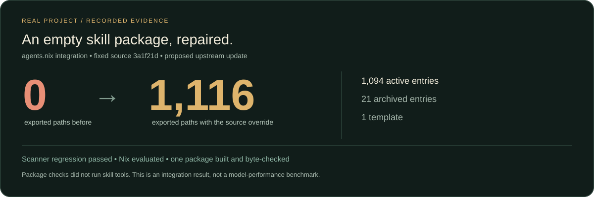

# A real repair: an empty Nix skill package

[中文](README.zh.md) · [All workflows](../README.md)

**Observed result:** the same fixed source changed from **0 to 1,116 exported Nix paths**. Nix evaluated the resulting attributes and built one representative package whose `SKILL.md` matched the pinned source bytes. The paths comprise **1,094 active entries, 21 archived entries and one template**. They are not 1,116 active or individually tested skills.

This is a real maintainer integration repair, recorded on 2026-11-15 in Asia/Shanghai. It is not a synthetic API fixture, an external-user study, a blind model trial or a task-success benchmark.

## Inspect the deliverable

- [Measured result and exact source identities](output/result.json)
- [Complete proposed Nix path map](output/nix-snapshot.json)
- [Pinned active/archive/template inventory](input/inventory.json)
- [Static review](output/review.md)
- [Proposed upstream fix: agents.nix #137800](https://github.com/sudosubin/agents.nix/pull/137800) — check that page for its current review/merge status.



## What failed, and what changed

The [original automatic import](https://github.com/sudosubin/agents.nix/pull/133322) stored `paths: {}`. The updater already recursively finds the library's files. Its [`is_mirror` heuristic](https://github.com/sudosubin/agents.nix/blob/8c19a05c76327e7e92360763dc5fd5fc3b558925/ci/scripts/agent-skills-update.py#L123) suppresses any source with at least 100 canonical paths.

The repair uses the existing exact-source `skip: false` override and refreshes the generated snapshot. It changes two data files; it does not rewrite discovery code or alter other sources, archive handling or template policy. The exception remains subject to upstream maintainer review.

The controlled scanner comparison uses Everything Skills commit `3a1f21dfc6eba47733fdae6a5f17b9c27f55834a` on both sides. The previously published empty snapshot used the older `08a9dfa` revision; its separate replay and NAR-hash match are retained in the result instead of mixing revisions into one comparison.

## Use the two-stage recipe on your own failure

Read [systematic-debugger](../../02-engineering/systematic-debugger/SKILL.md), then [code-reviewer](../../02-engineering/code-reviewer/SKILL.md). The first stage owns reproduction, experiments, repair and tests. The second reads the patch and its direct callers; it does not run tests or change files.

```sh
node bin/everything-skills.mjs compose skill-distribution-audit --json
```

Copy this prompt into your agent after supplying the repository and the failing integration:

```text
Read systematic-debugger and code-reviewer. Fix the supplied distribution
failure in an isolated checkout. Pin producer and consumer revisions; save the
original failing command and its full output. Test one hypothesis at a time,
repair the root cause and rerun the same path with a regression. Then perform
a separate static review of the exact patch and its callers. Deliver the patch,
before/after evidence, source identities and untested limits. Do not execute
bundled skill tools, publish to upstream or change production without authorization.
```

The repair agent read and applied the debugging guide **after the initial source-code diagnosis**, beginning with isolated replay and verification. A separate reviewer then applied `code-reviewer` to the exact two-file patch. This timing is disclosed; we do not retroactively claim that the recipe caused the initial discovery.

## Check the saved evidence offline

With Node.js >=22, from this repository's root:

```sh
node examples/nix-discovery/check.mjs
```

This checks source identity, the complete exported path set, unique paths, role counts and consistency of the recorded scanner/Nix observations. It does **not** rerun Nix, a model or the upstream scanner. Mutations of the source, counts, duplicate paths and traversal paths are rejected by the case tests.

## Replay the actual scanner

The optional [replay.py](replay.py) calls the reviewed upstream functions rather than reimplementing their mirror heuristic. Use a disposable environment with Python >=3.15, PyYAML and the dependencies in the upstream `ci/lib` package. Start with a canonical-LF checkout of [the fix commit](https://github.com/sudosubin/agents.nix/commit/bd3994822d8045100392edb01aae51b3b2982f0e), and download the [fixed library archive](https://api.github.com/repos/findscripter/everything-skills/tarball/3a1f21dfc6eba47733fdae6a5f17b9c27f55834a).

```sh
uv run --python 3.15 --with /path/to/agents.nix/ci/lib --with pyyaml \
  python examples/nix-discovery/replay.py \
  --consumer /path/to/agents.nix --archive /path/to/fixed-library.tar.gz
```

Run once on the upstream base to observe the configured-source regression fail, and once on the linked fix to see it pass. The script verifies the updater fingerprint and source NAR hash before accepting the result. It only reads the archive and prints JSON; it never extracts or executes skills. Do not mount credentials or personal projects into a replay container.

Real Nix validation was performed separately with Nix 2.35.6 on `x86_64-linux`: before 0 attributes, after 1,116; `systematic-debugger` built successfully and matched SHA-256 `e252605cdc89c78621bd7d0fff6d3ab5d23331796c2bb724b1c46a58718bafd9`. The other 1,115 packages were evaluated, not individually built. Early container permissions and CRLF-fixture failures were environment failures, not the discovery regression; the final run used canonical Git bytes and exited 0.

## Run the Nix checks separately

Use a working Nix installation with `nix-command` enabled on `x86_64-linux`. In a canonical-LF checkout of the upstream base or fix, the count expression below returns 0 or 1,116 respectively. The second expression forces every derivation and source root. Only run the final build on the fixed checkout. Nix may fetch the pinned nixpkgs and source archive; this is separate from the offline evidence check and Python scanner replay.

```sh
cd /path/to/agents.nix
nix eval --impure --json --expr 'builtins.length (builtins.attrNames (import ./default.nix).agent-skills.x86_64-linux.github.findscripter.everything-skills)'
nix eval --impure --json --expr 'let packages = (import ./default.nix).agent-skills.x86_64-linux.github.findscripter.everything-skills; in builtins.map (name: { inherit name; drvPath = packages.${name}.drvPath; sourceRoot = packages.${name}.sourceRoot; }) (builtins.attrNames packages)'
out=$(nix build --impure --no-link --print-out-paths --print-build-logs --expr '(import ./default.nix).agent-skills.x86_64-linux.github.findscripter.everything-skills.systematic-debugger')
test "$(sha256sum "$out/SKILL.md" | cut -d ' ' -f 1)" = e252605cdc89c78621bd7d0fff6d3ab5d23331796c2bb724b1c46a58718bafd9
```

These are the measured run's Nix expressions with a checkout-relative import. Package checks read and build files; they did not execute the packaged skill workflows or tools. The debugging and review guides were used separately as working methods.

Upstream source code keeps [agents.nix's license](https://github.com/sudosubin/agents.nix/blob/8c19a05c76327e7e92360763dc5fd5fc3b558925/LICENSE); skills retain their individual licenses. This case imports metadata and original analysis, not third-party skill bodies. [Share a result from your own task](https://github.com/findscripter/everything-skills/issues/new?template=workflow-result.yml) after removing private inputs and credentials.
