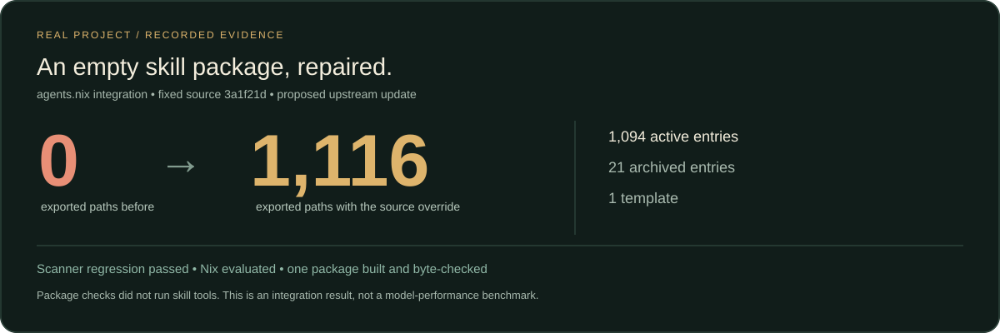

# 真实修复：Nix 为什么收录了一个空技能包

[English](README.md) · [全部工作流](../README.zh.md)

**实测结果：同一固定源码从 0 个导出路径变成 1116 个。** Nix 已对全部属性求值，并实际构建一个代表技能包，确认 `SKILL.md` 与固定源字节相同。1116 中包含 **1094 条现行记录、21 条归档和 1 个模板**，不能称为 1116 条现行或逐项验证有效的技能。

这是 2026 年 11 月 15 日（北京时间）记录的一次真实维护任务，不是合成 API 样例，也不是外部用户试验、盲测或模型成功率基准。

## 先看交付物

- [实测结果、命令及固定版本](output/result.json)
- [拟提交的完整 Nix 路径表](output/nix-snapshot.json)
- [现行／归档／模板的固定清单](input/inventory.json)
- [静态审查结论](output/review.md)
- [上游修复 PR：agents.nix #137800](https://github.com/sudosubin/agents.nix/pull/137800)；最新审核、合并状态以该页为准。



## 故障与修复

[原自动收录](https://github.com/sudosubin/agents.nix/pull/133322) 保存了 `paths: {}`。扫描器其实能递归找到文件；真正归零的是 [`is_mirror`](https://github.com/sudosubin/agents.nix/blob/8c19a05c76327e7e92360763dc5fd5fc3b558925/ci/scripts/agent-skills-update.py#L123)：发现至少 100 个规范路径就默认判为镜像库。

修复使用上游已有的精确仓库 `skip: false` 覆盖规则，再刷新生成快照。只改两个数据文件，不重写扫描器，不改变其他来源、归档或模板政策。该例外仍交上游维护者审核。

对照实验两边都使用本库 `3a1f21dfc6eba47733fdae6a5f17b9c27f55834a`。原公开空快照使用更早的 `08a9dfa`，其单独复跑与 NAR 哈希核对保存在结果中，不混作同版本对照。

## 在自己的故障上使用这组技能

依次完整读取 [systematic-debugger](../../02-engineering/systematic-debugger/SKILL.md) 与 [code-reviewer](../../02-engineering/code-reviewer/SKILL.md)。第一阶段负责复现、实验、修复与测试；第二阶段只读补丁和直接调用方，不运行测试、不改文件。

```sh
node bin/everything-skills.mjs compose skill-distribution-audit --json
```

提供仓库与失败的分发入口后，把这段提示词交给 Agent：

```text
读取 systematic-debugger 与 code-reviewer。固定生产方和消费方版本，
在隔离目录记录原始失败命令和完整输出。一次验证一个假设，定位根因，
做最小修复并在同一路径加回归。然后单独静态审查精确补丁及直接调用方。
交付补丁、前后结果、来源版本、验证与未验证范围。未经授权不执行随包技能工具、
不向上游发布、不改变生产环境。
```

本次修复代理是在初步读源码定位后才读取并应用调试技能，从隔离复跑和假设验证阶段开始；另一审阅者随后按 `code-reviewer` 静态审查两文件补丁。我们公开这个使用起点，不倒称配方导致了最初发现。

## 离线核对保存结果

Node.js >=22，在本库根目录执行：

```sh
node examples/nix-discovery/check.mjs
```

它核对固定版本、完整路径集合、去重、角色计数和已保存的 scanner/Nix 观察值；不重跑 Nix、模型或上游扫描器。案例测试会拒绝版本错配、虚增计数、重复路径和越界路径。

## 复跑真实扫描器

可选 [replay.py](replay.py) 调用真实上游函数，不另写一份镜像判定算法。使用临时隔离环境、Python >=3.15、PyYAML 和上游 `ci/lib` 依赖；准备采用原始 LF 的[修复提交](https://github.com/sudosubin/agents.nix/commit/bd3994822d8045100392edb01aae51b3b2982f0e)，下载[固定源码归档](https://api.github.com/repos/findscripter/everything-skills/tarball/3a1f21dfc6eba47733fdae6a5f17b9c27f55834a)。

```sh
uv run --python 3.15 --with /path/to/agents.nix/ci/lib --with pyyaml \
  python examples/nix-discovery/replay.py \
  --consumer /path/to/agents.nix --archive /path/to/fixed-library.tar.gz
```

分别在上游基底和修复版本执行，可观察配置回归先失败、再通过。脚本先核对扫描器指纹与源码 NAR 哈希，只读归档并输出 JSON，不解包或执行技能。不要向复跑容器挂载凭据和个人项目。

另已用 Nix 2.35.6、`x86_64-linux` 实测属性数 0→1116，构建 `systematic-debugger` 后核对 SHA-256 为 `e252605cdc89c78621bd7d0fff6d3ab5d23331796c2bb724b1c46a58718bafd9`。其余 1115 项只求值，未逐项构建。早期容器权限、CRLF 夹具失败属于环境问题，未冒充故障 RED；最终使用规范 Git 字节的运行退出 0。

## 单独运行 Nix 检查

准备启用 `nix-command` 的可用 Nix 环境，平台为 `x86_64-linux`。在原始 LF 的上游基底或修复 checkout 中，第一条求值分别返回 0 或 1116；第二条强制求值每个 derivation 和 source root。最后的构建只在修复 checkout 上运行。Nix 可能联网获取固定的 nixpkgs 与源码归档；它与离线证据核对、Python 扫描器复跑是分开的步骤。

```sh
cd /path/to/agents.nix
nix eval --impure --json --expr 'builtins.length (builtins.attrNames (import ./default.nix).agent-skills.x86_64-linux.github.findscripter.everything-skills)'
nix eval --impure --json --expr 'let packages = (import ./default.nix).agent-skills.x86_64-linux.github.findscripter.everything-skills; in builtins.map (name: { inherit name; drvPath = packages.${name}.drvPath; sourceRoot = packages.${name}.sourceRoot; }) (builtins.attrNames packages)'
out=$(nix build --impure --no-link --print-out-paths --print-build-logs --expr '(import ./default.nix).agent-skills.x86_64-linux.github.findscripter.everything-skills.systematic-debugger')
test "$(sha256sum "$out/SKILL.md" | cut -d ' ' -f 1)" = e252605cdc89c78621bd7d0fff6d3ab5d23331796c2bb724b1c46a58718bafd9
```

这些是实测使用的 Nix 表达式，只把导入位置改为 checkout 相对路径。打包检查读取、构建文件，没有运行被打包技能的工作流或工具；调试与审查指南另作为工作方法采用。

上游保留 [agents.nix 原许可](https://github.com/sudosubin/agents.nix/blob/8c19a05c76327e7e92360763dc5fd5fc3b558925/LICENSE)，各技能保留逐项许可。本案例只保存元数据与原创分析，不导入第三方正文。[提交你自己的任务结果](https://github.com/findscripter/everything-skills/issues/new?template=workflow-result.yml)前，请移除私有输入与凭据。
