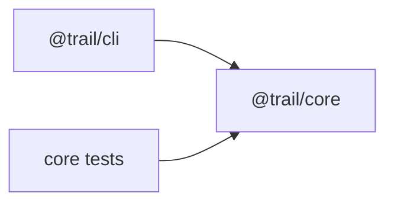

# Trail Notes: a new maintainer's first ten minutes

This is an original synthetic fixture, inspected using `codebase-onboarding-doc`, then `monorepo-navigator`. It is a two-package workspace, not an example of a deployed service.

## Start and verify

Requires Node.js >=22. From `examples/repository-onboarding/input/mini-repo`:

```text
node --test test/core.test.mjs
node apps/cli/index.mjs
```

The first command runs three tests: summation without mutation, empty input, and invalid-duration rejection. The second returns `{"count":3,"totalMinutes":60}`. Both were actually run in a fresh temporary copy with no dependencies installed. [Recorded facts and input hashes](facts.json) can be independently regenerated.

## Read in this order

1. `package.json`: Node >=22, `apps/*` and `packages/*` workspaces, and the test/demo entry points.
2. `packages/core/index.mjs`: validates finite, non-negative durations and returns a count plus their sum.
3. `test/core.test.mjs`: executable examples of valid, empty, and invalid inputs.
4. `apps/cli/index.mjs`: supplies three in-memory notes and prints the core result.

## Boundaries and change impact



`@trail/cli` declares `@trail/core` as a dependency; its actual import is relative so this tiny fixture needs no install. Core does no I/O. The CLI owns presentation and sample inputs. Changing core requires its tests **and** the CLI smoke run; changing only the CLI does not justify introducing a database or altering core validation.

The source contains three `.mjs` modules and three package manifests. No Turborepo, Nx, pnpm configuration, remote cache, CI, or release pipeline is present. The navigator skill's relevant work here is dependency mapping and change impact; we did not add tools, log in to a cache service, rewrite Git history, or publish a package.

## Common tasks and troubleshooting

- Add a summary field: update core, add an assertion to `test/core.test.mjs`, then rerun both commands.
- Change printed formatting or sample notes: edit the CLI and inspect its output.
- A `RangeError` means a note has a negative or non-finite `minutes` value; inspect the caller's input.
- An import error suggests a moved file or wrong relative path. Run commands from the fixture root.

## Evidence and limits

The guide is based on actual local file reads, package metadata, the relative import, the three tests, and a clean-directory execution. It is an onboarding walkthrough, not a code-quality or security audit. No Claude/Codex client installation, remote deployment, large-repository performance, or external service was tested. The original `codebase_analyzer.py` / `monorepo_analyzer.py` referenced by the skills are absent from their folders; the [example's own script](../reproduce.mjs) scans these facts instead.
